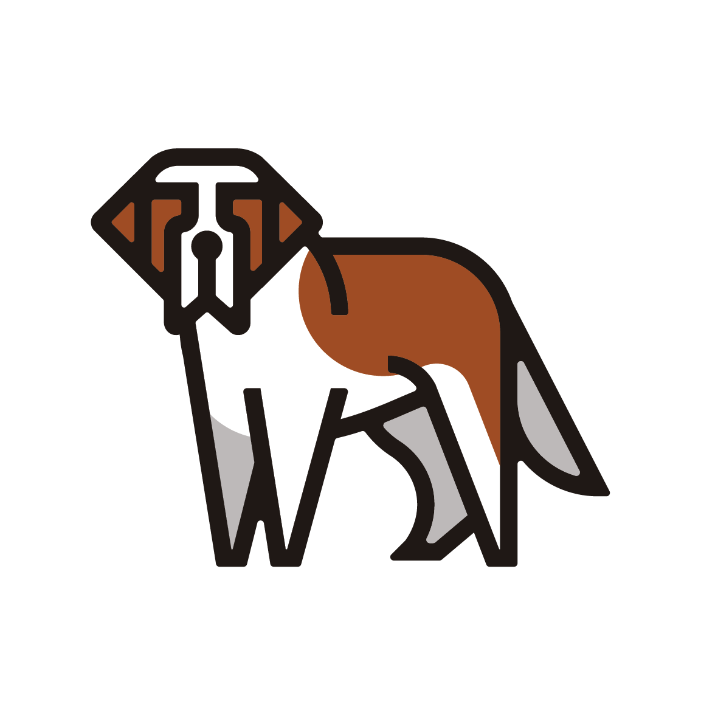
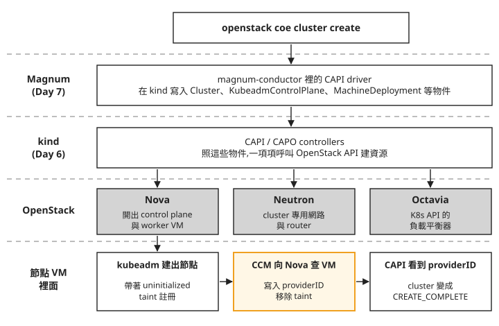

# 親手蓋一朵雲

{ .openstack-logo width="360" }

## OpenStack 是什麼？

**OpenStack 是用來建置雲端基礎設施的開源軟體。** 它把伺服器的運算能力、儲存空間與網路集中管理，讓使用者透過網頁或指令建立虛擬機、配置網路、掛載磁碟。把這些基礎設施提供給使用者自行取用，就是「基礎設施即服務」（Infrastructure as a Service，IaaS）。企業可以用它建立內部使用的私有雲，雲端業者也可以用它提供公有雲服務。[官方介紹](https://www.openstack.org/software/)

例如，你要建立一台有網路、能存資料的虛擬機。使用者只需要選擇作業系統映像檔、CPU 與記憶體規格，以及要連接的網路；雲端平台則要確認使用權限、選擇承載它的主機，並完成網路與磁碟設定。OpenStack 把這些工作分給不同服務，讓它們合作完成同一個請求。

其中，**Nova** 負責虛擬機的建立與管理，**Neutron** 負責網路，**Cinder** 提供可掛載到虛擬機的持久磁碟。你會在下方看到這些服務各自的吉祥物與用途；讀到後面的章節時，可以用圖片和名稱一起辨認它們。

這門課會帶你部署並操作這些服務。實驗從 Azure 上一台支援巢狀虛擬化的 VM 開始，也就是在這台 VM 裡再執行虛擬機。部署完成後，到了 [Day 2](runbook/sprint3-day2-openstack-resource-flow.md)，你會對自己的 OpenStack 環境送出建立虛擬機的指令：

```bash
openstack server create --flavor m1.tiny --image cirros --network net1 vm-cirros
```

這行指令指定虛擬機規格 `m1.tiny`、映像檔 `cirros`、網路 `net1`，並將新虛擬機命名為 `vm-cirros`。這些資源會在 Day 2 先準備好，你也會確認建立出的虛擬機能否連線。接著，課程逐步加入持久磁碟、負載平衡與 Kubernetes 叢集管理，再進入多節點維運、租戶與安全管理。

<div style="text-align: center;" markdown>

{ width="52" }
{ width="52" }
{ width="52" }
{ width="52" }
{ width="52" }
{ width="52" }
{ width="52" }
{ width="52" }

*由左至右是 Keystone、Glance、Nova、Neutron、Cinder、Octavia、Barbican 與 Magnum 的官方吉祥物。下方的服務表會沿用這些圖片，說明各自負責的工作。*

</div>

!!! note "這門課適合誰、需要什麼底子"
    - **平台、DevOps 與 SRE 工程師**：練習部署雲端基礎設施，理解服務如何合作，以及如何追查故障。
    - **後端與應用工程師**：理解虛擬機、磁碟、負載平衡與代管資料庫背後的資源管理方式。
    - **先備知識**：會 Linux 命令列、SSH、IP 網段與路由即可開始。Day 6 起會使用 Kubernetes 的 Pod、Deployment 與 `kubectl`；不熟悉的讀者可以先看 [Learn Kubernetes Basics](https://kubernetes.io/docs/tutorials/kubernetes-basics/)。Day 28 起會使用 Prometheus 的查詢語言 PromQL，章節會說明查詢的用途。

動手需要自己的 Azure 訂閱，以及各章指定的 VM、磁碟與網路資源。前段使用單機環境，後段另建獨立多節點環境；課程各章會交代實驗前提與驗證範圍。

## 這朵雲能做成什麼

下表把課程會操作的服務、吉祥物與用途放在一起。右側列出公有雲中用途相近的服務，方便已有使用經驗的讀者對照；它們的功能範圍與管理方式並不完全相同。

| | 服務 | 它給你什麼 | AWS | GCP | Azure |
|---|---|---|---|---|---|
| { width="32" } | [Keystone](runbook/sprint3-day2-openstack-resource-flow.md) | 身分認證與存取控制 | IAM | Cloud IAM | Entra ID |
| { width="32" } | [Glance](runbook/sprint3-day2-openstack-resource-flow.md) | VM 映像檔管理 | AMI | Images | Compute Gallery |
| { width="32" } | [Nova](runbook/sprint3-day2-openstack-resource-flow.md) | 虛擬機生命週期與運算調度 | EC2 | Compute Engine | Virtual Machines |
| { width="32" } | [Neutron](runbook/sprint3-day2-openstack-resource-flow.md) | 軟體定義網路:網段、路由、防火牆 | VPC | VPC | Virtual Network |
| { width="32" } | [Cinder](runbook/sprint3-day3-cinder-lvm.md) | 區塊儲存:可掛載、可搬移的持久磁碟 | EBS | Persistent Disk | Managed Disks |
| { width="32" } | [Octavia](runbook/sprint3-day4-octavia.md) | 將連線分配至多台虛擬機（負載平衡） | ELB | Cloud Load Balancing | Load Balancer |
| { width="32" } | [Barbican](runbook/sprint3-day5-barbican-heat.md) | 金鑰、憑證與機密集中管理 | Secrets Manager | Secret Manager | Key Vault |
| { width="32" } | [Heat](runbook/sprint3-day5-barbican-heat.md) | 用範本建立網路、虛擬機等資源（資源編排） | CloudFormation | Infrastructure Manager | Bicep / ARM |
| { width="32" } | [Magnum](runbook/sprint3-day7-magnum-capi-driver.md) | 代管 Kubernetes 叢集 | EKS | GKE | AKS |
| { width="32" } | [Horizon](runbook/sprint3-day1-kolla-aio-core.md) | 雲資源的網頁管理介面 | Console | Cloud Console | Portal |
| { width="32" } | [物件儲存(RGW)](runbook/sprint4-day15-object-storage-rgw.md) | 物件儲存：課程實作 Swift API，S3 為選讀 | S3 | Cloud Storage | Blob Storage |
| { width="32" } | [Manila](runbook/sprint4-day16-manila-cephfs.md) | 共享檔案系統 | EFS | Filestore | Azure Files |
| { width="32" } | [Designate](runbook/sprint4-day17-designate-dns.md) | DNS 代管 | Route 53 | Cloud DNS | Azure DNS |
| { width="32" } | [Trove](runbook/sprint4-day18-trove-dbaas.md) | 資料庫即服務 | RDS | Cloud SQL | Azure Database |
| { width="32" } | [Telemetry](runbook/sprint5-day28-ceilometer-metering.md) | 用量計量；告警與擴縮接續於 Day 29 | CloudWatch | Cloud Monitoring | Azure Monitor |
| { width="32" } | [CloudKitty](runbook/sprint5-day30-cloudkitty-rating.md) | 依用量與費率計價 | Cost Explorer | Cloud Billing | Cost Management |
| { width="32" } | [Masakari](runbook/sprint5-day31-masakari-ha.md) | 主機故障通知後的虛擬機恢復 | (EC2 內建自動復原) | (內建即時遷移) | (內建服務修復) |

點服務名稱可以直接跳到對應章節。Swift 的吉祥物在這裡標示物件儲存介面；本課程實際部署的是提供 Swift API 的 Ceph RGW。Telemetry 的計量與告警分別在 Day 28、Day 29 說明。

### 其他可以延伸認識的服務

Zun 與 Ironic 沒有在本課程部署；服務全景章會介紹它們的用途。

| | 服務 | 它給你什麼 | AWS | GCP | Azure |
|---|---|---|---|---|---|
| { width="32" } | [Zun](runbook/sprint3-day11-openstack-service-map.md) | 容器即服務(不經 K8s) | Fargate | Cloud Run | Container Instances |
| { width="32" } | [Ironic](runbook/sprint3-day11-openstack-service-map.md) | 裸機佈建與生命週期管理 | EC2 Bare Metal | Bare Metal Solution | Azure BareMetal |

想知道這些服務與核心服務的關係，可以接著讀 [Day 11：服務全景圖](runbook/sprint3-day11-openstack-service-map.md)。


## 從這裡出發

<div class="grid cards" markdown>

-   :material-rocket-launch:{ .lg .middle } __課程主線__

    ---

    從實驗環境開始，建立虛擬機，再用 OpenStack 提供 Kubernetes 叢集。章節包含操作說明、輸出解讀與適用範圍。

    [:octicons-arrow-right-24: Day 0 · 開始](runbook/sprint3-day0-azure-vm.md)

-   :material-tools:{ .lg .middle } __排錯手冊__

    ---

    依錯誤訊息與服務查找整合問題，對照原因、修正方式及驗證結果。

    [:octicons-arrow-right-24: 查找問題](solutions/README.md)

-   :material-history:{ .lg .middle } __前兩次嘗試__

    ---

    比較 Juju、OpenStack-Helm 與 Kolla-Ansible 的部署經驗，了解工具選擇與整合限制。

    [:octicons-arrow-right-24: 讀故事](previous-attempts.md)

-   :material-map:{ .lg .middle } __服務全景圖__

    ---

    對照官方 Landscape，查看運算、儲存、網路與其他服務的關係。

    [:octicons-arrow-right-24: 看地圖](runbook/sprint3-day11-openstack-service-map.md)

</div>

## 課程使用的部署工具

Kolla-Ansible 是部署 OpenStack 的工具，將各項服務放在容器中執行，再透過自動化設定完成整合。前期嘗試過的 Juju 與 OpenStack-Helm 採用不同的部署方式；它們遇到的整合限制與選擇依據，保留在[前兩次嘗試](previous-attempts.md)，供需要比較工具的讀者參考。

## 課程路徑（Day 0–35）

先從 Day 0–12 建立與使用資源，再於 Day 13–26 擴充服務、追查請求並練習維運，最後於 Day 27–35 處理租戶、用量、費率與安全管理。

| Day | 主題 | 里程碑 |
|---|---|---|
| [0](runbook/sprint3-day0-azure-vm.md) | Azure lab 環境 | 支援巢狀虛擬化的 VM + 成本控管 |
| [1](runbook/sprint3-day1-kolla-aio-core.md) | Kolla-Ansible 部署核心服務 | Keystone/Glance/Nova/Neutron/Horizon |
| [2](runbook/sprint3-day2-openstack-resource-flow.md) | OpenStack 資源全流程 | 純 CLI 開出可 SSH 的 VM |
| [3](runbook/sprint3-day3-cinder-lvm.md) | Cinder 區塊儲存 | volume 掛載、boot from volume |
| [4](runbook/sprint3-day4-octavia.md) | Octavia 負載平衡 | LB 建置全流程、round-robin 驗證 |
| [5](runbook/sprint3-day5-barbican-heat.md) | Barbican 機密管理 + Heat 編排 | secret 存取往返、HOT stack |
| [6](runbook/sprint3-day6-capi-management-cluster.md) | Cluster API 管理叢集 | kind + CAPI/CAPO controllers |
| [7](runbook/sprint3-day7-magnum-capi-driver.md) | Magnum + CAPI driver 整合 | ClusterTemplate 就緒 |
| [8](runbook/sprint3-day8-e2e-workload-cluster.md) | 端到端開出 workload cluster | nodes Ready + LB + PVC 三項驗收 |
| [9](runbook/sprint3-day9-day2-operations.md) | Day-2 維運 | 滾動升版、node group、autoscaler |
| [10](runbook/sprint3-day10-terraform-teardown.md) | Terraform 接管 + 拆除演練 | HCL 管 network/VM/LB |
| [11](runbook/sprint3-day11-openstack-service-map.md) | 服務全景圖 | 已部署服務的關係與延伸用途 |
| [12](runbook/sprint3-day12-sprint4-preview.md) | Sprint 4 預告 | 服務擴充、內部原理、維運實務、水平擴展 |
| [13](runbook/sprint4-day13-skyline.md) | Skyline 新一代儀表板 | 部署 Skyline，與 Horizon 比較操作方式 |
| [14](runbook/sprint4-day14-ceph-bootstrap.md) | Ceph 基礎 | cephadm 單機叢集、與 Kolla 同機共存 |
| [15](runbook/sprint4-day15-object-storage-rgw.md) | 物件儲存 RGW | Swift 存取與 Keystone 整合；S3 為選讀 |
| [16](runbook/sprint4-day16-manila-cephfs.md) | Manila 共享檔案系統 | CephFS 後端、掛載讀寫全流程 |
| [17](runbook/sprint4-day17-designate-dns.md) | Designate DNS | zone/recordset、FIP 自動 DNS 記錄 |
| [18](runbook/sprint4-day18-trove-dbaas.md) | Trove 資料庫服務 | 部署 Trove,開出代管 MySQL |
| [19](runbook/sprint4-day19-api-request-lifecycle.md) | server create 的完整路徑 | 從 API、訊息佇列與資料庫追到 qemu 行程 |
| [20](runbook/sprint4-day20-ovn-packet-trace.md) | 封包怎麼流(OVN) | ovn-trace 模擬邏輯規則與 NAT 路徑 |
| [21](runbook/sprint4-day21-observability.md) | 可觀測性 | Prometheus/Grafana/集中 log |
| [22](runbook/sprint4-day22-upgrade-backup.md) | 更新與備份還原 | 系列內更新、以測試資料檢查還原結果 |
| [23](runbook/sprint4-day23-multinode-ha.md) | 多節點部署與 HA | 比較 controller 正常停機與 quorum 限制 |
| [24](runbook/sprint4-day24-scale-out.md) | 橫向擴展 | 加入 compute、熱遷移與主機清空 |
| [25](runbook/sprint4-day25-sprint4-recap.md) | Sprint 4 總結 | 服務擴充與維運方式的適用範圍 |
| [26](runbook/sprint4-day26-sprint5-preview.md) | Sprint 5 預告 | 計量、計價、復原、治理稽核 |
| [27](runbook/sprint5-day27-multi-tenant-governance.md) | 多租戶治理與額度 | domain/project 階層、unified limits |
| [28](runbook/sprint5-day28-ceilometer-metering.md) | 計量管線(Ceilometer) | 用量流進 Prometheus,每筆帶 project_id |
| [29](runbook/sprint5-day29-aodh-autoscaling.md) | 告警與自動擴縮(Aodh) | 依告警條件增加與縮減 VM |
| [30](runbook/sprint5-day30-cloudkitty-rating.md) | 計價(CloudKitty) | 依租戶用量與費率核對計價明細 |
| [31](runbook/sprint5-day31-masakari-ha.md) | 主機故障與 VM 恢復(Masakari) | 手動通知主機故障後，觀察 VM 疏散與恢復 |
| [32](runbook/sprint5-day32-full-tls.md) | API 入口 TLS | HAProxy 終止 TLS 與用戶端 CA 信任 |
| [33](runbook/sprint5-day33-keycloak-federation.md) | 企業身分接軌(Keycloak) | 以外部帳號完成 CLI 認證與專案授權 |
| [34](runbook/sprint5-day34-cadf-audit.md) | 稽核軌跡(CADF) | 從 Nova API 事件追查請求者、資源與操作 |
| [35](runbook/sprint5-day35-sprint5-recap.md) | Sprint 5 總結 | 租戶治理、計量、計價與安全的關係 |
| [結語](runbook/epilogue.md) | 課程結語 | 依需求選擇後續練習 |

## 建立 Kubernetes 叢集時，OpenStack 做了什麼？

有了虛擬機與網路之後，還能在其上建立 Kubernetes 叢集，用來執行容器化應用程式。Magnum 提供叢集管理介面，本課程透過 Cluster API 將叢集需求轉成 OpenStack 資源。下圖由上往下呈現請求如何建立節點虛擬機、網路與負載平衡器。



圖中的 Nova、Neutron 與 Octavia，就是前面服務表裡的運算、網路與負載平衡服務。Kubernetes 的節點會執行在 Nova 建立的虛擬機上，節點之間透過 Neutron 網路連線，叢集 API 則透過 Octavia 的負載平衡器存取。[Day 6–8](runbook/sprint3-day6-capi-management-cluster.md) 會逐步建立並解釋這些連結。

## Cluster API 的圖示在表達什麼？

{ align=right width="110" }

Cluster API 的官方標誌是**大龜馱著小龜，龜殼上有 Kubernetes 的舵輪**。這張圖呼應它用 Kubernetes 管理其他 Kubernetes 叢集的做法：先有一個管理叢集，再由其中的控制器建立與管理執行應用程式的叢集。專案以這句話描述這個概念：

> *"It's Kubernetes all the way down."*(一路往下,全是 Kubernetes)

管理叢集和執行應用程式的叢集各自做什麼？詳見 [Day 6 · Cluster API 管理叢集](runbook/sprint3-day6-capi-management-cluster.md)

---

準備好了嗎? → **[開始:Day 0 · Azure Lab 環境](runbook/sprint3-day0-azure-vm.md)**


OpenStack 標誌與服務吉祥物為 OpenStack 專案官方資產，此處作教學用途。來源：[OpenStack](https://www.openstack.org/software/) 與[專案吉祥物](https://www.openstack.org/project-mascots/)。
