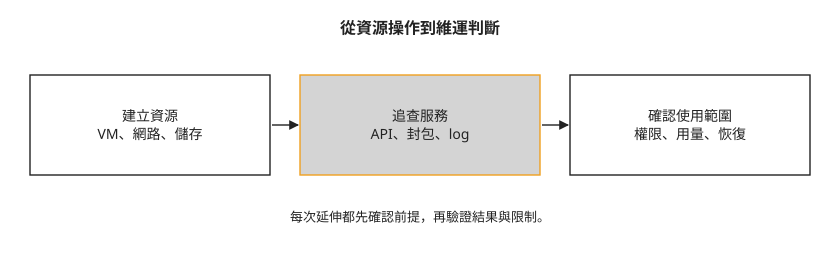

# 結語：從一次 API 操作，找到下一個問題

回到課程開始時，你可能只想知道怎麼開一台 VM。現在再看一次 `server create`，你能說出誰驗證身分、誰選主機、誰接上網路與儲存；如果結果不如預期，也知道先從哪個服務查起。這是後續練習最實用的起點。

整門課大致走過三段：先把資源建立起來，再觀察服務如何合作，最後加入共用環境需要的權限、用量與恢復設計。下圖把這些能力連在一起：

圖的最後一段不表示這個 lab 已經成為可直接營運的平台。多節點環境與單機環境分開，TLS、外部身分及稽核也各有尚未驗證的部分。你已經能讀懂這些差異，接下來可以選擇一個需要的能力，把它驗得更完整。

## 選一個與工作有關的練習

如果你正在開發應用，可以從一顆 volume 或一個負載平衡器開始。保存資料、重建 VM，再確認哪些內容留下來；或者調整後端服務，觀察健康檢查如何改變流量。先寫下預期結果，再用 API 狀態與實際讀寫一起確認，會比一次加入許多服務更容易知道自己理解了哪一段。

如果你主要操作 Kubernetes，可以維持 [Day 8](sprint3-day8-e2e-workload-cluster.md) 的環境前提重練，包括 Octavia 的 Amphora provider 與原有 API 位址。挑一個 PVC 或 LoadBalancer Service，對照它在 OpenStack 建出的資源，確認權限、網路與儲存各由誰管理。

若已做過 [Day 22 的 Octavia provider 變更](sprint4-day22-upgrade-backup.md#3-prechecks-octavia)或 [Day 32 的 TLS 改址](sprint5-day32-full-tls.md#5)，延伸題目就改為自行研究既有 cluster 的遷移。Day 22 改為只啟用 OVN provider，依賴 Amphora 的指引不能原樣沿用；Day 32 則涉及各用戶端的 endpoint 更新與新 CA 信任。兩章都沒有提供完整遷移步驟，Day 32 也沒有重測 Magnum／CAPI，不能直接假設早期 cluster 還能照原設定運作。

如果你負責平台維運，可以從 [Day 35](sprint5-day35-sprint5-recap.md) 選一項缺口：驗證設定在重新部署後仍保留、研究多節點部署中一個 Keystone 節點故障後的認證可用性與恢復，或補齊主機故障偵測與隔離。把範圍限制在可觀察的環境中，記下失敗時如何確認影響，以及恢復後如何檢查資料。

選擇 Keystone 題目時，可以先讀 [Kolla-Ansible 2025.1 Keystone 部署文件的 Fernet Tokens 段落](https://docs.openstack.org/kolla-ansible/2025.1/reference/shared-services/keystone-guide.html#fernet-tokens)，了解節點間如何同步 Fernet token 使用的金鑰，再規劃故障與恢復時的認證檢查。這是延伸研究的入口，本課沒有驗證這個故障恢復情境。

## 換一種工具時，保留判斷的方法

本課採用 Kolla-Ansible。其他部署工具有不同的整合與維護方式，課程之外還有[部署工具介紹](../deployment-tools.md)與[先前嘗試的紀錄](../previous-attempts.md)可參考。那些記錄描述的是當時的版本與環境，不能直接推論成某工具永遠可用或不可用。

換工具或升級時，先確認自己要完成的操作、相依服務與支援版本，再選一條最小流程測試。遇到失敗，分開看請求有沒有送達、設定有沒有載入、資源有沒有建立，以及應用能不能使用。課程中的指令會隨版本改變，這些檢查問題仍能幫你找到下一步。

## 想一想

- 從你目前的工作挑一個需求，要用哪個可觀察結果判斷完成？只看容器或 VM 狀態夠不夠？
- 換成另一個部署工具之後，哪些是工具特有的設定，哪些是仍須理解的 OpenStack 服務關係？

## 小結

這門課讓你從建立資源走到理解服務之間的關係，也練習把成功訊息與真正想完成的結果分開確認。下一次遇到新的平台需求，可以先選一個範圍清楚的問題，查版本與前提，完成操作，再把結果與限制寫下來。
