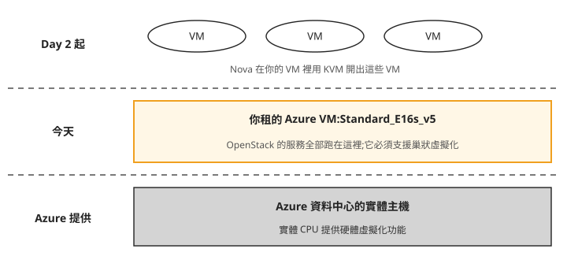
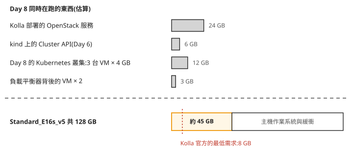
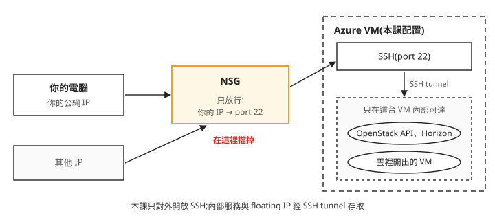

# Day 0: 準備 Azure Lab 環境——巢狀虛擬化、VM 規格與成本控管

這門課要在一台機器上蓋出整朵 OpenStack 雲,再從這朵雲裡開 VM。手邊多半沒有閒置的實體伺服器,所以我們在 Azure 租一台 VM 當實驗室。這台 VM 跟平常開來跑網站的不一樣:它裡面還要再開 VM,記憶體要撐住之後每一天加上去的服務,而且要連續用好幾週。規格挑錯的話,問題要到 Day 1 部署或 Day 2 開第一台 VM 時才會出現。

這一章用 Azure CLI 把這台 VM 開起來,並在開機當天設好每晚自動關機和預算警報。讀完之後,拿到一台候選的 VM,你能判斷它能不能當這門課的實驗室:支不支援巢狀虛擬化、記憶體夠不夠,以及關機之後還有哪些東西在計費。

## 一台 VM 裡還要再開 VM

OpenStack 裡負責開 VM 的服務叫 Nova。Nova 開 VM 時用的是 KVM:Linux 核心內建的虛擬化功能,讓 VM 直接使用 CPU 的硬體虛擬化指令,速度接近實體機。在實體伺服器上,CPU 本來就有這些指令;可是我們的 OpenStack 是裝在一台 Azure VM 上,這台 VM 看到的 CPU 是 Azure 虛擬出來的,硬體虛擬化指令有沒有一起交給它,要看機型。

把這三層畫出來,由下往上是誰在誰裡面:



照著圖看:

1. **中間那層是今天要租的機器。** 之後在 OpenStack 開的每一台 VM,都跑在它裡面,共用它的 CPU 和記憶體。
2. **最上層能不能用 KVM,取決於中間那層。** 在一台 VM 裡面再用硬體虛擬化開 VM,叫做**巢狀虛擬化**(nested virtualization),Azure 只有部分機型支援。機型不支援的話,Kolla 預設的 `nova_compute_virt_type: "kvm"` 不會自動退回其他方式,要在 Day 1 的 `globals.yml` 手動改成 `qemu`,讓 Nova 用 QEMU 的純軟體模擬開 VM,速度會慢很多。

這門課用 **Standard_E16s_v5**:Azure 官方的 Esv5 系列規格頁把巢狀虛擬化列為支援。步驟 7 會在 VM 上用 `kvm-ok` 實際確認一次。

## 記憶體要算到 Day 8

Kolla-Ansible(Day 1 用來部署 OpenStack 的工具)官方寫的主機最低需求是 8 GB 記憶體,那是只裝核心服務的情況。這門課會一路加上負載平衡、金鑰管理等服務,到了 Day 8 還要在雲裡開一整座 Kubernetes 叢集。記憶體要以 Day 8 同時在跑的東西來估:



第二項的 Cluster API 是 Day 6 起用來建立 Kubernetes 叢集的程式,跑在 kind(把一座小型 Kubernetes 裝在 Docker 容器裡的工具)上。上半部四項加起來約 45 GB,是 Kolla 官方最低需求的五倍多。Standard_E16s_v5 有 16 vCPU、128 GB 記憶體,扣掉這 45 GB,還有八十多 GB 留給主機的作業系統和緩衝。圖上的數字都是估算,估錯一些也還有空間。

## 開始之前

以下指令在你自己電腦的終端機上執行(以 macOS 或 Linux 為例),需要裝好 Azure CLI 並用 `az login` 登入。開 VM 之前先確認三件事:要用的訂閱存在、SSH 金鑰存在、目標區域的配額夠開 16 核。**配額**(quota)是 Azure 對每個訂閱、每個區域、每個 VM 系列設的 vCPU 上限,用量加上這台的 16 核超過上限,開 VM 就會失敗,要先到 Azure 入口網站申請提高:

```bash
az account list -o table          # 你要用的訂閱在清單裡
ls ~/.ssh/<ssh-key>.pub         # SSH 公鑰存在(沒有就先 ssh-keygen)
az vm list-usage -l japaneast -o table | grep -i esv5   # ESv5 家族配額 ≥ 16(不足要先申請)
```

接下來的指令裡有三個值要換成你自己的:`<resource-group>` 是步驟 1 要建立的 resource group 名稱,取一個認得出這個 lab 的名字即可,例如 `openstack-lab-rg`;`<your-name>` 是你的名字,步驟 1 會把它寫進 tag;`<ssh-key>` 是 `~/.ssh/` 底下那把金鑰的檔名,公鑰是同名加上 `.pub`。區域 `japaneast` 和 VM 名稱 `openstack-lab` 也可以換,只是之後每一步都要跟著換,包括後面章節開機用的 `az vm start`。換區域的話,先用上面第三行確認那一區有 Esv5 系列的配額。`<subscription-id>` 換成 `az account list` 列出的訂閱 ID。

## 步驟 1:建立 resource group 並加上 tags

**resource group** 是 Azure 裝一組相關資源的容器,VM、磁碟、網路都放在裡面,不用時可以整組刪掉。建立時順便加上 **tags**:附在資源上的 `key=value` 標籤。Azure 的成本分析可以依 tag 分組,之後想知道這個 lab 花了多少,篩 `purpose=lab` 就好:

```bash
az group create -n <resource-group> -l japaneast \
  --subscription <subscription-id> \
  --tags purpose=lab owner=<your-name> sprint=3
```

## 步驟 2:允許這個訂閱使用 Standard security type {#step-2}

Azure VM 有一個設定叫 **security type**。新建的 Gen2 VM(Azure 第二代 VM,用 UEFI 開機,Ubuntu 24.04 映像檔就是這一代)預設是 **Trusted Launch**,它會開啟 Secure Boot(開機時只允許有簽章的作業系統和驅動程式載入)和虛擬 TPM。另一個選項 **Standard** 不開這些功能。

這個 lab 用不到 Secure Boot 和虛擬 TPM,本課也只在 Standard 上確認過巢狀虛擬化可用,所以步驟 3 會指定 `--security-type Standard`。Azure 有些功能要先在訂閱上個別開啟才能用,這種開關叫 **feature**;`UseStandardSecurityType` 就是其中一個,新訂閱要先註冊它,才准建立 Standard 的 VM。**provider** 則是 Azure 上提供某一類資源的服務,VM 由 `Microsoft.Compute` 提供,feature 註冊完要重新註冊 provider,設定才會生效。這一步要在開 VM 之前做:

```bash
az feature register --namespace Microsoft.Compute --name UseStandardSecurityType \
  --subscription <subscription-id>
az feature show --namespace Microsoft.Compute --name UseStandardSecurityType \
  --subscription <subscription-id> --query properties.state -o tsv
az provider register -n Microsoft.Compute \
  --subscription <subscription-id> --wait
```

`az feature register` 送出註冊後,要幾分鐘才會完成。用 `az feature show` 查狀態,等它顯示 `Registered`,再執行最後的 `az provider register`。跳過這一步,步驟 3 會被拒絕,錯誤訊息見[疑難排解:`--security-type Standard` 被 Azure 拒絕](#mine-1)。

## 步驟 3:開 VM

從這一步開始計費。`az vm create` 除了 VM 本身,還會一起建立虛擬網路、公網 IP,以及一個名叫 `openstack-labNSG` 的防火牆規則組(步驟 4 會用到):

```bash
az vm create \
  --subscription <subscription-id> \
  -g <resource-group> -n openstack-lab \
  --image Ubuntu2404 --size Standard_E16s_v5 \
  --security-type Standard \
  --admin-username azureuser --ssh-key-values ~/.ssh/<ssh-key>.pub \
  --public-ip-sku Standard \
  --os-disk-size-gb 128 --data-disk-sizes-gb 256 \
  --tags purpose=lab owner=<your-name> sprint=3
```

這台 VM 會有兩顆磁碟:128 GB 的作業系統碟,和一顆 256 GB、什麼都沒裝的資料碟。資料碟今天不要格式化,Day 3 會把它整顆交給 OpenStack 的儲存服務 Cinder 使用。Esv5 系列沒有本機暫存碟,所以 VM 裡看到的第二顆磁碟一定是這顆資料碟。

指令跑完會印出一段 JSON,記下裡面的 `publicIpAddress`(公網 IP,SSH 連線用)和 `privateIpAddress`(VM 在 Azure 虛擬網路裡的位址,Day 1 設定 OpenStack 時會用到)。`--public-ip-sku Standard` 建立的公網 IP 是固定的,之後每天關機再開機,位址都不會變。

## SSH 是進這台 VM 的唯一入口

VM 開好之後,你從自己的電腦能連到的只有它的 SSH。原因在 Azure 的虛擬網路:它不轉送廣播,也會擋掉來源位址不屬於這台 VM 的封包。之後 OpenStack 在這台 VM 裡建的網路,外面連不進來:雲裡的 VM 拿到的 floating IP(OpenStack 配給 VM、讓它能被外部連線的位址)只在這台 VM 內部有效。雲裡的 VM 往外連可以經過 NAT(Day 2 會設定),但反方向不行。要從自己的電腦打開 OpenStack 的網頁介面 Horizon(Day 1 會裝),或連到雲裡的 VM,一律透過 SSH 轉送(SSH tunnel)。Day 1 設定 OpenStack 網路時會再遇到這個限制。

既然 SSH 是唯一的入口,就要管好誰能連。`az vm create` 建立的 **NSG**(network security group,Azure 的防火牆規則組)預設允許任何來源連 SSH。這一步把它改成只允許你自己的公網 IP:



我們可以從圖上看到兩件事:NSG 是外面到 VM 之間唯一的檢查點,而雲裡的東西全部在右邊的虛線框內,外面只能經由 SSH 進去。

## 步驟 4:NSG 只讓你的 IP 連 SSH

`curl -s ifconfig.me` 會回傳你現在對外的公網 IP。NSG 的名稱是 VM 名稱加上 `NSG`,規則名稱 `default-allow-ssh` 是 `az vm create` 預設建立的:

```bash
MY_IP=$(curl -s ifconfig.me)
az network nsg rule update \
  --subscription <subscription-id> \
  -g <resource-group> --nsg-name openstack-labNSG \
  -n default-allow-ssh --source-address-prefixes "$MY_IP/32"
```

換了網路(例如從家裡換到公司),你的公網 IP 會跟著變,SSH 就會連不上。這時重跑這一步即可。

## 步驟 5:每晚自動關機

這台 VM 要用好幾週,忘記關機的時數會一直累積成費用。`az vm auto-shutdown` 設定每天固定時間關機。時間以 UTC 計算,`1400` 就是台北時間 22:00:

```bash
az vm auto-shutdown \
  --subscription <subscription-id> \
  -g <resource-group> -n openstack-lab --time 1400   # UTC → 台北 22:00
```

自動關機做的是 **deallocate**:VM 停止,並釋放它在 Azure 實體主機上佔用的資源。deallocate 之後不再收 VM 的運算費用,但磁碟和網路資源照樣計費,所以兩顆磁碟和公網 IP 每天 24 小時都在收錢。

自動關機不會自動開機。每天開始操作前,先在自己的電腦上把 VM 開起來:

```bash
az vm start --subscription <subscription-id> -g <resource-group> -n openstack-lab
```

因為這台 VM 每天都會重開,之後幾章會遇到一些「開機後要自動重建」的設定,例如 Day 1 的 dummy 網卡(Day 1 會建的一張不接任何線路的虛擬網卡)、Day 2 的對外網路修正,原因都在這裡。

## 步驟 6:預算警報

自動關機防的是忘記關機;**預算警報**(budget alert)防的是另一種情況:費用不知不覺超出預期。它在 Azure 上設一個每月預算,花費達到門檻時寄信通知。這裡用 Azure 的 Budgets REST API,透過 `az rest` 直接呼叫,在這個 resource group 上設兩道通知:

- `actual80`:本月實際花費超過預算的 80%。
- `forecast100`:Azure 依目前的用量預測,月底會超過預算的 100%。

```bash
az rest --method PUT \
  --url "https://management.azure.com/subscriptions/<subscription-id>/resourceGroups/<resource-group>/providers/Microsoft.Consumption/budgets/sprint3-lab-budget?api-version=2023-05-01" \
  --body '{"properties":{"category":"Cost","amount":150,"timeGrain":"Monthly",
    "timePeriod":{"startDate":"2026-07-01T00:00:00Z","endDate":"2026-12-31T00:00:00Z"},
    "notifications":{
      "actual80":{"enabled":true,"operator":"GreaterThan","threshold":80,"contactEmails":["you@example.com"],"thresholdType":"Actual"},
      "forecast100":{"enabled":true,"operator":"GreaterThan","threshold":100,"contactEmails":["you@example.com"],"thresholdType":"Forecasted"}}}}'
```

照打之前要改四個地方:`amount` 改成你自己的每月預算(金額以帳單帳戶的幣別計算),`contactEmails` 改成你的信箱,`startDate` 改成本月 1 日(Azure 要求月預算的起始日是某個月的第一天),`endDate` 改成你預計結束 lab 的日子。

預算警報只會寄信,不會停掉任何資源,收到信之後要自己決定關機或刪除。Azure 的官方教學也列出 `az consumption budget create-with-rg` 這個指令,同樣可以帶通知設定,本課沒有用它驗證過。

## 步驟 7:確認 VM 可以開始用

SSH 進 VM,把 `203.0.113.10` 換成步驟 3 記下的公網 IP。`kvm-ok` 是 `cpu-checker` 套件裡的小工具,檢查這台機器能不能用 KVM:

```bash
ssh -i ~/.ssh/<ssh-key> azureuser@203.0.113.10
sudo apt-get update -qq && sudo apt-get install -y cpu-checker
sudo kvm-ok
lsblk -o NAME,SIZE,TYPE,MOUNTPOINT
```

看兩個地方:

- `kvm-ok` 最後一行要是 `KVM acceleration can be used`。這代表巢狀虛擬化可用,Nova 之後能用 KVM 開 VM。如果不是這一行,回頭確認步驟 3 的 `--size`。
- `lsblk` 裡,`sda` 是 128G 的作業系統碟,掛在 `/`;`sdb` 是 256G 的資料碟,沒有分割區,也沒有掛載點。保持這樣,Day 3 才會用到它。

再確認 CPU、記憶體和作業系統版本:

```bash
nproc
free -h
lsb_release -d
```

`nproc` 應該是 16;`free -h` 的總記憶體約 125Gi,比 128 GB 少一點是正常的;`lsb_release -d` 顯示 Ubuntu 24.04 LTS。

## 疑難排解

### `--security-type Standard` 被 Azure 拒絕 {#mine-1}

**症狀**:`az vm create --security-type Standard` 直接失敗,錯誤訊息是 `BadRequest: The value 'Standard' is not available for property 'securityType' until the feature Microsoft.Compute/UseStandardSecurityType is registered`。

**原因**:這個訂閱還沒註冊 `UseStandardSecurityType`,只能建立 Trusted Launch 的 VM。回到[步驟 2](#step-2) 補跑,再重試 `az vm create`。

## 想一想

- 一位同學為了省錢,挑了一台記憶體夠大、但規格頁沒有列出支援巢狀虛擬化的機型。他會在這一章的哪一步第一次發現不對?如果他堅持用這台機器,Nova 開 VM 只剩什麼方式?
- 週五晚上 VM 自動關機,整個週末你都沒開機。這兩天裡,這個 resource group 還有哪些東西在計費?如果這個月累計的花費在週末超過預算的 80%,預算警報會替你做什麼?
- 你帶筆電到咖啡店,SSH 連不上 VM,同一時間同事從辦公室卻連得上。你會先檢查哪一步的設定?

## 小結

這一章開的 VM 承載之後所有章節的內容:OpenStack 的服務和它開出的 VM 都跑在裡面,所以它必須支援巢狀虛擬化,記憶體要以 Day 8 同時在跑的東西來估。Azure 的虛擬網路讓外面連不進雲裡的東西,只能經由 SSH 進去,所以 NSG 只放行你自己的 IP;換了網路連不上時,重跑步驟 4。費用方面,自動關機只停掉運算費用,磁碟和公網 IP 照樣計費,預算警報也只寄信、不停機。這台 VM 每天都會重開,之後章節裡凡是開機後要自動重建的設定,都是因為這件事。

## 延伸閱讀

想再深入,可以從這幾份開始:

- **[Azure Esv5 系列規格](https://learn.microsoft.com/en-us/azure/virtual-machines/sizes/memory-optimized/esv5-series)** —— 各尺寸的 vCPU 與記憶體,以及巢狀虛擬化、本機暫存碟等功能支援表;挑其他機型時,用同樣的欄位對照。
- **[Azure Trusted Launch](https://learn.microsoft.com/en-us/azure/virtual-machines/trusted-launch)** —— Trusted Launch 包含哪些功能、什麼情況下是預設值,對應步驟 2。
- **[Azure VM 的狀態與計費](https://learn.microsoft.com/en-us/azure/virtual-machines/states-billing)** —— Stopped 和 Deallocated 的差別、哪些狀態不收運算費用,以及磁碟與網路為什麼仍然計費。
- **[用 Azure 建立與管理預算](https://learn.microsoft.com/en-us/azure/cost-management-billing/costs/tutorial-acm-create-budgets)** —— 實際花費與預測花費兩種通知、月預算起始日的規定,以及入口網站、CLI 等其他建立方式。
- **[Kolla-Ansible Quick Start(2025.1)](https://docs.openstack.org/kolla-ansible/2025.1/user/quickstart.html)** —— 開頭的主機最低需求,可以跟本章的記憶體估算對照;Day 1 會照這份文件部署。

## 下一步

一台支援巢狀虛擬化的空白 VM 已經就緒。[Day 1](sprint3-day1-kolla-aio-core.md) 我們安裝部署工具 Kolla-Ansible,把 OpenStack 的核心服務部到這台 VM 上,讓它變成一朵能登入的雲。

如果你想先了解為什麼選 Kolla-Ansible、之前兩條路線怎麼失敗,可以先讀[前兩次嘗試](../previous-attempts.md);想直接動手也可以,Day 1 開頭會交代需要的背景。
