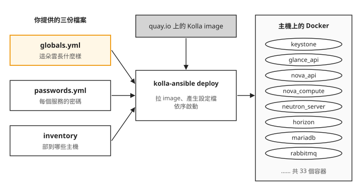
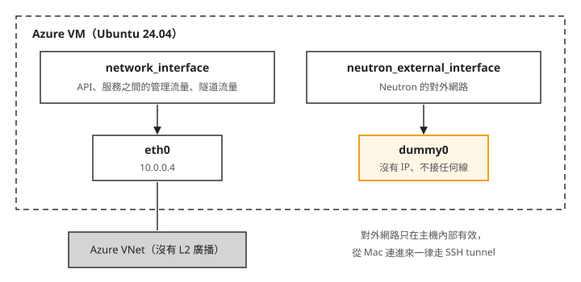
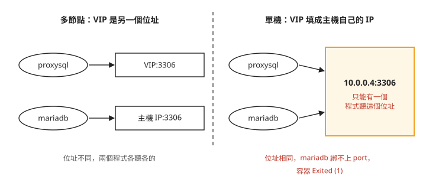
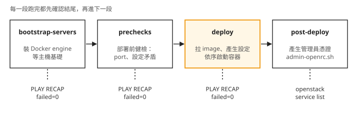
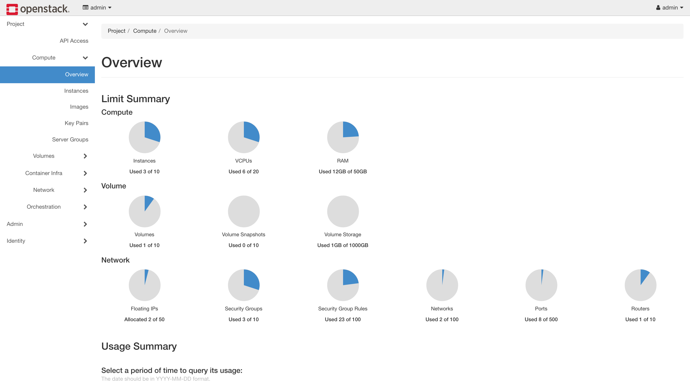

# Day 1: 用 Kolla-Ansible 部署 OpenStack 核心服務——設定檔、單機部署與失敗後的重跑

{ align=right width="110" }

Day 0 留下的是一台乾淨的 Ubuntu 24.04 VM,上面什麼都還沒裝。這一章結束時,同一台主機上會跑著一朵能用的 OpenStack 雲:在命令列打 `openstack service list` 會列出服務清單,在瀏覽器裡能用管理員帳號登入網頁儀表板 Horizon。

要走到這一步,得把 OpenStack 的五個核心服務裝起來:Keystone(帳號與認證)、Glance(VM 映像檔)、Nova(開 VM)、Neutron(網路)、Horizon(網頁儀表板)。儲存服務 Cinder 這一章先不裝,留到 Day 3 示範怎麼對已經在運作的雲加一個服務。讀完之後,部署失敗或想改設定時,你會知道該改設定檔重跑,還是要先清掉半途留下的東西才能重跑。

## 為什麼不手動裝

OpenStack 不是一個程式,而是十幾個服務的集合。以 Nova 為例,它要有自己的設定檔、自己的資料庫帳號、一條連到訊息佇列 RabbitMQ 的連線(服務內部各元件靠它互傳工作和通知),還要知道 Keystone 的位址和自己在 Keystone 裡的密碼,才能驗證每個請求。其他服務也都一樣。全部手動裝,光是把這些位址和密碼一個個填對就要好幾天,而且換一台機器就得再來一次。所以實務上不會手動裝 OpenStack,而是交給部署工具。

這門課用的部署工具是 Kolla-Ansible。名字裡的兩個部分分別來自兩個專案:

- **Kolla** 把每個 OpenStack 服務預先打包成 Docker image(容器映像檔,裡面裝好了執行一個服務需要的所有軟體),放在 `quay.io/openstack.kolla/`。你不用自己編譯或安裝任何 OpenStack 軟體。
- **Kolla-Ansible** 是一組 Ansible 劇本。Ansible 是一套自動化工具,照著劇本(playbook)上寫的步驟一步步在主機上執行。Kolla-Ansible 的劇本負責把 image 拉到主機、替每個服務產生設定檔、按正確順序啟動,把它們串成一朵雲。

你要提供的只有三份檔案,剩下的交給 `kolla-ansible deploy`:



我們可以從圖上看到兩件事:

1. **三份輸入裡,真正要動腦的只有 `globals.yml`。** 密碼由一個指令自動產生,單機用的 inventory 直接複製官方範例。這一章大部分的篇幅都在決定 `globals.yml` 裡那幾行。
2. **每個服務跑在自己的容器裡。** 部署完之後 `docker ps` 會看到 `keystone`、`nova_api`、`mariadb` 這些名字。其中 MariaDB 是保存 OpenStack 服務資料的資料庫。哪個服務出問題,就看那個容器的 log,邊界很清楚。

## 開始之前

這一章需要 Day 0 建好的 Azure VM:Ubuntu 24.04、16 vCPU、128 GB 記憶體,`kvm-ok` 確認過支援巢狀虛擬化,而且你能 SSH 進去。VM 要能連到外網,deploy 時要從 quay.io 下載約 30 個 image。除非特別註明「在 Mac 上」,以下所有指令都在 VM 上執行。

## 步驟 1:安裝 Kolla-Ansible

先決定裝哪一版。OpenStack 每半年發布一版,版名依字母順序排(……Dalmatian、Epoxy、Flamingo……)。本課用 **2025.1 Epoxy**:發布滿一年,文件和社群經驗都夠多。kolla-ansible 的 **20.x** 對應 OpenStack 2025.1,所以下面直接從 git 的 `stable/2025.1` 分支安裝,不用自己猜 pip 的版號範圍。Ubuntu 24.04 在這一版的官方支援清單內。

Kolla-Ansible 是 Python 套件,我們把它裝進一個獨立的 **venv**(Python 虛擬環境:一個資料夾,裡面有自己的 Python 和套件),避免跟系統的 Python 互相干擾。先裝系統層的編譯依賴,再建 venv:

```bash
sudo apt-get install -y git python3-venv python3-dev libffi-dev gcc libssl-dev
python3 -m venv ~/kolla-venv
source ~/kolla-venv/bin/activate
```

!!! warning "之後每次操作都要先進 venv"
    這一章以及之後每一天,執行任何 `kolla-ansible` 指令之前都要先 `source ~/kolla-venv/bin/activate`,提示符前面出現 `(kolla-venv)` 才算進來了。`install-deps` 要靠 PATH 找到 venv 裡的 `ansible-galaxy`,沒進 venv 就無法安裝所需的 collection。

接著在 venv 內安裝 kolla-ansible 本體(從 stable 分支)與它需要的 Ansible:

```bash
pip install -U pip
pip install "ansible-core>=2.16,<2.18"
pip install git+https://opendev.org/openstack/kolla-ansible@stable/2025.1
```

裝完先確認版本,拿到的應該是 20.x:

```bash
kolla-ansible --version
```

```text
kolla-ansible 20.4.0
```

kolla-ansible 還需要一批 Ansible collection(Ansible 的擴充套件,裡面裝的是劇本會用到的模組),用內建指令安裝:

```bash
kolla-ansible install-deps
```

最後補裝兩個 Python 模組。官方文件沒有列出這一步,但少了它們,步驟 5 的 prechecks 會分別因為缺 Docker SDK 和缺 dbus 模組而失敗。Docker SDK 是讓 Python 程式操作 Docker 的介面,Kolla-Ansible 在 venv 裡透過它管理容器;bootstrap-servers 裝的 Docker engine 則是主機上執行容器的服務,兩者要分別安裝。其中 dbus-python 要從原始碼編譯,所以先裝系統的標頭檔:

```bash
sudo apt-get install -y pkg-config libdbus-1-dev libdbus-glib-1-dev
pip install docker dbus-python
```

工具裝好了,下一步準備它要讀的設定檔。

## 步驟 2:準備設定檔骨架

Kolla-Ansible 預設從 `/etc/kolla/` 讀設定。把官方範例複製過去,再把單機用的 inventory 複製到家目錄。**inventory** 是 Ansible 的主機名單,寫著要部到哪些主機、每台主機扮演什麼角色。這一章所有服務都裝在同一台主機上,這種部署方式叫 **AIO**(all-in-one),官方直接提供一份叫 `all-in-one` 的名單,裡面只有本機 `localhost`。正式環境會把控制服務和跑 VM 的主機拆開,名單也會長得不一樣:

```bash
sudo mkdir -p /etc/kolla && sudo chown $USER:$USER /etc/kolla
cp -r ~/kolla-venv/share/kolla-ansible/etc_examples/kolla/* /etc/kolla/
cp ~/kolla-venv/share/kolla-ansible/ansible/inventory/all-in-one ~/all-in-one
```

確認骨架就位:

```bash
ls /etc/kolla/
```

```text
globals.yml  passwords.yml
```

打開 `globals.yml` 會發現它幾乎全是註解:每個選項都有預設值,你只要寫出想改的那幾行。`passwords.yml` 則是一份只有欄位名、沒有值的清單,步驟 4 再填滿。

## 對外網路需要一張沒有 IP 的網卡

填 `globals.yml` 之前,有一件事要先處理。之後在這朵雲裡開的 VM,要透過 Neutron 的**對外網路**(external network)跟雲外面溝通,Kolla 要你指定一張網卡專門給它用,設定名稱是 `neutron_external_interface`。這張網卡不能有 IP:Neutron 會把整張網卡接到自己管理的虛擬交換器上,從此這張網卡變成虛擬交換器的一個連接埠,不再是主機自己收發資料用的網卡。如果把主機原本在用、有 IP 的網卡交給 Neutron,主機靠這張網卡的連線(包括你的 SSH)就會斷掉。

問題是 Azure VM 只有一張真正的網卡 `eth0`,它已經有 IP,而且你靠它 SSH 進來。(用 `ip link` 還會看到一張 `enP` 開頭的網卡,那是 Azure 加速網路附帶的,不要動它。)標準的做法是造一張 **dummy 網卡**:Linux 核心提供的虛擬網卡,不接任何實體線路,剛好可以當成「沒有 IP 的那一張」交給 Neutron。

把兩張網卡各自的用途畫出來:



我們可以從圖上看到兩件事:

1. **只有 `eth0` 連到 VM 外面。** 服務之間的溝通、你下的 API 請求,都走 `eth0`,設定名稱是 `network_interface`。
2. **dummy0 沒有通到任何地方。** 所以 Neutron 的對外網路只在這台主機內部有效,而 Azure 的虛擬網路本來也不轉送 VM 之間的 L2 廣播(Neutron 對外網路需要的那種同一網段內的廣播),就算接上也出不去。雲外面因此連不進這朵雲裡的 VM(VM 往外連要靠 Day 2 在主機上補的 NAT);這不是設定錯誤,是在公有雲上跑 OpenStack 實驗環境的既定限制,正式環境的對外網路會接到真正的實體網路。

## 步驟 3:造一張 dummy 網卡

先讓 dummy 網卡立即生效:

```bash
sudo ip link add dummy0 type dummy && sudo ip link set dummy0 up
```

`ip link` 建的網卡重開機就會消失,而 Day 0 設了每晚自動關機,所以要同時寫成 systemd-networkd(Ubuntu 管理網路設定的系統服務)的設定,讓它開機時自動重建。少了這一步,隔天開機後 Neutron 會找不到 dummy0:

```bash
sudo tee /etc/systemd/network/10-dummy0.netdev <<EOF
[NetDev]
Name=dummy0
Kind=dummy
EOF
sudo tee /etc/systemd/network/10-dummy0.network <<EOF
[Match]
Name=dummy0

[Network]
LinkLocalAddressing=no
ConfigureWithoutCarrier=yes
EOF
```

確認網卡存在且已啟用:

```bash
ip -br link show dummy0
```

```text
dummy0           UNKNOWN        aa:bb:cc:dd:ee:ff <BROADCAST,NOARP,UP,LOWER_UP>
```

第二欄的 `UNKNOWN` 是正常的:dummy 網卡沒有實體線路可以回報連線狀態。要看的是角括號裡有 `UP`。

## 步驟 4:填 globals.yml、產生密碼

接下來要附加到 `globals.yml` 的有七行,下一小節還會再補一行。先一行行看這七行在決定什麼:

- `kolla_base_distro: "ubuntu"`:用 Ubuntu 為基底的 image。
- `network_interface: "eth0"` 和 `neutron_external_interface: "dummy0"`:上一節那張圖的兩條線。
- `kolla_internal_vip_address` 和 `enable_haproxy: "no"`:這兩行要一起看。多台主機的部署會在 API 服務前面放一層負載平衡器 haproxy,並準備一個 **VIP**(virtual IP):一個不固定屬於某台主機、可以在主機之間移轉的位址,所有服務都透過它找到彼此。這一章只有一台主機,不需要負載平衡,所以關掉 haproxy,VIP 直接填主機自己的 IP。
- `neutron_plugin_agent: "ovn"`:Neutron 實際建立虛擬網路、虛擬路由器時,交給 OVN(Open Virtual Network,一套虛擬網路軟體)去做。Kolla 的預設值是 `openvswitch`,不寫這一行就會裝成另一套 Open vSwitch agent;本課選 OVN,Day 2 會用到它建立的網路,Day 20 再追進 OVN 內部看封包怎麼走。
- `nova_compute_virt_type: "kvm"`:Nova 開 VM 時用硬體虛擬化加速。Day 0 用 `kvm-ok` 確認過這台 VM 支援巢狀虛擬化。這行不寫也是預設值,寫出來是為了讓設定檔一眼看得出這個前提。

把這七行**附加到 `globals.yml` 檔尾**。原檔全是註解,不會衝突,之後打開檔案拉到最後,就能看到自己改了什麼:

```bash
tee -a /etc/kolla/globals.yml <<EOF
kolla_base_distro: "ubuntu"
kolla_internal_vip_address: "10.0.0.4"
enable_haproxy: "no"
network_interface: "eth0"
neutron_external_interface: "dummy0"
neutron_plugin_agent: "ovn"
nova_compute_virt_type: "kvm"
EOF
```

> `kolla_internal_vip_address` 請填**你的 VM 的私有 IP**(`ip -4 addr show eth0` 可查),不一定是上面的 `10.0.0.4`。

### 關 haproxy 時,proxysql 也要一起關

這七行還少了一行。Kolla 預設會啟用 **proxysql**(`enable_proxysql` 預設是 `yes`),它站在資料庫 MariaDB 前面,負責把資料庫連線分給後面的 MariaDB 節點,而它跟 haproxy 是兩個獨立的開關:關了 haproxy,proxysql 還是開著。

麻煩在於 Kolla 的容器不做網路隔離,全部共用主機的網路(host network mode),每個服務就像直接跑在主機上一樣佔用 port。proxysql 聽的是 VIP 上的 3306,MariaDB 聽的是主機 IP 上的 3306。下面這張圖比較多台主機和單機兩種情況:



左邊兩個位址不同,不會衝突。右邊因為 VIP 填的就是主機 IP,兩個程式要聽同一個 IP 和 port,MariaDB 起不來,deploy 會卡在等 MariaDB 的那一步直到逾時。所以單機部署關 haproxy 時,proxysql 也要一起關。附加完上面七行之後,再補這一行:

```bash
echo 'enable_proxysql: "no"' >> /etc/kolla/globals.yml
```

### 設定在部署時產生

Kolla-Ansible 在執行部署的當下,才把資料庫帳密、訊息佇列位址、認證端點這些服務互連需要的資訊算出來,寫進每個服務的設定檔。這帶來一個工作習慣:**改設定要改 Kolla 的輸入,再重跑部署指令**,不要直接去改主機上產生出來的設定檔,下次部署會把它蓋掉。輸入有兩個地方:整朵雲的選項(裝哪些服務、用哪張網卡、VIP)寫在 `globals.yml`;某個服務設定檔裡的單一選項,例如 `nova.conf` 的某一行,寫在 `/etc/kolla/config/` 底下同名的檔案(例如 `/etc/kolla/config/nova.conf`),部署時 Kolla 會把它合併進產生的設定檔。部署指令是**冪等**的(重跑只會套用和現況不同的部分,已經正確的東西不會被重做),所以重跑是安全的。設定檔就放在主機上,想知道某個服務拿到了什麼,打開看就知道。

接著一個指令產生所有服務的隨機密碼,填滿 `passwords.yml`:

```bash
kolla-genpwd
```

抽查一個,應該看到一串隨機字串而不是空白:

```bash
grep keystone_admin_password /etc/kolla/passwords.yml
```

三份輸入都齊了:這朵雲長什麼樣(`globals.yml`)、密碼(`passwords.yml`)、部到哪(`all-in-one`)。可以開始部署。

## 步驟 5:bootstrap 與 prechecks

部署不要一次到位,而是分成幾段指令,每段跑完都先確認結果再往下:



照著圖由左到右看:四段都是 Ansible 劇本,結尾都會印同一種摘要;前三段負責把服務部署起來,第四段不部署服務,只產生登入用的憑證,用它下第一個 OpenStack 指令就是最後的確認。分段跑的好處是出錯時範圍小:prechecks 抓到的問題都還沒動到任何服務。

第一段 `bootstrap-servers` 替主機裝好 Docker engine 等基礎(約 3 分鐘):

```bash
kolla-ansible bootstrap-servers -i ~/all-in-one
```

第二段 `prechecks` 做部署前健檢,例如 port 有沒有被佔、設定有沒有互相矛盾:

```bash
kolla-ansible prechecks -i ~/all-in-one
```

兩段結尾都會印 Ansible 的 **`PLAY RECAP`**:每台主機一行,統計這次執行有幾個步驟成功(`ok`)、幾個改了東西(`changed`)、幾個失敗(`failed`)。判斷過了沒有,只看 `failed=0`:

```text
PLAY RECAP *********************************************************
localhost : ok=45   changed=8    unreachable=0    failed=0    ...
```

這裡只有 `localhost` 一行,因為 `all-in-one` 名單裡只有本機。prechecks 沒過就不要繼續,它抓到的每個問題,到 deploy 階段都會變成更難查的失敗。如果看到 `No module named 'docker'` 或 `No module named 'dbus'`,回到步驟 1 最後補裝模組的那段。

## 步驟 6:deploy(約 25–30 分鐘)

正式部署。這一步要拉約 30 個 image,並依序啟動所有服務,第一次跑(含下載 image)約 25–30 分鐘。中途 SSH 斷線的話,前景執行的指令會跟著中斷,所以用 `nohup` 放到背景跑,輸出寫進 log 檔:

```bash
nohup bash -c "source ~/kolla-venv/bin/activate && kolla-ansible deploy -i ~/all-in-one" \
  > ~/kolla-deploy.log 2>&1 &
tail -f ~/kolla-deploy.log
```

`nohup` 後面的指令自己先 `source` 一次 venv,不依賴你目前的終端機有沒有進 venv。`tail -f` 讓你即時看進度,按 `Ctrl+C` 只會停止觀看,不影響背景的部署。結尾一樣看 `PLAY RECAP` 的 `failed=0`,完整跑完會像這樣:

```text
PLAY RECAP *********************************************************
localhost : ok=367  changed=214  unreachable=0    failed=0    ...
```

如果 deploy 中途失敗,先在 log 裡找**第一個** `fatal:`,那才是真正的錯誤,後面的失敗多半是它引起的連鎖反應。

找到原因、改好 `globals.yml` 之後,通常直接重跑 deploy 就好。但冪等有它的範圍:對 Kolla 管理的資源,重跑只套用差異,不會自動清除初始化失敗留下的資料。MariaDB 使用的 volume 是保存資料、獨立於容器生命週期的儲存區,刪掉容器不會一併刪掉裡面的資料。如果是首次部署時 MariaDB 初始化失敗,只有在確認資料庫沒有需要保留的資料後,才可刪除相關容器與 volume 再重跑。已有資料或無法確認資料狀態時,不要刪除 volume,應先查明失敗原因。

## 步驟 7:第一次使用你的雲

部署完成後,產生管理員的登入憑證檔:

```bash
kolla-ansible post-deploy -i ~/all-in-one
```

這會產生 `/etc/kolla/admin-openrc.sh`,內容是一組環境變數(帳號、密碼、API 位址),OpenStack CLI 靠它知道要連哪朵雲、用什麼身分。裝 CLI、載入憑證、下第一個指令:

```bash
pip install python-openstackclient
source /etc/kolla/admin-openrc.sh
openstack service list
```

```text
+----------------------------------+-----------+----------------+
| ID                               | Name      | Type           |
+----------------------------------+-----------+----------------+
| ...                              | keystone  | identity       |
| ...                              | glance    | image          |
| ...                              | placement | placement      |
| ...                              | nova      | compute        |
| ...                              | neutron   | network        |
| ...                              | heat      | orchestration  |
| ...                              | heat-cfn  | cloudformation |
+----------------------------------+-----------+----------------+
```

看到這 7 個服務,代表 Keystone 在運作,而且其他服務都向它登記好了。我們可以從清單上看到幾件事:

- `Type` 欄就是每個服務的職責:keystone 管身分認證(identity)、glance 管映像檔(image)、nova 管運算(compute)、neutron 管網路(network)。
- **placement** 不在開場那五個服務裡。它記錄每台主機還剩多少 CPU、記憶體,Nova 決定把 VM 開在哪台主機時要問它。Kolla 部署 Nova 時會一起帶上它。
- **heat** 和 **heat-cfn** 是編排服務 Heat(用一份範本檔一次建立 VM、網路等多項資源),Kolla 預設就會啟用,Day 5 會直接用到。
- **Horizon 不在清單上**,因為它是網頁介面,不提供 API 給其他服務呼叫。

服務清單只代表「登記了」,不代表每個元件都活著。還可以再確認三件事:`openstack compute service list` 裡 Nova 的 scheduler、conductor、compute 三個元件狀態都是 `up`;`openstack network agent list` 裡的 OVN agent 都是 Alive;`sudo docker ps -a` 列出的 33 個容器都是 `Up`,沒有 `Exited` 或 `Restarting`。`-a` 會列出包含已停止容器在內的所有容器,才能檢查是否有 `Exited`。

最後打開網頁儀表板 Horizon。Horizon 聽在 VM 的私有 IP 上,而 Day 0 的 NSG 只對你的 IP 開了 SSH,所以要**在 Mac 上**開一條 SSH tunnel(透過 SSH 連線轉送某個 port),把 Mac 的 8080 port 轉到 VM 上 Horizon 的 80 port:

下面保留的實跑指令漏了 Day 0 的金鑰參數。沿用 Day 0 的登入方式時,應寫成 `ssh -i ~/.ssh/<ssh-key> -L 8080:<VM私有IP>:80 azureuser@<VM公網IP>`,將 `<ssh-key>` 換成 Day 0 使用的金鑰檔名,兩個 IP 換成你的 VM 位址。修正後的寫法本課沒有實跑。

```bash
# 在 Mac 上執行;<VM公網IP> 換成你 Day 0 拿到的
ssh -L 8080:<VM私有IP>:80 azureuser@<VM公網IP>
```

瀏覽器開 `http://localhost:8080`,帳號 `admin`,密碼在 VM 上查:

```bash
grep keystone_admin_password /etc/kolla/passwords.yml
```



*登入後的 Horizon Overview:配額圓餅圖顯示這朵雲目前的資源用量。圖中的用量和左側的 Volumes、Container Infra 選單,是之後幾天加上的服務和資源;剛部署完時,你的畫面上不會有這些。*

## 疑難排解

### MariaDB 起不來,port 3306 被 proxysql 佔走 {#mine-4}

**症狀**:deploy 卡在 `Wait for first MariaDB service port liveness` 直到逾時;`docker ps -a` 看到 `mariadb Exited (1)`;`ss -tlnp | grep 3306` 發現聽 3306 的是 **proxysql**。

**原因**:Kolla 的 `enable_proxysql` 預設是 `yes`,而且它跟 `enable_haproxy` 是**獨立的開關**。關了 haproxy、把 VIP 設成主機 IP 之後,proxysql 綁 VIP:3306、mariadb 綁主機 IP:3306,兩者是同一個 IP 和 port(見步驟 4 的對照圖)。

**修法**:以下清理方式只適用於首次部署、MariaDB 初始化失敗,且已確認資料庫沒有需要保留的資料。關掉 proxysql,並清掉初始化到一半的 MariaDB,再重跑 deploy。如果步驟 4 已經補過 `enable_proxysql` 那一行,下面第一行就跳過,免得 `globals.yml` 出現重複的設定:

```bash
echo 'enable_proxysql: "no"' >> /etc/kolla/globals.yml
sudo docker rm -f proxysql haproxy mariadb
sudo docker volume rm mariadb     # DB 還沒資料,砍掉讓它重新初始化最乾淨
kolla-ansible deploy -i ~/all-in-one   # 冪等,直接重跑
```

單機部署關 haproxy 時,proxysql 要一起關。更完整的分析見排錯手冊:[Kolla ProxySQL vs MariaDB port](../solutions/integration-issues/kolla-proxysql-mariadb-port-conflict.md)。

## 想一想

- 部署完隔天,你想把 Nova 的某個設定改掉。你會直接進 `nova_compute` 容器改設定檔,還是有別的做法?為什麼?
- 一位同學的 deploy 在 MariaDB 那一步失敗,他找到原因、改好 `globals.yml` 之後重跑,卻還是在同一個地方失敗。你會請他先檢查什麼?
- 另一位同學在自己的實體機上部署,那台機器有兩張網卡:第一張有 IP,他靠它 SSH 連進去;第二張接了網路線,但沒有設定 IP。`network_interface` 和 `neutron_external_interface` 各該填哪一張?他還需要照步驟 3 造一張 dummy0 嗎?

## 小結

Kolla-Ansible 把 OpenStack 的每個服務放進各自的容器,你只要提供 `globals.yml`、`passwords.yml` 和 inventory 三份輸入,它就在部署當下產生所有服務的設定並依序啟動。單機部署要多做兩個決定:用一張沒有 IP 的 dummy 網卡給 Neutron 的對外網路,以及把 VIP 設成主機 IP 時,haproxy 和 proxysql 要一起關。之後改設定,改 `globals.yml` 或 `/etc/kolla/config/` 底下的覆寫檔,再重跑部署;重跑失敗時,先從 log 裡第一個 `fatal:` 找原因。首次部署的 MariaDB 初始化失敗時,也要先確認沒有需要保留的資料,才可清除容器與 volume。

## 延伸閱讀

想往下深挖,從這幾份開始:

- **[Kolla-Ansible 官方 Quick Start](https://docs.openstack.org/kolla-ansible/2025.1/user/quickstart.html)** —— 本章部署流程的官方版;哪些步驟是 Kolla 標準動作、哪些是本課環境特調,對照著看就清楚。
- **[Get started with OpenStack](https://docs.openstack.org/install-guide/get-started-with-openstack.html)** —— 官方的服務總覽:每個核心服務是什麼、彼此怎麼分工,一頁講完。
- **[Kolla 專案文件](https://docs.openstack.org/kolla/2025.1/)** —— 那些容器映像檔是誰做的?就是這個專案;想理解映像檔怎麼組出來的看這份。
- **[Kolla-Ansible 支援矩陣](https://docs.openstack.org/kolla-ansible/2025.1/user/support-matrix.html)** —— 哪些作業系統、哪些服務受官方支援,規劃環境前值得先掃一眼。

## 下一步

雲部好了,但裡面是空的:沒有租戶、沒有 image、沒有網路。[Day 2](sprint3-day2-openstack-resource-flow.md) 我們分別扮演管理員和租戶(使用這朵雲的團隊或客戶,各自有獨立的資源),把開出第一台 VM 需要的資源從零建立起來。
