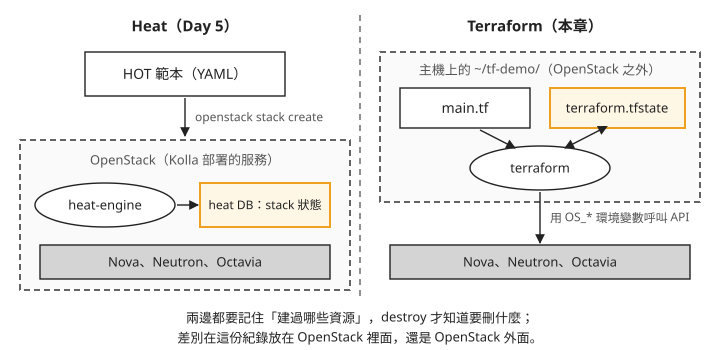
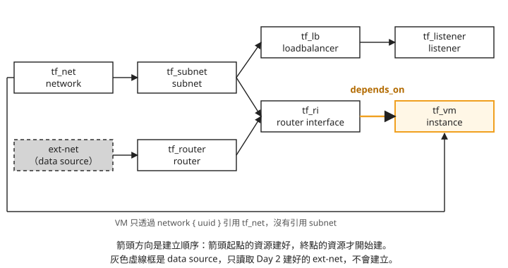

# Day 10: 用 Terraform 建立與拆除 OpenStack 資源——provider、state、depends_on 與 kolla-ansible destroy

{ align=right width="90" }

Day 2 開第一台 VM 時,network、subnet、router、VM 是一行一行 `openstack ... create` 建出來的。如果明天要替另一個專案再建一套一樣的環境,或做完實驗想全部清掉,只能翻筆記照順序重打,刪的時候還得倒過來刪。Day 5 的 Heat 可以用一份範本一次建好,但範本建出來的紀錄存在這朵雲自己的資料庫裡,雲一拆,紀錄也跟著消失。

這一章用 Terraform 把一組 network、VM 和負載平衡器寫成一個檔案,建立、查看、一次拆掉;再整理把整朵 OpenStack 拆掉重建時要做哪些事。讀完之後,拿到一套環境,你能判斷拆掉之後各部分靠什麼重建:哪些 `terraform apply` 就能回來,哪些要重跑 Kolla,哪些只能照前幾章的步驟手動補。

## Terraform 把狀態記在雲的外面

Terraform 是 HashiCorp 的工具:你在一個文字檔裡描述想要哪些資源,它負責呼叫 API 把資源建出來,事後也能照同一份描述把它們刪掉。描述檔用的語言叫 **HCL**(HashiCorp Configuration Language),副檔名是 `.tf`。

Heat 和 Terraform 都是「寫範本、一次建好」,最大的差別在於「建過哪些資源」這份紀錄放在哪裡。下面這張圖把兩者並排:



圖上標成橘色的兩個框,就是這份紀錄。我們可以看到兩件事:

1. **Heat 的紀錄在 OpenStack 裡面。** Day 5 建的 stack,狀態存在 heat 的資料庫,跟其他服務的資料庫一起由 Kolla 部署。
2. **Terraform 的紀錄在 OpenStack 外面。** 它是你工作目錄裡的一個檔案 `terraform.tfstate`,這個檔案叫 **state**。Terraform 靠它知道自己建過哪些資源、各自的 ID 是什麼,之後要刪的時候就照這份紀錄逐一刪除。

另一個差別是範圍:Heat 只管 OpenStack,Terraform 透過不同的 provider(下一節會講)可以在同一份描述裡同時管 OpenStack、其他公有雲和 DNS 這類外部服務。

## 步驟 1:安裝 terraform

在 OpenStack 主機上安裝。下面先向 HashiCorp 查目前的最新版號,下載對應的 zip,解壓後放進 `/usr/local/bin`:

```bash
VER=$(curl -s https://checkpoint-api.hashicorp.com/v1/check/terraform | python3 -c "import sys,json;print(json.load(sys.stdin)['current_version'])")
curl -fsSLo /tmp/tf.zip "https://releases.hashicorp.com/terraform/${VER}/terraform_${VER}_linux_amd64.zip"
python3 -c "import zipfile; zipfile.ZipFile('/tmp/tf.zip').extractall('/tmp')"
sudo install -m0755 /tmp/terraform /usr/local/bin/terraform    # v1.15.8
```

解壓用的是 Python 內建的 `zipfile`,所以主機上不必另外裝 `unzip`。行尾的版號是本課安裝時拿到的版本,你裝到的可能更新。

## 步驟 2:把資源寫成 main.tf

建一個目錄 `~/tf-demo/`,把下面的內容存成 `~/tf-demo/main.tf`。先整份看過,接著逐段說明:

```hcl
terraform {
  required_providers {
    openstack = { source = "terraform-provider-openstack/openstack", version = "~> 3.0" }
  }
}
provider "openstack" {}                       # 讀 OS_* env

data "openstack_networking_network_v2" "extnet" { name = "ext-net" }

resource "openstack_networking_network_v2" "tf_net" { name = "tf-net" }

resource "openstack_networking_subnet_v2" "tf_subnet" {
  name            = "tf-subnet"
  network_id      = openstack_networking_network_v2.tf_net.id
  cidr            = "10.20.0.0/24"
  ip_version      = 4
  dns_nameservers = ["8.8.8.8"]
}

resource "openstack_networking_router_v2" "tf_router" {
  name                = "tf-router"
  admin_state_up      = true
  external_network_id = data.openstack_networking_network_v2.extnet.id
}

resource "openstack_networking_router_interface_v2" "tf_ri" {
  router_id = openstack_networking_router_v2.tf_router.id
  subnet_id = openstack_networking_subnet_v2.tf_subnet.id
}

resource "openstack_compute_instance_v2" "tf_vm" {
  name        = "tf-vm"
  depends_on  = [openstack_networking_router_interface_v2.tf_ri]
  image_name  = "cirros"
  flavor_name = "m1.tiny"
  key_pair    = "k8s-admin"
  network { uuid = openstack_networking_network_v2.tf_net.id }
}

resource "openstack_lb_loadbalancer_v2" "tf_lb" {
  name                  = "tf-lb"
  vip_subnet_id         = openstack_networking_subnet_v2.tf_subnet.id
  loadbalancer_provider = "amphora"
}

resource "openstack_lb_listener_v2" "tf_listener" {
  name            = "tf-listener"
  protocol        = "HTTP"
  protocol_port   = 80
  loadbalancer_id = openstack_lb_loadbalancer_v2.tf_lb.id
}

output "tf_vm_ip"  { value = openstack_compute_instance_v2.tf_vm.access_ip_v4 }
output "tf_lb_vip" { value = openstack_lb_loadbalancer_v2.tf_lb.vip_address }
```

### provider:Terraform 怎麼連到這朵雲

開頭的 `terraform { required_providers ... }` 宣告這份檔案要用哪個 **provider**。Terraform 本身不認得 OpenStack,呼叫 OpenStack API 的工作由 provider 這個外掛負責;這裡用的是社群維護的 `terraform-provider-openstack/openstack`,`~> 3.0` 表示接受 3.x 的任何版本。

`provider "openstack" {}` 是空的,裡面沒有帳號密碼。provider 會改讀環境變數 `OS_AUTH_URL`、`OS_USERNAME`、`OS_PASSWORD`、`OS_PROJECT_NAME` 和網域相關的 `OS_*_DOMAIN_NAME`,也就是 Day 1 `admin-openrc.sh` 設定的那一組。所以帳密不必寫進 HCL,只要執行前先 `source` 憑證檔。要給多個環境或自動化流程用時,provider 也支援用 `cloud = "..."` 指向 `clouds.yaml` 裡的一個項目,或改用 application credential,不必拿管理員密碼。

### resource 和 data source

檔案裡的區塊分成兩種:

- **`resource`** 是要 Terraform 建立並管理的東西,這裡有七個:network、subnet、router、router interface(把 subnet 接上 router)、VM、負載平衡器、listener。
- **`data`** 是 **data source**,只讀取一個已經存在的資源,不建立、也不會刪除。`ext-net` 是 Day 2 建的對外網路,這朵雲的其他東西也在用它,所以只用 data source 查出它的 ID,交給 router 當對外閘道。

一個區塊可以引用另一個區塊的屬性,例如 subnet 的 `network_id = openstack_networking_network_v2.tf_net.id`。Terraform 從這些引用推出資源之間的相依:subnet 引用了 network,就要等 network 建好才能建 subnet。彼此沒有引用關係的資源,Terraform 會同時建立。

### 為什麼 VM 要加 depends_on {#why-depends-on}

把這七個資源的引用關係畫成圖,箭頭方向就是建立順序:



先看底部那條繞過整張圖的線。VM 的 `network { uuid = ... }` 只引用了 network,沒有引用 subnet,所以單看引用關係,Terraform 只知道 VM 要等 network 建好。network 一建好,VM 和 subnet 就會同時開始建。VM 送到 Nova 的時候 subnet 可能還沒建好,Nova 會拒絕:這個 network 上沒有 subnet,沒辦法分 IP 給 VM。

VM 需要 subnet,但 HCL 裡沒有任何一行把這件事寫出來,Terraform 也就推不出來。這種情況要用 **`depends_on`** 明確告訴 Terraform 順序。圖上那條橘色箭頭就是 `depends_on = [openstack_networking_router_interface_v2.tf_ri]`:router interface 本身引用了 subnet 和 router,等它建好時,subnet 已經存在,也已經接上 router,這時再建 VM。只寫 `depends_on = [openstack_networking_subnet_v2.tf_subnet]` 也能解決 subnet 的問題。漏掉這一行會看到什麼錯誤,見[疑難排解：VM 建立失敗,Nova 回 400](#mine-1)。

### 負載平衡器與 output

負載平衡器明確指定 `loadbalancer_provider = "amphora"`。Day 4 提過,這朵雲的 Octavia 有 amphora 和 ovn 兩個 provider,ovn provider 只處理 TCP、UDP 這類 L4 流量;這裡的 listener 用的是 `HTTP`,所以要指定 amphora,由 Octavia 開一台跑 haproxy 的 amphora VM 來處理。

最後兩個 `output` 區塊,讓 Terraform 建完之後印出 VM 的 IP 和負載平衡器的 VIP(對外服務用的那個 IP),不必再用 `openstack` 指令去查。

## 步驟 3:plan、apply、確認、destroy

在 `~/tf-demo/` 目錄裡依序執行:

```bash
source /etc/kolla/admin-openrc.sh
terraform init
terraform plan          # 7 to add
terraform apply -auto-approve
terraform output        # tf_vm_ip / tf_lb_vip
terraform destroy -auto-approve    # 一鍵拆 7 資源(含 amphora)
```

一行一行看:

- **`terraform init`** 照 `required_providers` 下載 OpenStack provider,放進目錄裡的 `.terraform/`。每個新目錄只要做一次。
- **`terraform plan`** 比對 HCL、state 和雲上的現況,列出接下來要建立、修改或刪除什麼,但不會真的動手。第一次執行時 state 還是空的,所以結果是 `7 to add`:正好是七個 `resource`。`ext-net` 是 data source,不在其中。先看 plan 再動手,是 Terraform 最常用的習慣:改了 HCL 之後,plan 會告訴你這次改動會不會把某個資源刪掉重建。
- **`terraform apply`** 真正呼叫 API 建立資源,完成後把每個資源的 ID 寫進 `terraform.tfstate`。平常 apply 會先印出 plan 並等你輸入 `yes`;`-auto-approve` 省略這個確認,只適合在你已經看過 plan 的時候用。七個資源裡最慢的是負載平衡器,約一分鐘,因為要等 Octavia 開好 amphora VM;VM 約 20 秒。
- **`terraform output`** 印出兩個 output 的值。本課執行時拿到的是 `tf_vm_ip` 10.20.0.46、`tf_lb_vip` 10.20.0.234,兩個 IP 都落在 HCL 裡 subnet 設定的 `10.20.0.0/24`;你的數字會不同,但應該也在這個範圍內。

destroy 之前,可以先用 `openstack server list`、`openstack network list`、`openstack loadbalancer list` 看看,名稱是 `tf-` 開頭的資源都在。amphora VM 建在 Octavia 自己的 service project 裡,`openstack server list` 列不到,要用 `openstack loadbalancer amphora list` 看。

- **`terraform destroy`** 照 state 裡的紀錄,依相依關係的反方向刪除:listener 先於負載平衡器、VM 先於 router interface,最後才刪 network。刪除負載平衡器時,Octavia 會把它的 amphora VM 一起刪掉。

destroy 跑完再列一次,`tf-` 開頭的資源應該全部不見,`openstack loadbalancer amphora list` 裡也不再有這個負載平衡器的 amphora。這一步確認的是:Terraform 建的東西,它都能自己收回去,不會在 OpenStack 留下殘留。

## 拆掉整朵 OpenStack 要做什麼

`terraform destroy` 拆的只是建在 OpenStack 上面的資源。如果要把 OpenStack 本身拆掉重建,例如換一台主機、或者環境壞到不值得修,要用的是 Kolla-Ansible 的 **`kolla-ansible destroy`**:它把 Kolla 部署的所有容器和 Docker volume 清掉,資料庫的資料和上傳到 Glance 的 image 都存在 Docker volume 裡,所以一併消失,無法復原。主機上的 `/etc/kolla/` 則是部分保留:`globals.yml`、`passwords.yml` 和自訂設定目錄 `config/` 會留下,其餘產生出來的檔案會被刪掉,包括 Day 1 `post-deploy` 產生的 `admin-openrc.sh`。

這一段**本課沒有實際執行**。下面的程序是把前幾章的手動步驟整理成的清單,沒有從頭到尾跑過一次;重建需要的時間也只是估計。

清單分四段:先備份設定,再拆,再用 Kolla 重新部署,最後補上 Kolla 管不到的東西。第 3 段的註解是一串提醒,各自對應前面某一章的步驟:CAPI mgmt cluster 是 Day 6 用 kind 建的 Cluster API 管理叢集,ORC 是它呼叫 OpenStack API 用的元件;`o-hm0` 是 Day 4 讓 Octavia 連到 amphora 管理網路的介面。

```bash
# 0. 先備份會遺失的狀態(node image 已在 Glance repo 外、magnum kubeconfig、globals.yml)
cp /etc/kolla/globals.yml ~/globals.backup.yml

# 1. 拆整套 OpenStack(清所有容器 + volumes + 資料;不可逆)
kolla-ansible destroy -i ~/all-in-one --yes-i-really-really-mean-it

# 2. 重建(~30-60 分,依服務數)
kolla-ansible bootstrap-servers -i ~/all-in-one   # 若 host 也被清
kolla-ansible deploy -i ~/all-in-one              # core + octavia + barbican + magnum

# 3. 重建後必做的 post-steps(這些不在 kolla deploy 範圍內):
#    - Octavia 憑證: kolla-ansible octavia-certificates -i ~/all-in-one(Day 4)
#    - 重傳 amphora / node image 到 Glance(Day 4/7)
#    - 重建 CAPI mgmt cluster(kind + clusterctl init + ORC,Day 6)——kind 資料不隨 kolla 走
#    - magnum kubeconfig 換新 kind API port,重放 /etc/kolla/config/magnum/kubeconfig(Day 7)
#    - kind MASQUERADE / octavia o-hm0 / disk_allocation_ratio 等 host 級設定(有 systemd unit / config 的會自動回)
```

`--yes-i-really-really-mean-it` 是 `kolla-ansible destroy` 要求的確認參數,少了它不會執行。destroy 會保留 `globals.yml`、`passwords.yml` 和 `config/`,但拆除前把它們另外複製一份仍然值得,萬一要換一台主機重建,這幾個檔案就是全部的設定。

deploy 跑完之後,`admin-openrc.sh` 已經在拆除時被刪掉,要先重新產生,才能 `source` 它、執行 `openstack` 或 `terraform` 指令:

```bash
kolla-ansible post-deploy -i ~/all-in-one
```

第 3 段那串 post-steps 要分成兩類看。放在 `/etc/kolla/config/` 底下的東西,destroy 會保留,deploy 重跑時自動帶回:Day 4 產生的 Octavia 憑證、Day 9 調整 `disk_allocation_ratio` 的 `nova.conf`、Day 7 交給 Magnum 的 kubeconfig 檔案。其中 kubeconfig 只有在 kind 叢集也重建、API port 換了的時候,才需要換成新內容。

真正要手動補的是 Kolla 以外的東西:Day 4 和 Day 7 上傳的 amphora image 與 Kubernetes 節點 image(它們在 Glance 的 Docker volume 裡,跟著消失)、Day 6 用 kind 建的管理叢集,以及 Day 6 讓 kind 節點連得到外網的 MASQUERADE 規則。

把拆除和重建按層次畫出來:


照著圖由下往上看重建的順序:

1. **最下層有現成的指令。** `kolla-ansible deploy` 是冪等的(Day 1),設定都在保留下來的 `globals.yml` 和 `config/` 裡,重跑就能把服務帶回來,再用 `post-deploy` 產生憑證檔。
2. **最上層也有。** 只要 `main.tf` 還在,`terraform apply` 就能把這一層建回來。但要等下面兩層都就緒:Glance 裡還沒有 amphora image,負載平衡器就建不起來。
3. **中間那一層只有筆記。** 這些資料和設定散在 Day 4 到 Day 7 的步驟裡,沒有一個指令能一次重建。

所以「能不能一次拆掉、一次重建」,取決於中間那一層有沒有也寫成程式。這一層可以用 Ansible 劇本或 Terraform 補上,這門課沒有做。

## 疑難排解

### VM 建立失敗,Nova 回 400 {#mine-1}

**症狀**:`terraform apply` 建 VM 時失敗,錯誤訊息是 `Network ... requires a subnet in order to boot instances on`(HTTP 400)。

**原因**:VM 只引用了 network,沒有引用 subnet,Terraform 把 VM 和 subnet 同時建,VM 送到 Nova 時 subnet 還沒建好。詳細的說明和修法見[步驟 2「為什麼 VM 要加 depends_on」](#why-depends-on):在 VM 加上 `depends_on`,指向 router interface 或 subnet。

## 想一想

- 一位同學覺得 `depends_on` 那行多餘,把它刪掉之後 apply 了三次:兩次成功、一次在 VM 那一步失敗。為什麼結果會不一樣?
- 另一位同學做完實驗,把整個 `~/tf-demo/` 目錄刪掉了,才想起資源還沒清。他重新寫了一份一模一樣的 `main.tf`,在新目錄裡執行 `terraform destroy`,能把舊的那七個資源刪掉嗎?為什麼?
- 主管問你:「我們的網路和 VM 都寫成 Terraform 了,這朵雲哪天壞了,是不是 `terraform apply` 就能全部建回來?」你會怎麼回答,還需要準備什麼?

## 小結

Terraform 用 HCL 描述想要的資源,透過 provider 呼叫 OpenStack API,並把建過的資源記在雲外的 state 檔案裡;`plan` 先列出差異,`apply` 照著建,`destroy` 照 state 刪乾淨。資源之間的順序靠引用推導,HCL 裡沒寫出來的需求,例如 VM 需要 subnet,要用 `depends_on` 補上。之後判斷一套環境能不能重建時,把它分成三層看:Terraform 管的資源、Kolla 部署的服務,以及 Kolla 以外、只存在於前幾章步驟裡的 image、kind 叢集和主機設定。最後這一層沒有寫成程式之前,拆掉整朵雲就要照筆記一件件補回來。

## 延伸閱讀

想再深入,可以從這幾份開始:

- **[Terraform OpenStack Provider 文件](https://registry.terraform.io/providers/terraform-provider-openstack/openstack/latest/docs)** —— 每種資源(instance、network、loadbalancer)的完整參數,以及 provider 支援的各種認證方式。
- **[Terraform 官方入門](https://developer.hashicorp.com/terraform/intro)** —— state、plan、apply 的第一手說明。
- **[Terraform:depends_on](https://developer.hashicorp.com/terraform/language/meta-arguments/depends_on)** —— 官方說明什麼時候 Terraform 推不出相依、為什麼建議把 `depends_on` 當最後手段。
- **[Kolla-Ansible 維運指南](https://docs.openstack.org/kolla-ansible/2025.1/user/operating-kolla.html)** —— `destroy`、`reconfigure`、升級這些日常操作的官方說明。

## 下一步

Sprint 3 的動手部分到這裡結束:從一台空的 Azure VM 開始,部署了 OpenStack,一路做到在上面開 Kubernetes 叢集,最後用 Terraform 管理資源。[Day 11](sprint3-day11-openstack-service-map.md) 不用動手,把這十天用過與沒用過的 OpenStack 服務放在一張圖上;回顧與產業對照見 [Sprint 3 回顧](../sprint3-reflection.md)。

---

*Terraform 標誌為 HashiCorp 之商標,此處作社群教學用途。*
