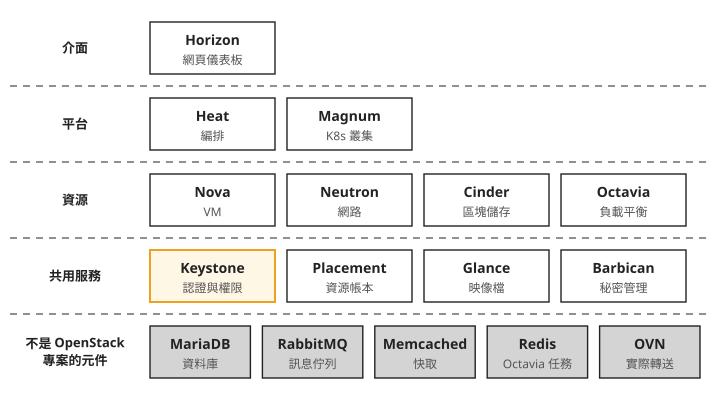
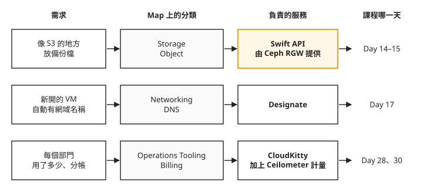
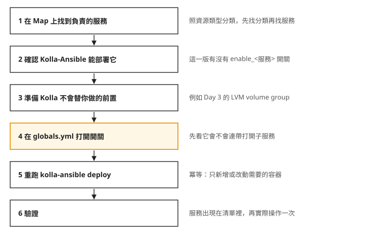

# Day 11: OpenStack 服務全景圖——用過的 11 個服務、OpenStack Map 與加服務的流程

{ align=right width="96" }

Day 10 結束時,你手上有一朵能開 VM、掛硬碟、開負載平衡器、開 Kubernetes 叢集的雲。雲一能用,同事就會來提需求:想要一個像 S3 的地方放備份檔;希望新開的 VM 自動有個域名,不用每次記 IP;月底想知道每個部門各用了多少,好拆帳。你打開 Kolla-Ansible 的 `globals.yml` 範本,看到一長串 `enable_*` 開關,卻不確定哪一個對應哪一個需求。

這一章不動手部署。我們先把這朵雲裡已經有的服務整理一次,再用 OpenStack 官方的服務地圖,把同事的三個需求逐一對到負責的服務。讀完之後,拿到一個雲端需求,你能說出它歸 OpenStack 哪個服務管、這門課有沒有教、在哪一天,以及要加上去時先查什麼。

## OpenStack 是一組各自獨立的服務

回想 Day 3 加 Cinder 的那一步:在 `globals.yml` 加上 `enable_cinder: "yes"`,重跑 `kolla-ansible deploy`,雲就多了區塊儲存。其他服務完全沒受影響,Nova 照樣開 VM。

這是因為 OpenStack 本身就是由許多獨立的**專案**組成的。每個專案負責一種資源,有自己的 API、自己的資料庫、自己的容器,通常也有自己的名字:管 VM 的叫 Nova,管網路的叫 Neutron,管區塊儲存的叫 Cinder。社群把它們放在同一個名字底下發布,但部署時每個都可以單獨開或關。`globals.yml` 裡那一長串 `enable_*`,就是逐一列出 Kolla-Ansible 會部署的專案。

下面把 Day 10 這朵雲裡跑著的東西畫成一張圖。由上往下分五層:最上面是你操作的介面,往下是建在其他服務之上的平台、管各種資源的服務、每個服務都要用的共用服務,最底下一層灰色的元件不屬於 OpenStack,卻是整朵雲運作的前提。

從圖上可以看出兩件事:

1. **越往上的服務,依賴的服務越多。** Magnum 開一個 Kubernetes 叢集,要靠 Nova 開節點、Neutron 接網路、Octavia 替叢集的 API 開負載平衡器、Barbican 存憑證。所以 Magnum 這一層出的問題,原因常常在下面一層:Day 8 的 `Service type=LoadBalancer` 一直 pending,最後查到的是 Octavia 沒有啟用叢集要求的 provider,也就是 Octavia 實際建立負載平衡器用的 driver,例如 amphora(Day 8 的[「LoadBalancer 一直 pending,CCM 報 `Provider 'amphorav2' is not enabled`」](sprint3-day8-e2e-workload-cluster.md#mine-3))。
2. **共用服務那一層每個請求都會經過。** 橘框的 Keystone 負責驗證身分與權限,你下的每一個 `openstack` 指令都要先向它拿 token,其他服務收到請求時也會回頭找它確認。

## 這門課用過的 11 個服務

上圖從介面到共用服務共 11 個 OpenStack 服務,每一個都實際部署、操作過。下表依出場順序整理,「AWS 對應」欄列出公有雲上功能相近的服務,方便你把這裡學到的對到其他雲上。每個專案的官方吉祥物也放在表裡,之後在文件或部署輸出裡看到名字,比較容易想起它是做什麼的。

| | 服務 | 管什麼 | AWS 對應 | 在本課程 |
|---|---|---|---|---|
| { width="64" } | **Keystone** | 帳號、租戶、權限、token | IAM | Day 1 部署;之後每一天的每個指令都經過它 |
| { width="64" } | **Glance** | VM 開機映像檔 | AMI | Day 1 部署;Day 2 上傳 cirros/Ubuntu、Day 7 上傳 K8s node image |
| — | **Placement** | 資源帳本(哪台主機還有多少 CPU/RAM/disk) | (EC2 內部機制) | Day 1 部署;Day 9 調 `disk_allocation_ratio` 就是在調它的可分配量 |
| { width="64" } | **Nova** | 開 VM、排程 | EC2 | Day 1 部署;Day 2 起開遍了 VM(含 K8s 節點、amphora) |
| { width="64" } | **Neutron**(+ OVN) | 虛擬網路、路由、防火牆 | VPC | Day 1 部署;Day 2 建網路/router/FIP,之後所有網路都是它 |
| { width="64" } | **Horizon** | 網頁儀表板 | Console | Day 1 部署;課程以 CLI 為主,Horizon 用來對照查看 |
| { width="64" } | **Heat** | 宣告式編排(用範本建一組資源) | CloudFormation | Day 1 隨預設部署、Day 5 實際寫 HOT stack |
| { width="64" } | **Cinder** | 區塊儲存(VM 的外接硬碟) | EBS | Day 3 部署 + volume 生命週期;Day 8 供裝 K8s PVC |
| { width="64" } | **Octavia** | 負載平衡(amphora VM 模型) | ELB | Day 4 部署 + 手動 LB;Day 8 供裝 K8s LoadBalancer |
| { width="64" } | **Barbican** | 秘密與憑證的儲存 | Secrets Manager / KMS | Day 5 部署 + secret 往返;Day 7 起存放 cluster 憑證 |
| { width="64" } | **Magnum** | K8s-as-a-Service | EKS | Day 7 部署(CAPI driver),Day 8–9 開 cluster、升版、擴縮 |

Placement 那一列沒有吉祥物圖。它原本是 Nova 裡面的一部分,後來才拆成獨立的服務。

### 不是 OpenStack 專案、但一起被部署的元件

圖上最底下那一層灰色元件,都是 Kolla-Ansible 一起替你部署的開源軟體,但它們不是 OpenStack 專案,有各自的社群和版本。出問題時,它們的症狀常常出現在 OpenStack 服務上,所以要知道它們各自負責什麼:

| 元件 | 負責什麼 | 在課程中出現的地方 |
|---|---|---|
| MariaDB | 所有服務的資料庫 | Day 1 部署時被 ProxySQL 佔走 port,整個部署卡住(Day 1 的[「MariaDB 起不來,port 3306 被 proxysql 佔走」](sprint3-day1-kolla-aio-core.md#mine-4)) |
| RabbitMQ | 服務內部的訊息佇列(API 收到請求,交給背後的 worker 執行) | 課程中沒有出過問題 |
| Memcached | Keystone token 快取 | 課程中沒有出過問題 |
| Redis | Octavia 用來記錄進行中任務的資料庫 | Day 4 沒開它,LB 一直停在 PENDING(Day 4 的[「LB 卡在 PENDING_CREATE,amphora 沒有開機」](sprint3-day4-octavia.md#mine-3)) |
| OVN | Neutron 底下實際轉送封包的軟體網路 | Day 2 的邏輯 router/switch、Day 4 的 o-hm0 都由它實作 |

另外還有兩組工具也不屬於 OpenStack:Day 6 的 kind、Cluster API、CAPO 是 Kubernetes 社群的專案,Day 10 的 Terraform 是 HashiCorp 的工具。它們從外面呼叫 OpenStack 的 API,不在雲的裡面。

## OpenStack Map:照資源類型找服務

回到開場的三個需求。要知道它們歸哪個服務管,最直接的工具是 OpenInfra Foundation 維護的 **OpenStack Map**:一張把所有官方服務依資源類型分格排好的圖。下面這張是 2026.04.01 版,中間的大框是 OpenStack 本身,左右兩側是用戶端工具和維運工具,最下面是部署工具。

*(點圖可到 openstack.org/software 看互動版)*

照著圖上的位置看:

- **中間大框的格子名稱就是資源類型。** Compute 分 VM 和容器,Storage 分 Object、Block、File 三種,Networking 分 SDN、負載平衡、DNS。這門課用過的 Nova、Cinder、Neutron、Octavia 都在這幾格裡。Networking 右邊的 Hardware Lifecycle 管實體硬體:Bare Metal 是 Ironic,Accelerators 是 Cyborg。
- **最下排的 Shared Services** 就是上一節圖裡的共用服務那一層:Keystone、Placement、Glance、Barbican。
- **右側的 Operations Tooling** 是維運用的服務:監控、資源最佳化建議、計費、測試。這門課到 Day 10 都還沒碰到。
- **左側的 Integration Enablers** 是讓 OpenStack 和其他系統接起來的專案:Container Services 的 Kuryr 把容器網路接到 Neutron,NFV 的 Tacker 給電信業部署虛擬化網路功能。
- **最下方的 Lifecycle Management** 列的是部署工具。Kolla-Ansible 旁邊的 OpenStack-Charms 和 OpenStack-Helm,正是這門課之前[兩次嘗試](../previous-attempts.md)用過的工具。

有了分類,開場的三個需求就可以照「需求 → 分類 → 服務」的順序對下去:

第二列和第三列都很直接:域名是 DNS,在 Networking 格裡找到 Designate;分帳在 Billing 格裡找到 CloudKitty。CloudKitty 只負責把用量換算成費用,用量本身要靠 Monitoring 格裡的 Ceilometer 收集,所以這個需求要兩個服務一起上。

第一列多了一個轉折。Storage 的 Object 格裡是 **Swift**,OpenStack 的物件儲存服務,用法就是上傳一個檔案、拿到一個網址。但 Kolla-Ansible 2025.1 的 release notes 寫明,它已經不再支援部署 Swift。這門課的做法是在 Day 14 先建一套 Ceph 儲存叢集,Day 15 用 Ceph 的 **RGW**(物件儲存閘道)提供物件儲存。RGW 和 Swift **API 相容**:它接受的請求和回應的格式跟 Swift 一樣,原本寫給 Swift 的程式,常用的物件操作大多可以直接沿用,同時也接受 S3 的 API。

這一列說明 Map 能告訴你的範圍:它列出 OpenStack 有哪些服務、各自歸哪一類,但不會告訴你某一版的 Kolla-Ansible 能不能部署它。這要另外查 Kolla-Ansible 對應版本的文件和 release notes。

## 這門課還沒用到的服務

Map 上還有很多服務是 Day 10 為止沒碰過的。其中一部分會在 Sprint 4、5 陸續加上,下面依你之後最可能用到的程度分組。

### 後面會部署的服務

這些在日常營運一朵雲時常會被問到,Sprint 4、5 會逐一部署:

| | 服務 | 管什麼 | AWS 對應 | 在本課程 |
|---|---|---|---|---|
| { width="64" } | **Skyline** | 新一代網頁儀表板 | Console | [Day 13](sprint4-day13-skyline.md),與 Horizon 並存 |
| { width="64" } | **Swift**(API) | 物件儲存(上傳檔案、拿到網址) | S3 | [Day 15](sprint4-day15-object-storage-rgw.md),由 Ceph RGW 提供 Swift API |
| { width="64" } | **Manila** | 共享檔案系統(多台 VM 同時掛同一份) | EFS | [Day 16](sprint4-day16-manila-cephfs.md),建在 Day 14 的 Ceph 上 |
| { width="64" } | **Designate** | DNS 服務 | Route 53 | [Day 17](sprint4-day17-designate-dns.md) |
| { width="64" } | **Trove** | 資料庫服務(開一個代管的 MySQL) | RDS | [Day 18](sprint4-day18-trove-dbaas.md) |
| { width="40" } { width="36" } | **Prometheus + Grafana** | 監控與儀表板 | CloudWatch | [Day 21](sprint4-day21-observability.md);兩者來自 OpenStack 以外的社群,由 Kolla-Ansible 整合部署 |
| { width="64" } | **Ceilometer / Aodh** | 計量(誰用了多少)與告警 | CloudWatch | [Day 28](sprint5-day28-ceilometer-metering.md) 計量、[Day 29](sprint5-day29-aodh-autoscaling.md) 告警與自動擴縮 |
| { width="64" } | **CloudKitty** | 費率與計費(把用量變成帳單) | — | [Day 30](sprint5-day30-cloudkitty-rating.md) |
| { width="64" } | **Masakari** | VM 高可用(主機故障時把 VM 移到別台重開) | — | [Day 31](sprint5-day31-masakari-ha.md),在多節點環境上 |

*上表第一列的 Skyline,在 Day 13 部署後長這樣:同一朵雲,換一套網頁介面。*

### 這門課不會教的服務

下面這些服務 Map 上都有,但只在特定場景才需要,這門課不會部署:

- **Ironic**(裸機服務):把實體伺服器當成 VM 一樣用 API 開關、裝系統,用在資料中心自動化。
- **Cyborg**(加速器管理):管理 GPU、FPGA 這類加速卡,讓 VM 可以申請使用。
- **Zun**(容器服務):不經過 Kubernetes,直接用 OpenStack API 跑容器。Kolla-Ansible 自 2026.1 起不再支援部署 Zun;這門課跑容器工作負載走的是 Magnum。
- **Blazar**(資源預約):預先保留某段時間要用的主機或資源。
- **Watcher**(資源最佳化):分析整朵雲的用量,提出搬移 VM 之類的最佳化建議。
- **Tacker**(NFV 編排):電信業用來部署虛擬化網路功能。
- **Mistral**(工作流程):把多個 API 呼叫串成一個可重跑的流程。

一個服務在 Map 上,不代表它仍有人積極維護。打算投入時間學某個服務之前,先查它的維護狀態,[Day 35](sprint5-day35-sprint5-recap.md) 會整理查的方法。

## 要加一個服務時:Day 3 的流程

不管之後要加的是上面哪一個服務,Kolla-Ansible 加服務的流程都跟 Day 3 加 Cinder 一樣,只是前面多了查 Map 和查支援兩步。下圖由上往下是完整順序,右邊是每一步要注意的地方:

照著圖上的編號看,最容易出錯的是第 2 到第 4 步:

- **第 2 步**擋掉的是 Swift 這種情況:Map 上有,Kolla-Ansible 這一版卻不能部署。
- **第 3 步**是 Kolla-Ansible 管不到的部分。Day 3 的 LVM volume group 要先自己用 `pvcreate`、`vgcreate` 建好,Day 15 的 RGW 要先有 Day 14 的 Ceph。
- **第 4 步**的開關可能會連帶打開子服務。Day 3 開了 `enable_cinder` 之後,cinder-backup 也跟著部署,但這個 lab 沒有它需要的備份後端,服務一直是 down,最後要另外設 `enable_cinder_backup: "no"`,再刪掉已經建出來的 `cinder_backup` 容器。打開一個開關之前,先查它會帶起哪些子服務。

第 5 步的 `kolla-ansible deploy` 每次都會走過所有服務。沒有打開的服務,在部署輸出裡會看到它的 `PLAY [Apply role ...]` 後面接著 `skipping: no hosts matched`。Day 5 部署 Barbican 時捲過去的那一長串 skipping,大致對應 Kolla-Ansible 支援、但這朵雲還沒打開的服務,也就是第 2 步要查的那份清單。只是大致對應:裡面也有 prometheus、opensearch 這類不屬於 OpenStack 的角色。

## 想一想

- 有個團隊希望在這朵雲上直接租用整台實體伺服器,不要虛擬化,好跑對效能很敏感的資料庫。照這一章的方法,你會在 Map 的哪一格找服務?這門課有沒有教到它?
- 同事看到 Map 上 Storage 格裡的 Swift,在 Kolla-Ansible 2025.1 的 `globals.yml` 裡加了 `enable_swift: "yes"` 就準備重跑 deploy。你會先請他確認哪一件事?如果他要的是放檔案的地方,這門課的做法是什麼?
- 某天 Octavia 新建的負載平衡器全部停在 PENDING,Octavia 的 API 卻照常回應。照第一張圖的分層,除了 Octavia 本身,你還會去看哪一層的哪個元件?

## 小結

OpenStack 由許多各自獨立的專案組成,每個專案管一種資源,在 Kolla-Ansible 裡用一個 `enable_*` 開關決定要不要部署。到 Day 10 為止,這朵雲用了 11 個服務,底下還有 MariaDB、RabbitMQ、Redis、OVN 這些不屬於 OpenStack、但出問題時症狀會出現在 OpenStack 服務上的元件。之後拿到一個新需求,先在 OpenStack Map 上找到它屬於哪一類、哪個服務負責,再去查這一版的 Kolla-Ansible 能不能部署它;確定能部署,就照 Day 3 的流程準備前置、打開開關、重跑 deploy、驗證。

## 延伸閱讀

想再深入,可以從這幾份開始:

- **[OpenStack Map(openstack.org/software)](https://www.openstack.org/software/)** —— 本章那張圖的互動版,點每個服務可以看到它的簡介與文件連結。
- **[Kolla-Ansible 2025.1:Projects Deployment Configuration Reference](https://docs.openstack.org/kolla-ansible/2025.1/reference/index.html)** —— 這一版 Kolla-Ansible 能部署哪些服務、各自要怎麼設定,依運算、儲存、網路等分類列出;查「第 2 步」從這裡開始。
- **[Kolla-Ansible 2025.1 release notes](https://docs.openstack.org/releasenotes/kolla-ansible/2025.1.html)** —— 這一版新增、棄用、移除了哪些服務的部署支援,Swift 的移除也記在這裡。
- **[OpenStack 官方專案列表](https://governance.openstack.org/tc/reference/projects/)** —— OpenStack 技術委員會維護的正式專案清單,每個專案的負責團隊與 repo 都列在這裡。

## 下一步

這一章列出的「後面會部署的服務」,就是下一段課程的內容。[Day 12](sprint3-day12-sprint4-preview.md) 是 Sprint 4 的預告,說明為什麼挑這些服務、為什麼物件儲存教 RGW 而不是 Swift。想先回顧 Sprint 3 的決策,可以看 [Sprint 3 回顧](../sprint3-reflection.md)。

---

*本頁吉祥物圖像與 OpenStack Map 為 OpenInfra Foundation 官方資產([Project Mascots](https://www.openstack.org/project-mascots/)、[OpenStack Map](https://www.openstack.org/software/)),版權屬原基金會,此處作社群教學用途。*
