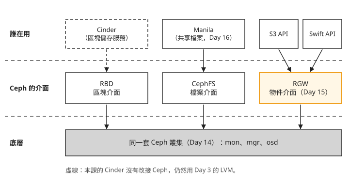

# Day 12: 下一步的地圖——Sprint 4 預告

Sprint 3 結束時,你手上有一朵單機的雲:能開 VM、建網路、掛 Cinder 磁碟,還能用 Magnum 開出 K8s cluster。假設把它交給同事試用一週,回來的問題大概會是這幾個:備份檔要放哪裡?這台主機掛了,整朵雲是不是就停了?VM 開滿了,要怎麼加機器?

這些問題 Sprint 3 都沒有回答,Sprint 4 的十二天實作(Day 13–24)就是在回答它們,後面另有 Day 25 總結與 Day 26 預告。這一頁不動手,先看 Sprint 4 怎麼安排,再說明三個看課表時容易冒出來的疑問。讀完之後,手上有一個「這朵雲還缺什麼、怎麼維運、怎麼加機器」的問題時,你能指出 Sprint 4 的哪一段在處理它,也能說明為什麼物件儲存走 Ceph RGW、為什麼多節點要另外開機器。各章連結列在下方課表。

## 三類問題,四個階段

同事那幾個問題可以歸成三類:

1. **這朵雲還缺什麼服務?** 放檔案的物件儲存、多台 VM 共用的檔案系統、DNS、代管資料庫,Day 11 的服務全景圖都介紹過,但 Sprint 3 一個也沒裝。
2. **怎麼長期維運?** 出事時去哪裡看、怎麼套用上游的修補、資料庫壞了怎麼救。
3. **怎麼加機器?** 一台主機掛掉時服務還在不在、容量不夠時怎麼擴充。

Sprint 4 把這三類問題排成四個階段。第一類拆成兩段:先把缺的服務裝上(階段一),再拆開已經在用的服務看它們內部怎麼運作(階段二)。下面的地圖由上往下是上課順序,每張卡片是一個階段,圓形貼片上的數字是 Day 編號:

  <strong>階段一 · 服務擴充</strong>&ensp;Day 13–18 · 加上六個新服務
  

    
<b>13</b>&nbsp;Skyline 儀表板

    
<b>14</b>&nbsp;Ceph 基礎

    
🪣<b>15</b>&nbsp;物件儲存 RGW

    
<b>16</b>&nbsp;Manila 共享檔案

    
<b>17</b>&nbsp;Designate DNS

    
<b>18</b>&nbsp;Trove 資料庫

  

▼

  <strong>階段二 · 內部原理</strong>&ensp;Day 19–20 · 追一個請求與一個封包
  

    
🔬<b>19</b>&nbsp;server create 背後

    
<b>20</b>&nbsp;封包怎麼流

  

▼

  <strong>階段三 · 維運實務</strong>&ensp;Day 21–22 · 監控、升版、備份
  

    
<b>21</b>&nbsp;可觀測性

    
<b>22</b>&nbsp;升版、備份與 DB 維運

  

▼

  <strong>階段四 · 水平擴展</strong>&ensp;Day 23–24 · 從單機到多機
  

    
🖥️<b>23</b>&nbsp;多節點部署

    
<b>24</b>&nbsp;橫向擴展實戰

  

<em>貼片上的圖有些是服務的官方吉祥物(例如 Skyline、Manila、Designate、Trove),有些是專案標誌(Ceph)或通用圖示;逐日內容見下方課表。</em>

照著地圖看,有兩件事值得先注意。第一,前三個階段都在原本那台單機上做,Day 13–22 一路沿用 Sprint 3 的環境;只有最後的階段四換到新的多台機器。第二,階段二不裝任何新服務,它拆解的對象是前面 18 天已經在用的東西,所以排在服務擴充之後。

## 實作課表(Day 13–24)

| Day | 主題 | 一句話 |
|---|---|---|
| [13](sprint4-day13-skyline.md) | **Skyline 新一代儀表板** | 在 `globals.yml` 打開一個開關就部署完成,和 Horizon 並存,兩代介面對照 |
| [14](sprint4-day14-ceph-bootstrap.md) | **Ceph 基礎** | 用 cephadm(Ceph 官方的部署工具)在同一台主機立一套最小的 Ceph:mon 維護叢集狀態、mgr 負責管理與監控、osd 管一顆硬碟並實際存資料,當 Day 15、16 的共同底層 |
| [15](sprint4-day15-object-storage-rgw.md) | **物件儲存(RGW)** | 在 Ceph 上開物件儲存,用 Keystone 身分走 Swift API 上傳下載,並說明怎麼用 EC2 credentials(Keystone 發給使用者、格式與 AWS 相容的一組 access/secret 金鑰)拿 S3 金鑰 |
| [16](sprint4-day16-manila-cephfs.md) | **Manila 共享檔案系統** | 以 CephFS 為後端,讓多台 VM 同時讀寫同一份資料;選讀既有 K8s `ReadWriteMany` PVC 結果,並說明缺少的建置資料 |
| [17](sprint4-day17-designate-dns.md) | **Designate DNS** | zone 與 recordset;接上 Neutron 之後,建立帶 DNS 名稱的 floating IP 時發布記錄,刪除時移除 |
| [18](sprint4-day18-trove-dbaas.md) | **Trove 資料庫服務** | 部署 Trove、準備 guest 映像檔(資料庫 VM 開機用的映像,裡面跑著接收 Trove 指令的 guest agent)、註冊 datastore(向 Trove 登記可以開哪種資料庫、哪個版本),開出一台代管 MySQL 並實際讀寫 |
| [19](sprint4-day19-api-request-lifecycle.md) | **server create 背後發生什麼** | 認識 token 與 request-id,用 server UUID 對照 Nova log、qemu 行程與資料庫 |
| [20](sprint4-day20-ovn-packet-trace.md) | **封包怎麼流(OVN)** | 用 OVN 的工具讀出 Day 2 建的網路變成了什麼,再用 `ovn-trace` 模擬封包並判讀 SNAT 規則 |
| [21](sprint4-day21-observability.md) | **可觀測性** | Prometheus 與 Grafana 看指標,OpenSearch 集中各容器的 log,用 VM 的 UUID 一次查出跨服務的紀錄 |
| [22](sprint4-day22-upgrade-backup.md) | **更新與備份還原** | 套用 2025.1 系列內的修補;備份 MariaDB 後實際還原,用備份前後各建一個 project 判斷有沒有回到備份時間點 |
| [23](sprint4-day23-multinode-ha.md) | **多節點部署與 HA** | 四台機器部署 2 control + 2 compute,打開 haproxy 與 VIP,正常關閉一台 controller 觀察 API 是否繼續回應,並說明 quorum 限制 |
| [24](sprint4-day24-scale-out.md) | **橫向擴展** | 加入第五台機器當 compute、熱遷移(VM 不關機搬到另一台)、將 VM 移離一台 compute 節點,再用 placement(記錄每台主機有多少資源、用掉多少的服務)的數字做容量規劃 |

實作之後,[Day 25](sprint4-day25-sprint4-recap.md) 回顧服務、維運與容量的關係,[Day 26](sprint4-day26-sprint5-preview.md) 則預告租戶治理、計價與安全稽核。

## 物件儲存為什麼教 RGW,不教 Swift

同事問的「備份檔要放哪裡」,要的是**物件儲存**:不掛磁碟、沒有目錄樹,透過 HTTP 把檔案整個上傳、整個下載。Cinder 給的是區塊儲存,一顆 volume 要掛到一台 VM 上才能用,不適合拿來放備份。OpenStack 自己的物件儲存服務叫 **Swift**,Day 11 的服務全景圖介紹過它。

照理說,Sprint 4 應該教 Swift。但 Kolla-Ansible 從 2025.1(也就是本課用的版本)起,已經不能部署 Swift:這一版的 release notes 寫明移除了 Swift 的部署支援,原因是這部分的 CI 失敗、也沒有人維護。Swift 專案本身還在,只是 Kolla-Ansible 這個部署工具不再支援它;想部署原生的 Swift,要換別的部署工具(見[部署工具圖鑑](../deployment-tools.md))。

Kolla-Ansible 留下的物件儲存路線是 Ceph。**Ceph** 是一套分散式儲存系統,把資料分散存在多顆硬碟上,並且同時提供三種介面。下面這張圖由上往下是「誰在用」「Ceph 提供的介面」和「底層的 Ceph 叢集」,橘框是物件儲存這一條:

我們可以從圖上看到兩件事:

1. **三種介面共用同一套 Ceph。** **RGW**(RADOS Gateway)是 Ceph 對外提供物件儲存的那一個介面,CephFS 是檔案介面,Day 16 的 Manila 就接在它上面。所以 Sprint 4 先花一天(Day 14)把 Ceph 立起來,後面兩天都建在它上面。區塊介面 RBD 可以當 Cinder 的後端,但本課的 Cinder 沒有改接,仍然用 Day 3 的 LVM。
2. **RGW 同時接受兩種 API。** 一種是 Swift API,另一種是 **S3 API**,也就是 AWS 物件儲存的介面,很多備份工具和程式庫都直接支援。Day 15 用 Keystone 身分走 Swift API,建立 container、上傳再下載檔案;也會說明怎麼透過 Keystone 的 EC2 credentials 拿一組 S3 金鑰,不過 S3 這條路本課只示範做法,沒有附實測輸出。

所以 Swift 的 API 在 Day 15 還是會用到,只是背後換成 RGW。要注意的是,RGW 實作的是 Swift API 裡常用的那一部分,不是全部;Day 15 驗過的只有 container 與物件的基本操作。原本寫給 Swift 的程式要搬過來,先確認它用到的操作在 RGW 的相容清單裡。

## server create 的原理為什麼放到 Day 19 才講

Day 19–20 想讓你做到一件事:不靠 `openstack` 指令的回傳,也能看懂這朵雲正在做什麼。Day 19 從一個 `openstack server create` 出發,先認識身分 token 與 API 請求的編號(request-id),再用 server UUID 對照 Nova log、主機上的 qemu 行程及資料庫紀錄。RabbitMQ 的部分則觀察佇列統計,不把它當成逐筆追蹤每個請求的證據。Day 20 則用 OVN 的 `ovn-trace` 模擬一個封包,看它在哪一步被改寫位址。

這兩天拆解的,都是 Day 0–18 用過的東西:Keystone、Nova、Neutron、RabbitMQ、floating IP。如果把它們排在最前面,你會在還沒開過 VM、沒掛過 floating IP 的時候,就被要求讀懂開 VM 和 floating IP 背後的流程。先用過,再拆開,才知道每一段輸出對應的是自己做過的哪一個動作。

## 最後兩天為什麼要另外開機器

前 22 天都在一台主機上。單機可以學會每一個服務,但「一台主機掛了,服務還在不在」這個問題,在單機上沒辦法練:主機一關,整朵雲就停了。

Day 1 寫 `globals.yml` 時,把 `enable_haproxy` 設成 `"no"`,VIP 直接填主機自己的 IP。當時的理由是只有一台主機,不需要在 API 前面做負載平衡。下面這張圖左邊是那時的樣子,右邊是 Day 23–24 的多節點環境:

照著圖從左往右看:

1. **單機時,所有角色擠在同一台。** Kolla-Ansible 的 inventory 把主機分成幾個群組,**control 節點**跑 API、資料庫和訊息佇列,**compute 節點**實際執行 VM。單機時每個群組都指向同一台主機。
2. **多節點時,群組拆到不同機器上,VIP 和 haproxy 才有作用。** 兩台 control 節點各跑一份 API,haproxy 把打到 VIP 的請求分給它們。Day 23 會把其中一台 control 節點正常關機,觀察 API 是否繼續回應。只有兩台 control 節點是為了 lab 成本的妥協:兩台之間的資料庫叢集(Galera)要拿到多數票才肯服務,一台無預警失聯時,剩下那台只有一半的票,會自己停止讀寫,所以正式環境至少要三台。另外,一般機房會用 keepalived(讓幾台主機互相選出一台掛上 VIP,掛掉時由另一台接手)來搬移 VIP,但它靠的 VRRP 與 GARP 廣播在 Azure 的虛擬網路裡不會被轉送,所以 Day 23 改由 Azure 的內部負載平衡器接手。
3. **加 compute 節點就是在加容量。** Sprint 3 的 Magnum 可以替 K8s cluster 自動多開 worker VM,但那些 VM 用的是雲已經有的容量;那麼 Nova 和 Magnum 背後的機器,是誰準備好的?答案是維運者。Day 24 加入第五台機器當 compute 節點,看它的資源出現在 placement 裡,再練習把 VM 熱遷移到別台、把一台節點清空。

這個實驗需要好幾台真的機器,所以 Day 23 另外開四台 VM(2 台 control、2 台 compute),Day 24 再加第五台。這是全新的環境,和 Day 0–22 的單機環境分開。

## 想一想

- 同事在一朵用 Kolla-Ansible 2025.1 部署的雲上要提供物件儲存,他手上有一支舊程式,是照 Swift API 寫的。你會建議他部署原生 Swift,還是走 Ceph RGW?選 RGW 的話,搬過去之前要先確認什麼?
- 你只有一台機器可以做 lab,想練習「一台 controller 掛掉時 API 還能回應」。照這一章的說明,單機上能練嗎?如果要做的是正式環境,不只是演練正常關機,control 節點最少要幾台?為什麼兩台不夠?
- 有人想跳過 Day 13–18,直接從 Day 19 開始讀 server create 的請求路徑。他已經走完 Sprint 3,這樣讀會遇到什麼困難嗎?如果他連 Sprint 3 都沒走過呢?

## 小結

Sprint 3 的雲能用,但還缺服務、不知道怎麼維運,也只有一台主機。Sprint 4 用四個階段補上:Day 13–18 加上儀表板、Ceph、物件儲存、共享檔案、DNS 和代管資料庫;Day 19–20 拆開已經在用的服務,看請求和封包實際怎麼走;Day 21–22 處理監控、更新和備份還原;Day 23–24 換到多台機器,讓 haproxy 和 VIP 真正發揮作用,再加入新的 compute 節點。之後遇到「這朵雲還缺什麼」的問題,先想它屬於哪一類,再回到這張課表找對應的那一天。

## 下一步

Sprint 4 從最輕鬆的一天開始:在 `globals.yml` 打開一個開關,替這朵雲加上新一代儀表板 Skyline,順便複習對已經在運作的雲加服務的流程。→ [Day 13 · Skyline](sprint4-day13-skyline.md)

想先回顧 Sprint 4 會裝上的服務,可以看 [Day 11 · 服務全景圖](sprint3-day11-openstack-service-map.md);想回顧 Sprint 3 這一段,看 [Sprint 3 回顧](../sprint3-reflection.md)。
