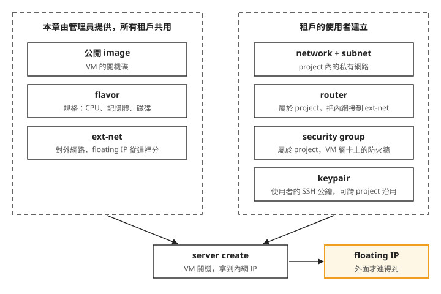
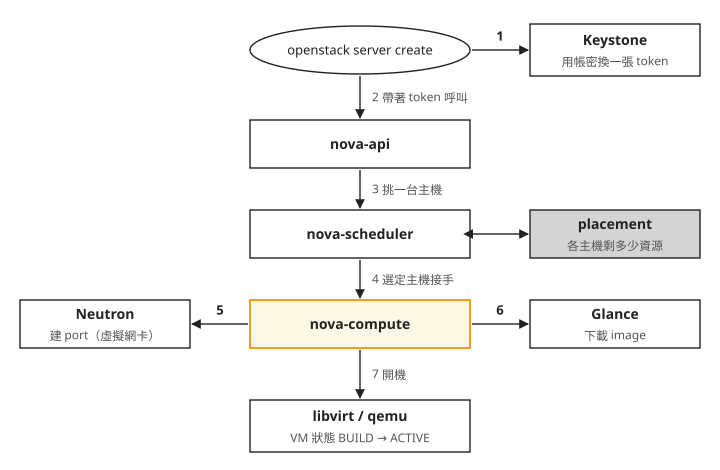
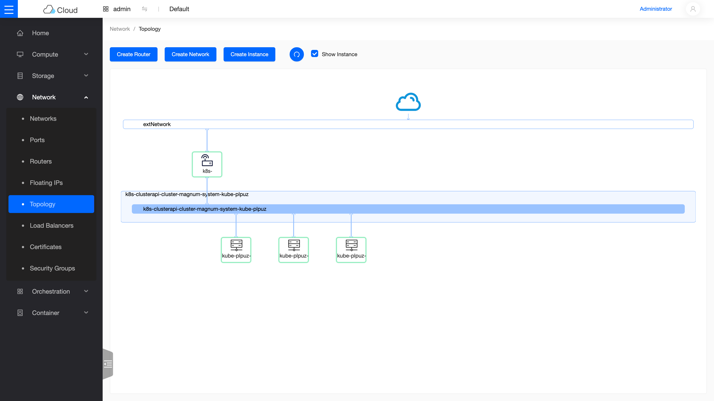

# Day 2: OpenStack 資源全流程——租戶、image、網路到 floating IP

Day 1 結束時,`openstack service list` 列出了七個服務,但這朵雲裡還沒有任何使用者的東西:沒有租戶、沒有 image、沒有網路。假設現在有一個團隊來要一台 Ubuntu VM,要能從外面 SSH 進去,VM 裡也要能上網。在公有雲上這是按幾下的事;在自己的雲上,這台 VM 需要的每一樣東西都得先有人建好。

這一章全程用 CLI,不開 Horizon,分別扮演兩個角色把整條流程走一遍:先當**雲管理員**,建立租戶、上傳 image、開出對外網路;再換成**租戶**,建自己的網路、開 VM、貼上對外 IP,最後 SSH 進去。Day 3 之後的 volume、負載平衡器、Kubernetes 叢集,都建在今天建立的租戶和網路上。

讀完之後,VM 開出來卻連不上時,你能分辨是租戶這邊少了哪一樣資源,還是主機上的閘道與 NAT 沒掛上,或是 VM 根本沒拿到你的公鑰。

## 開一台 VM 要先備齊什麼

`openstack server create` 只是一行指令,但它的參數都要指向已經存在的東西:用哪個 image 開機、用哪種規格、接哪個網路、帶哪把 SSH 公鑰。這些東西還分成兩批,一批由管理員建立、所有租戶共用,另一批由每個租戶自己建立。把今天要建的資源依建立者分開畫出來:



我們可以從圖上看到兩件事:

1. **兩批東西的建立者不同。** 左邊三樣只有管理員能建,建一次就給所有租戶用;右邊四樣是租戶在自己的範圍裡建的,其他租戶看不到。所以這一章先用管理員身分做步驟 1、2,再換成租戶身分做步驟 3、4。
2. **VM 開好時,外面還連不到它。** `server create` 之後,VM 只有租戶內網的 IP,要再貼上一個 floating IP,外面的機器才找得到它。

這些資源由 Day 1 部署的四個服務分別管理。旁邊附上 AWS 上對應的服務,用過公有雲的話可以對照著看(服務旁的小圖是各專案的官方吉祥物):

| | OpenStack 服務 | 它管什麼 | AWS 對應 |
|---|---|---|---|
| { width="56" } | **Keystone** | 帳號、租戶、權限、發 token | IAM |
| { width="56" } | **Glance** | VM 開機用的 image | AMI |
| { width="56" } | **Nova** | flavor、開 VM、決定 VM 開在哪台主機 | EC2 |
| { width="56" } | **Neutron** | 網路、router、security group、floating IP | VPC |

## 步驟 1:建立租戶、flavor 和 image

Day 1 產生的 `admin-openrc.sh` 是管理員的身分,先用它建立今天的租戶。OpenStack 裡的租戶叫 **project**:一個彼此隔離的資源範圍,裡面有自己的網路、VM 和配額,通常對應一個團隊或一個客戶。使用者本身不擁有資源,而是被加進某個 project 並給一個**角色**(role),角色決定他在這個 project 裡能做什麼。下面建立 `demo` project 和同名的使用者,給他 `member` 角色:能在 demo 裡建立和管理自己的資源,但不能做管理員的操作,例如建 flavor 或建對外網路。

接著是開機要用的兩樣東西。**image** 是 VM 的開機碟,裡面裝好了作業系統,相當於 AWS 的 AMI。**flavor** 是規格,決定一台 VM 有幾顆 vCPU、多少記憶體、多大磁碟,相當於 AWS 的 instance type。兩者都由管理員建立,所有租戶都能選用。

這一步建兩組:

- `m1.tiny`(1 vCPU、512 MB 記憶體、1 GB 磁碟)給 **cirros** 用。cirros 是專門拿來測試的迷你 Linux,image 很小、開機很快,適合拿來確認網路通不通。
- `m1.small`(2 vCPU、2 GB 記憶體、10 GB 磁碟)給 **Ubuntu 24.04** 的官方 cloud image 用,也就是團隊實際要的那台。

```bash
source ~/kolla-venv/bin/activate && source /etc/kolla/admin-openrc.sh
openstack project create --description "Sprint3 demo tenant" demo
openstack user create --project demo --password demopass123 demo
openstack role add --project demo --user demo member
openstack flavor create --vcpus 1 --ram 512  --disk 1  m1.tiny
openstack flavor create --vcpus 2 --ram 2048 --disk 10 m1.small
curl -sL -o /tmp/cirros.img https://download.cirros-cloud.net/0.6.2/cirros-0.6.2-x86_64-disk.img
openstack image create --disk-format qcow2 --container-format bare --public --file /tmp/cirros.img cirros
curl -sL -o /tmp/noble.img https://cloud-images.ubuntu.com/noble/current/noble-server-cloudimg-amd64.img
openstack image create --disk-format qcow2 --container-format bare --public --file /tmp/noble.img ubuntu-24.04
```

照順序看:第一行進入 Day 1 的 venv 並載入管理員憑證;接著三行建立 project、使用者和角色,`demopass123` 是 demo 使用者的密碼,步驟 3 換身分時會用到;再來兩行建 flavor;最後兩組 `curl` 加 `image create`,先把 image 下載到主機,再上傳給 Glance。`--disk-format qcow2` 是 QEMU 的磁碟檔格式,兩個官方 image 都是這種格式;`--public` 讓所有 project 都看得到這兩個 image。

每個 `create` 指令都會印出剛建好的資源欄位。整段跑完沒有出現錯誤訊息,這一步就完成了;這些資源要到步驟 4 開機時才真正用上。

## 步驟 2:開出對外網路,讓主機當它的閘道

租戶的 VM 要連到雲外面,或讓外面連進來,都要經過一張由管理員建立、所有租戶共用的網路,這一章叫它 `ext-net`。它是一種 **provider network**:由管理員指定它直接接在主機的哪一條實體網路上,而不是由 Neutron 自己虛擬出來。

Day 1 把 dummy0 填進 `neutron_external_interface`,Kolla 會把它接到主機上的 **br-ex**。br-ex 是 OVS(Open vSwitch,主機上的虛擬交換器軟體)的一座橋接器,Kolla 替這條接到 br-ex 的實體網路取的名字是 `physnet1`。所以下面的 `--provider-physical-network physnet1` 意思是「這張網路接在 br-ex 上」,`--provider-network-type flat` 則表示不切 VLAN,整條線就是一張網路:

```bash
openstack network create --external --provider-network-type flat \
  --provider-physical-network physnet1 ext-net
openstack subnet create --network ext-net --subnet-range 172.24.4.0/24 \
  --gateway 172.24.4.1 --no-dhcp \
  --allocation-pool start=172.24.4.100,end=172.24.4.200 ext-subnet
```

第二個指令在 ext-net 上切出 172.24.4.0/24。這張網路不直接接 VM,所以用 `--no-dhcp` 關掉自動發位址;`--allocation-pool` 限定 172.24.4.100 到 .200 這一段給 OpenStack 分配,之後 router 對外的位址和 floating IP 都從這裡拿。

subnet 宣告了閘道是 172.24.4.1,但現在沒有任何東西拿著這個位址。Day 1 說過,dummy0 不接任何線,對外網路只在主機內部有效。所以 ext-net 要通到外面,得讓主機自己扮演它的上游閘道。下面把這條路徑畫出來,由上往下是 VM 送往網際網路的封包經過的順序。圖上有幾個標記第一次出現:

- **OVN**:Day 1 在 `globals.yml` 選定的虛擬網路軟體。Neutron 收到建網路、建 router 的請求後,由 OVN 實際建出來。它用 LS(Logical Switch,邏輯交換器)表示一張網路,用 LR(Logical Router,邏輯路由器)表示一個 router。
- **Geneve**:租戶網路的封包在主機之間傳送時用的隧道封裝。
- **localnet**:OVN 把一張邏輯網路接到主機實體網路的接口,這裡接的就是 br-ex。
- **FIP**:floating IP 的縮寫,步驟 4 會介紹。

```
VM 10.10.10.x ── net1(Geneve LS)── r1(LR, SNAT/FIP)── ext-net(flat LS)
                                                          │ localnet
                                                       br-ex(host OVS bridge)
                                            host 掛 172.24.4.1/24 當「外部閘道」
                                                          │ iptables MASQUERADE
                                                        eth0 → Azure → internet
```

照著圖由上往下看:

- VM 先經過租戶網路 `net1` 到 router `r1`(兩者都在步驟 3 建立),r1 把封包轉進 ext-net。
- ext-net 透過 br-ex 進到主機。主機在 br-ex 上掛 172.24.4.1,就成了 ext-net 的閘道;有了這個位址,主機也能直接 ping、SSH 到 floating IP。
- 封包從主機的 eth0 送出去之前,還要再換一次來源位址。Azure 的網路只認 VM 網卡本身的 IP,來源是 172.24.4.x 的封包送不出去,所以用 iptables 的 **MASQUERADE** 規則,把來源位址換成 eth0 的 IP。主機還要開啟 IP forwarding,才會把封包從 br-ex 轉送到 eth0。

這三件事各是一行指令。用 `tee` 把它們寫成 `/usr/local/sbin/ext-net-fixup.sh`,`#!/bin/bash` 會是檔案的第一行:

```bash
sudo tee /usr/local/sbin/ext-net-fixup.sh <<'EOF'
#!/bin/bash
ip addr replace 172.24.4.1/24 dev br-ex && ip link set br-ex up
sysctl -qw net.ipv4.ip_forward=1
iptables -t nat -A POSTROUTING -s 172.24.4.0/24 -o eth0 -j MASQUERADE
EOF
```

這三行設的都是主機執行中的狀態,重開機就會消失,而 Day 0 設了每晚自動關機。所以把腳本包成開機時自動執行一次的 systemd 服務(`Type=oneshot`:執行完就結束),先等 30 秒,讓 OVS 把 br-ex 建好。同樣用 `tee` 寫檔,檔案第一行是標出路徑的註解,systemd 會忽略它:

```bash
sudo tee /etc/systemd/system/ext-net-fixup.service <<'EOF'
# /etc/systemd/system/ext-net-fixup.service
[Unit]
After=network-online.target
Wants=network-online.target

[Service]
Type=oneshot
ExecStartPre=/bin/sleep 30
ExecStart=/usr/local/sbin/ext-net-fixup.sh
RemainAfterExit=yes

[Install]
WantedBy=multi-user.target
EOF
```

啟用時,**先手動執行一次讓這次開機就生效**,再設定之後每次開機自動執行:

```bash
sudo chmod +x /usr/local/sbin/ext-net-fixup.sh
sudo /usr/local/sbin/ext-net-fixup.sh          # 當前這次開機就套上
sudo systemctl enable ext-net-fixup            # 之後每次開機自動重跑
```

`systemctl enable` 只設定開機時執行,當下不會跑。少了中間手動執行那一行,這次開機的 br-ex 上還沒有 172.24.4.1,步驟 4 從主機 ping、SSH floating IP 都不會通。這一步的成果要到步驟 4 才驗得到:從主機 ping 得到 floating IP,就代表 br-ex 上的閘道位址掛上了。`systemctl enable` 有印出建立 symlink 的訊息,服務就是 enabled,下次開機才會自動重掛;如果隔天連不到 VM,見[疑難排解:從主機 ping 不到 floating IP](#mine-1)。

## 步驟 3:換成租戶,建網路、router 和防火牆規則

從這一步開始用 demo 的身分操作。先準備租戶的登入憑證:把 `/etc/kolla/admin-openrc.sh` 複製成 `~/demo-openrc.sh`,打開它,找到設定使用者、project 和密碼的三行,改成:

- `export OS_USERNAME=demo`
- `export OS_PROJECT_NAME=demo`
- `export OS_PASSWORD=demopass123`(步驟 1 設的密碼)

如果檔案裡還有 `OS_TENANT_NAME`(project 的舊名稱),也一併改成 `demo`。其他行(認證網址、domain 等)不用動。下面指令區塊第一行的註解說的就是這件事。Day 3 之後的章節也會一再 `source` 這個檔。

這一步建四樣東西,依指令順序:

**租戶網路。** `network create net1` 建一張只屬於 demo 的私有網路,`subnet create` 在上面切出 10.10.10.0/24,VM 開機時從這個範圍拿內網 IP,相當於 AWS 的 VPC 和 subnet。`--dns-nameserver 8.8.8.8` 讓 VM 拿到 IP 時一併拿到 DNS 伺服器的位址。

**router。** 把 net1 接到 ext-net,相當於 AWS 的 NAT gateway。`router set r1 --external-gateway ext-net` 讓 r1 在 ext-net 上拿一個位址當對外的一端,`router add subnet` 把 subnet1 接到另一端。VM 往外送的封包經過 r1 時,來源位址會換成 r1 在 ext-net 上的位址,這叫 SNAT。

**security group。** 掛在 VM 網卡上的防火牆規則,相當於 AWS 的 Security Group。每個 project 都有一個叫 `default` 的 security group,開 VM 時沒指定就用它。它預設擋掉來自群組以外的進站連線(同一個 security group 裡的 VM 彼此可以互通),連從主機 ping 都要明確放行,所以這裡加兩條規則:放行 ICMP(ping)和 TCP 22(SSH)。

**keypair。** 最後兩行產生一對 SSH 金鑰,把公鑰登記成名為 `oslab` 的 keypair。開 VM 時指定它,公鑰會在開機時放進 VM,所以雲上的 VM 通常不用密碼登入。公鑰怎麼進到 VM 裡,步驟 4 之前會看到兩種方式。

```bash
# demo-openrc.sh = admin-openrc 改 OS_USERNAME/OS_PROJECT_NAME/OS_PASSWORD
source ~/demo-openrc.sh
openstack network create net1
openstack subnet create --network net1 --subnet-range 10.10.10.0/24 --dns-nameserver 8.8.8.8 subnet1
openstack router create r1
openstack router set r1 --external-gateway ext-net
openstack router add subnet r1 subnet1
openstack security group rule create --proto icmp default
openstack security group rule create --proto tcp --dst-port 22 default
ssh-keygen -t ed25519 -f ~/.ssh/oslab_ed25519 -N ""
openstack keypair create --public-key ~/.ssh/oslab_ed25519.pub oslab
```

這裡建的東西都屬於 demo project。換另一個 project 開 VM,網路、router、security group 規則和 keypair 都要在那個 project 裡再建一次。整段沒有出現錯誤訊息就可以往下走;router 和 security group 規則設得對不對,步驟 4 的 ping 和 SSH 會一起驗證。

## `server create` 送出之後,誰接手

下一步就要開 VM 了。先看 `server create` 送出去之後,有哪些服務依序接手。圖上的編號是先後順序:



照著編號看:

- **1、2**:CLI 先用 openrc 裡的帳密向 Keystone 換一張 token,之後呼叫其他服務都帶著它。nova-api 是 Nova 接收請求的入口。
- **3**:nova-scheduler 決定 VM 開在哪台主機。Day 1 看過的 placement 記著每台主機還剩多少 CPU、記憶體和磁碟,scheduler 依此挑選。這一章只有一台主機,但流程一樣。
- **4**:每台跑 VM 的主機上都有一個 nova-compute,選定的那一台負責接下來的事。
- **5、6**:nova-compute 向 Neutron 要一個 **port**,也就是 VM 的虛擬網卡,記著它的 MAC 位址和內網 IP,security group 規則就套在 port 上;同時向 Glance 下載 image 當開機碟。
- **7**:最後交給主機上的虛擬化軟體 libvirt 和 qemu 把 VM 開起來,狀態從 `BUILD` 變成 `ACTIVE`。

這張圖也是 VM 開不起來時的查找順序:VM 停在 `BUILD` 或變成 `ERROR`,挑不到主機就看 nova-scheduler,網卡建不出來就看 Neutron,image 下載失敗就看 Glance。Day 1 說過,每個服務都在自己的容器裡,看對應容器的 log 就好。

## VM 怎麼拿到你的公鑰 {#vm-metadata}

步驟 4 會開兩台 VM,cirros 那台照一般方式開,Ubuntu 那台多加了 `--config-drive True`。差別在 VM 開機時怎麼拿到 keypair 的公鑰這類設定資料,OpenStack 把這些資料叫做 **metadata**,有兩種方式交給 VM:


左右兩邊各是一種方式:

1. **左邊走網路。** VM 開機後對固定位址 169.254.169.254 發 HTTP 請求,主機上替這張網路準備的 haproxy 接下請求,轉給 neutron-ovn-metadata-agent,agent 再轉給 Nova。agent 和 Nova 之間用一組共用的密鑰(shared secret)確認請求的來源,兩邊設定不一致時,VM 一樣拿不到 metadata。cirros 走這條路,所以 cirros 能 SSH 進去,就代表這整條路是通的。
2. **右邊不走網路。** 加了 `--config-drive True`,Nova 會把同樣的資料打包成一顆唯讀磁碟,開機時就掛在 VM 上,稱為 **config drive**。Ubuntu 的 cloud image 開機時由 cloud-init(負責第一次開機設定的程式)讀取 metadata,有這顆磁碟就直接讀它。

Ubuntu 加 config drive 的理由,在於 cloud-init 開機的時機。OVN 替新 VM 設好網路路徑要花一點時間,cloud-init 如果在這條路還沒通的時候查 metadata,查不到就會放棄,公鑰也就不會放進 VM。config drive 開機時就已經掛著,不用等網路。

## 步驟 4:開機、貼上 floating IP、連進去

最後一個要介紹的是 **floating IP**:從 ext-net 的位址範圍分出一個位址,貼到某台 VM 上,相當於 AWS 的 Elastic IP。送到這個位址的流量,r1 會轉給 VM 的內網 IP;VM 往外送的流量也用這個位址出去。floating IP 是獨立的資源,VM 刪掉之後它還留在 project 裡,可以改貼到新的 VM。

```bash
openstack server create --flavor m1.tiny --image cirros --network net1 \
  --key-name oslab --wait vm-cirros
CFIP=$(openstack floating ip create ext-net -c floating_ip_address -f value)
openstack server add floating ip vm-cirros $CFIP
ping -c2 $CFIP && ssh -i ~/.ssh/oslab_ed25519 cirros@$CFIP uptime

openstack server create --flavor m1.small --image ubuntu-24.04 --network net1 \
  --key-name oslab --config-drive True --wait vm-ubuntu
UFIP=$(openstack floating ip create ext-net -c floating_ip_address -f value)
openstack server add floating ip vm-ubuntu $UFIP
ssh -i ~/.ssh/oslab_ed25519 ubuntu@$UFIP "ping -c2 8.8.8.8"
```

兩台 VM 的做法相同:`--wait` 讓指令等到 VM 變成 `ACTIVE` 才返回;`floating ip create ext-net` 從 172.24.4.100 到 .200 之間分出一個位址,`-c floating_ip_address -f value` 只印出位址本身,存進變數;再用 `server add floating ip` 貼上去。兩台的驗證各自檢查不同的東西:

- **cirros**:先從主機 ping floating IP。ping 得通,代表主機上的 172.24.4.1、r1 的轉送和 security group 的 ICMP 規則都正常。接著 SSH 進去執行 `uptime`,進得去就代表 TCP 22 有放行,而且公鑰經由 metadata 那條路放進了 VM。
- **Ubuntu**:開機比 cirros 慢,大約一分鐘後才連得上。貼完 floating IP 馬上 SSH 多半會逾時,這時等一分鐘再試一次。這次 SSH 進去之後,在 VM 裡 ping 8.8.8.8。這個封包走的是步驟 2 那張圖的整條路:經過 r1 的 NAT、主機的 MASQUERADE,從 eth0 出去。ping 得通,代表對外連線的每一段都設好了。DNS 也順便確認:在 VM 裡解析一個網域名稱(例如 openstack.org),拿得到位址,就代表 subnet 設的 DNS 伺服器 8.8.8.8 有生效。

cirros 能 ping 也能 SSH、Ubuntu 能 SSH、Ubuntu 裡 ping 得到 8.8.8.8 也解析得到網域名稱,四項都通,今天的流程就走完了。哪一項不通,先對照下面的[疑難排解](#troubleshooting)。

## 回頭看:剛才的指令在 OVN 裡建了什麼

回頭對照步驟 2 那張圖。net1 和 ext-net 在 OVN 裡各是一台 Logical Switch:net1 的封包用 Geneve 封裝,封裝要佔一點空間,所以 net1 的 MTU 自動扣成 1442;ext-net 多一個 localnet port,接到 physnet1,也就是 br-ex。r1 是一台 Logical Router,它的 SNAT 和每個 floating IP 都是 router 上的一條 NAT 規則,floating IP 那種叫 dnat_and_snat,用 `ovn-nbctl lr-nat-list` 看得到。security group 在 OVN 裡變成 ACL(存取控制規則),套在 port group 上;port group 是屬於同一個 security group 的 port 集合。metadata 走的就是前面那張圖左半邊的 haproxy。Day 20 會用 OVN 的工具把這些物件一一讀出來。

同一條「對外網路 → router → 租戶網路 → VM」的鏈,在儀表板的網路拓樸圖上看得更清楚:



*網路拓樸視圖:外部網路 → router → 租戶內網 → VM,跟今天用指令建立的是同一條鏈。畫面來自新一代儀表板 Skyline,[Day 13](sprint4-day13-skyline.md) 會部署它;圖中是課程後期 Kubernetes 叢集的網路。*

## 疑難排解 {#troubleshooting}

VM 是 `ACTIVE` 卻連不上時,下面三種情況最常見。前兩項都是漏了正文的某一步,第三項是沒照步驟 4 加 config drive。

### 從主機 ping 不到 floating IP {#mine-1}

**症狀**:VM 是 `ACTIVE`,從主機 ping floating IP 沒有回應,SSH 也連不上,所有 VM 都一樣。常出現在隔天重新開機之後。

**原因**:主機上的閘道位址 172.24.4.1、IP forwarding 或 MASQUERADE 規則不在。只執行了 `systemctl enable`、沒有手動跑過腳本,或開機時服務沒有執行,都會這樣。

**修法**:照步驟 2 手動執行一次 `ext-net-fixup.sh`。再看服務這次開機有沒有執行成功,只看 enabled 看不出開機時是否執行失敗:

```bash
systemctl status ext-net-fixup
```

狀態應該是 `active (exited)`;如果是 `failed`,代表開機時腳本執行失敗,下方的 log 會顯示錯誤訊息。

### VM 開機超過一分鐘,ping 不通或 SSH 仍然逾時 {#mine-2}

**症狀**:VM 是 `ACTIVE`,而且已經開機超過一分鐘,ping 不通或 SSH 逾時;其他 VM 的 floating IP 從主機連得上,所以不是主機那端的問題。

**原因**:這個 project 的 default security group 沒有放行 ICMP 或 TCP 22。security group 屬於各自的 project,在新的 project 開 VM 要重新加規則。ping 得通、SSH 逾時,就是只少了 TCP 22 那一條。

**修法**:用該 project 的身分執行步驟 3 的兩條 `security group rule create`。

### Ubuntu VM 的 SSH 回 `Permission denied (publickey)` {#mine-3}

**原因**:開 VM 時沒加 `--config-drive True`,cloud-init 查 metadata 時網路路徑還沒通,公鑰沒有放進 VM(見[VM 怎麼拿到你的公鑰](#vm-metadata))。

**修法**:刪掉這台 VM,加上 `--config-drive True` 重開。沒加 config drive 時會遇到這個症狀,依據是另一套環境的紀錄,完整分析見排錯手冊:[cirros sshd race / Ubuntu metadata race](../solutions/runtime-errors/cirros-sshd-race-vs-ubuntu-config-drive.md)。

## 想一想

- 另一個團隊也要 VM。你替他們建了 project `team-b` 和使用者,他們照步驟 3、4 建網路、開 cirros,但跳過了兩條 security group 規則。VM 是 `ACTIVE`,也貼了 floating IP。從主機 ping 它會怎樣?demo project 加過的那兩條規則能不能讓他們也通?
- 一位同學做步驟 2 時只執行了 `systemctl enable ext-net-fixup`,沒有手動跑腳本。他今天走到步驟 4 會看到什麼?隔天開機之後又會怎樣?
- 你要替租戶上傳一個同樣靠 cloud-init 做開機設定的 Rocky Linux cloud image。開 VM 時要不要加 `--config-drive True`?如果沒加,VM 開起來後 SSH 回 `Permission denied (publickey)`,而同一張網路上的 cirros 可以正常登入,你會懷疑哪一段?

## 小結

在 OpenStack 上開一台連得到的 VM,要先備齊兩批資源:管理員建立、全租戶共用的 image、flavor 和對外網路,以及租戶自己建立的網路、router、security group 和 keypair,開機之後再貼上 floating IP。在這個 lab 裡,對外網路只存在於主機內部,要靠主機在 br-ex 上掛閘道位址、開 IP forwarding、加 MASQUERADE 才通得出去,而這些設定每次開機都要重新套用。之後 VM 連不上時,先想想封包經過的每一段:主機上的閘道與 NAT、租戶的 security group 規則、router 和 floating IP,以及 VM 有沒有透過 metadata 或 config drive 拿到公鑰。

## 延伸閱讀

想再深入,可以從這幾份開始:

- **[Nova 官方「Launch instances」流程](https://docs.openstack.org/nova/2025.1/user/launch-instances.html)** —— 開 VM 需要哪些資源、有哪些開機選項的官方說明。
- **[Neutron 網路概念總覽](https://docs.openstack.org/neutron/2025.1/admin/intro-os-networking.html)** —— network/subnet/router/floating IP 這些名詞的第一手定義,provider 網與自助網的差異也在這份。
- **[官方安裝指南的「Launch an instance」](https://docs.openstack.org/install-guide/launch-instance.html)** —— 跟本章同結構的官方版 walkthrough,適合對照著看第二遍。
- **[Nova 的 Security Groups 說明](https://docs.openstack.org/nova/2025.1/user/security-groups.html)** —— 安全群組規則的完整語法與預設行為。
- **[Nova 的 Metadata 說明](https://docs.openstack.org/nova/2025.1/user/metadata.html)** —— metadata service 與 config drive 各提供哪些資料、VM 怎麼讀取。
- **[OpenStack Metadata API and OVN](https://docs.openstack.org/neutron/2025.1/contributor/internals/ovn/metadata_api.html)** —— OVN 環境下每台主機為每張網路跑一個 haproxy、再經 metadata agent 轉給 Nova 的設計說明。

## 下一步

今天開的 VM,磁碟跟著 VM 存在,VM 刪掉資料就沒了。[Day 3](sprint3-day3-cinder-lvm.md) 加上區塊儲存服務 Cinder,讓 VM 可以掛一顆獨立於 VM 的硬碟,同時示範怎麼替已經在運作的雲加上一個新服務。
