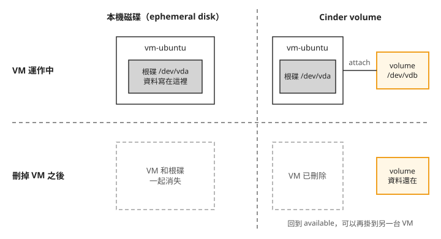
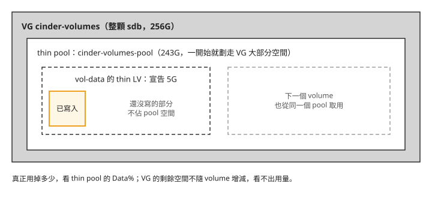
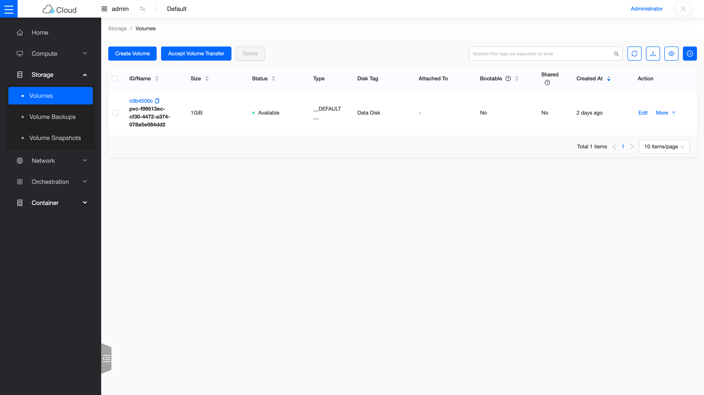

# Day 3: 用 Cinder 加上區塊儲存——LVM 後端、掛載 volume 與從 volume 開機

{ align=right width="110" }

Day 2 結束時,demo 租戶裡有兩台 VM:vm-cirros 和 vm-ubuntu。假設你在 vm-ubuntu 裡放了一些資料,後來想換一個大一點的 flavor,或是想重灌系統。最直接的做法是把 VM 刪掉重開,但這樣 VM 裡的資料會一起消失。要讓資料留得比 VM 久,需要一顆不屬於任何一台 VM 的磁碟,這就是 OpenStack 的區塊儲存服務 **Cinder** 提供的東西。

這一章先把 Day 0 留下的那顆空白 data disk 交給 Cinder 管理,再用 Day 1 學過的「改 `globals.yml`、重跑 deploy」把 Cinder 加進已經在運作的雲,最後實際建一顆磁碟、掛到 VM 上寫入資料,並從磁碟直接開一台 VM。讀完之後,volume 建不起來或掛不上時,你能分辨該先查 OpenStack 的服務狀態,還是主機的儲存設定。

## VM 的兩種磁碟

Day 2 開 VM 時,`server create` 只給了 image 和 flavor,沒有提到磁碟。Nova 會依 flavor 的磁碟大小,在跑 VM 的那台主機上建一顆根碟,把 image 寫進去。這種磁碟叫 **ephemeral disk**(本機磁碟):它是 VM 的一部分,VM 在它就在,VM 刪掉它也跟著刪掉。

Cinder 提供的是另一種,叫 **volume**:一顆由 Cinder 管理、獨立存在的磁碟。你可以把它 **attach**(掛載)到一台 VM 上,VM 裡會多出一顆 `/dev/vdb`;不用時 **detach**(卸載),它回到可用狀態,資料留在上面,之後可以再掛給另一台 VM。公有雲上的 EBS、Managed Disks 也是這一類。

下面這張圖比較兩種磁碟在刪掉 VM 前後的差別:



這張圖說明兩件事:

1. **volume 不會取代根碟。** 一般的 VM 照樣有本機根碟,volume 是額外掛上去的第二顆碟,適合放要留下來的資料。
2. **刪 VM 只影響本機磁碟。** volume 的生命週期由 Cinder 管,跟哪台 VM 無關。步驟 4 還會看到另一種用法:連根碟都放在 volume 上。

## Cinder 怎麼把一顆碟交給 VM

volume 背後總要有真正的儲存空間。Cinder 本身不實作儲存,而是透過 **backend**(後端)使用既有的儲存技術,每種 backend 由一個 driver 負責操作。這門課用的是最簡單的 **LVM backend**:直接用主機上的一顆硬碟。

這裡先認識 LVM(Logical Volume Manager)。它是 Linux 內建的磁碟管理機制,有三層:

- **PV**(physical volume):交給 LVM 管理的實體硬碟,這一章是 `/dev/sdb`。
- **VG**(volume group):一個或多個 PV 合成的空間池。Cinder 預設使用名為 `cinder-volumes` 的 VG。
- **LV**(logical volume):從 VG 裡切出來的一塊空間,用起來就像一顆獨立的硬碟。Cinder 每建一個 volume,就在 VG 裡切一個 LV。

## 步驟 1:把 data disk 做成 VG

Day 0 建 VM 時多掛了一顆 256G 的 data disk,在 VM 裡是 `/dev/sdb`,一直保持未格式化,就是留給這一步。Kolla 不會替你分割或格式化磁碟,VG 要自己先準備好,名稱用 Kolla 預設的 `cinder-volumes`。

`pvcreate` 會清掉磁碟原本的內容,所以前兩行先確認對象:`lsblk` 看容量對不對、有沒有分割或檔案系統;`blkid` 在磁碟上找不到任何格式標記時會回傳失敗,這時印出 `safe` 才動手:

```bash
lsblk -o NAME,SIZE,TYPE,MOUNTPOINT,FSTYPE /dev/sdb   # 256G、無分割、無檔案系統
sudo blkid /dev/sdb || echo "safe"                    # 無 signature 才動手
sudo pvcreate /dev/sdb
sudo vgcreate cinder-volumes /dev/sdb                 # VG 名稱 = kolla 預設 cinder_volume_group
```

確認 `sdb` 是哪一顆碟,要看容量,不要看名字。Day 0 用的 E16s_v5 沒有本機暫存碟,所以 `sdb` 就是那顆 256G 的 data disk;如果你換成名稱帶 `d` 的機型(例如 Ed16s_v5),Azure 會多掛一顆暫存碟,`sdb` 可能是它,這時要依 `lsblk` 的容量找出真正的 data disk,把上面指令裡的 `/dev/sdb` 換掉。

## 步驟 2:對已經在運作的雲加上 Cinder

Cinder 的控制路徑由三個服務組成:`cinder-api` 接收請求;`cinder-scheduler` 決定這顆 volume 要放在哪個 backend;`cinder-volume` 是實際去操作儲存的那一個,它裡面跑的就是 LVM driver。

Day 1 說過,想改設定就改 `globals.yml` 再重跑 deploy。加一個新服務也是同樣的做法:打開它的開關,重跑 deploy。因為 deploy 是冪等的,已經在運作的 Keystone、Nova、Neutron 不會被重做,Kolla 只會新增 Cinder 的容器,並更新其他服務裡跟 Cinder 有關的設定(例如 Nova 掛 volume 需要的設定),重啟設定有變動的容器。

這一章要打開兩個開關:`enable_cinder` 部署 Cinder 本身,`enable_cinder_backend_lvm` 讓它使用步驟 1 的 VG。開關會連帶打開其他東西:LVM backend 會帶起 `tgtd` 和 `iscsid` 兩個容器,負責提供與連接磁碟,步驟 3 會說明掛載時的分工;但 `enable_cinder` 還會連帶部署 **cinder-backup**,這是另一個服務,負責把 volume 備份到別的儲存系統。在 Kolla 2025.1,`enable_cinder_backup` 的預設值是 `yes`,備份目的地預設是 Ceph(一套分散式儲存系統,Day 14 才會部署),而這個環境沒有任何可用的備份目的地,它部署起來也只會處於 down 的狀態。

所以在打開 Cinder 之前,先把 cinder-backup 關掉:

```bash
echo 'enable_cinder_backup: "no"' >> /etc/kolla/globals.yml
```

接著打開兩個開關,重跑 deploy:

```bash
printf 'enable_cinder: "yes"\nenable_cinder_backend_lvm: "yes"\n' >> /etc/kolla/globals.yml
source ~/kolla-venv/bin/activate
kolla-ansible deploy -i ~/all-in-one    # 冪等重跑
```

跑完一樣看 `PLAY RECAP` 的 `failed=0`。再用管理員身分(`source /etc/kolla/admin-openrc.sh`)確認 Cinder 的服務:

```bash
openstack volume service list
```

清單裡要有兩個服務,狀態都是 `up`:`cinder-scheduler`,以及 Host 欄以 `@lvm-1` 結尾的 `cinder-volume`。`lvm-1` 是 Kolla 替這個 LVM backend 取的名字。這兩個就是控制路徑上的兩個服務;如果其中一個是 `down`,先不要往下做,去看它的 log:Kolla 把各服務的 log 寫在主機的 `/var/log/kolla/<服務名稱>/` 底下,cinder-volume 的 log 就在 `/var/log/kolla/cinder/cinder-volume.log`,從最後幾十行找 `ERROR`。

## 步驟 3:volume 的建立、掛載與卸載

切出來的 LV 在主機上,VM 卻是 qemu 跑起來的程序,中間還要一段連線。LVM backend 用的是 **iSCSI**:一種讓一台機器透過網路使用另一台機器上磁碟的協定。提供磁碟的一方叫 target,使用磁碟的一方叫 initiator。

正式環境裡,存放 volume 的儲存主機和跑 VM 的運算主機通常是不同台,iSCSI 就是讓兩邊透過網路接起來。這一章所有東西都在同一台主機上,target 和 initiator 也在同一台,連線只在主機內部繞一圈;換成多台主機,協定和設定方式都一樣,只是中間真的經過網路。

Kolla 用兩個容器實作這兩方:`tgtd` 是 target,負責把 LV 分享出去;`iscsid` 是 initiator,nova-compute 透過它連上這顆磁碟,再交給 qemu,VM 裡就多出一顆 `/dev/vdb`。

把一次「建立 volume、掛到 VM」的經過畫出來,上下分成兩條路徑:


照著圖由上往下看:

1. **上半是控制路徑,全是 OpenStack 的服務。** `cinder-api` 接收請求;`cinder-scheduler` 決定這顆 volume 要放在哪個 backend;`cinder-volume` 是實際去操作儲存的那一個,它裡面跑的就是 LVM driver。
2. **下半是資料路徑,全是 Linux 本來就有的機制。** LVM 負責切空間,iSCSI 負責把空間提供給 VM。cinder-volume 收到請求後去呼叫這些工具,所以租戶只要呼叫 API 就能拿到一顆碟,不需要登入主機。
3. **兩條路徑的交會點是 `cinder-volume`。** 這也決定了除錯的順序:volume 狀態卡在 `creating` 或變成 `error`,先確認上半的服務都正常運作;服務都正常,才往下查主機上的 VG、LV 和 iSCSI。

現在換回 demo 租戶的身分,走一次 volume 的完整生命週期:建一顆 5G 的 volume,掛到 vm-ubuntu,在 VM 裡格式化、寫一個檔案,再卸載。下面兩處 `ssh` 的 `<vm-ubuntu-floating-IP>` 都要換成 Day 2 分配給 vm-ubuntu 的 floating IP,可以從 `openstack server list` 的 Networks 欄查到。

下方原有操作在 VM 裡掛載 `/mnt`、寫入檔案後,沒有先卸載就直接 detach。正確順序是寫入後先執行 `sudo sync && sudo umount /mnt`,把資料寫回磁碟並卸載檔案系統,再執行 `server remove volume`。修正後的寫法本課沒有實跑。執行下方操作時,請在 detach 前先透過 SSH 完成這一步:

```bash
ssh -i ~/.ssh/oslab_ed25519 ubuntu@<vm-ubuntu-floating-IP> "sudo sync && sudo umount /mnt"
```

原有操作如下,執行到 `server remove volume` 前須先完成上面的卸載:

```bash
source ~/demo-openrc.sh
openstack volume create --size 5 vol-data          # → available
openstack server add volume vm-ubuntu vol-data     # VM 內出現 /dev/vdb
ssh -i ~/.ssh/oslab_ed25519 ubuntu@<vm-ubuntu-floating-IP> \
  "sudo mkfs.ext4 /dev/vdb && sudo mount /dev/vdb /mnt && echo test | sudo tee /mnt/proof.txt"
openstack server remove volume vm-ubuntu vol-data  # → available
sudo lvs cinder-volumes                            # host 端看 thin LV
```

每一行對應圖上的一段:

- `volume create` 走控制路徑,cinder-volume 在 VG 裡切出 LV。完成後狀態是 `available`,表示這顆 volume 沒有掛在任何 VM 上。
- `server add volume` 是 attach,這時資料路徑接通,VM 裡多出 `/dev/vdb`,volume 狀態變成 `in-use`。
- `ssh` 那一行在 VM 裡把 `/dev/vdb` 格式化成 ext4、掛到 `/mnt`,寫入 `proof.txt`。對 VM 來說,它就是一顆普通的空白硬碟。
- `server remove volume` 是 detach。只要前面先 `umount` 過,volume 回到 `available` 之後,剛才寫入的資料就完整留在 LV 上。
- 最後一行回到主機,用 `lvs` 列出 `cinder-volumes` 裡的 LV。註解裡的 thin LV 是 Cinder 預設建立的一種 LV,用多少才佔多少空間,下一小節說明。

### 5G 的 volume 只佔一點點空間

<span id="mine-2"></span>

建了一顆 5G 的 volume 後,可以用 `lvs` 查看 LV 的大小與用量。以下列數字為例:一個 243G、名為 `cinder-volumes-pool` 的 LV,以及一個掛在它裡面、大小 5G 的 LV,而後者的使用率只有 1.33%。這個比例是相對於它自己的 5G,大約 68 MB,不是整個 243G 的 pool。

原因是 Cinder LVM driver 的 `lvm_type` 預設是 `auto`:系統支援時就用 **thin provisioning**(精簡配置)。cinder-volume 先在 VG 裡建一個 thin pool,也就是那個 243G 的 LV;之後每顆 volume 都是 pool 裡的 thin LV,宣告的大小是 5G,但只有實際寫入的部分才從 pool 裡拿空間。剛格式化完、只寫了一個小檔案的 volume,真正寫進去的大多是 `mkfs.ext4` 建立的 journal(檔案系統用於復原的日誌)和檔案系統 metadata,`proof.txt` 本身只有幾個位元組,所以範例中只用到 5G 的 1.33%。



由於每顆 volume 只在寫入時才從 pool 拿空間,所有 volume 宣告的大小加起來可以超過 pool 的實際容量,也就是允許超額配置。要知道儲存空間還剩多少,要看 thin pool 在 `lvs` 輸出裡的 `Data%` 欄。VG 的剩餘空間在 pool 建好之後就不再隨 volume 增減,從它看不出 volume 用了多少。

pool 真的寫滿時,需要配置新區塊的寫入會卡住,最後失敗,而且 pool 裡每一顆 volume 都一樣;覆寫已經配置過的區塊則不受影響。

## 步驟 4:從 volume 開機

步驟 3 的 volume 是第二顆碟,VM 的根碟還是本機磁碟。也可以反過來,讓根碟本身就是一顆 volume,這叫 **boot-from-volume**。分兩步:先建一顆 volume 時指定 `--image cirros`,Cinder 會把 Glance 裡的 cirros image 寫進這顆 volume;再開 VM 時用 `--volume` 取代 Day 2 用的 `--image`:

```bash
openstack volume create --image cirros --size 2 vol-boot   # 把 image 灌進 volume
openstack server create --flavor m1.tiny --volume vol-boot \
  --network net1 --key-name oslab --wait vm-bfv            # 根碟在 Cinder,不在 hypervisor 本地
```

`--wait` 等到 VM 開好才回來,`vm-bfv` 的狀態是 `ACTIVE` 就成功了。這台 VM 的系統放在 Cinder 管理的 volume 上,而不是 Nova 在主機上建的本機磁碟,所以它的根碟也跟 vol-data 一樣,是 `cinder-volumes` 裡的一個 thin LV。指令註解裡的 hypervisor 指的是跑 VM 的那台主機,在這一章就是同一台 Azure VM。

### 清掉這一章建立的資源

`vol-data`、`vol-boot` 和 `vm-bfv` 只是這一章的練習,後面的章節不會用到。用 demo 租戶的身分刪掉它們。先刪 VM,`vol-boot` 掛在它上面當根碟,VM 刪掉之後才能刪:

```bash
openstack server delete --wait vm-bfv
openstack volume delete vol-data vol-boot
```

用 `--volume` 開機時,刪除 VM 不會連帶刪除那顆 volume,所以第二行要明確刪 `vol-boot`。刪完之後可以用 `openstack volume list` 確認兩顆 volume 都不在了。

## 從儀表板看成果

Skyline 是 OpenStack 的另一個網頁介面,Day 13 才會部署。下面是它的 Volume 列表,先看 volume 在介面上長什麼樣子:



*Volume 列表(Skyline 檢視):圖中那顆 1 GiB 的 `pvc-*` volume,是 Day 8 Kubernetes cluster 透過 Cinder 自動建立的,背後就是今天部署的 Cinder。*

## 想一想

- 一位同學把一顆 volume 掛到 vm-ubuntu 上,寫了資料之後把 vm-ubuntu 刪掉了。他的資料還在嗎?如果他當初是把資料寫在 vm-ubuntu 的 `/home` 底下呢?
- `openstack volume create` 之後,volume 狀態變成 `error`。`openstack volume service list` 顯示 `cinder-volume` 是 `down`。你會先去查主機上的 `lvs`,還是先看哪一個 log?為什麼?
- 你建了 20 顆 volume,每顆宣告 20G,加起來 400G,比 256G 的 data disk 還大,建立時都沒有出現錯誤。這可能嗎?要知道磁碟還剩多少空間,你會看哪個數字?

## 小結

Cinder 讓磁碟跟 VM 分開管理:volume 可以掛上、卸下、換一台 VM 再掛,VM 刪掉資料還在,也可以直接當成 VM 的根碟。它分成兩條路徑:cinder-api、cinder-scheduler、cinder-volume 組成的控制路徑屬於 OpenStack;LVM 切空間、iSCSI 把空間送到 VM 的資料路徑,是 Linux 本來就有的機制。加上 Cinder 的方式跟 Day 1 改設定一樣,先準備好 Kolla 不會替你做的 VG,再打開開關重跑 deploy,並留意開關會連帶帶起哪些服務。之後 volume 出問題時,先看 `volume service list` 確認控制路徑的服務都在,再到主機上看 VG 和 thin pool 的 `Data%`。

## 延伸閱讀

想再深入,可以從這幾份開始:

- **[Kolla-Ansible 的 Cinder 指南](https://docs.openstack.org/kolla-ansible/2025.1/reference/storage/cinder-guide.html)** —— 本章 LVM 後端設定的官方對照,也列出其他後端(NFS、Ceph)的接法。
- **[Cinder LVM driver 參考](https://docs.openstack.org/cinder/2025.1/configuration/block-storage/drivers/lvm-volume-driver.html)** —— 這個 driver 的完整設定選項與限制,包括決定 thin provisioning 的 `lvm_type`。
- **[Cinder 磁碟區操作手冊](https://docs.openstack.org/cinder/2025.1/cli/cli-manage-volumes.html)** —— 建立、掛載、快照、擴容的官方 CLI 流程。

## 下一步

VM 現在有了網路和可以留下來的磁碟。[Day 4](sprint3-day4-octavia.md) 再加一個服務:負載平衡器 Octavia,讓多台 VM 共用一個對外的位址。
