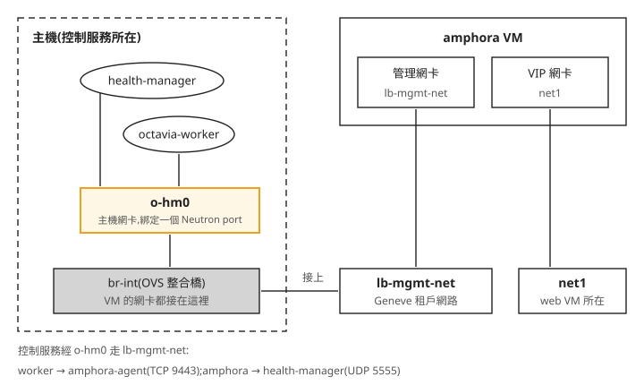
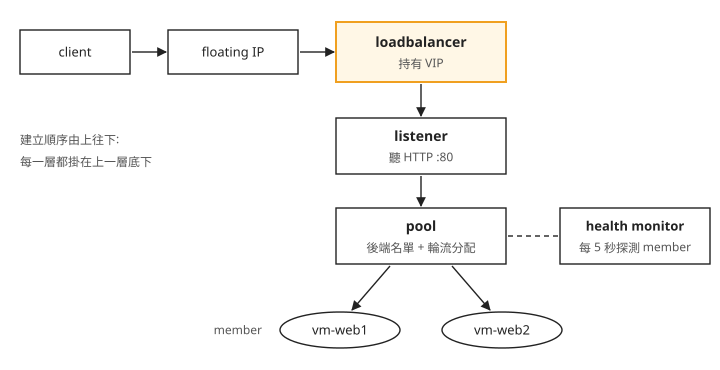
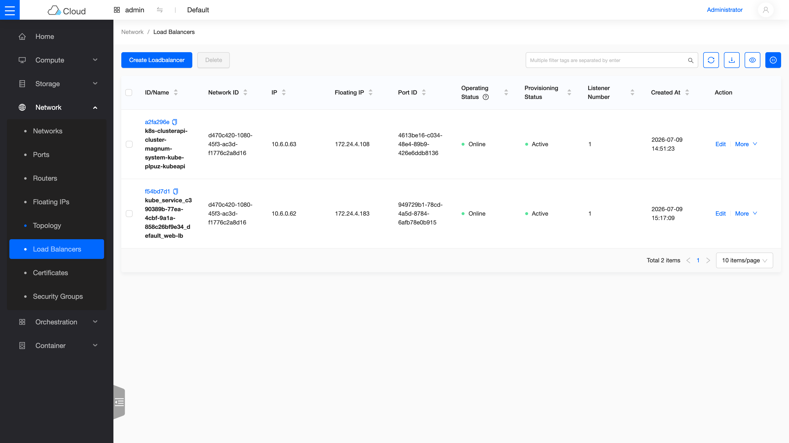

# Day 4: 用 Octavia 建負載平衡器——amphora、管理網路與 listener/pool/member

{ align=right width="110" }

Day 2 開出來的 VM,靠一個 floating IP 讓外面連得到。假設現在有兩台 VM 跑同一個網站,你希望使用者只記一個位址,請求平均分給兩台;其中一台當機時,請求就不要再送過去。floating IP 一次只能綁在一台 VM 上,做不到這件事,需要的是一台**負載平衡器**(load balancer,以下簡稱 LB):使用者一律連到它,由它決定把每個請求轉給後面哪一台。

OpenStack 提供 LB 的服務叫 **Octavia**。這一章用 Kolla 把 Octavia 加進 Day 1 部好的雲,再以租戶身分建一台 LB,放在兩台 web VM 前面,最後對它連續 `curl` 幾次,看回應是不是在兩台之間輪流出現。讀完之後,LB 卡在 `PENDING_CREATE`、或後端被標成 `ERROR` 時,你能判斷問題出在 Octavia 的控制服務、amphora 的管理網路,還是後端的 VM 本身。

## Octavia 的 LB 是一台 VM

在 Octavia 的預設做法裡,你每建一台 LB,Octavia 就替你開一台小 VM,裡面跑著開源的負載平衡軟體 haproxy。這台 VM 叫 **amphora**,它就是 LB 本體:使用者的流量進到 amphora,由裡面的 haproxy 轉給後端。

Octavia 自己的程式不轉送任何流量,它們負責管理 amphora。下面這張圖把 Octavia 的容器和 amphora 分成上下兩層,上層是**控制面**(負責建立、設定、監控),下層是**資料面**(使用者的流量實際走過的地方):


照著圖由上往下看:

1. **octavia-worker 做實際的建立工作。** 你下 `openstack loadbalancer create`,API 收下請求後交給 worker,worker 請 Nova 開 amphora、請 Neutron 給它一個對外的位址,再把 haproxy 的設定推進去。
2. **health-manager 負責顧 amphora。** 每台 amphora 定期用 UDP 5555 回報心跳,太久沒收到,health-manager 就判定那台 amphora 壞了,開一台新的取代它(這個動作叫 failover)。
3. **使用者的流量只經過下層。** 控制面的容器停掉,已經建好的 LB 還是照常轉送;受影響的是建新 LB、改設定和 failover。

所以 LB 出問題時,先分清楚是哪一層:建不出來、狀態卡住,看控制面;建好了但連不到後端,看資料面。

## 開始之前

這一章接在 Day 2、Day 3 之後,需要:

- Day 1 部好的雲,以及 kolla 的 venv(`source ~/kolla-venv/bin/activate`)。
- Day 2 以租戶身分建好的資源:`~/demo-openrc.sh`、網路 `net1` 與子網 `subnet1`、對外網路 `ext-net`、keypair `oslab`、flavor `m1.small`、image `ubuntu-24.04`。主機要能直接連到 `ext-net` 上的 floating IP(Day 2 在 `br-ex` 掛的 `172.24.4.1`)。

每台 amphora 都會佔用一份 Nova 的資源:Kolla 預設替 amphora 建的 flavor 是 1 vCPU、1 GB 記憶體、5 GB 磁碟。

## 步驟 1:準備 image、管理網路與憑證

Octavia 開 amphora 時,需要一個裝好 haproxy 和 amphora-agent(amphora 上接收控制服務指令的程式)的 image。官方做法是用 diskimage-builder 自己建,約 15 分鐘,而且需要 debootstrap。[OSISM 每月發布預建的 amphora image](https://github.com/osism/openstack-octavia-amphora-image),有對應 2025.1 的版本,這一章直接下載它。正式環境建議自己建:image 裡裝了什麼、多久更新一次,由你決定。

接下來的設定裡,最需要先弄懂的是 amphora 的管理網路。

### amphora 的管理網路:lb-mgmt-net 與 o-hm0

上一節的圖裡,worker 要連到 amphora-agent 推設定(TCP 9443),amphora 要把心跳送回 health-manager(UDP 5555)。這兩條連線都需要一個網路,讓主機上的 Octavia 容器和 amphora 互相連得到。這個網路叫 **lb-mgmt-net**,只給 Octavia 管理用,不走租戶的流量。

麻煩在於 amphora 是 VM,它的網卡接在 Neutron 的虛擬網路上;Octavia 的容器跑在主機上,用的是主機的網路。兩邊要接上,Kolla 提供兩種模式,用 `octavia_network_type` 選:

| | provider 模式(Kolla 預設) | tenant 模式(本課採用) |
|---|---|---|
| lb-mgmt-net 是什麼 | 一個實體的 VLAN 或 flat 網路(flat:不分 VLAN、直接用整個實體網段) | 一個普通的 Geneve 租戶網路,跟 Day 2 的 `net1` 同一種 |
| 主機怎麼接進去 | 主機的實體網卡本來就在那個網段上 | Kolla 在 lb-mgmt-net 上建一個 Neutron port,再在主機上造一張叫 **o-hm0** 的網卡,掛到 br-int 並標上那個 port 的 ID |
| 適合 | 有真實網路設備的正式環境 | 沒有 VLAN 可用的單機實驗環境,例如 Azure VM |

這台 Azure VM 沒有第二個實體網段可以給 Octavia,所以用 tenant 模式。它的接法畫成圖是這樣:



照著圖看兩個重點:

1. **o-hm0 讓主機在虛擬網路裡看起來像一台 VM。** 這件事分三步完成:
    - br-int 是 Open vSwitch 的整合橋,所有 VM 的網卡都接在上面。Kolla 把 o-hm0 加到 br-int,並在這個介面上標記 lb-mgmt-net 上那個 Neutron port 的 ID(`iface-id`)。這個動作的核心是 `ovs-vsctl add-port br-int o-hm0 -- set Interface o-hm0 external-ids:iface-id=<port_id>`,實際在 `openvswitch_vswitchd` 容器裡執行,參數比這裡多。
    - 主機上負責虛擬網路的 ovn-controller 依 `iface-id` 把 o-hm0 對應到那個 port,o-hm0 從此接在 lb-mgmt-net 上。
    - o-hm0 再用 DHCP 從 lb-mgmt-net 要一個 IP。
2. **amphora 有兩張網卡。** 一張在 lb-mgmt-net,讓控制服務管理它;另一張在 LB 所服務的網路上(這一章是 `net1`),持有 LB 的 **VIP**:LB 對外的固定位址(跟 Day 1 的 VIP 一樣,是一個不屬於某台機器固定網卡的位址)。

!!! warning "tenant 模式配 OVN 不在官方支援範圍內"
    Kolla 2025.1 的文件把 tenant 模式列為開發與測試用途,只標明支援 Open vSwitch 的 Neutron 設定,不建議用在正式環境。這門課的 Neutron 用的是 OVN,Kolla 的 Octavia prechecks 會擋下這個組合,錯誤訊息是 `Neutron plugin agent ovn is not supported when octavia_network_type is tenant, only openvswitch is supported currently`。同一組 prechecks 也會檢查 Redis(或 Valkey)有沒有打開,見下面的「還要補兩樣」。

    Day 1 說過 prechecks 沒過就不要繼續。這一章是例外:prechecks 一定會因為上面這條失敗,而本課選擇用 tenant 模式換一個能在單機 Azure VM 上跑的 amphora,所以直接 deploy、不跑 prechecks。這樣實際能運作:上面第 1 點的 iface-id 接法,ovn-controller 一樣認得。跳過 prechecks 的代價是其他檢查也一併沒跑,這一章需要的另外兩個條件(Redis、dhclient)要照步驟 1 自己補,deploy 完也要照步驟 2 自己確認容器和 o-hm0。代價會在 Day 22 出現:那天全量 prechecks 擋下這行設定,最後把 Octavia 改成只用 OVN provider,amphora 從此不能再用,細節見 Day 22 的[prechecks 擋下 Octavia 設定](sprint4-day22-upgrade-backup.md#mine-1)。跟著本課做實驗可以沿用;正式環境請用 provider 模式。

### 控制服務與 amphora 互相驗證

worker 對 amphora-agent 下的指令,等於能改掉一台 LB 的全部設定,所以兩邊連線時要互相驗證身分,用的是雙向 TLS(mTLS):不只 amphora 出示憑證,控制服務也要出示。Kolla 用兩個獨立的 CA 簽這兩邊的憑證:

- `server_ca`:簽 amphora 的憑證,控制服務靠它確認對方真的是自己開的 amphora。
- `client_ca`:簽控制服務的憑證,amphora 靠它確認下指令的是 Octavia。

`kolla-ansible octavia-certificates` 先在 `/etc/kolla/octavia-certificates/` 產生兩個 CA 和控制服務的憑證,再把部署要用的四個檔複製到 `/etc/kolla/config/octavia/`:`client.cert-and-key.pem`、`client_ca.cert.pem`、`server_ca.cert.pem`、`server_ca.key.pem`。`server_ca` 的私鑰會複製過去,因為控制服務每開一台 amphora,都要用它簽那台 amphora 的憑證;`client_ca` 的私鑰不複製,所以控制服務和 amphora 上都沒有能簽出新的控制服務憑證的金鑰,拿到一台 amphora 的內容也沒辦法冒充控制服務。

### 下載 image、改設定、產生憑證

下面這段做三件事。第一段下載 amphora image;檔案不小,可以另開一個終端機跑,同時做後面的設定。中間三行是要加進 `/etc/kolla/globals.yml` 的設定,不是指令,用編輯器加到檔尾即可:`enable_octavia` 打開 Octavia、`octavia_network_type` 選 tenant 模式、`octavia_auto_configure` 讓 Kolla 自動建好 lb-mgmt-net、router、amphora 用的 flavor、security group 和 keypair。最後一行產生憑證:

```bash
# amphora image(背景下載)
curl -sL -o /tmp/amphora.qcow2 \
  https://nbg1.your-objectstorage.com/osism/openstack-octavia-amphora-image/octavia-amphora-haproxy-2025.1.qcow2

# globals.yml
enable_octavia: "yes"
octavia_network_type: "tenant"
octavia_auto_configure: yes     # kolla 自建 lb-mgmt-net/router/flavor/SG/keypair

# 憑證(注意:這個子指令也要 -i,否則找預設 inventory 路徑會出錯)
kolla-ansible octavia-certificates -i ~/all-in-one
```

`octavia-certificates` 跟 deploy 一樣要帶 `-i ~/all-in-one`,漏了會報 `Path does not exist`,見[疑難排解:`octavia-certificates` 找不到 inventory](#mine-1)。

### 還要補兩樣:Redis 和 dhclient

照上面的設定直接 deploy,會連續遇到兩個問題,先在這裡補好。

第一個是 Redis。worker 收到建 LB 的請求後,不是當場做完,而是先把這件工作放進一個任務佇列,再由 worker 取出來執行;做到一半 worker 重啟,工作還在佇列裡,可以接著做。這個佇列叫 **jobboard**,存在 Redis(一套放在記憶體裡的鍵值資料庫,常用來做佇列和快取)裡;Kolla 2025.1 也接受用 Valkey 取代 Redis,本課用的是 Redis。Kolla 2025.1 只要啟用了 amphora provider,就會打開 jobboard,但 Redis 的開關 `enable_redis` 預設是 `no`,打開 Octavia 不會連帶打開它。有跑 prechecks 的話,會在這裡被擋下,訊息是 `Redis or Valkey must be enabled when using octavia jobboard`;這一章跳過了 prechecks,少了 Redis 時 Octavia 的容器全都正常,直到建第一台 LB 才失敗,而且失敗的方式是卡住不動(見[疑難排解:LB 卡在 PENDING_CREATE](#mine-3))。所以先打開 Redis:

```bash
echo 'enable_redis: "yes"' >> /etc/kolla/globals.yml
```

第二個是 o-hm0 要 IP 的方式。Kolla 替 o-hm0 產生的 systemd 服務 `octavia-interface.service`,寫死用 `/sbin/dhclient` 要 DHCP,但 Ubuntu 24.04 的 cloud image 已經不內建這個程式(套件 isc-dhcp-client)。先在主機上裝好:

```bash
sudo apt install -y isc-dhcp-client
```

## 步驟 2:deploy

設定和憑證都齊了。跟 Day 1 學到的一樣,改完 `globals.yml` 就重跑部署:

```bash
kolla-ansible deploy -i ~/all-in-one
```

結尾一樣看 `PLAY RECAP` 的 `failed=0`。跑完後確認兩件事。第一,`sudo docker ps` 裡 Octavia 的五個容器都是 `Up`:`octavia_api`、`octavia_worker`、`octavia_health_manager`、`octavia_housekeeping`,以及 OVN provider 需要的 `octavia_driver_agent`。第二,o-hm0 拿到了 lb-mgmt-net 的位址:

```bash
ip -br addr show o-hm0
```

狀態要是 `UP`,而且有一個 `10.1.0.x` 的位址。`10.1.0.0/24` 是 Kolla 給 lb-mgmt-subnet 的預設網段,這個位址由 OVN 內建的 DHCP 發出;拿得到它,代表上一步圖上的 o-hm0 → br-int → lb-mgmt-net 這條路通了。如果 deploy 停在 `Restart octavia-interface.service`,見[疑難排解:octavia-interface.service 起不來](#mine-2)。

## 步驟 3:建一台 LB,放在兩台 web VM 前面

這一步的指令放在同一段裡,但請一段一段貼,不要整段一次貼上:中間要先查到兩台 web VM 的 IP,再填進建 member 的指令。先看會建出哪些東西。

### LB 由哪些物件組成

在 Octavia 裡,「一台能用的 LB」是好幾個物件疊起來的,每個物件掛在上一個底下。下面這張圖由上往下就是建立的順序:



照著圖由上往下:

1. **loadbalancer**:LB 本身,持有 VIP。建它的時候 Octavia 才會開 amphora。
2. **listener**:LB 在哪個 port、用什麼協定收請求,這裡是 HTTP 的 80。一台 LB 可以有好幾個 listener,例如同時聽 80 和 443。
3. **pool**:後端的名單,加上分配的方式。`ROUND_ROBIN` 是依序輪流,第一個請求給第一台、第二個給第二台,以此類推。
4. **member**:名單上的每一台後端,用「IP + port」指定。
5. **health monitor**:掛在 pool 上,定期探測每個 member。這一章的設定是每 5 秒(`--delay 5`)送一次 HTTP 請求到 `/`,3 秒(`--timeout 3`)沒回應算一次失敗;失敗太多次的 member 會被標成 `ERROR`,不再分到流量,恢復後連續成功 3 次(`--max-retries 3`)才重新標回 `ONLINE`。

最外層的 floating IP 是 Day 2 學過的:把 `ext-net` 上的一個位址對應到某個 port。這次對應的是 VIP 的 port,所以主機打 floating IP,就會進到 LB。

### 準備 web VM 的開機腳本

兩台 web VM 開機時,要在 80 port 起一個 HTTP 服務,回應自己的 hostname,這樣從回應就看得出請求被送到哪一台。開機時自動執行的腳本叫 **user-data**,由 cloud-init 在 VM 第一次開機時執行。最小可用的版本如下(Ubuntu 24.04 內建 python3),存成主機上的 `/tmp/web-userdata.sh`,下面的指令會用 `--user-data` 把它交給 VM:

```bash
#!/bin/bash
hostname > /root/index.html
cd /root && python3 -m http.server 80
```

### 建 LB 的整段指令

整段指令分成四部分,先說明再貼:

- **上傳 amphora image**(admin 身分)。image 要上傳到 Octavia 自己的 project,並加上 `amphora` 這個 tag,Octavia 開 amphora 時是用 tag 找 image。那個 project 的 ID 寫在 `octavia.conf` 的 `amp_image_owner_id`,`octavia_auto_configure` 已經填好,第一行從 worker 容器裡讀出來。最後一行 `pip install python-octaviaclient` 裝的是 `openstack loadbalancer` 系列指令,它不在 Day 1 裝的 `python-openstackclient` 裡,要另外裝進 venv。
- **開兩台 web VM**(租戶身分)。先在 `default` security group 放行 TCP 80,否則 LB 和 health monitor 都連不到 VM 的 80 port。`server create` 這行建 `vm-web1`,同一行把最後的名字換成 `vm-web2` 再跑一次。`--config-drive True` 讓 VM 從一個掛載的唯讀磁碟讀 user-data,跟 Day 2 開 Ubuntu VM 時一樣。
- **建 LB 的物件**,順序跟上面的圖一樣。每一行都帶 `--wait`,等這個物件建好再往下。第一行 `loadbalancer create` 會開 amphora,約 2 到 4 分鐘。LB 的名字 `lb2` 可以自己取,後面的指令跟著改即可。
- **把 floating IP 接到 VIP,然後從主機 `curl` 六次。**

`member create` 那兩行的 `10.10.10.124`、`10.10.10.188` 是本課兩台 web VM 的 IP,你的幾乎一定不同。兩台 VM 建好後,先查它們在 `net1` 上的 IP,再代入:

```bash
openstack server show vm-web1 -c addresses -f value   # 取 net1 上的 fixed IP
```

填錯的話,health monitor 會把兩個不存在的 member 標成 `ERROR`,錯誤訊息不會告訴你是 IP 抄錯了。

```bash
# image 上傳到 octavia.conf 的 amp_image_owner_id 那個 project,tag 必須是 amphora
AMP_PROJECT=$(sudo docker exec octavia_worker grep amp_image_owner_id /etc/octavia/octavia.conf | awk '{print $3}')
source /etc/kolla/admin-openrc.sh
openstack image create amphora-x64-haproxy --file /tmp/amphora.qcow2 \
  --disk-format qcow2 --container-format bare --private --tag amphora \
  --project $AMP_PROJECT --property hw_architecture=x86_64 --property hw_rng_model=virtio
pip install python-octaviaclient

# 兩台 web member(user-data 起 http server 回 hostname)
source ~/demo-openrc.sh
openstack security group rule create --proto tcp --dst-port 80 default
openstack server create --flavor m1.small --image ubuntu-24.04 --network net1 \
  --key-name oslab --config-drive True --user-data /tmp/web-userdata.sh --wait vm-web1   # web2 同

# LB 全流程(第一次 create 會觸發 amphora VM 開機,2-4 分)
openstack loadbalancer create --name lb2 --vip-subnet-id subnet1 --wait
openstack loadbalancer listener create --name listener1 --protocol HTTP --protocol-port 80 --wait lb2
openstack loadbalancer pool create --name pool1 --lb-algorithm ROUND_ROBIN --listener listener1 --protocol HTTP --wait
openstack loadbalancer member create --subnet-id subnet1 --address 10.10.10.124 --protocol-port 80 --wait pool1
openstack loadbalancer member create --subnet-id subnet1 --address 10.10.10.188 --protocol-port 80 --wait pool1
openstack loadbalancer healthmonitor create --name hm1 --delay 5 --max-retries 3 --timeout 3 --type HTTP --url-path / --wait pool1

# VIP 掛 FIP → host 直接打
VIPPORT=$(openstack loadbalancer show lb2 -c vip_port_id -f value)
LBFIP=$(openstack floating ip create ext-net -c floating_ip_address -f value)
openstack floating ip set --port $VIPPORT $LBFIP
for i in $(seq 6); do curl -s http://$LBFIP/; done   # web1/web2 交替 = round robin
```

最後那個迴圈印出六行 hostname,`vm-web1` 和 `vm-web2` 一行一行交替出現,代表請求從 floating IP 進到 amphora,再由 haproxy 依序輪流送到兩台 VM。再看一下 health monitor 對兩個 member 的判斷:

```bash
openstack loadbalancer member list pool1
```

兩個 member 的 `operating_status` 都要是 `ONLINE`,`provisioning_status` 是 `ACTIVE`。如果有一個是 `ERROR`,health monitor 對它的探測一直失敗,那台 VM 不會分到流量。

如果結果不對,照第一節的兩層往回查:

- `loadbalancer create` 一直沒回來,`openstack loadbalancer show lb2` 的 `provisioning_status` 停在 `PENDING_CREATE`:問題在控制面,amphora 可能根本沒開。先看 worker 的 log,見[疑難排解:LB 卡在 PENDING_CREATE](#mine-3)。
- amphora 開起來了,LB 最後卻變成 `ERROR`:worker 會反覆嘗試連 amphora-agent 的 9443 port 推設定,一直連不上就放棄,把 LB 標成 `ERROR`。這時查管理網路:o-hm0 有沒有 `10.1.0.x` 的位址(步驟 2)、amphora 在 lb-mgmt-net 上有沒有位址。
- LB 是 `ACTIVE`,但 `curl` 沒有回應或只回一台:問題在資料面或後端。檢查 member 的 IP 有沒有填對、`default` security group 有沒有放行 80、VM 的 user-data 有沒有把 HTTP 服務跑起來。
- 想確認 amphora 本身:以 admin 身分執行 `openstack loadbalancer amphora list`,正常的 amphora 狀態是 `ALLOCATED`,角色是 `STANDALONE`(單台,沒有備援),並且有一個 lb-mgmt-net 上的 `10.1.0.x` 位址。

## 步驟 4:OVN provider,不開 amphora 的 LB

Octavia 用同一套 API 管理 LB,背後真正實作 LB 的程式可以換,這個可以替換的實作叫 **provider**。前面用的是預設的 `amphora`。Neutron 用 OVN 時,Kolla 會再註冊第二個 provider:`ovn`。它把負載平衡規則直接寫進 OVN 的流量規則,由 OVN 在轉送封包時完成分配,不開任何 VM。

建法幾乎一樣,只多一個 `--provider ovn`,但協定和演算法要換:

```bash
openstack loadbalancer create --name lb-ovn --provider ovn --vip-subnet-id subnet1 --wait
openstack loadbalancer listener create --name lis-ovn --protocol TCP --protocol-port 80 --wait lb-ovn
openstack loadbalancer pool create --name pool-ovn --lb-algorithm SOURCE_IP_PORT --listener lis-ovn --protocol TCP --wait
openstack loadbalancer member create --subnet-id subnet1 --address 10.10.10.124 --protocol-port 80 --wait pool-ovn
# 特徵:L4 only、SOURCE_IP_PORT、無 amphora VM、規則直接進 OVN 流表
```

跟 amphora provider 比,差別在這幾個參數上:

- listener 是 `TCP`,不是 `HTTP`。OVN provider 只支援 TCP、UDP、SCTP(一種跟 TCP 同層、常用在電信系統的傳輸協定),看不懂 HTTP 內容,所以不能依網址路徑分流這類 L7 功能。
- 演算法是 `SOURCE_IP_PORT`:依來源 IP 和 port 決定送往哪一台,這也是 OVN provider 唯一支援的演算法,沒有 `ROUND_ROBIN`。
- health monitor 只支援 TCP 和 UDP-CONNECT 兩種。
- 建好之後 `openstack loadbalancer amphora list` 不會多出 amphora,沒有額外的 VM 佔資源,也不用等 VM 開機。

建好之後,`openstack loadbalancer show lb-ovn` 的狀態應該是 `ACTIVE`/`ONLINE`。這個 LB 沒有掛 floating IP,要測試就從租戶網路內(例如 `net1` 上的另一台 VM)連它的 VIP。需要 HTTP 層的功能(依路徑分流、HTTP 健康檢查)時用 amphora;只需要把 TCP 連線分散到幾台後端、又不想多開 VM 時,可以考慮 OVN provider。

## 從儀表板看成果

下面是 Skyline 儀表板的 Load Balancer 列表:



*Load Balancer 列表(Skyline 檢視):圖中兩台 LB 都是 Day 8 建 Kubernetes cluster 時自動建立的,`kubeapi` 是 cluster API 的入口,`web-lb` 由 `Service type=LoadBalancer` 產生(Kubernetes 裡要求雲端提供 LB 的宣告方式,Day 8 會介紹)。Operating Status 的 Online 來自 health monitor 的持續探測,就是這一章設定的機制。*

這一章建的 `lb2`、`lb-ovn` 和兩台 web VM 會一直佔著 Nova 的磁碟額度,關機也一樣。Day 8 會因為磁碟不夠開不出新的 amphora,先把它們刪掉,見 Day 8 的[「LB 的 amphora 開不出來,Nova 報 `No valid host was found`」](sprint3-day8-e2e-workload-cluster.md#mine-4)。

## 疑難排解

### `octavia-certificates` 找不到 inventory {#mine-1}

**症狀**:`kolla-ansible octavia-certificates` 報 `Path does not exist`,找的是 `/etc/kolla/ansible/inventory/all-in-one`。

**原因**:這個子指令跟 deploy 一樣,沒帶 `-i` 時會去找預設的 inventory 路徑。照步驟 1 帶上 `-i ~/all-in-one` 即可。

### octavia-interface.service 起不來,`status=203/EXEC` {#mine-2}

**症狀**:deploy 停在 `Restart octavia-interface.service`;`systemctl status octavia-interface` 顯示 `dhclient ... status=203/EXEC`,意思是要執行的檔案不存在。

**原因**:Ubuntu 24.04 的 cloud image 沒有 dhclient,Kolla 產生的服務卻寫死 `/sbin/dhclient`。步驟 1 已經先裝了 isc-dhcp-client;如果是在裝之前就跑了 deploy,裝好後重啟服務,再只補跑 Octavia 的部分:

```bash
sudo apt install -y isc-dhcp-client
sudo systemctl reset-failed octavia-interface.service
sudo systemctl start octavia-interface.service
ip -br a show o-hm0        # 應拿到 lb-mgmt-subnet 的 IP(OVN 原生 DHCP 發的)
kolla-ansible deploy -i ~/all-in-one --tags octavia   # 補跑剩餘任務
```

更完整的記錄見排錯手冊:[octavia-interface 的 dhclient 問題](../solutions/integration-issues/kolla-octavia-dhclient-noble.md)。

### LB 卡在 PENDING_CREATE,amphora 沒有開機 {#mine-3}

**症狀**:`loadbalancer create` 之後 LB 一直停在 `PENDING_CREATE`,Nova 裡看不到 amphora,Octavia 的容器卻都正常。worker 的 log 有 `MasterNotFoundError: No master found for 'kolla'` 和 `Error 111 connecting to 127.0.0.1:6379`。

**原因**:amphora provider 的 jobboard 需要 Redis,而 `enable_redis` 預設是 `no`,見步驟 1 的「還要補兩樣」。如果 deploy 時還沒打開 Redis,補上後只部署 Redis 和 Octavia:

```bash
echo 'enable_redis: "yes"' >> /etc/kolla/globals.yml
kolla-ansible deploy -i ~/all-in-one --tags redis,octavia
```

更完整的記錄見排錯手冊:[amphora 的 Redis jobboard 問題](../solutions/integration-issues/kolla-octavia-redis-jobboard.md)。Redis 修好之前建的 LB 不會自己恢復,刪除方式見下一項。

### 卡在 PENDING 的 LB 刪不掉 {#mine-5}

**症狀**:Redis 沒開時建的 LB 永遠停在 `PENDING_CREATE`,`openstack loadbalancer delete` 回 409。

**原因**:Octavia 不允許修改或刪除狀態是 `PENDING_*` 的 LB,要等處理中的工作結束。可是這件工作從來沒有進到 jobboard,不會有任何程式把它的狀態改掉。Octavia 沒有提供重置這種狀態的官方工具。

**修法**:社群常用的做法是進 MariaDB,把那台 LB 在 `load_balancer` 表裡的 `provisioning_status` 改成 `ERROR`,再用 `openstack loadbalancer delete --cascade` 連同底下的物件一起刪掉。SQL 寫法見排錯手冊的[後遺症一節](../solutions/integration-issues/kolla-octavia-redis-jobboard.md)。直接改資料庫只適合實驗環境;正式環境遇到,先找維運團隊或廠商處理。

### 找不到 `/etc/kolla/octavia-openrc.sh` {#mine-4}

**症狀**:Kolla 的 Octavia 文件用 `/etc/kolla/octavia-openrc.sh` 上傳 amphora image,但主機上沒有這個檔。

**原因**:這個檔由 `kolla-ansible post-deploy` 產生,而且只在 `enable_octavia` 為 `yes` 時才產生。這一章打開 Octavia 之後只跑了 deploy,沒有重跑 post-deploy。需要這個檔的話,打開 Octavia 之後重跑 `kolla-ansible post-deploy -i ~/all-in-one`,就會產生 Octavia 的 openrc。不需要這個檔也能完成本章:步驟 3 用 admin 身分加上 `--project $AMP_PROJECT`,把 image 放進同一個 project。

## 想一想

- 同學建 LB 之後等了十分鐘,狀態還是 `PENDING_CREATE`,`openstack server list --all-projects` 也看不到任何 amphora。你會先看 Octavia 的哪個容器、找什麼訊息?如果 amphora 有開起來、但 LB 最後變成 `ERROR`,你會改查哪一段網路?
- 一台 LB 運作正常時,主機上的 `octavia_worker` 和 `octavia_health_manager` 容器都停了。正在 `curl` 這台 LB 的使用者會發現嗎?這段期間如果 amphora 當機,會發生什麼事?
- 有個服務只需要把 TCP 連線分給三台後端,不需要看 HTTP 內容,而且這朵雲的運算資源很吃緊。你會選 amphora 還是 ovn provider?如果需求變成要依網址路徑把 `/api` 送到另一組後端呢?

## 小結

Octavia 的預設做法是替每台 LB 開一台 amphora VM,裡面的 haproxy 處理使用者的流量;Octavia 的容器負責開 amphora、推設定、收心跳、壞了就換一台,控制服務停掉不影響已經在轉送的流量。控制服務要連到 amphora,需要管理網路 lb-mgmt-net,單機環境用 tenant 模式,讓主機透過 o-hm0 這張網卡接進去,兩邊用各自的 CA 互相驗證。一台能用的 LB 由 loadbalancer、listener、pool、member 疊成,health monitor 決定哪些 member 能分到流量。之後遇到 LB 的問題,先分清楚是建不出來(看 worker 和 jobboard)、amphora 失聯(看 o-hm0 和 lb-mgmt-net),還是建好了卻連不到後端(看 member、security group 和後端服務本身)。

## 延伸閱讀

想再深入,可以從這幾份開始:

- **[Octavia 官方介紹](https://docs.openstack.org/octavia/2025.1/reference/introduction.html)** —— amphora 架構與各個控制服務的官方說明。
- **[Kolla-Ansible 的 Octavia 指南](https://docs.openstack.org/kolla-ansible/2025.1/reference/networking/octavia.html)** —— 憑證產生、管理網路的兩種模式、OVN provider 的設定,本章最容易卡住的幾步都在這裡。
- **[Octavia Basic Cookbook](https://docs.openstack.org/octavia/2025.1/user/guides/basic-cookbook.html)** —— 各種 LB 組法(TCP、HTTP、健康檢查、TLS)的官方範例,本章只做了最基本的一種。
- **[OVN Octavia provider 說明](https://docs.openstack.org/ovn-octavia-provider/2025.1/admin/driver.html)** —— OVN provider 支援的協定、演算法與 health monitor 類型。

## 下一步

LB 之後,[Day 5](sprint3-day5-barbican-heat.md) 加上存放憑證與密鑰的服務 Barbican,並回頭用 Day 1 就已經部好的 Heat,以範本一次建立多項資源。之後用 Magnum 建 Kubernetes cluster 時,會用 Barbican 存放 cluster 的憑證。
