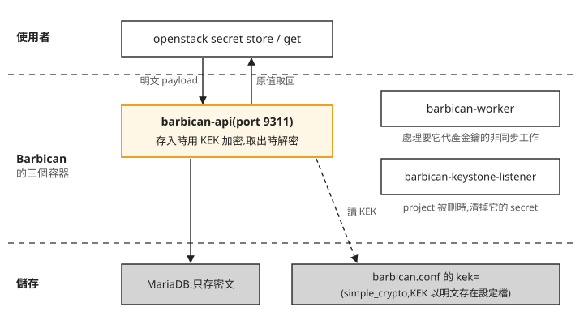
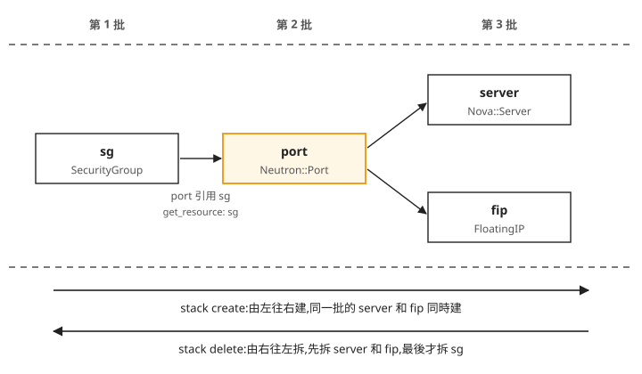

# Day 5: Barbican 與 Heat——把秘密交給雲保管,用一份範本建立和刪除一組資源

Day 2 為了開一台能從外面 SSH 進去的 VM,你照順序打了十幾條指令:建網路、建 router、開 security group、開機、掛 floating IP,順序錯了就會報錯;要清掉時,還得反過來一條條刪。再往後看,Day 7 的 Magnum 開 Kubernetes cluster 時,會替每座 cluster 產生幾把 CA 私鑰,這些私鑰得放在雲上某個有加密、有權限控管的地方。

這一章各解決一件事。前半部開啟 **Barbican**,把一筆秘密存進去再原樣取回,並看它在資料庫裡怎麼保存;後半部用已經部署好的 **Heat**,把 Day 2 那組資源寫成一份範本,一個指令建好、一個指令拆光。讀完之後,看到一份 Heat 範本,你能說出它會用什麼順序建立和刪除資源、哪些資源會同時建;遇到要存密碼或私鑰的需求,也能判斷 Barbican 預設的加密方式擋得住哪種外洩、擋不住哪種。

## 秘密要放在哪裡

{ align=right width="100" }

寫過應用程式的人都遇過這個問題:資料庫密碼、API 金鑰要放哪?寫在程式碼裡會跟著進 git,寫在設定檔裡,任何能登入那台主機的人都讀得到。

**Barbican** 是 OpenStack 的金鑰管理服務,服務類型(service type)叫 `key-manager`。它專門保管這類資料:你交給它一筆秘密,它加密後存進資料庫,之後預設只有同一個 project 裡、有權限的使用者能取回(Barbican 也可以用 ACL 把某筆 secret 開放給其他使用者)。權限由 Keystone 判斷,跟其他 OpenStack 資源一樣。在 Barbican 裡,一筆被保管的資料叫 **secret**,內容可以是一段密碼、一把對稱金鑰,或憑證和私鑰。AWS 上對應的服務是 Secrets Manager。

Kolla 預設不部署 Barbican,所以第一步是把它開起來。

## 步驟 1:開啟 Barbican,存一筆 secret 再取回

下面這個區塊照註解的編號分成三段:

1. **開啟 Barbican**:`globals.yml` 裡的 `enable_barbican` 預設是 `"no"`(範例檔裡是一行註解),在檔尾補一行 `"yes"`。
2. **只部署 Barbican**:Day 3 加 Cinder 時重跑的是完整的 `kolla-ansible deploy`。這次加上 `--tags`,Ansible 只執行標了這些 tag 的任務,其他已經在運作的服務不會被碰到,跑起來也比較快。`barbican` 這個 tag 已經包含建 Barbican 的資料庫、向 Keystone 登記 API 位址(endpoint),以及 haproxy 裡 barbican 那一段設定。`loadbalancer` 這個 tag 是給有 haproxy 的環境用的;本課 Day 1 關了 haproxy 和 proxysql,這部分會被跳過,加不加都沒有影響。barbican-api 直接聽在主機 IP 的 9311 port。
3. **驗證並存取一筆 secret**:確認服務清單裡出現 `key-manager`,然後存一筆名為 `day5-demo` 的 secret,記下它的位址(Barbican 稱為 secret href,是一個指向這筆 secret 的網址),再用這個位址把原文取回來。

第 3 段的 `pip install python-barbicanclient` 不能省。`openstack` 指令本身只內建核心服務的子命令,`openstack secret ...` 屬於 Barbican 自己的 client 套件,要另外安裝才會出現;這類掛進 `openstack` 指令的擴充套件叫 **osc plugin**。Day 4 另外裝 `python-octaviaclient` 也是同樣的原因。

```bash
# 1. globals.yml 開 barbican(預設 #enable_barbican: "no")
echo -e '\n# Day 5: enable Barbican (secret/cert store for Magnum)\nenable_barbican: "yes"' \
  | sudo tee -a /etc/kolla/globals.yml

# 2. targeted deploy(--tags barbican 已自帶:建 DB(bootstrap.yml)、註冊 keystone
#    endpoint(register.yml)、barbican 的 haproxy frontend(site.yml 內 barbican 的
#    loadbalancer 子任務掛在 barbican tag);加 loadbalancer 確保 haproxy reload)
source ~/kolla-venv/bin/activate
kolla-ansible deploy -i ~/all-in-one --tags barbican,loadbalancer

# 3. 驗證 + secret 存取往返
source /etc/kolla/admin-openrc.sh
openstack service list | grep key-manager          # 出現 barbican / key-manager
pip install python-barbicanclient                  # osc plugin 不隨 openstackclient
SREF=$(openstack secret store --name day5-demo --payload 'Sup3rS3cretDemo!' \
         -c 'Secret href' -f value)
openstack secret list
openstack secret get "$SREF" --payload -f value     # 應原值取回 Sup3rS3cretDemo!
```

跑完之後確認四件事:

- **deploy 成功,而且沒動到別的服務**:跟 Day 1 一樣,`PLAY RECAP` 要是 `failed=0`。log 裡如果出現 Octavia 相關的任務,都應該是 `changed=0`,代表 `--tags` 沒有去改 Day 4 部好的 Octavia。
- **三個容器都在跑**:`docker ps` 裡 `barbican_api`、`barbican_worker`、`barbican_keystone_listener` 三個容器都是 `Up (healthy)`。
- **API 位址登記好了**:Keystone 裡 key-manager 的 internal 和 public endpoint 都是 `http://<主機 IP>:9311`,本課的主機 IP 是 `10.0.0.4`。
- **原值取回**:最後一行印出的正是存進去的 `Sup3rS3cretDemo!`,一個字都不差。

這筆 `day5-demo` 只是示範用,確認完可以用 `openstack secret delete "$SREF"` 刪掉;換了終端機、`$SREF` 已經不在的話,從 `openstack secret list` 的 `Secret href` 欄複製它的位址代入。

如果 `openstack secret` 回 `is not an openstack command`,是 plugin 沒裝進目前的 venv,見[疑難排解:找不到 `secret` 或 `stack` 子命令](#mine-1)。

## Barbican 怎麼保管這筆 secret

你剛剛交出去的是明文,取回來的也是明文。中間這段時間,它在資料庫裡是什麼樣子?

Barbican 把資料寫進資料庫之前,會先用一把專門用來加密其他金鑰的金鑰加密一次,這把金鑰叫 **KEK**(Key Encryption Key)。KEK 本身放在哪,由 **crypto plugin** 決定。Kolla 預設用的 plugin 叫 `simple_crypto`:KEK 直接寫在 `barbican.conf` 的 `kek=` 這一行,值來自 `passwords.yml` 裡的 `barbican_crypto_key`,跟其他服務的密碼一樣由 Day 1 的 `kolla-genpwd` 產生。本課沒有改這個設定。

下面這張圖把剛才那筆 secret 的路徑和 Barbican 的三個容器畫在一起,由上往下是使用者、Barbican、儲存三層:



照著圖看:

1. **加密、解密都在 barbican-api 裡完成。** MariaDB 裡只有密文。剛才的存取往返只經過 api 這一個容器。
2. **另外兩個容器做的是背景工作。** barbican-worker 處理要 Barbican 代為產生金鑰這類非同步的請求;barbican-keystone-listener 接收 Keystone 的事件,某個 project 被刪除時,把那個 project 在 Barbican 裡的資料一起清掉,不留下已經不屬於任何 project 的 secret。

KEK 和資料庫放在同一台主機上,決定了 `simple_crypto` 擋得住什麼:如果外流的只有資料庫備份,拿到的人只看得到密文;但如果有人拿到這台主機的 root,他可以同時讀到 `barbican.conf` 裡的 KEK 和資料庫,secret 就全部能解開。需要更高保護時,可以改用 `p11_crypto` plugin,把 KEK 放在硬體安全模組(HSM)裡,KEK 從頭到尾不離開 HSM;或改用 Vault 等其他 secret store 當後端。單機的練習環境用 `simple_crypto` 就夠了。

## Magnum 為什麼需要 Barbican

回到開場的第二個問題。一座 Kubernetes cluster 裡,元件之間互相驗證身分靠的是憑證,而簽發這些憑證的是幾組 **CA**(憑證授權單位):Kubernetes API 一組、etcd(存放 cluster 狀態的資料庫)一組,還有其他幾組。誰拿到 CA 的私鑰,誰就能簽出這座 cluster 會信任的憑證,所以這些私鑰要妥善保管。

Day 7 用 Magnum 建 cluster 時,這些 CA 由 Magnum 產生,存在哪裡由 Magnum 設定檔裡的 `cert_manager_type` 決定,而 Kolla 會依 `globals.yml` 自動填這個值:


圖上分成兩段:

1. **剛才開 Barbican 這一步,決定了 Magnum 的 CA 存在哪。** 開了 Barbican,Kolla 就把 Magnum 設成 `cert_manager_type = barbican`,CA 存成 Barbican 的 secret,享有上一節講的加密和權限控管。沒開的話,Kolla 會改用 `x509keypair`,CA 存在 Magnum 自己的資料庫裡。本課只走過開了 Barbican 這條路,沒有驗證另一條。
2. **建 cluster 的時候,CA 會被讀出來。** Day 7 會用到 Magnum 的 CAPI driver,它把建 cluster 的工作交給 Cluster API;Day 6 會先建一座 management cluster,也就是專門跑 Cluster API、負責建立和管理其他 Kubernetes cluster 的那一座。CAPI driver 從上面任一處讀出 CA,寫進 management cluster 裡 `magnum-system` 這個 namespace(driver 放自己物件的地方),新建的節點再用這幾組 CA 簽發自己的憑證。所以 Barbican 要在 Day 7 之前就準備好。

## 步驟 2:準備 Heat 的 CLI 和範本

{ align=right width="100" }

**Heat** 是 OpenStack 的編排服務:你把一組資源寫進一份 YAML 範本,Heat 照著範本把它們全部建好,之後也能一次全部刪掉。Day 1 跑 `openstack service list` 時已經看到 `heat` 和 `heat-cfn`(Heat 另外提供的一套相容 AWS CloudFormation 格式的 API,本課不會用到),Kolla 預設就會部署它,今天不用改 `globals.yml`。

跟 Barbican 一樣,`openstack stack ...` 子命令要另外裝 Heat 的 osc plugin。範本裡的資源要建在 Day 2 的 demo project 裡,所以改用 demo 使用者的憑證:

```bash
pip install python-heatclient                        # 同樣要裝 osc plugin
source ~/demo-openrc.sh                               # 資源在 demo project
```

Heat 讀的範本格式叫 **HOT**(Heat Orchestration Template)。把下面的內容存成 `~/day5-heat-demo.yaml`,它描述的正是 Day 2 手動建過的那一組:一個 security group、一個 port(VM 接到網路上的那張虛擬網卡)、一台 cirros VM、一個 floating IP。

```yaml
heat_template_version: 2021-04-16
description: Sprint3 Day5 Heat demo — SG + Port + cirros Server + FloatingIP on net1.

parameters:
  image:   { type: string, default: cirros }
  flavor:  { type: string, default: m1.tiny }
  net:     { type: string, default: net1 }
  ext_net: { type: string, default: ext-net }
  key:     { type: string, default: oslab }

resources:
  sg:
    type: OS::Neutron::SecurityGroup
    properties:
      name: day5-heat-sg
      rules:
        - protocol: icmp
        - { protocol: tcp, port_range_min: 22, port_range_max: 22 }
  port:
    type: OS::Neutron::Port
    properties:
      network: { get_param: net }
      security_groups: [ { get_resource: sg } ]
  server:
    type: OS::Nova::Server
    properties:
      name: day5-heat-vm
      image: { get_param: image }
      flavor: { get_param: flavor }
      key_name: { get_param: key }
      networks: [ { port: { get_resource: port } } ]
  fip:
    type: OS::Neutron::FloatingIP
    properties:
      floating_network: { get_param: ext_net }
      port_id: { get_resource: port }

outputs:
  server_id:   { value: { get_resource: server } }
  internal_ip: { value: { get_attr: [server, first_address] } }
  floating_ip: { value: { get_attr: [fip, floating_ip_address] } }
```

範本分成三段:

- **`parameters`**:可以替換的值。預設值都是 Day 2 建好的東西:`cirros` image、`m1.tiny` flavor、內網 `net1`、對外網路 `ext-net`、keypair `oslab`。範本裡用 `get_param` 取用它們。
- **`resources`**:要建的四個資源,每個都有一個範本內的名字(`sg`、`port`、`server`、`fip`)和一個資源型別,例如 `OS::Nova::Server` 就是一台 VM。
- **`outputs`**:建好之後要回報的值,這裡是 VM 的 ID、內網 IP 和 floating IP。

注意 `port` 底下這一行:

```yaml
security_groups: [ { get_resource: sg } ]
```

`get_resource: sg` 的意思是「用範本裡名叫 `sg` 的那個資源」。port 要套用的 security group 是同一份範本建出來的,所以 sg 一定要先存在。`get_attr` 也一樣,它取的是某個資源建好之後才知道的屬性,例如 `outputs` 裡 server 的 IP。Heat 會掃過整份範本,每找到一個 `get_resource` 或 `get_attr`,就記下一條「誰要等誰」的關係,再依這些關係排出建立順序。

把四個資源之間的引用畫出來,由左往右是建立的先後:



我們可以從圖上看到三件事:

1. **範本裡沒寫順序,順序是從引用推出來的。** sg 沒有引用任何東西,最先建;port 引用 sg,排第二。
2. **server 和 fip 同時建。** 兩者都只引用 port,彼此沒有關係,Heat 不會讓其中一個等另一個。fip 綁的是 port,不是 server,所以 floating IP 不用等 VM 開機完成。
3. **刪除的順序正好相反。** 有人引用的資源要等引用它的資源都刪完才能刪,所以 sg 最後才拆。

這種只寫「最後要有哪些資源」、不寫「先做什麼再做什麼」的寫法,叫**宣告式**(declarative)。Day 2 你手打指令時,順序得自己記;在範本裡,順序由 Heat 從引用關係推導。

## 步驟 3:建立、查看、刪除 stack

Heat 把一份範本建出來的整組資源叫一個 **stack**,以 stack 為單位建立和刪除。下面五個指令依序是:檢查範本語法、建立名為 `day5-stack` 的 stack、看 outputs、列出 stack 裡的資源、刪除整個 stack。

```bash
openstack orchestration template validate -t ~/day5-heat-demo.yaml   # 語法檢查
openstack stack create -t ~/day5-heat-demo.yaml --wait day5-stack     # DAG:sg→port→server+fip
openstack stack output show day5-stack --all                          # 看 outputs
openstack stack resource list day5-stack                              # 4 個資源
openstack stack delete --yes --wait day5-stack                        # 一條全拆
```

逐行看要注意什麼:

- **`template validate`** 在真正建資源之前檢查語法和參數,範本有錯在這一步就會指出來,不會建了一半才失敗。
- **`stack create --wait`** 會等到 stack 狀態變成 `CREATE_COMPLETE` 才回到提示符。註解裡的 DAG(有向無環圖)指的就是上一節那張依賴圖。
- **`stack output show --all`** 會列出 `server_id`、`internal_ip`、`floating_ip` 三個值。內網 IP 在 net1 的 `10.10.10.x` 範圍,floating IP 在 ext-net 的 `172.24.4.x` 範圍,本課拿到的是 `10.10.10.194` 和 `172.24.4.149`,你的會不同。這時可以像 Day 2 一樣 ping 或 SSH 這個 floating IP。
- **`stack resource list`** 會列出 `sg`、`port`、`server`、`fip` 四個資源,跟範本一一對應。
- **`stack delete --wait`** 一個指令拆掉這四個資源。拆完後用 Day 2 學過的 `openstack server list` 和 `openstack security group list` 看,`day5-heat-vm` 和 `day5-heat-sg` 都不會再出現。

比起 Day 2,差別在於「這幾個資源是一組」這件事被記下來了:Heat 把每個 stack 有哪些資源存在自己的資料庫裡,所以刪除時不用你一條條回想建過什麼。Day 10 會用 Terraform 做同樣的事,可以回來對照。

## 疑難排解

### 找不到 `secret` 或 `stack` 子命令 {#mine-1}

**症狀**:`openstack secret ...` 或 `openstack stack ...` 回 `is not an openstack command`。

**原因**:這兩組子命令不在 `python-openstackclient` 裡,是 Barbican 和 Heat 各自 client 套件提供的 osc plugin。步驟 1 和步驟 2 的 `pip install python-barbicanclient`、`pip install python-heatclient` 漏了,或裝在別的 venv。

**修法**:先 `source ~/kolla-venv/bin/activate` 進到裝 `openstack` 指令的那個 venv,再補裝這兩個套件。之後每加一個非核心服務,都要記得裝它的 client 套件。

## 想一想

- 同學在步驟 2 的範本裡再加兩個資源:一顆 Cinder volume,以及一個把這顆 volume 掛到 `server` 上的 attachment(它同時用 `get_resource` 引用 `server` 和 volume)。現在這六個資源會分成幾批建立?volume 要等 sg 嗎?`stack delete` 時誰最先被拆?
- 你的團隊把應用程式的資料庫密碼存進 Barbican,環境跟本課一樣用 `simple_crypto`。有人問:如果 Barbican 的 MariaDB 備份檔外流,密碼會不會跟著外洩?如果是控制節點的 root 帳號被盜呢?
- 另一位同學的 Kolla 環境從來沒開 Barbican,卻已經用 Magnum 建了一座 cluster。這座 cluster 的 CA 私鑰存在哪裡?

## 小結

Barbican 替雲上的使用者保管密碼、金鑰和憑證:secret 用 KEK 加密後存進資料庫,取回時由 barbican-api 解密,權限跟其他資源一樣由 Keystone 判斷。Kolla 預設的 `simple_crypto` 把 KEK 寫在設定檔裡,資料庫外流時有保護,主機被入侵時沒有;本課開 Barbican 的直接原因,是讓 Day 7 的 Magnum 把 cluster 的 CA 存在這裡。Heat 則把一組資源寫成 HOT 範本,從 `get_resource`、`get_attr` 的引用推出建立順序,彼此無關的資源同時建,刪除時倒過來拆。之後讀到任何宣告式的範本,不管是 Day 6 的 Cluster API 還是 Day 10 的 Terraform,都可以先找出資源之間的引用,畫出誰要等誰。

## 延伸閱讀

想再深入,可以從這幾份開始:

- **[Barbican 官方文件](https://docs.openstack.org/barbican/2025.1/)** —— 金鑰管理服務的架構與 API;secret 型別的完整定義在這。
- **[Heat 範本指南](https://docs.openstack.org/heat/2025.1/template_guide/index.html)** —— 寫 HOT 範本的官方教學,從入門範例到進階功能。
- **[HOT 規格書](https://docs.openstack.org/heat/2025.1/template_guide/hot_spec.html)** —— 範本每個欄位的權威定義;寫範本卡住時查這份最快。

## 下一步

Magnum 的兩個前提到這裡都準備好了:CA 有地方存,宣告式的範本也看過一次。[Day 6](sprint3-day6-capi-management-cluster.md) 用 kind(把 Kubernetes cluster 跑在 Docker 容器裡的工具)建一座 Cluster API 的 management cluster,並用 `clusterctl init` 裝上 OpenStack 的 provider(CAPO),Day 7 的 Magnum 會把建 cluster 的工作交給它。
