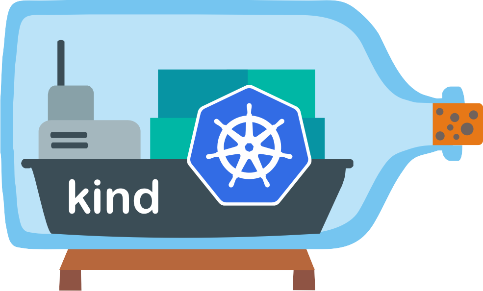
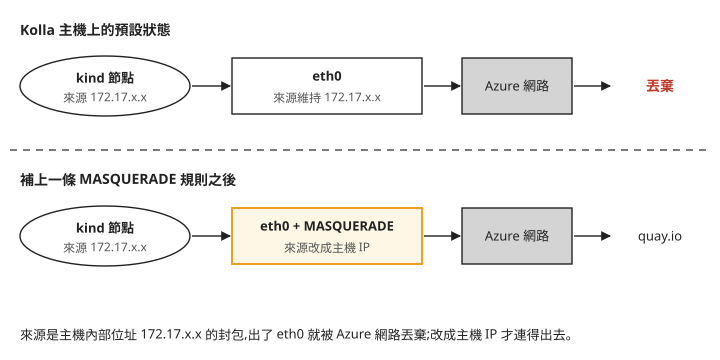

# Day 6: Cluster API 管理叢集——management cluster、provider 與 kind 的對外 NAT

到 Day 5 為止,這朵雲能開 VM、建網路、掛硬碟、配負載平衡器,也能用 Heat 一次建好一組資源。Day 8 要再往上走一步:使用者下一行指令,雲就交出一座可以用的 Kubernetes。這背後有一連串的工作要有人代勞:開幾台 VM、在每台裝好 Kubernetes、把節點加進同一座叢集,壞了要修、要升版時一台台換新。這一章先把負責這些工作的程式裝起來,Day 7 再把它接到 OpenStack 的 Magnum 服務上。

這組程式叫 Cluster API,它本身只能跑在一座 Kubernetes 裡,所以今天要在同一台主機上先開一座小 Kubernetes 給它用。這座小叢集用 **kind**(Kubernetes in Docker)建立,它把 Kubernetes 的節點放進 Docker 容器。在 Kolla 部署過的主機上,這座小叢集一開起來就會遇到一個問題:裡面所有 pod 都拉不到 image。讀完這一章,看到這個症狀時,你會知道原因是 kind 的網段少了一條 NAT 規則,也知道為什麼該只替 kind 補這一條規則,而不是去改 Docker 的全域設定。

## 開始之前

這一章需要 Day 1–5 部好 OpenStack 的那台 Azure VM。從這一章起會用到 Kubernetes 的基本操作:`kubectl`(Kubernetes 的命令列工具)、pod、deployment、namespace。如果這些對你是新的,先花半小時做官方的 [Learn Kubernetes Basics](https://kubernetes.io/docs/tutorials/kubernetes-basics/) 互動教學再回來。其他會用到的 Kubernetes 名詞,第一次出現時會說明。

## Cluster API:把「一座 Kubernetes」寫成宣告

{ align=right width="130" }

手動裝一座 Kubernetes,要開 VM、在每台裝 kubeadm(Kubernetes 官方的叢集安裝工具)、在第一台初始化 control plane(負責管理整座叢集的節點,上面跑著 API server,也就是接收所有 `kubectl` 請求的元件)、再讓其他 worker 節點 join 進來。換一座叢集就得從頭再做一次,之後的升版和修復也全靠人。

**Cluster API**(簡稱 CAPI)換一種做法:你寫一份宣告,例如「一座叢集,1 台 control plane、2 台 worker,Kubernetes v1.34」,交給 Kubernetes 保存,剩下的由程式完成。Kubernetes 的內建資源型別包含 Pod、Deployment,但不包含 CAPI 的 Cluster、Machine。CAPI 用 CRD(自訂資源定義,用來擴充 Kubernetes 的資源型別)加入這些型別,於是宣告一座叢集就跟宣告一個 deployment 一樣,是一份 YAML。

真正動手的是 **controller**:一支常駐在 Kubernetes 裡的程式,不斷比對「宣告要幾台」和「現在有幾台」,少了就開、多了就刪、壞了就換。這個比對再補齊的動作叫 **reconcile**。你在 Learn Kubernetes Basics 裡看過 deployment 讓 pod 維持指定數量,做的就是同一件事;CAPI 的 controller 管的對象換成了 VM 和整座叢集。

controller 是在 Kubernetes 裡跑的程式,所以要先有一座 Kubernetes 給它們跑。這座叢集叫 **management cluster**(管理叢集),只跑 CAPI 的 controller,不跑你的應用程式。CAPI 依照宣告開出來、真正跑應用程式的叢集,叫 **workload cluster**。CAPI 的標誌是一隻烏龜馱著更小的烏龜,官方的說法是 "It's Kubernetes all the way down":用一座 Kubernetes 去管理其他 Kubernetes。

在 OpenStack 上,負責呼叫 API 建立 VM 和負載平衡器的 controller 叫 **CAPO**(Cluster API Provider OpenStack)。到 Day 8 為止,同一台 Azure VM 上會有三套系統。下面這張圖把它們並排,由左到右是指令傳遞的方向:


我們可以從圖上看到兩件事:

1. **OpenStack 本身不是 Kubernetes。** Kolla 部署的是一群 Docker 容器,CAPI 的 controller 沒辦法裝進去,所以才需要另外開一座 management cluster。
2. **management cluster 不直接開 VM。** 它透過 OpenStack API 請 Nova 開,workload cluster 的節點是 OpenStack 裡的 VM。之後排錯時,先分清楚問題出在哪一塊:controller 沒反應看 management cluster,VM 開不起來看 OpenStack。

## 為什麼 management cluster 用 kind

{ align=right width="160" }

management cluster 只跑幾個 controller,不需要多台機器。單機 lab 用 kind 最省事:本章只需要一個 Docker 容器作為 Kubernetes 節點,一行指令就能建好或刪掉。

正式環境不會這樣做。management cluster 停擺時,已經建好的 workload cluster 照常運作,但擴充、升版、替換壞掉的節點都要等它恢復,所以正式環境會用一座專用、高可用的叢集來當 management cluster。

## CAPI 的四個 provider

CAPI 的功能拆成幾個 **provider**,每個 provider 是一組 controller,負責一部分工作。這一章要裝四個,步驟 4 的 `clusterctl init` 用四個旗標各指定一個。

CAPO 還依賴 **ORC**(openstack-resource-controller)。CAPO 從 v0.12 起,把部分 OpenStack 資源(目前主要是 image)的建立、查詢、刪除交給這個獨立的 controller:CAPO 產生描述這類資源的宣告(例如 `Image`),ORC 再去呼叫 OpenStack API。VM、網路、負載平衡器仍由 CAPO 自己呼叫 API。

下面這張圖畫的是宣告一座叢集之後,各個 provider 依序做的事,也標出 ORC 負責的資源:


照著圖由上往下看:

1. **core**(`cluster-api`)和 **control-plane**(`kubeadm`)把一座叢集的宣告拆成一台台 **Machine**(一台節點的宣告)。control-plane provider 專管 control plane 那幾台的數量與升版。
2. **bootstrap**(`kubeadm`)替每台 Machine 產生開機時執行的腳本,內容是用 kubeadm 初始化 control plane,或 join 進叢集。
3. **infrastructure** 是唯一跟雲打交道的 provider。對 OpenStack 來說是 CAPO,它把 Machine 變成一台 Nova VM,把開機腳本交給這台 VM,也替叢集的 API server 建 Octavia 負載平衡器。這些都是 CAPO 直接呼叫 OpenStack API 完成的。
4. 圖上 CAPO 旁邊的 ORC 是 CAPO 依賴的另一個元件,負責 image 這類資源,步驟 4 會說明。

## 步驟 1:安裝命令列工具

先決定版本。前三個 provider 跟 CAPI 本身同版號,CAPO 自己有一套版號。這一章不挑最新版,而是用 Day 7 那個 Magnum driver(vexxhost 的 `magnum-cluster-api`)測過的組合。

這組版本取自 `magnum-cluster-api` v0.37.0 的 `hack/setup-capo.sh`。這是它的 CI(每次程式改動時自動跑的測試流程)用來架設 management cluster 的腳本,裡面固定使用 CAPI v1.13.2、CAPO v0.14.4、ORC v2.2.0。之後要升版,也先看這個腳本換成了哪一組。

下面一次裝四個工具:`kubectl`、`kind`、`clusterctl`(CAPI 的命令列工具,版本要跟 CAPI 一致,所以是 v1.13.2)和 `helm`(Kubernetes 的套件管理工具)。helm 這一章用不到,Day 16 往 workload cluster 安裝 CSI 驅動時會用它,這裡先一起裝好。kind 要用一般使用者身分操作 Docker,所以最後把使用者加進 `docker` 群組:

```bash
# kubectl / kind / clusterctl(=CAPI 版) / helm
curl -sLo /tmp/kubectl    https://dl.k8s.io/release/v1.36.2/bin/linux/amd64/kubectl
curl -sLo /tmp/kind       https://kind.sigs.k8s.io/dl/v0.32.0/kind-linux-amd64
curl -sLo /tmp/clusterctl https://github.com/kubernetes-sigs/cluster-api/releases/download/v1.13.2/clusterctl-linux-amd64
sudo install -m0755 /tmp/{kubectl,kind,clusterctl} /usr/local/bin/
curl -sSfL https://raw.githubusercontent.com/helm/helm/main/scripts/get-helm-3 | sudo bash

# kind 需要「非 sudo」docker → 把使用者加進 docker group(需新 ssh session 生效)
sudo usermod -aG docker azureuser
```

`azureuser` 是 Day 0 建 VM 時設定的登入帳號,如果你用了別的名稱,換成自己的帳號(`whoami` 會印出來)。群組變更要重新登入才生效,所以裝完先登出,再 SSH 進來,才繼續下一步。

## 步驟 2:建 management cluster

用 kind 建一座叫 `capi-mgmt` 的叢集,`--wait 120s` 讓指令等到 control plane 就緒才返回。kind 會順便把這座叢集的連線資訊寫進 kubeconfig(`kubectl` 用來連叢集的設定檔,預設在 `~/.kube/config`,記著 API server 的位址和登入憑證),並設成預設對象,所以接著就能用 `kubectl` 查它:

```bash
kind create cluster --name capi-mgmt --wait 120s     # kindest/node v1.36.1
kubectl get nodes                                    # control-plane Ready
```

`kubectl get nodes` 應該只列出一個節點 `capi-mgmt-control-plane`,狀態 `Ready`。這個節點就是一個 Docker 容器,`docker ps` 也看得到同名的容器,下一步會直接進到這個容器裡測試網路。

## Kolla 改過 Docker 的網路設定 {#kolla-docker}

叢集建好了,但在 Kolla 主機上,它還連不到外面。原因在 Day 1 的部署:Kolla 為了 OpenStack 改過這台主機的 Docker 全域設定(`/etc/docker/daemon.json`),其中兩項跟今天有關:

- **`iptables: false`**:Docker 不再自動寫任何防火牆或 NAT 規則。OpenStack 的容器全部直接使用主機的網路,網路由 Neutron 和 OVN 管理,Kolla 透過這項設定停用 Docker 的 iptables 管理功能。
- **`bridge: none`**:Docker 不建立預設的 `docker0` 網橋。

kind 的節點卻是一般的 Docker 容器,接在 kind 自己建立的網路上,拿到的是主機內部的位址(在這台主機上是 `172.17.x.x`)。這種位址出不了主機,所以 Docker 平常會自動加一條 **NAT** 規則(網路位址轉換):容器的封包離開主機前,把來源位址改成主機自己的 IP。iptables 裡做這件事的規則叫 **MASQUERADE**。

下面這張圖比較有沒有這條規則時,kind 節點送出的封包會怎麼走:



兩列唯一的差別在 eth0 那一格。`iptables: false` 讓 Docker 不寫這條規則,kind 節點的封包帶著 `172.17.x.x` 出去就被丟掉。這時 kind 裡的 pod 拉 image 會一律 `i/o timeout`,而主機自己連 quay.io 完全正常,很容易誤以為是 quay.io 或 kind 本身有問題。

修法有兩個方向。把 `daemon.json` 的 `iptables` 改回 `true`,Docker 會重新管理整台主機的防火牆規則,而且要重啟 Docker 才會生效,所有 OpenStack 容器都會跟著重啟。Docker 接管後會在 iptables 寫入自己的規則鏈;依 Docker 官方文件,它負責 IP 轉送時還會把轉送(FORWARD)的預設政策設成 DROP,Day 2 讓雲裡的 VM 經主機轉送出去的流量就可能被擋下。另一個方向是只替 kind 的網段手動加一條 MASQUERADE,Kolla 的設定完全不動。這一章用後者。

## 步驟 3:補上 kind 的對外 NAT

這一步不做,步驟 4 的 `clusterctl init` 一定會失敗。iptables 的規則分成幾張表,NAT 規則放在 `nat` 表;表裡的 `POSTROUTING` 是封包即將從網卡送出前經過的那一串規則,改來源位址就在這裡做。下面第一行在 `POSTROUTING` 替 `172.17.0.0/16` 這個網段加一條 MASQUERADE,`-o eth0` 表示只處理從 eth0 出去的封包。[Day 2](sprint3-day2-openstack-resource-flow.md) 替 OpenStack 的對外網路 `172.24.4.0/24` 加過同樣形式的一條(在 `ext-net-fixup.service` 裡),這裡照它的寫法。第二行進到 kind 節點的容器裡,試著連 `1.1.1.1` 的 443 port:

```bash
sudo iptables -t nat -A POSTROUTING -s 172.17.0.0/16 -o eth0 -j MASQUERADE
# 驗證:kind node 應能連外
docker exec capi-mgmt-control-plane bash -c 'cat </dev/null >/dev/tcp/1.1.1.1/443 && echo OK'
```

印出 `OK` 就表示 kind 節點連得出去了。

`172.17.0.0/16` 只在 Kolla 主機上成立:`bridge: none` 讓 `172.17` 沒有被 `docker0` 佔用,kind 建網路時就分到這一段。一般主機上 `172.17` 是 `docker0`,kind 通常會拿到 `172.18` 以後的網段,這時上面的規則對不到任何封包,症狀跟沒加一樣。不確定的話,改用下面的寫法,先查出 kind 網路實際的網段再帶入,取代上面的第一行(兩種擇一,不要都跑,否則規則會重複):

```bash
KIND_CIDR=$(docker network inspect kind -f '{{(index .IPAM.Config 0).Subnet}}')
sudo iptables -t nat -A POSTROUTING -s "$KIND_CIDR" -o eth0 -j MASQUERADE
```

`bridge: none` 對這門課的影響不只這一處,Day 28 的[Docker 連接埠映射沒有生效](sprint5-day28-ceilometer-metering.md#mine-1)會再遇到。

用 `iptables` 加的規則重開機就會消失,而 Day 0 設了每晚自動關機。所以再寫一個開機時執行一次的 systemd 服務,把同一條規則補回去。`ExecStart` 先用 `-C` 檢查規則在不在,不在才用 `-A` 加,重跑幾次都只會有一條。下面用 `sudo tee` 把設定檔寫進 `/etc/systemd/system/kind-masquerade.service`。如果你的網段不是 `172.17.0.0/16`,把 `ExecStart` 裡的兩處都換成自己的網段:

```bash
sudo tee /etc/systemd/system/kind-masquerade.service <<'EOF'
[Unit]
Description=MASQUERADE for kind mgmt-cluster egress (workaround Kolla docker iptables=false)
After=docker.service
Wants=docker.service

[Service]
Type=oneshot
RemainAfterExit=yes
ExecStart=/bin/bash -c "iptables -t nat -C POSTROUTING -s 172.17.0.0/16 -o eth0 -j MASQUERADE 2>/dev/null || iptables -t nat -A POSTROUTING -s 172.17.0.0/16 -o eth0 -j MASQUERADE"

[Install]
WantedBy=multi-user.target
EOF
```

接著讓 systemd 重新讀取設定,啟用這個服務並立刻執行一次:

```bash
sudo systemctl daemon-reload && sudo systemctl enable --now kind-masquerade.service
```

最後列出 nat 表 POSTROUTING 的規則,確認 kind 網段那條只出現一次,旁邊還會看到 Day 2 加的那條 `172.24.4.0/24`:

```bash
sudo iptables -t nat -S POSTROUTING
```

完整的診斷過程,整理在排錯手冊的 [kind × Kolla 的 docker iptables 衝突](../solutions/integration-issues/kind-kolla-docker-iptables-masquerade.md)。

## 步驟 4:先裝 ORC,再 `clusterctl init`

CAPO 使用的 `Image` 等宣告型別由 ORC 提供,所以 ORC 要在 CAPO 之前裝好,漏了這一步,CAPO 會因為缺少型別而起不來。

`clusterctl init` 會一次裝好四個 provider。三個 `export` 是 CAPI 的功能開關,照 driver 的 CI 腳本打開。依 CAPI 文件,`EXP_CLUSTER_RESOURCE_SET` 讓新叢集建好後自動套用指定的資源;`EXP_KUBEADM_BOOTSTRAP_FORMAT_IGNITION` 讓開機腳本除了 cloud-init 也能用 Ignition 格式(Flatcar 這類作業系統使用的開機設定格式);`CLUSTER_TOPOLOGY` 開啟 ClusterClass(用一份範本定義叢集的樣子)。下面先安裝 ORC,再設定這三個開關並安裝 provider:

```bash
# 先裝 ORC(CAPO v0.14 依賴)
kubectl apply -f https://github.com/k-orc/openstack-resource-controller/releases/download/v2.2.0/install.yaml

# clusterctl init(EXP 旗標比照 setup-capo.sh)
export EXP_CLUSTER_RESOURCE_SET=true
export EXP_KUBEADM_BOOTSTRAP_FORMAT_IGNITION=true
export CLUSTER_TOPOLOGY=true
clusterctl init \
  --core cluster-api:v1.13.2 \
  --bootstrap kubeadm:v1.13.2 \
  --control-plane kubeadm:v1.13.2 \
  --infrastructure openstack:v0.14.4
# clusterctl 會自動先裝 cert-manager(v1.20.2),不需手動處理
```

`clusterctl init` 第一件事是裝 cert-manager(在叢集裡自動簽發和更新 TLS 憑證的元件,CAPI 的 controller 靠它取得憑證),等它就緒才裝四個 provider。如果輸出停在 `Waiting for cert-manager to be available...`,最後以 `context deadline exceeded` 結束,先看[疑難排解的連線檢查](#mine-1),確認是否因為拉不到 image 而卡住。

## 步驟 5:確認四個 controller 都在跑

四個 provider 各自裝在自己的 namespace,每個有一個 deployment。下面的迴圈逐一等它們 rollout 完成(rollout 指 deployment 把 pod 建好並等到就緒的過程),最後用 `kubectl get providers` 列出 clusterctl 記下的安裝紀錄:

```bash
for ns_dep in \
  capi-system/capi-controller-manager \
  capi-kubeadm-bootstrap-system/capi-kubeadm-bootstrap-controller-manager \
  capi-kubeadm-control-plane-system/capi-kubeadm-control-plane-controller-manager \
  capo-system/capo-controller-manager; do
  kubectl -n ${ns_dep%/*} rollout status deploy/${ns_dep#*/} --timeout=180s
done
kubectl get providers -A
```

看結果時注意兩處。第一,迴圈的四次 `rollout status` 都要回報成功;任何一個逾時,先看[疑難排解的連線檢查](#mine-1)。第二,`kubectl get providers -A` 的版本欄:core、bootstrap、control-plane 三筆是 v1.13.2,infrastructure 那筆是 openstack v0.14.4,跟步驟 1 選的組合一致。這個迴圈沒有檢查 ORC 和 cert-manager:ORC 的 `orc-controller-manager` 和 cert-manager 的三個 deployment 各在自己的 namespace 裡,也應該都在跑。

做到這裡,management cluster 裡還沒有任何叢集的宣告,controller 只是在待命。Day 7 把 Magnum 接上來之後,宣告才會從 Magnum 寫進這裡。

## 疑難排解

### 步驟 3 的連線測試失敗,或 image 拉取逾時 {#mine-1}

如果步驟 3 的 `docker exec` 連線測試沒有印出 `OK`,先停在這一步檢查。繼續安裝可能會讓 kind 裡的 pod 卡在 `ImagePullBackOff`,事件裡出現 `dial tcp ...:443: i/o timeout`;`clusterctl init` 也可能停在 `Waiting for cert-manager to be available...`,最後以 `context deadline exceeded` 結束。

依序區分主機連線、kind 連線和 NAT 設定:

1. 在主機執行 `curl -sI https://quay.io/v2/`。收到 HTTP 401 表示主機能連到 quay.io;如果主機也連不上,先處理主機的對外連線。
2. 主機連線正常時,重跑步驟 3 的 `docker exec` 測試。若連 `1.1.1.1:443` 也失敗,問題就不只出在 quay.io,接著檢查 kind 的對外 NAT。
3. 查看步驟 3 的 `sudo iptables -t nat -S POSTROUTING` 結果,確認 MASQUERADE 的來源網段與 kind 實際的網段一致。只有 OpenStack 的 `172.24.4.0/24` 那條規則並不足夠;kind 的網段可用步驟 3 的 `docker network inspect` 查詢。
4. 執行 `cat /etc/docker/daemon.json`,確認是否有 `iptables: false` 和 `bridge: none`。這是 [Kolla 改過的 Docker 設定](#kolla-docker),不要為了 kind 改回全域設定。若缺少 kind 網段的 MASQUERADE,依步驟 3 補上對應規則,再測試連線。

<span id="mine-2"></span>

如果已經執行過 `clusterctl init`,且 cert-manager 因為拉不到 image 而逾時,先確認上述連線測試通過。卡在 `ImagePullBackOff` 的 pod 會自己隔一段時間重試,間隔會越拉越長,所以不刪也會恢復,只是要多等一陣子。想立刻重拉,可以刪掉 cert-manager 的 pod,讓它們馬上重建(非必要):

```bash
kubectl -n cert-manager delete pod --all
```

等 cert-manager 的 pod 都跑起來之後,重跑步驟 4 同一條 `clusterctl init`。它會發現 cert-manager 已經在了,直接接著裝四個 provider。

### VM 重開機後 management cluster 沒有恢復 {#mine-4}

**症狀**:隔天開機後 `kubectl get nodes` 連不上,或 controller 沒有回到 Running。

**原因**:步驟 3 的 `kind-masquerade.service` 會在開機時補回 NAT 規則,但 kind 節點的容器預設不會在 VM 重開機後自動恢復到正常狀態。

**修法**:用 management cluster 之前,先 `docker start capi-mgmt-control-plane`,等它穩定後確認 `kubectl get providers -A` 四筆都在。

如果仍起不來,只有在尚未建立 Cluster、Machine 等管理資源的練習階段,才可以刪掉叢集重建。已有這些資源,或無法確認是否存在時,不要執行下面的刪除指令,應先診斷並恢復既有 management cluster。重裝 provider 和更新 kubeconfig 都不會還原原有的資源宣告。

確認仍是尚無管理資源的練習叢集後,才執行:

```bash
kind delete cluster --name capi-mgmt
```

然後重做步驟 2、4、5。做完步驟 2 先重跑步驟 3 的 `docker exec` 連線測試,確認 kind 節點連得出去,再做步驟 4。重建的叢集 API port 也會變,Day 7 放進 Magnum 的 kubeconfig 要一起更新。

## 想一想

1. 你在另一台沒有部署 Kolla 的 Ubuntu 主機上,Docker 是安裝後的預設設定,用 kind 建了一座叢集。這台主機也需要步驟 3 那條 MASQUERADE 規則嗎?如果照抄 `172.17.0.0/16` 那一行,會發生什麼事?
2. 同事建議把 `/etc/docker/daemon.json` 的 `iptables` 改成 `true`,理由是「以後在這台主機跑任何容器都不用再補規則」。在一台已經跑著 OpenStack 的主機上,你會怎麼回應?
3. Day 8 建好一座 workload cluster 之後,kind 的容器停了。workload cluster 上已經在跑的應用程式會受影響嗎?這時剛好有一台 worker VM 壞了,它會被自動換掉嗎?要等到什麼時候?

## 小結

這一章在 Kolla 主機上用 kind 開了一座 management cluster,裝好 CAPI 的四個 provider 和 CAPO 依賴的 ORC。之後 Day 7 的 Magnum 和 Day 8 的 workload cluster,都是透過這裡的 controller 去呼叫 OpenStack API。過程中最容易卡住的是網路:Kolla 為了 OpenStack 讓 Docker 不再管 iptables,一般 Docker 容器因此沒有對外的 NAT。以後在 Kolla 主機上跑任何一般網路模式的容器,看到拉 image 逾時、主機自己卻連得出去,先查 POSTROUTING 裡有沒有那個容器網段的 MASQUERADE,再只替那個網段補規則。

## 延伸閱讀

想再深入,可以從這幾份開始:

- **[Cluster API Quick Start](https://cluster-api.sigs.k8s.io/user/quick-start)** —— CAPI 官方入門;本章 kind 加 clusterctl 的流程就是它的 OpenStack 版。
- **[CAPO:Cluster API Provider OpenStack](https://cluster-api-openstack.sigs.k8s.io/)** —— 本章裝的那個 provider 的官方手冊,OpenStackCluster、OpenStackMachine 資源的定義都在這。
- **[kind 官方文件](https://kind.sigs.k8s.io/)** —— 用 Docker 容器跑 Kubernetes 的工具;設定檔選項與已知限制。
- **[Docker 的封包過濾與防火牆](https://docs.docker.com/engine/network/packet-filtering-firewalls/)** —— Docker 平常替容器寫了哪些 iptables 規則,關掉之後少了什麼。

## 下一步(Day 7)

management cluster 已經在待命,但 OpenStack 這邊還沒有服務會把建叢集的請求送過來。[Day 7](sprint3-day7-magnum-capi-driver.md) 部署 Magnum,並把這座 management cluster 的 kubeconfig 交給它,讓 `openstack coe cluster create` 能把宣告寫進這裡。

---

*Cluster API 與 kind 標誌為 CNCF(Linux Foundation)之商標與專案資產,此處作社群教學用途。*
