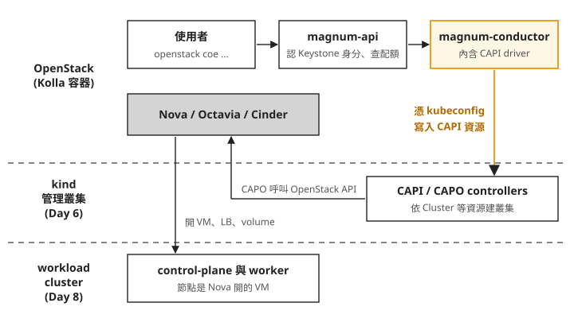

# Day 7: 把 Magnum 接上 Cluster API——cluster driver、kubeconfig 開關與 ClusterTemplate

{ align=right width="110" }

Day 6 結束時,主機上多了一座 kind 管理叢集,裡面的 CAPI 和 CAPO 已經會呼叫 OpenStack 開 VM、建負載平衡器,組出一座 Kubernetes cluster。不過要用它,得手寫一疊 CAPI 資源的 YAML,手上還要有 kind 的 kubeconfig(`kubectl` 用來連線和認證的那份設定檔)。

現在假設這朵雲上有兩個租戶,各自想要一座 Kubernetes cluster。最直接的做法是把 kind 的 kubeconfig 交給他們,但拿到這份檔案的人能看到管理叢集裡的所有 cluster,也能刪掉別人的。這一章要部署 OpenStack 的 Kubernetes 服務 **Magnum**,讓租戶用自己的 OpenStack 帳號、一行 `openstack coe cluster create` 申請 cluster,由 Magnum 轉給 Day 6 的管理叢集去建。讀完之後,Magnum 建不出 cluster 時,你能分辨問題出在 CAPI driver 沒啟用、Magnum 連不到管理叢集,還是 ClusterTemplate(管理員預先寫好的 cluster 規格)用的 image 沒標對。

## 為什麼有了 CAPI 還要 Magnum

CAPI 管的是「怎麼把 cluster 建出來」:開節點、裝 Kubernetes、壞了換新、升版。它沒有租戶的概念,誰能操作管理叢集,誰就能動裡面所有的 cluster。如果只有你自己的團隊要用 Kubernetes,直接用 CAPI 就夠了,不需要 Magnum。

要把 Kubernetes 當成雲上的服務開放給多個租戶,還需要另一半:Magnum 用 Keystone 認人,每個請求都帶著租戶自己的 OpenStack 身分;每個 project 有自己的配額,A 看不到 B 的 cluster;租戶只要下 `openstack coe` 指令,不必懂 CAPI。Magnum 自己不建 cluster,它把請求交給管理叢集。

下面這張圖由上往下,是一個建 cluster 的請求會經過的地方:



照著圖由上往下看:

1. **上層全是 OpenStack 的事。** 認身分、查配額都在 magnum-api 完成,沒通過的請求不會碰到管理叢集。
2. **兩層之間只有一條橘色的線。** Magnum 和管理叢集之間的連結就是一份 kubeconfig。這一章主要的工作就是把這份檔案交給 Magnum,並確認它真的連得上。
3. **下面兩層是 Day 6 已經準備好的部分。** CAPO 回頭呼叫 Nova、Octavia、Cinder 開出節點,這一段 Day 8 才會真的跑。

## Magnum 怎麼把工作交給管理叢集

Magnum 收到建 cluster 的請求後,實際去建的是 **cluster driver**:Magnum 裡可替換的建置模組,每個 driver 用一種方式把 cluster 建出來。Magnum 早期的 driver 透過 Heat 建 VM,裡面寫死了 node image 的下載網址,這些網址後來都失效了(Sprint 1 就是卡在這裡)。這一章用的是 vexxhost 的 `magnum-cluster-api` driver,它把 Magnum 的請求轉成 CAPI 資源,寫進管理叢集,之後的事交給 CAPI 和 CAPO。

Kolla Epoxy 的官方 magnum image 已經內建這個 driver,不用自己打包 image,也不用進容器 `pip install`。driver 在 image 裡,但預設是關著的。Magnum 用設定檔 `magnum.conf` 裡的 **`disabled_drivers`** 列出要停用的 driver,而 Kolla 產生這份設定檔的模板裡有這麼一段:

```jinja

disabled_drivers = k8s_cluster_api_flatcar,k8s_cluster_api_rockylinux,k8s_cluster_api_ubuntu,k8s_cluster_api_ubuntu_focal

```

`magnum_kubeconfig_file_path` 只有在 `/etc/kolla/config/magnum/kubeconfig` 這個檔案存在時,Kolla 的 magnum role 才會定義它。也就是說,有沒有放管理叢集的 kubeconfig,決定了 CAPI driver 開不開:


左欄是還沒做這一章時的狀態,右欄是做完之後。image 裡的 driver 其實有五個,還有一個 `k8s_cluster_api_debian` 不在 Kolla 的停用清單上,圖裡只畫 Kolla 會開關的四個。名稱裡的 `ubuntu_focal` 是給 Ubuntu 20.04(代號 Focal)image 用的,`ubuntu` 則是一般的 Ubuntu image。右下那個 `os_distro` 決定用哪一個 driver,步驟 3 再談;現在只要記得,driver 有沒有啟用,看的是生成出來的 `magnum.conf` 裡有沒有 `disabled_drivers` 這一行。

這個設計的好處是不用額外的開關:沒有管理叢集時,啟用 CAPI driver 也沒有用處;一放進 kubeconfig,driver 就有了可以連的地方,也跟著啟用。

## 步驟 1:開啟 Magnum、放入 kubeconfig {#step-1}

這一步要在 `globals.yml` 加兩行。第一行 `enable_magnum` 開啟 Magnum。

第二行 `enable_cluster_user_trust` 跟 **trust** 有關:trust 是 Keystone 的委託機制,讓一個使用者授權另一個身分代替自己呼叫 OpenStack API。依 Kolla 的 Magnum 指南,開了這個選項,cluster 才能代表建立它的使用者呼叫 OpenStack,cluster 的 auto-scaler(自動增減節點)和 auto-healer(自動替換壞掉的節點)要靠它才能運作。指南也說明這個選項預設關閉的原因:開了之後 cluster 會暴露在 CVE-2016-7404 這個已知弱點的風險下。實驗環境直接開;正式環境要先評估這個風險。

要注意,Day 8 cluster 裡負責建負載平衡器、掛 volume 的元件,用的不是這個 trust,而是 driver 替每座 cluster 另外建的 application credential(一組只給這座 cluster 用的 OpenStack 登入資訊,寫在 cluster 裡的 `clouds.yaml`)。trust 這個選項 Day 7 用不到,但它屬於 magnum 部署時的設定,現在一起開好,之後就不用再為它重跑 deploy。

下面的區塊分三段:第 1 段是要加進 `/etc/kolla/globals.yml` 的兩行設定(像 Day 1 步驟 4 那樣附加到檔尾,不是要在終端機執行的指令);第 2 段把 Day 6 kind 的 kubeconfig 複製到 Kolla 讀自訂設定的目錄;第 3 段重跑 deploy:

```bash
# 1. globals
enable_magnum: "yes"
enable_cluster_user_trust: "yes"

# 2. 放 management cluster 的 kubeconfig(Day 6 kind 的 ~/.kube/config)
sudo mkdir -p /etc/kolla/config/magnum
sudo cp ~/.kube/config /etc/kolla/config/magnum/kubeconfig
sudo chown azureuser:azureuser /etc/kolla/config/magnum/kubeconfig

# 3. deploy(magnum 建 DB/keystone/trustee、掛 kubeconfig、省略 disabled_drivers)
kolla-ansible deploy -i ~/all-in-one --tags magnum,loadbalancer,horizon
```

有兩個地方要留意:

- **`chown` 那一行不能省。** `sudo cp` 產生的檔案屬於 root,權限 `0600`;kolla-ansible 卻是用你自己的帳號讀這個檔案,讀不到就會在 deploy 中途失敗。`azureuser` 是 Day 0 建 VM 時的使用者,如果你用別的帳號執行 kolla-ansible,換成那個帳號。漏了的症狀見[疑難排解:Permission denied](#mine-1)。
- **deploy 帶了三個 tag。** `magnum` 建資料庫、Keystone 帳號、trustee 網域(Magnum 在 Keystone 裡另建的網域,trust 用的帳號放在這裡;區塊註解裡的 trustee 指的就是它),並把 kubeconfig 放進容器;`horizon` 讓網頁儀表板多出 Container Infra 選單;`loadbalancer` 管的是 haproxy 的設定,Day 1 已經關掉 haproxy,單機上它沒有東西要改。跟 Day 1 一樣,deploy 是冪等的,失敗修好後直接重跑。

## 步驟 2:確認 driver 啟用、Magnum 連得到管理叢集

Magnum 由兩個服務組成:**magnum-api** 接收請求、做認證和配額檢查;**magnum-conductor** 做實際的工作,CAPI driver 就在它裡面執行。所以要連管理叢集的是 conductor。你放的那份 kubeconfig 走了下面這條路,才到 conductor 手上:


照著圖由上往下看,有兩點值得注意:

1. **檔案最後落在 `/var/lib/magnum/.kube/config`。** 容器裡 magnum 使用者的家目錄就是 `/var/lib/magnum`,所以這個位置正好是 driver 預設會去讀的 `~/.kube/config`,不用另外設定路徑。
2. **最後一格的位址是 `127.0.0.1`。** kind 產生的 kubeconfig,`server` 欄寫的是 `https://127.0.0.1:` 加上一個 kind 建 cluster 時挑的 port(打開 `~/.kube/config` 就看得到)。從容器裡連 `127.0.0.1` 之所以會連到主機上的 kind,是因為 Day 1 說過 Kolla 的容器都走 host network,容器的 `127.0.0.1` 就是主機本身。如果你用的部署工具沒有讓 magnum 走 host network,就要改用 kind 容器的 Docker 網路 IP,或用 `kind get kubeconfig --internal` 產生的版本。

下面依序確認三件事:生成的 `magnum.conf` 沒有 `disabled_drivers`;conductor 容器連得到 kind;conductor 服務在 Magnum 裡登記為運作中。第二項用的 pykube 是 driver 呼叫 Kubernetes API 時用的 Python 套件,這行指令用跟 driver 相同的方式讀 `~/.kube/config`、列出管理叢集的節點。註解裡的 `→` 是預期的結果:

```bash
source /etc/kolla/admin-openrc.sh
# disabled_drivers 應「不存在」= driver 啟用
sudo grep -c '^disabled_drivers' /etc/kolla/magnum-conductor/magnum.conf   # → 0
# conductor 用 driver 的方式實連 kind
sudo docker exec magnum_conductor python3 -c \
  "import pykube; a=pykube.HTTPClient(pykube.KubeConfig.from_env()); print([n.name for n in pykube.Node.objects(a)])"
# → ['capi-mgmt-control-plane']
pip install python-magnumclient
openstack coe service list        # magnum-conductor state=up
```

另外,容器內的 `/var/lib/magnum/.kube/config` 應該存在,擁有者是 `magnum:magnum`、權限 `600`,這是 Kolla 為 conductor 容器設定的複製規則決定的。本課當時確認過這個結果,但沒有留下所用的指令;想自己看的話,用你習慣的方式進 `magnum_conductor` 容器列出這個檔案即可。

這三項各自對應開場說的一種失敗:

- `grep -c` 印出 `1`:driver 沒啟用。回頭確認 `/etc/kolla/config/magnum/kubeconfig` 存在,再重跑 deploy。
- pykube 那行報連線錯誤:conductor 連不到管理叢集。先確認 kind 還在跑、kubeconfig 裡的 port 跟現在的 kind 一致。印出 `['capi-mgmt-control-plane']`(Day 6 那座 kind 唯一的節點)才算連通。
- `openstack coe service list` 裡 magnum-conductor 不是 `up`:conductor 本身沒起來,看 `magnum_conductor` 容器的 log。

`openstack coe` 這組指令不在 Day 1 裝的 `python-openstackclient` 裡,要另外裝 `python-magnumclient`,跟 Day 4、Day 5 補裝 Octavia、Heat 的 client 是同一回事。

## 步驟 3:準備 node image、flavor 和 ClusterTemplate

租戶建 cluster 時不會每次都指定一長串參數,而是挑一個 **ClusterTemplate**:一份預先寫好的 cluster 規格,裡面記著節點用哪個 image、哪個 flavor、接哪個對外網路、Kubernetes 版本等。管理員先建好 template,租戶建 cluster 時指定 template,再補上節點數量就好。

template 裡最重要的一項是 node image,因為它同時決定 Magnum 用哪個 driver。Magnum 看的是 image 上的 **`os_distro`** 屬性(property):image 標了 `os_distro=ubuntu`,就選 `k8s_cluster_api_ubuntu`,也就是前面那張比較圖右欄被選中的那一個。每個 driver 都宣告了自己對應的作業系統名稱,`os_distro` 的值要完全對上:`ubuntu`、`ubuntu-focal`、`debian`、`flatcar`、`rockylinux`(注意 `ubuntu-focal` 用的是連字號,跟 driver 名稱裡的底線不同)。沒有標 `os_distro`,Magnum 找不到對應的 driver。

node image 來自 vexxhost 的 `capo-image-elements` 專案。每個 image 是一份預先裝好 kubelet、kubeadm、containerd 的 Ubuntu 24.04,CAPO 開出 VM 之後,節點用 kubeadm 加入 cluster。<span id="mine-3"></span>這個專案每一版會同時提供幾個 Kubernetes 版本的 image,本課用 `2026.05-7` 版裡的 v1.34.8。driver(Kolla Epoxy image 內建的版本)、Day 6 裝的 CAPI v1.13.2 和 CAPO v0.14.4、node image 這三者要彼此相容;本課用的是 vexxhost 測過的組合。之後要換其中任何一項的版本,先查 driver 測過哪個組合,不要只升級一邊。

flavor 的部分,Day 2 只建了 `m1.tiny` 和 `m1.small`,放不下 Kubernetes 節點,所以這裡另外建一個 `m1.medium`。名稱沿用 vexxhost 入門文件範例裡的 flavor 名稱,2 vCPU、4 GB 記憶體、40 GB 磁碟是本課自己的設定。

下面的區塊依序下載並上傳 image、建 flavor、建 template:

```bash
# image(os_distro=ubuntu 是 driver 選型關鍵)
curl -fLO https://github.com/vexxhost/capo-image-elements/releases/download/2026.05-7/ubuntu-24.04-v1.34.8.qcow2
openstack image create ubuntu-24.04-v1.34.8 --disk-format qcow2 --container-format bare --public \
  --file ubuntu-24.04-v1.34.8.qcow2 --property os_distro=ubuntu --property os_version=24.04

# flavor(k8s 節點,原本只有 m1.tiny/small)
openstack flavor create m1.medium --vcpus 2 --ram 4096 --disk 40

# ClusterTemplate(master-lb-enabled 必需;kube_tag 對應 image 版本)
openstack coe cluster template create k8s-v1.34.8 \
  --image ubuntu-24.04-v1.34.8 --external-network ext-net --dns-nameserver 8.8.8.8 \
  --master-lb-enabled --master-flavor m1.medium --flavor m1.medium \
  --network-driver calico --docker-storage-driver overlay2 \
  --coe kubernetes --label kube_tag=v1.34.8
```

template 的參數裡,有三個跟這朵雲的其他部分接在一起:

- `--external-network ext-net`:Day 2 建的對外網路,節點和 API 的浮動 IP 從這裡來。
- `--master-lb-enabled`:在 control-plane 前面放一個 Octavia 負載平衡器(Day 4 的服務),cluster 的 Kubernetes API 透過它對外提供。vexxhost 入門文件的範例有開這一項,本課照做。
- `--label kube_tag=v1.34.8`:Kubernetes 版本,要跟 image 名稱裡的版本一致。

其他幾個參數:`--network-driver calico` 指定 cluster 裡 pod 之間的網路用 Calico;`--docker-storage-driver overlay2` 是節點上容器檔案系統的格式選項,入門文件的範例有帶,本課照做;上傳 image 時的 `os_version` 只是標記作業系統版本,選 driver 時看的是 `os_distro`。

這份 template 是用 admin 身分建的,沒有加 `--public`,所以只有 admin 這個 project 看得到。要讓其他租戶也能挑這份 template,建立時加上 `--public`,這個選項需要 admin 權限。

建好之後,`openstack image show ubuntu-24.04-v1.34.8` 的狀態應該是 `active`,`properties` 裡有 `os_distro='ubuntu'`;`openstack coe cluster template show k8s-v1.34.8` 的 `cluster_distro` 欄應該是 `ubuntu`,這表示 Magnum 已經從 image 認出要用 ubuntu 那個 driver。

template create 成功不代表 Day 8 一定開得出 VM:Magnum 建 template 時只檢查 flavor 存不存在,不比對 flavor 的磁碟和 image 的大小,這要到 Nova 實際開節點時才檢查,見[疑難排解:flavor 磁碟比 image 小](#mine-2)。

## 疑難排解

### deploy 停在 "Copying over kubeconfig file",`Permission denied` {#mine-1}

**症狀**:deploy `failed=1`,錯誤是 `Permission denied: /etc/kolla/config/magnum/kubeconfig`。

**原因**:`sudo cp` 產生的檔案是 `root:root 0600`,而 kolla-ansible 用執行它的帳號從本機讀這個檔案。修法見[步驟 1](#step-1) 的 `chown`(權限維持 `600` 即可),改完重跑 deploy。放進 `/etc/kolla/config/` 的其他自訂檔也一樣,要讓執行 kolla-ansible 的帳號讀得到。

### 找不到 `m1.medium`,或 flavor 磁碟比 image 小 {#mine-2}

**原因**:Day 2 只建了 `m1.tiny` 和 `m1.small`,`m1.medium` 要照步驟 3 自己建。另外,建 template 時,Magnum 只檢查 flavor 存不存在(不存在時 template create 會失敗),不比對 flavor 磁碟和 image 的大小,所以 flavor 偏小 template 照樣建得成功,要到 Day 8 Nova 開節點時才失敗。

**修法**:建 flavor 時,`--disk` 要不小於 node image 的虛擬大小(image 展開後的磁碟大小,不是 qcow2 檔案本身的大小)。

## 想一想

- 一位同事照著做完這一章,`grep -c '^disabled_drivers'` 印出 `1`,但他很確定已經把 kubeconfig 放進去了。你會請他先檢查什麼?
- VM 重開機後,kind 的管理叢集被重建了。Magnum 這邊還能建 cluster 嗎?步驟 2 的三項確認裡,哪一項會先失敗,要怎麼修?
- 另一位同事上傳了自己用 Rocky Linux 做的 node image,沒有加任何 `--property`,建 template 時就失敗了。少了什麼?該補什麼、值要填什麼,補上之後會用哪個 driver?

## 小結

Magnum 是 OpenStack 上給租戶用的 Kubernetes 入口:magnum-api 負責認身分、查配額,magnum-conductor 裡的 CAPI driver 把請求轉成 CAPI 資源,寫進 Day 6 的管理叢集。在 Kolla 上接起這兩層,只需要在 `/etc/kolla/config/magnum/` 放一份管理叢集的 kubeconfig:有這份檔案,Kolla 就不再產生 `disabled_drivers`,driver 也跟著啟用;至於用哪個 driver,由 ClusterTemplate 的 image 上的 `os_distro` 決定。之後 Magnum 建不出 cluster 時,照這個順序查:`magnum.conf` 有沒有 `disabled_drivers`、conductor 連不連得到管理叢集、image 有沒有標 `os_distro`。

## 延伸閱讀

想再深入,可以從這幾份開始:

- **[Kolla-Ansible 的 Magnum 指南](https://docs.openstack.org/kolla-ansible/2025.1/reference/containers/magnum-guide.html)** —— Kolla 部署 Magnum 的官方說明,包括本章開啟的 `enable_cluster_user_trust` 的用途與預設值。
- **[Magnum 官方 User Guide](https://docs.openstack.org/magnum/2025.1/user/)** —— ClusterTemplate 每個參數的定義,以及 image 的 `os_distro` 怎麼決定 driver。
- **[magnum-cluster-api 入門文件(vexxhost)](https://vexxhost.github.io/magnum-cluster-api/user/getting-started/)** —— 本章用的 driver 的官方文件:node image 怎麼上傳、template 怎麼建,本章 `m1.medium` 這個 flavor 名稱也是沿用這裡的範例。
- **[The Cluster API Book](https://cluster-api.sigs.k8s.io/)** —— CAPI 的官方文件,Day 6 見過的 Cluster、Machine、MachineDeployment 等資源的完整說明。
- **[The Turtle-Powered Shark(StackHPC)](https://www.stackhpc.com/magnum-clusterapi.html)** —— StackHPC 說明 Magnum 為什麼改用 Cluster API 取代 Heat 建 cluster。文中介紹的是他們自己的 Helm 版 driver,跟本章用的 vexxhost driver 是兩個實作,但背後的理由相同。

## 下一步

template 建好了,但還沒有任何 cluster。[Day 8](sprint3-day8-e2e-workload-cluster.md) 用 `openstack coe cluster create` 實際開一座 workload cluster,看請求怎麼依序經過 Magnum、管理叢集、Nova 和 Octavia,並確認節點 Ready、`LoadBalancer` 拿得到 Octavia 負載平衡器、PVC 綁得上 Cinder volume。Day 8 會以這份 template 為基礎,另外建一份加上實驗環境專用 label 的 template。

開始 Day 8 之前,如果 VM 重開過機,先確認 kind 管理叢集已經恢復(見 Day 6 的[「VM 重開機後 management cluster 沒有恢復」](sprint3-day6-capi-management-cluster.md#mine-4)),而且 `/etc/kolla/config/magnum/kubeconfig` 裡的 port 跟現在的 kind 一致。kind 重建後 port 會換,這時要把新的 kubeconfig 複製過去,再跑一次 `kolla-ansible deploy --tags magnum`。
