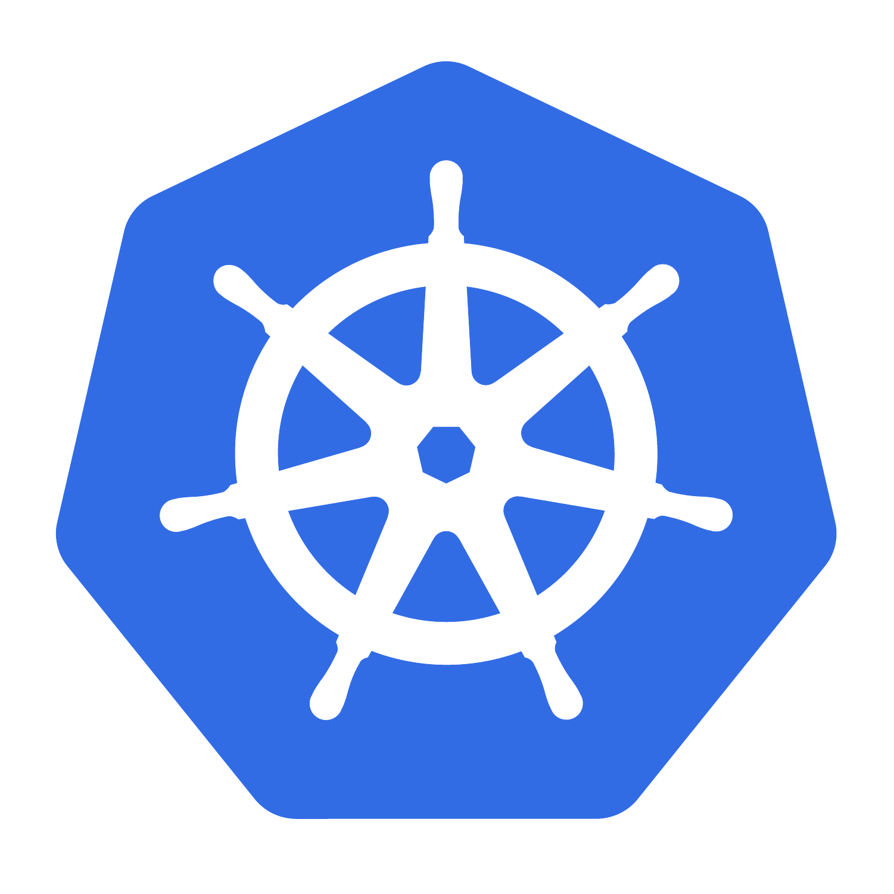
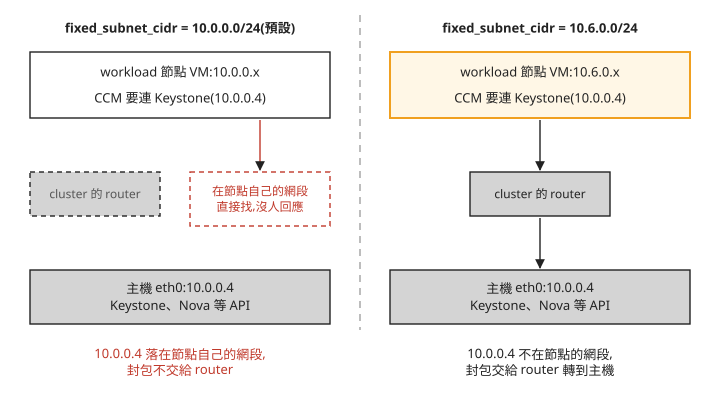

# Day 8: 開出第一座 workload cluster——Nova microversion、CCM 與 providerID、LoadBalancer 與 PVC

{ align=right width="90" }

Day 7 結束時,Magnum 已經接上 Day 6 的 kind,也有了一份 ClusterTemplate。這一章真的下單:打一行 `openstack coe cluster create`,等它開出一座 Kubernetes。下完指令之後,你能直接看到的只有一個狀態欄位。它可能幾秒就變成 `CREATE_FAILED`,也可能停在 `CREATE_IN_PROGRESS`,VM 明明都開好了,狀態卻一直不往下走。

這一行指令會依序經過 Magnum、kind 裡的 CAPI、OpenStack 的 Nova、Neutron 和 Octavia,最後還要等新 cluster 裡的元件回頭向 OpenStack 確認自己的身分。cluster 建好之後,我們再在裡面開一個 `type=LoadBalancer` 的 Service 和一個 PVC(PersistentVolumeClaim,pod 對儲存空間的請求),確認它們分別變成 Octavia 的 LB 和 Cinder 的 volume。讀完之後,cluster 建不起來或 LoadBalancer、PVC 卡住時,你能判斷問題停在 Magnum 本身、新節點的初始化,還是 OpenStack 這邊的資源。

## 一行 `cluster create` 會經過哪些服務

先分清楚兩座 cluster。Day 6 的 kind 是 **management cluster**,只負責管理別的 cluster,不跑你的應用程式。這一章開出來的叫 **workload cluster**:節點是 OpenStack 裡真正的 VM,你的應用程式跑在這裡。

圖中的 providerID 是 K8s 節點用來記錄對應雲端 VM 的欄位;taint 是節點上的排程限制標記,這裡用來阻止一般 pod 排入尚未完成雲端初始化的節點。把 `cluster create` 之後發生的事由上往下畫出來,左側標出每一段由誰負責:


照著圖由上往下看:

1. **Magnum 接收請求並建立 CAPI 物件。** 它驗過身分、查過配額,就把物件寫進 kind(Day 7 接上的那條線)。如果狀態幾秒就變成 `CREATE_FAILED`,而且 kind 裡一個 CAPI 物件都沒有,問題就出在 Magnum 這一層,還沒輪到 CAPI。
2. **真正建資源的是 kind 裡的 CAPI 和 CAPO。** 它們呼叫的 Nova、Neutron、Octavia 都是你前幾天部署過的服務,所以這一層出錯時,錯誤訊息通常會出現在那些服務的 log 裡。
3. **節點 VM 開好不等於 cluster 建好。** 最下面一排是在節點 VM 裡發生的事,要等其中橘色那一步完成,CAPI 才會把節點標成就緒。這一步是什麼、為什麼會卡住,下面會單獨講。

## 開始之前

這一章會用到 Day 4 的 Octavia、Day 6 的 kind、Day 7 的 Magnum,三者都要先確認還在運作,特別是主機(跑 Kolla 的那台 Azure VM)重開機過的話。下文的「主機」都指這台 VM,Nova 替 cluster 開的 VM 則叫「節點 VM」。

kind 裡應該要有 Day 6 裝的四個 provider。kind 在主機重開後不會自己恢復,處理方式見 Day 6 的[「VM 重開機後 management cluster 沒有恢復」](sprint3-day6-capi-management-cluster.md#mine-4)。如果你重建過 kind,它的 API port 會改變,要照 Day 7 的做法更新 `/etc/kolla/config/magnum/kubeconfig`,再跑一次 `kolla-ansible deploy --tags magnum`。

cluster 的節點要用一組 keypair(SSH 金鑰對)建立,這裡先建好。

o-hm0 是 Day 4 在主機上建的網卡,Octavia 透過它跟 amphora VM 溝通。這座 cluster 的 K8s API 前面會有一台 Octavia LB,o-hm0 不通,這台 LB 就建不起來。主機重開機後,負責建立 o-hm0 的 `octavia-interface.service` 可能比 OVN 先啟動而失敗,o-hm0 就會停在 DOWN。最後兩條指令手動重新啟動這個服務(服務已經正常時重跑也無妨),再確認網卡是 UP、有一個 `10.1.0.x` 的位址(Day 4 的 dhclient 問題也會造成同樣的症狀,見 Day 4 的[「octavia-interface.service 起不來,`status=203/EXEC`」](sprint3-day4-octavia.md#mine-2)):

```bash
# management cluster 4 controllers Ready、magnum 連得到 kind、template 在
kubectl get providers -A
# keypair(cluster create 需要)
openstack keypair create k8s-admin > ~/k8s-admin.pem && chmod 600 ~/k8s-admin.pem
sudo systemctl reset-failed octavia-interface && sudo systemctl start octavia-interface
ip -br addr show o-hm0     # 應 UP + 10.1.0.x
```

### 清掉前幾天留下的 VM 和 LB

<span id="nova-disk"></span>確認完上面幾項,建 cluster 之前還要騰出 Nova 的磁碟空間。這座 cluster 要開兩台 m1.medium(control plane 和 worker 各一台,每台宣告 40 GB 磁碟),再加上兩台 LB 的 amphora VM。Nova 計算一台主機還剩多少磁碟,用的是每台 VM 的 flavor 宣告的磁碟大小加總,不是實際用了多少;關機(SHUTOFF)的 VM 也照算。Day 2 和 Day 4 的示範 VM、Day 4 用 amphora 建的 lb2 如果還留著,單機 lab 的磁碟額度很快就會用完,amphora 會開不出來。

這些資源是用 demo 帳號建的,先切到 demo 帳號再刪,刪完切回 admin:

```bash
source ~/demo-openrc.sh
openstack server delete vm-cirros vm-ubuntu vm-web1 vm-web2
openstack loadbalancer delete --cascade lb2
openstack loadbalancer delete --cascade lb-ovn
source /etc/kolla/admin-openrc.sh
```

`--cascade` 會連同 LB 底下的 listener、pool、member 一起刪掉,也會刪掉 lb2 的 amphora VM。lb-ovn 走 OVN provider,沒有 amphora VM,不佔 Nova 磁碟,這裡一併刪掉只是清理。如果你在前幾天用了別的名字,先用 `openstack server list` 和 `openstack loadbalancer list` 找出來。

## 步驟 1:讓 Magnum 用夠新的 Nova API

<span id="mine-1"></span>

Magnum 的 CAPI driver 會替 cluster 的節點建一個 **server group**:Nova 的一個分組,讓同一組 VM 照指定的規則擺放。driver 用的規則是 `soft-anti-affinity`,意思是「盡量把這組 VM 放在不同的主機上,放不開也沒關係」。這對單機 lab 很重要:只有一台主機時,要求「一定分開」的 `anti-affinity` 會讓第二台 VM 開不出來,「盡量分開」則照樣開在同一台上。

問題在於 Nova 的 API 有版本之分。Nova 每次改 API 的行為,就把版本號往上加一點,這叫 **microversion**,呼叫的人要在請求裡說明自己要用哪一個版本,Nova 就照那個版本的規則回應。`soft-anti-affinity` 是 2.15 才加進來的規則,而 Magnum 預設用 `2`,也就是最早的 2.1。用 2.1 送出這個規則,Nova 會回 400:`'soft-anti-affinity' is not one of ['anti-affinity','affinity']`,cluster 幾秒內就 `CREATE_FAILED`。

修法是在 Magnum 的設定裡指定 2.15。Kolla 的自訂設定放在 `/etc/kolla/config/` 底下(Day 7 的 kubeconfig 也放在這裡),部署時 Kolla 會把這份 `magnum.conf` 合併進 Magnum 容器的設定檔:

```ini
# /etc/kolla/config/magnum.conf  (Kolla merge)
[nova_client]
# 預設 2 太舊,driver 建 soft-anti-affinity server group 需 ≥2.15
api_version = 2.15
```

註解要自己獨立一行。OpenStack 讀 ini 設定檔時,只把 `#` 或 `;` 開頭的整行當成註解,寫在值後面的 `# ...` 會被當成值的一部分。

版本也不要設得太高。從 2.64 開始,建立 server group 的 API 把規則欄位從清單 `policies` 改成單一值 `policy`,而 driver 送的還是清單,設到 2.64 以上會換成另一種失敗。

改完設定,重跑 Magnum 的部署,讓新設定生效:

```bash
kolla-ansible deploy -i ~/all-in-one --tags magnum   # regen conf + 重啟容器
```

## K8s 節點怎麼對上 OpenStack 的 VM

建 cluster 之前,還要先決定 cluster 內部網路用哪個網段。為什麼網段會影響 cluster 能不能建好,要先看流程圖最下面那一排。

節點 VM 開機後,裡面的 kubeadm 把它變成一個 K8s 節點,向 cluster 註冊。這時節點上只記錄了 hostname 和 IP,沒有記錄它對應 OpenStack 裡的哪一台 VM。CAPI 需要這筆對應,才能把每個節點對回自己請 Nova 開的那台 VM 來管理。

替節點補上這個資訊的,是跑在 workload cluster 裡的 **OpenStack CCM**(cloud controller manager,K8s 跟所在的雲溝通的元件,Magnum 的 driver 會替你裝好)。它向 Nova 查出這個節點是哪一台 VM,把 VM 的 UUID 寫進節點的 **providerID** 欄位,格式是 `openstack:///<VM 的 UUID>`。CAPI 檢查到 providerID,就能把節點對回 VM,把它標成就緒。

在 CCM 完成之前,節點身上會帶著一個 taint `node.cloudprovider.kubernetes.io/uninitialized:NoSchedule`,意思是「這個節點還沒被雲端元件初始化,不要排 pod 進來」。CCM 寫完 providerID 會順手拿掉它。

所以,cluster 建立期間 CCM 如果起不來,後果會一路傳下去:節點沒有 providerID,CAPI 一直等不到就緒的節點;taint 沒拿掉,coredns、Cinder CSI 這些 pod 排不進去,一直 Pending。cluster 已經建好之後 CCM 才出問題,影響比較小:已經就緒的節點和上面的 pod 照常運作,既有的 LB 由 Octavia 自己運作,照樣轉送流量;但新的節點加不進來,新的 LoadBalancer 也建不出來。

### CCM 要連得到 Keystone

<span id="mine-2"></span>

CCM 要向 Nova 查資料,得先在 Keystone 取得身分,用的是 Magnum 的 driver 為這座 cluster 建的 application credential(一組只給這座 cluster 用的 OpenStack 登入資訊)。所以 CCM 必須連得到 OpenStack 的 API 位址,在本課的環境是 `10.0.0.4`,也就是 Day 1 填進 `kolla_internal_vip_address` 的主機私有 IP。

CCM 跑在節點 VM 上,節點的位址來自 cluster 專用網路。driver 預設把這個網路設成 `10.0.0.0/24`,剛好跟主機所在的 Azure 網段相同。下面對照兩種網段設定,看 CCM 送往 `10.0.0.4` 的封包怎麼走:



我們可以從圖上看到,差別在 `10.0.0.4` 落不落在節點自己的網段裡:

1. **左邊:網段重疊。** 節點的網段是 `10.0.0.0/24`,`10.0.0.4` 落在裡面,節點的路由表據此把它當成同一個區域網路上的位址,直接在 cluster 專用網路裡找,不交給 router。可是那個網路上沒有 `10.0.0.4`,真正的 Keystone 在主機上,CCM 連不上,不斷重啟(`CrashLoopBackOff`)。
2. **右邊:網段錯開。** 節點的網段換成 `10.6.0.0/24`,`10.0.0.4` 不在裡面,封包交給 router,由 router 轉到主機。CCM 連得到 Keystone,節點就能拿到 providerID。

網段要錯開的不只 API 位址。這朵雲上已經用掉的網段還有 Octavia 的管理網路 `10.1.0.0/24`(o-hm0 那張網卡所在的網路)和對外網路 `172.24.4.0/24`;workload cluster 內部也有自己的網段,pod 用 `10.100` 開頭、service 用 `10.254` 開頭。`10.6.0.0/24` 跟這些都不重疊。

## 步驟 2:建 template 與 cluster

<span id="mine-3"></span>

Day 7 那份 template 沒有指定網段,所以這裡另建一份,帶上三個 label:

- `kube_tag=v1.34.8`:K8s 的版本,要跟 Day 7 上傳的 node image(`ubuntu-24.04-v1.34.8`)一致。
- `fixed_subnet_cidr=10.6.0.0/24`:上一節講的 cluster 專用網路網段。
- `octavia_provider=amphora`:之後 CCM 替 `type=LoadBalancer` 的 Service 向 Octavia 開 LB 時,指定要哪一種 provider。Day 4 用過 Octavia 的 amphora 和 OVN 兩種 provider,這朵雲 Octavia 的 `enabled_provider_drivers` 也只有 `amphora` 和 `ovn` 兩個名字。driver 預設要的是 `amphorav2`,不在清單上,Octavia 會回 400:`Provider 'amphorav2' is not enabled`,所以明確指定 `amphora`。

若已有同名且建立失敗的 cluster,先刪除它,等刪除完成再建立:

```bash
openstack coe cluster delete k8s-lab
```

`--master-lb-enabled` 讓 K8s API 前面也放一台 Octavia LB,就是「開始之前」提到需要 o-hm0 的那一台。建 cluster 時指定一台 control plane、一台 worker:

```bash
openstack coe cluster template create k8s-v1.34.8-azure \
  --image ubuntu-24.04-v1.34.8 --external-network ext-net --dns-nameserver 8.8.8.8 \
  --master-lb-enabled --master-flavor m1.medium --flavor m1.medium \
  --network-driver calico --docker-storage-driver overlay2 --coe kubernetes \
  --label kube_tag=v1.34.8 \
  --label fixed_subnet_cidr=10.6.0.0/24 \
  --label octavia_provider=amphora

openstack coe cluster create k8s-lab --cluster-template k8s-v1.34.8-azure \
  --keypair k8s-admin --master-count 1 --node-count 1
```

!!! note "Octavia precheck 的限制條件"
    本章使用 amphora。[Kolla-Ansible stable/2025.1 的 precheck](https://raw.githubusercontent.com/openstack/kolla-ansible/stable/2025.1/ansible/roles/octavia/tasks/precheck.yml) 會在三個條件同時成立時失敗:啟用 `octavia_auto_configure`、`octavia_network_type` 為 `tenant`、`neutron_plugin_agent` 不是 `openvswitch`。這項檢查沒有要求 `octavia_provider_drivers` 只能保留 `ovn`。

    要保留 amphora,可依[官方 Octavia 設定文件](https://docs.openstack.org/kolla-ansible/2025.1/reference/networking/octavia.html)配置控制節點可連線的管理網路(通常使用 VLAN provider network),或停用 `octavia_auto_configure` 後手動註冊所需資源並填入設定;後者仍須確保 worker 與 health manager 能連到管理網路。這些替代配置本課沒有實跑。若在 [Day 22](sprint4-day22-upgrade-backup.md#mine-1) 選擇只啟用 `ovn`,之後建立 LoadBalancer 就不能再指定本章的 `octavia_provider=amphora`。

## 步驟 3:看著 cluster 建到 CREATE_COMPLETE

建立需要一段時間。第一行用 `watch` 每隔幾秒刷新 cluster 的狀態,看完按 `Ctrl-C` 離開,再接著跑下面幾行。

另外再盯一個更早出現問題的指標:節點有沒有拿到 providerID。要看 workload cluster 裡的節點,得先有它的 kubeconfig。CAPI 把每座 workload cluster 的 kubeconfig 存成 kind 裡 `magnum-system` 這個 namespace 的一個 Secret,下面的第二、三行把它取出來存成檔案。最後一行在指令前面加上 `KUBECONFIG=...`,只有這一條指令改用 workload cluster 的 kubeconfig,你終端機裡的 `kubectl` 還是指向 kind:

```bash
watch openstack coe cluster show k8s-lab -c status
# 盯 providerID 是否被 CCM 設上(關鍵健康指標):
SEC=$(kubectl -n magnum-system get secret -o name | grep kubeconfig | head -1)
kubectl -n magnum-system get $SEC -o jsonpath='{.data.value}' | base64 -d > /tmp/wl.kubeconfig
KUBECONFIG=/tmp/wl.kubeconfig kubectl get nodes -o jsonpath='{..providerID}'
```

節點註冊之後,最後一行應該印出 `openstack:///` 開頭的字串,每個節點一個。如果印出來是空的,而節點 VM 都已經 ACTIVE,就回頭看「K8s 節點怎麼對上 OpenStack 的 VM」那一節:CCM 很可能連不到 Keystone,網段重疊的診斷見排錯手冊:[CAPI 子網撞 API IP](../solutions/integration-issues/magnum-capi-fixed-subnet-overlaps-api.md)。

狀態變成 `CREATE_COMPLETE` 就可以進下一步。

## 步驟 4:讓 LoadBalancer 和 PVC 落到 OpenStack

cluster 建好之後,剩下要確認的是 workload cluster 裡的資源能不能變成 OpenStack 的資源。這一步開兩樣東西,每一樣背後都是你前幾天部署過的服務在做事:

| 你在 K8s 宣告的 | 實際做事的 OpenStack 服務 | 你在哪天認識它 |
|---|---|---|
| 節點(`kubectl get nodes`) | { width="48" } **Nova** 開 VM | Day 1–2 |
| `Service type=LoadBalancer` | { width="48" } **Octavia** 建 LB | Day 4 |
| `PVC` | { width="48" } **Cinder** 建 volume | Day 3 |

節點已經在步驟 3 看過了。另外兩樣,中間都要靠一個 workload cluster 裡的元件轉手:


照著圖上兩排看:

- **上排是 LoadBalancer。** CCM 除了替節點寫 providerID,也負責 `type=LoadBalancer` 的 Service:它看到這種 Service,就請 Octavia 開一台 LB,把各節點當成 LB 的成員(流量轉到各節點上 Service 的 NodePort),再把 LB 的 VIP 掛上對外網路 `ext-net` 的一個 floating IP。這個 floating IP 就是 `kubectl get svc` 看到的 `EXTERNAL-IP`。
- **下排是 PVC。** PVC 是 pod 對儲存空間的請求(「我要 1 GiB」)。真正去建儲存空間的是 **Cinder CSI**,一個跑在 workload cluster 裡、會呼叫 Cinder API 的儲存外掛。PVC 透過 **StorageClass** 指定要交給哪個外掛處理。Cinder CSI 收到請求就建一顆 Cinder volume,掛到 pod 所在的節點 VM 上,再掛進容器。

driver 裝 Cinder CSI 時,會替 Cinder 裡每個 `__DEFAULT__` 以外的 volume type 建一個名叫 `block-<type>` 的 StorageClass。這朵雲的 Cinder 只有 `__DEFAULT__`,所以 workload cluster 裡一個 StorageClass 都沒有,下面的指令先建一個名叫 `cinder` 的 StorageClass,並設成預設值(annotation `is-default-class`,之後沒寫 StorageClass 的 PVC 也會交給它)。接著建一個 1 GiB 的 PVC 和一個掛載它的 busybox pod,pod 啟動時把一行字寫進 volume。最後部署兩份 nginx,開一個 `type=LoadBalancer` 的 Service。

開頭的 `export` 讓這個終端機接下來的 `kubectl` 都改連 workload cluster。之後要回頭操作 kind,開一個新的終端機就好:

下面先執行到建立 PVC／Pod 的第二個 `EOF`,接著用區塊後的等待指令取代緊接的 `kubectl get pvc` 與 `kubectl exec` 兩行;等待或讀取失敗就停在這一步,全部成功後再從 `kubectl create deploy web` 繼續。

```bash
export KUBECONFIG=/tmp/wl.kubeconfig
# ① nodes Ready
kubectl get nodes
# ③ PVC → Cinder(先建 StorageClass,driver 沒附預設的)
kubectl apply -f - <<'EOF'
apiVersion: storage.k8s.io/v1
kind: StorageClass
metadata: {name: cinder, annotations: {storageclass.kubernetes.io/is-default-class: "true"}}
provisioner: cinder.csi.openstack.org
volumeBindingMode: Immediate
EOF
kubectl apply -f - <<'EOF'        # PVC 1Gi + busybox 掛載(最小可用範本)
apiVersion: v1
kind: PersistentVolumeClaim
metadata: {name: day8-pvc}
spec:
  accessModes: ["ReadWriteOnce"]
  storageClassName: cinder
  resources: {requests: {storage: 1Gi}}
---
apiVersion: v1
kind: Pod
metadata: {name: day8-pod}
spec:
  containers:
    - name: busybox
      image: busybox
      command: ["sh", "-c", "echo deepwave-day8 > /data/hello && sleep 3600"]
      volumeMounts: [{name: vol, mountPath: /data}]
  volumes:
    - name: vol
      persistentVolumeClaim: {claimName: day8-pvc}
EOF
kubectl get pvc                   # Bound;openstack volume list 出現 pvc-*
kubectl exec day8-pod -- cat /data/hello   # 回 deepwave-day8 = volume 掛載+持久化成功
# ② LoadBalancer → Octavia
kubectl create deploy web --image nginx --replicas 2
kubectl expose deploy web --port 80 --type LoadBalancer --name web-lb
kubectl get svc web-lb            # EXTERNAL-IP(ext-net FIP)
curl http://<EXTERNAL-IP>/        # host 內可打(Azure FIP 僅 host 內有效)
```

這段指令依序檢查三件事,每一件該看到的結果如下:

- **節點**:`kubectl get nodes` 列出 control plane 和 worker 兩個節點,STATUS 都是 `Ready`,版本是 `v1.34.8`。workload cluster 裡 CCM、Cinder CSI、calico 的 pod 都是 `Running`,CCM 的重啟次數是 0。
- **PVC**:`kubectl get pvc` 的 STATUS 是 `Bound`。這時在 OpenStack 這邊跑 `openstack volume list`,會多一顆名字以 `pvc-` 開頭、狀態 `in-use` 的 volume,它就是這個 PVC。`kubectl exec` 讀回 `deepwave-day8`,代表 pod 寫進去的資料確實落在這顆 volume 上。
- **LoadBalancer**:`kubectl get svc web-lb` 的 `EXTERNAL-IP` 從 `<pending>` 變成一個 `172.24.4.x` 的位址,也就是 ext-net 的 floating IP。LB 要先開一台 amphora VM,會等上幾分鐘。拿到位址時,`openstack loadbalancer list` 裡這台 LB 的狀態是 `ACTIVE`、`ONLINE`。把位址填進最後一行的 `<EXTERNAL-IP>`。跟 Day 4 一樣,ext-net 只在主機內有效,所以 `curl` 要在主機上打。

`EXTERNAL-IP` 一直停在 `<pending>`,通常是兩個原因之一:provider 名稱不對(先核對[步驟 2 的 label](#mine-3)),或 Nova 磁碟額度不夠開 amphora([疑難排解:amphora 開不出來](#mine-4))。

## 疑難排解

### 清理後 LB 的 amphora 仍開不出來,Nova 報 `No valid host was found` {#mine-4}

**症狀**:已照「開始之前」清理示範 VM 和舊 LB,也指定了 `octavia_provider=amphora`,LB 仍建不起來;Octavia 建 amphora 時,Nova 回 `No valid host was found`。查主機的 hypervisor 磁碟帳(`<host>` 換成 `openstack hypervisor list` 列出的名稱):

```bash
openstack hypervisor show <host> -c local_gb -c local_gb_used -c free_disk_gb
```

先看 `local_gb` 的總容量、`local_gb_used` 的已分配量,以及 `free_disk_gb` 的剩餘量。Nova 用 flavor 宣告的磁碟大小計帳,SHUTOFF 的 VM 和既有 LB 的 amphora 也照算。清掉示範資源後,cluster 節點和仍保留的 VM、LB 仍會佔用額度。

把 `free_disk_gb` 與這朵雲實際使用的 amphora flavor 磁碟需求比較。剩餘量不足時,先用前文已有的 `openstack server list` 和 `openstack loadbalancer list` 確認還有哪些資源,只清理已不需要的項目,再查一次磁碟額度。不要重複刪除已清掉的示範資源。若剩餘量足夠,就不能只憑 `No valid host was found` 判定磁碟不足,需再查看 Nova 排程失敗的原因。

## 想一想

- 一位同學的 cluster 建立後五秒就 `CREATE_FAILED`,他打算到 kind 裡翻 CAPI 的 Machine 物件找原因。你會建議他先看哪裡?為什麼?
- 另一朵 OpenStack 的 API 位址是 `192.168.10.5`,有人把 template 的 `fixed_subnet_cidr` 設成 `192.168.10.0/24`。cluster 建立時會在哪一步卡住?你會從哪個指令最早發現?
- workload cluster 已經跑了一陣子,某天 CCM 因為設定錯誤一直重啟。線上那兩份 nginx 還能不能連到?這時新開一個 `type=LoadBalancer` 的 Service 會怎樣?

## 小結

`openstack coe cluster create` 這一行指令,先由 Magnum 翻譯成 CAPI 的物件,再由 kind 裡的 CAPI/CAPO 呼叫 Nova、Neutron、Octavia 開出 VM、網路和 API 的 LB,最後還要等 workload cluster 裡的 CCM 向 Nova 查出每個節點是哪台 VM、寫上 providerID,CAPI 才把 cluster 標成建好。所以追查問題時可以照這個順序往下找:幾秒就失敗、kind 裡沒有 CAPI 物件,問題在 Magnum,例如 Nova 的 microversion 不夠新;VM 都開好了卻一直不完成,先看 providerID 和 CCM,特別是 cluster 網段有沒有跟 API 位址重疊。cluster 建好之後,CCM 和 Cinder CSI 會繼續把 LoadBalancer 和 PVC 轉成 Octavia 的 LB 和 Cinder 的 volume;LB 卡住時,先看 provider 名稱,再看 Nova 還有沒有磁碟額度可以開 amphora。

## 延伸閱讀

想再深入,可以從這幾份開始:

- **[K8s 官方:Cloud Controller Manager 概念](https://kubernetes.io/docs/concepts/architecture/cloud-controller/)** —— 說明 CCM 如何呼叫雲端 API,以及節點初始化、路由與 Service 控制器的職責。
- **[cloud-provider-openstack 專案](https://github.com/kubernetes/cloud-provider-openstack)** —— 本章用到的 OpenStack CCM 與 Cinder CSI 都在這個 repo;文件目錄裡有各元件的設定參考。
- **[K8s 官方:Persistent Volumes](https://kubernetes.io/docs/concepts/storage/persistent-volumes/)** —— PV、PVC、StorageClass 的正式定義;本章「PVC 變成 Cinder volume」在 K8s 這一側的原理。
- **[K8s 官方:Service](https://kubernetes.io/docs/concepts/services-networking/service/)** —— `type=LoadBalancer` 承諾了什麼,以及它怎麼交給雲(這裡是 Octavia)實現。

## 下一步

cluster 開起來之後,還要能升級版本、增加節點、依負載自動擴縮。[Day 9](sprint3-day9-day2-operations.md) 用 `k8s-v1.34.8-azure` 這份 template 做這三件事,每一件都會多開 VM,開工前一樣先照本章「開始之前」確認 kind、Magnum 和 o-hm0 都正常。

---

*Kubernetes 標誌為 CNCF(Linux Foundation)之商標;OpenStack 吉祥物為 OpenInfra Foundation 官方資產。此處均作社群教學用途。*
