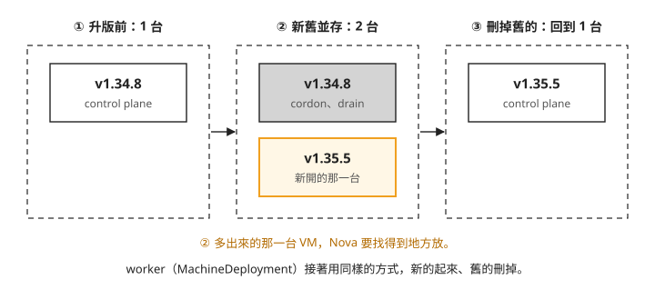
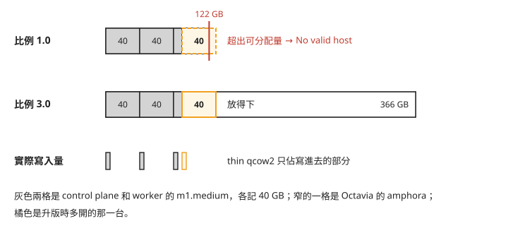
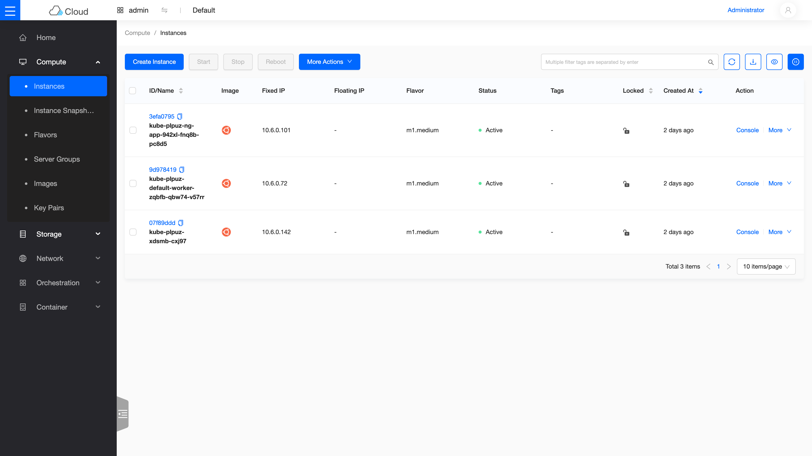

# Day 9: Day-2 維運——滾動升版、新增 node group、讓節點自動增減

Day 8 開出的 workload cluster `k8s-lab` 已經能跑應用程式。cluster 建好之後的日常維護,一般叫做 Day-2 維運。這一章做其中最常遇到的三件事:Kubernetes 出了新的小版本,要把 cluster 從 v1.34.8 升到 v1.35.5;某一類工作想放在專用的節點上,要多開一組節點;負載變大時,希望節點數自己增加,負載退了再自己減回來。

這三件事都會讓 Nova 多開 VM。所以除了指令,這一章還要看懂兩件事:新 VM 在 Nova 那邊排不排得進去,以及節點數由誰決定。讀完之後,遇到升版開不出新節點,或節點數自己跳回原值時,你能分辨是 Nova 的 disk 帳不夠,還是有兩個控制器在改同一個欄位。

## 開始之前

這一章接著 Day 8 的環境做:kind management cluster、Magnum 和 Octavia 都要正常運作,`k8s-lab` 是 `CREATE_COMPLETE`。主機重開過的話,先照 [Day 8](sprint3-day8-e2e-workload-cluster.md) 開頭的 Pre-flight 檢查一遍。

本章的指令會在兩座 cluster 之間切換。`KUBECONFIG=~/.kube/config` 指向 kind management cluster(Day 6 建的,CAPI 的資源都在這裡);看 workload cluster 的節點和 pod,要用 Day 8 從 secret 取出的那份 workload kubeconfig。Day 8 把它存成 `/tmp/wl.kubeconfig`,檔案不見了就照 Day 8 的步驟再取一次。下面的指令用 `<Day 8 的 workload kubeconfig>` 代表這個路徑。

## 升版為什麼要多開一台 VM

在 CAPI 上升級 Kubernetes,不會登入舊節點去升級套件,而是用新版本的 node image 開一台新 VM,等它加入 cluster,再把舊的那台移除。這種一次換一台的做法叫 **rolling upgrade**(滾動升版),替換過程中暫時多出來的那一台叫 **surge**。

拿 `k8s-lab` 的 control plane 來看。Day 6 介紹過,control plane 節點由 KubeadmControlPlane 管理,`k8s-lab` 只有 1 台。把升版過程依時間順序畫出來:



照著圖上的編號看:

1. 升版前是一台 v1.34.8。
2. KubeadmControlPlane 先把數量從 1 調到 2,開出一台 v1.35.5,等它加入 cluster、etcd 同步完成。接著把舊的那台 cordon(標記成不再接收新的 pod)和 drain(把上面的 pod 移走)。
3. 刪掉舊的,數量回到 1。

worker 由 MachineDeployment 管理,接著用同樣的方式替換。這樣換完的節點都是從乾淨的目標版本 image 開起來的,不會帶著舊版升級留下的東西。代價是第 ② 步:替換期間 cluster 會比平常多一台 VM,Nova 必須有空間放它。

## 步驟 1:讓 Nova 的 disk 帳放得下 surge 那一台 {#step-disk}

Day 8 遇過一次 `No valid host`:Nova 計算一台主機還剩多少 disk 時,加總的是每台 VM 的 flavor 宣告的磁碟大小,不是實際用量,而且關機(SHUTOFF)的 VM 也算在內。這筆帳記在 placement,也就是記錄每台主機還剩多少資源、Nova 排程時會去問的那個服務。

workload cluster 的節點都是 m1.medium,一台在帳上記 40 GB。以本課的 VM 為例,Nova 帳上的 disk 容量是 122 GB(Day 8 從 hypervisor 資訊看到的數字)。升版開始前,帳上已經有 control plane 和 worker 各 40 GB,再加上 Octavia 的 amphora;surge 再要 40 GB,就超過 122 GB。實際上,nested VM(在這台 Azure VM 裡面再開的 VM)的磁碟是 thin provisioning 的 qcow2 檔,只佔真正寫進去的部分,遠小於 flavor 宣告的 40 GB。

placement 對每種資源有一個 **allocation ratio**(超額分配比例):可分配的量 = 實際容量 × 這個比例。disk 的比例由 Nova 的 `disk_allocation_ratio` 設定。這個選項預設沒有值,新登記的 resource provider 會套用另一個選項 `initial_disk_allocation_ratio` 的 1.0。把兩種比例並排看:



比例 1.0 時,帳上剩下的空間不夠 surge 那台的 40 GB,排程就失敗;調成 3.0,可分配的量從 122 GB 變成 366 GB,surge 那台就排得進去。最下面那一列說明了為什麼這樣調在 lab 裡可行:每台 VM 實際寫進磁碟的量都很小。正式環境要依實際的超賣風險決定比例,因為所有 VM 真的把磁碟寫滿時,主機的磁碟會不夠用。

用 Day 1 的方式,在 `/etc/kolla/config/` 下放 Nova 的自訂設定,再只重新部署 Nova:

```ini
# /etc/kolla/config/nova.conf
[DEFAULT]
disk_allocation_ratio = 3.0
```
```bash
kolla-ansible deploy -i ~/all-in-one --tags nova
# 驗證:pip install osc-placement; openstack resource provider inventory list <rp> → DISK_GB allocation_ratio=3.0
```

註解那一行是驗證方式:`openstack` 指令要先裝 `osc-placement` 外掛才有 `resource provider` 系列子指令。`<rp>` 是 resource provider 的 UUID,單機部署只有一個,就是這台主機,可以用 `openstack resource provider list` 查到。`DISK_GB` 那一列的 `allocation_ratio` 變成 3.0,就是生效了。

## 步驟 2:升版 v1.34.8 → v1.35.5

升版的目標由 ClusterTemplate 決定。所以要先準備兩樣東西:v1.35.5 的 node image,以及一份指向它的新 template。新 template 和 Day 8 的 `k8s-v1.34.8-azure` 一樣帶齊三個 label:`kube_tag`(指定 Kubernetes 版本的 label)改成 v1.35.5,`fixed_subnet_cidr` 和 `octavia_provider` 照抄;image 換成新上傳的那一個,其他參數不變。準備好之後,`openstack coe cluster upgrade` 把 cluster 換到新 template,CAPI 就開始滾動替換:

```bash
# 1. 目標版本 node image + template(3 個 Azure label 齊全)
curl -fLO https://github.com/vexxhost/capo-image-elements/releases/download/2026.05-7/ubuntu-24.04-v1.35.5.qcow2
openstack image create ubuntu-24.04-v1.35.5 --disk-format qcow2 --container-format bare --public \
  --file ubuntu-24.04-v1.35.5.qcow2 --property os_distro=ubuntu --property os_version=24.04
openstack coe cluster template create k8s-v1.35.5-azure \
  --image ubuntu-24.04-v1.35.5 --external-network ext-net --dns-nameserver 8.8.8.8 \
  --master-lb-enabled --master-flavor m1.medium --flavor m1.medium \
  --network-driver calico --docker-storage-driver overlay2 --coe kubernetes \
  --label kube_tag=v1.35.5 --label fixed_subnet_cidr=10.6.0.0/24 --label octavia_provider=amphora

# 2. 觸發 rolling upgrade,監控 machine 版本滾動
openstack coe cluster upgrade k8s-lab k8s-v1.35.5-azure
watch 'KUBECONFIG=~/.kube/config kubectl -n magnum-system get machine -o custom-columns=P:.status.phase,V:.spec.version'
# UPDATE_COMPLETE 後 kubectl get nodes 全 v1.35.5
```

`watch` 那一行在 kind 上列出每個 Machine 的狀態(P 欄)和版本(V 欄)。對照前面的圖看:先多出一個 v1.35.5 的 Machine,原本 v1.34.8 的那個接著消失,control plane 換完再換 worker。如果新的 Machine 一直沒出現,先看 Nova 有沒有報 `No valid host`,見[疑難排解:升版時新節點開不出來](#mine-1)。

`openstack coe cluster show k8s-lab` 的狀態變成 `UPDATE_COMPLETE` 後,切到 workload cluster 看節點,VERSION 欄應該全部是 v1.35.5:

```bash
export KUBECONFIG=<Day 8 的 workload kubeconfig>
kubectl get nodes
```

## 步驟 3:新增一組 node group {#step-nodegroup}

**node group** 是 Magnum 的用語:一組規格相同、角色相同的節點。`k8s-lab` 建立時自帶一組 worker,現在要再加一組名為 `ng-app`、角色(role)為 `app` 的節點,讓指定的工作只跑在這組節點上。

node group 在 CAPI 那邊對應一個 MachineDeployment。不過 Magnum 使用的 driver(vexxhost 的 magnum-cluster-api)不會直接建立 MachineDeployment,中間還隔了一層。

這一層是 CAPI 的 **ClusterClass**:一份 cluster 範本,規定 control plane 和 worker 該長什麼樣子。Magnum 開的每座 cluster 都套用同一份範本。

每座 cluster 自己的參數,例如有哪幾組 worker、各要幾台,寫在 Cluster 物件的 `spec.topology` 欄位裡。其中 `spec.topology.workers.machineDeployments` 是一個陣列,每個 node group 佔一格。

CAPI 有一個 **topology controller**,讀這個陣列,替每一格建立並持續更新對應的 MachineDeployment。這種「Cluster 只寫 topology,底下的 MachineDeployment 由 topology controller 產生」的方式,叫 **managed topology**。

所以 `openstack coe nodegroup create` 做的事,就是在這個陣列裡加一格。

陣列的每一格都有一個 `failureDomain` 欄位,填的是節點要放在哪個 **availability zone**(AZ,Nova 把主機分組的單位;單機部署只有預設的 `nova`)。driver 從 node group 的 `availability_zone` label 讀這個值。沒給這個 label,driver 會填入 `null`,而 CAPI 只接受字串,整個 node group 會直接 `CREATE_FAILED`。建立 cluster 時自帶的 default-worker 走另一條路徑,值是空字串 `""`,所以沒有問題。所以建立時一定要帶上這個 label。最後一行要對 workload cluster 下,先切換 kubeconfig:

```bash
export KUBECONFIG=<Day 8 的 workload kubeconfig>
```

```bash
openstack coe nodegroup create k8s-lab ng-app --node-count 1 --role app \
  --labels availability_zone=nova
openstack coe nodegroup list k8s-lab           # ng-app CREATE_COMPLETE
kubectl get nodes -L node.cluster.x-k8s.io/nodegroup   # 新節點 role=app
```

AZ 的名稱可以用 `openstack availability zone list --compute` 確認。`kubectl get nodes` 加上 `-L` 會多印一欄節點所屬的 node group,新加入的那台應該屬於 `ng-app`,也就是註解說的 role 為 app 的那組節點。

## 步驟 4:讓 cluster-autoscaler 管 ng-app 的節點數

**cluster-autoscaler** 是 Kubernetes 的元件,發現有 pod 因為資源不夠而卡在 Pending 時加節點,節點閒置時再把它移除。它支援很多種雲,在 CAPI 上用的是 `clusterapi` provider:autoscaler 自己不開 VM,只改 MachineDeployment 的 `replicas`(要幾台),接下來由 CAPO(Day 6 裝的 CAPI OpenStack provider)呼叫 Nova API 開 VM 或刪 VM。

**annotation** 是 Kubernetes 物件的附加中繼資料,可以用來提供工具需要的設定。哪些 MachineDeployment 歸 autoscaler 管,由兩個 annotation 決定:`cluster.x-k8s.io/cluster-api-autoscaler-node-group-min-size` 和 `...-max-size`,分別是最少和最多幾台。同時有這兩個 annotation 的 MachineDeployment,autoscaler 才會去調整。

### autoscaler 放在哪一座 cluster

autoscaler 要同時看兩座 cluster:在 workload cluster 看哪些 pod 卡在 Pending,在 kind 讀寫 MachineDeployment。本課把它放在 kind 裡:讀寫 MachineDeployment 直接用 kind 內的身分,再用 `--kubeconfig` 指向 workload cluster。workload cluster 的 API 位址在 ext-net 上,從 kind 連得到。

反過來放進 workload cluster 也可以,但要另外給它 kind 的 kubeconfig,而 kind 的 API 只綁在主機的 127.0.0.1 上(Day 7 放進 Magnum 的那份 kubeconfig 就是這個位址),workload cluster 裡的 pod 連不到,還得另外做 port-forward 和略過 TLS 驗證。

### 先在 MachineDeployment 標上 min 和 max

在 kind 上找到 ng-app 對應的 MachineDeployment,標上最少 1 台、最多 3 台:

```bash
export KUBECONFIG=~/.kube/config          # kind mgmt
# 1. 標註 ng-app MD 的 min/max
MD=$(kubectl -n magnum-system get machinedeployment -o name | grep ng-app)
kubectl -n magnum-system annotate $MD \
  cluster.x-k8s.io/cluster-api-autoscaler-node-group-min-size=1 \
  cluster.x-k8s.io/cluster-api-autoscaler-node-group-max-size=3 --overwrite
```

### replicas 只能由一個控制器決定 {#replicas-owner}

到這裡如果直接部署 autoscaler,會遇到一個問題。步驟 3 說過,MachineDeployment 是 topology controller 照 Cluster 的 `spec.topology` 建出來的,而 `ng-app` 那一格寫著 `replicas: 1`。topology controller 會持續把 MachineDeployment 校正成 topology 寫的樣子(Day 6 講的 reconcile)。autoscaler 把 replicas 改成 3,topology controller 就改回 1:


我們可以從圖上看到,上下兩半差在 topology 裡有沒有 replicas。上半部有兩個控制器寫同一個欄位,節點數會在 1 和 3 之間來回;下半部 topology 不寫 replicas,這個欄位只剩 autoscaler 在改。CAPI 和 cluster-autoscaler 的文件對 ClusterClass 的要求也是這樣:要讓 autoscaler 管,Cluster topology 裡的 replicas 就不能設定。

所以下一步要改 Cluster 物件:移除 ng-app 那一格的 `replicas`,並把 min 和 max 的 annotation 寫進同一格的 `metadata`,讓 topology 宣告的內容和剛才直接標在 MachineDeployment 上的一致。

改之前先查兩件事。第一,CAPI 那邊 Cluster 物件的名稱:它由 Magnum 產生,是 `kube-` 開頭加一段隨機字串,跟 `openstack coe` 用的 `k8s-lab` 不同:

```bash
kubectl get cluster -n magnum-system
```

第二,`ng-app` 在陣列裡的位置。下面的 patch 用的是陣列位置 `1`,因為建立 cluster 時自帶的 `default-worker` 佔了第 0 格,`ng-app` 是後來加的第 1 格。如果你的 cluster 加過其他 node group,先看 Cluster 物件的 YAML 裡 `spec.topology.workers.machineDeployments` 底下各格的 `name`,從 0 開始數到 `ng-app`,把 patch 裡的兩個 `1` 換成那個位置。

確認之後再 patch,`<capi-cluster-name>` 換成上一條查到的名稱:

```bash
# 2. topology 交出 replicas 擁有權
kubectl -n magnum-system patch cluster <capi-cluster-name> --type=json -p \
 '[{"op":"remove","path":"/spec/topology/workers/machineDeployments/1/replicas"},
   {"op":"add","path":"/spec/topology/workers/machineDeployments/1/metadata/annotations",
    "value":{"cluster.x-k8s.io/cluster-api-autoscaler-node-group-min-size":"1",
             "cluster.x-k8s.io/cluster-api-autoscaler-node-group-max-size":"3"}}]'
```

### 部署 autoscaler

**ServiceAccount** 是 Pod 中程式使用的身分,**RBAC** 是授予該身分操作權限的機制。這裡要讓 autoscaler 使用的身分有權限讀寫 kind 裡的 MachineDeployment 等 CAPI 資源。

autoscaler 的 Deployment、ServiceAccount 和 RBAC 用 [cluster-autoscaler 官方 `clusterapi` provider 範例](https://github.com/kubernetes/autoscaler/blob/master/cluster-autoscaler/cloudprovider/clusterapi/README.md)的組態,部署到 kind。本課改了 image、args,並加上 `--kubeconfig`:

```bash
# 3. 部署 autoscaler 到 kind(clusterapi provider,--kubeconfig 指 workload)——關鍵 image/args:
#    image: registry.k8s.io/autoscaling/cluster-autoscaler:v1.35.1
#    args: --cloud-provider=clusterapi --clusterapi-cloud-config-authoritative
#          --node-group-auto-discovery=clusterapi:namespace=magnum-system,clusterName=<你的cluster名>
```

這幾個參數的作用:

- `--cloud-provider=clusterapi`:用 CAPI 的方式加減節點,也就是改 MachineDeployment 的 replicas。
- `--clusterapi-cloud-config-authoritative`:讀寫 MachineDeployment 時用 kind 內的身分,不要改用 `--kubeconfig` 指向的 workload cluster。官方 README 裡「management cluster 用 in-cluster 設定、另外指定 workload kubeconfig」的範例就是這樣搭配。
- `--node-group-auto-discovery`:只找 `magnum-system` namespace 裡、屬於指定 cluster 的 MachineDeployment。`clusterName` 填前面 `kubectl get cluster` 查到的名稱。

- `--kubeconfig`:指向掛進 Pod 的 workload cluster kubeconfig,讓 autoscaler 看得到 workload cluster 的 pod 和節點。

本課沒有保留當時用的完整 manifest,你要以官方範例為底,自己準備這幾樣:

- 在 kind 上選一個 namespace 放 autoscaler 的 Deployment 和 ServiceAccount。
- RBAC:讓這個 ServiceAccount 能讀寫 `magnum-system` namespace 裡的 MachineDeployment 等 CAPI 資源。官方範例裡有對應的 ClusterRole 和 binding 可以參考。
- 一個 Secret,內容是 workload cluster 的 kubeconfig。kind 的 `magnum-system` 裡已經有一個,就是 Day 8 取 kubeconfig 的那個 secret;把它複製到 autoscaler 所在的 namespace,或改用你自己存下的那份建立。
- Deployment:用上面的 image 和 args,把 Secret 掛成檔案,`--kubeconfig` 指向掛載的路徑。

autoscaler 起來之後,它的 log 會列出發現的 node group,應該看到 `discovered MachineDeployment ng-app (min:1 max:3)` 這樣的內容。

## 步驟 5:觸發擴充,再看它縮回

這一步的 Deployment 要自己寫,本課沒有保留當時的 YAML。規格是:名稱 `scale-test`,3 個副本,每個 pod 的 `resources.requests.cpu` 是 1,`nodeSelector` 用 `node.cluster.x-k8s.io/nodegroup` 這個 label 指向 ng-app 的節點(值以步驟 3 `kubectl get nodes -L` 那一欄印出的為準),image 用任何長時間執行的就可以。原本的 ng-app 只有一台 m1.medium,放不下 3 個各要 1 CPU 的 pod,多出來的 pod 會停在 Pending。

先切回 workload cluster,再套用你寫好的 Deployment:

```bash
export KUBECONFIG=<Day 8 的 workload kubeconfig>
```

接著部署一個超量的 workload 觸發擴充:`nodeSelector` 指定 `ng-app`,3 個 pod 各要 1 CPU,現有節點放不下,pod 會變成 Pending。

autoscaler 看到 Pending 的 pod,把 ng-app 的 replicas 從 1 改成 3;CAPO 呼叫 Nova 開兩台新 VM,加入 cluster 之後,3 個 pod 全部變成 Running。在 kind 上看 MachineDeployment,replicas 應該停在 3,不會再跳回 1。

接著把負載移除,讓 autoscaler 把多出來的節點縮回去(KUBECONFIG 仍指向 workload cluster):

```bash
kubectl delete deployment scale-test
```

這兩台節點閒置一段時間後,autoscaler 會把 replicas 調回 min 的 1,多開的兩台 VM 也會被刪掉。

## 從儀表板看成果



*Skyline 的 Instance 列表:workload cluster 有三台 Active 的節點,分別是 control plane、自帶的 worker 和 ng-app 的一台。名稱以 `ng-app` 開頭的那一台,就是步驟 3 加的 node group。*

## 疑難排解

### 升版時新節點開不出來,Nova 報 `No valid host` {#mine-1}

**症狀**:`openstack coe cluster upgrade` 之後,新版本的 Machine 一直沒有起來,Nova 端報 `No valid host`。

**原因**:Nova 的 disk 帳用 flavor 總和計算,surge 多開的那一台 40 GB 超出可分配量。修法見[步驟 1](#step-disk);如果 Day 2–4 留下的 VM 或 Octavia amphora 還在,也會佔掉 disk 帳,見 Day 8 的[「LB 的 amphora 開不出來,Nova 報 `No valid host was found`」](sprint3-day8-e2e-workload-cluster.md#mine-4)。

## 想一想

- 一位同學的 cluster 是 3 台 control plane 加 5 台 worker,他準備升版。替換過程中,他的 Nova 至少要多容納幾台節點 VM?如果他的主機 disk 帳只夠再放一台,升版能完成嗎?
- 另一位同學想讓 autoscaler 也管另一組 node group `ng-batch`。他只在 `ng-batch` 的 MachineDeployment 標上 min 和 max 的 annotation 就部署了,觸發擴充時會看到什麼?他漏了哪一步?
- 有人建議乾脆把 `disk_allocation_ratio` 設成 10,這樣以後都不會遇到 `No valid host`。在什麼情況下這會出問題?

## 小結

這一章的三件維運工作,最後都落在 Nova 多開或少開 VM。CAPI 升版是開新 VM 換掉舊的,替換期間會多一台,所以先用 `disk_allocation_ratio` 讓 placement 的 disk 帳放得下它;thin qcow2 實際只佔一小部分,lab 裡這樣超賣是安全的。node group 是 Cluster topology 陣列裡的一格,由 topology controller 建成 MachineDeployment,在 magnum-cluster-api 上新增時要帶 `availability_zone` label。cluster-autoscaler 透過改 MachineDeployment 的 replicas 來加減節點,前提是 topology 不再寫 replicas。之後遇到節點數或設定值「自己變回去」,先找出是哪幾個控制器在寫同一個欄位;遇到新節點開不出來,先看 Nova 的 disk 帳。

## 延伸閱讀

想再深入,可以從這幾份開始:

- **[Nova 排程與資源配置](https://docs.openstack.org/nova/2025.1/admin/scheduling.html)** —— allocation ratio 的官方說明,包括 `disk_allocation_ratio` 和 placement 的關係。
- **[Magnum User Guide](https://docs.openstack.org/magnum/2025.1/user/)** —— cluster 升版與 node group 的官方參數定義。
- **[Kubernetes Cluster Autoscaler](https://github.com/kubernetes/autoscaler/tree/master/cluster-autoscaler)** —— 自動擴縮的上游專案;`cloudprovider/clusterapi` 目錄下的 README 有 min/max annotation、ClusterClass 不設 replicas 的說明,以及部署範例。
- **[Kolla-Ansible 維運指南](https://docs.openstack.org/kolla-ansible/2025.1/user/operating-kolla.html)** —— reconfigure、upgrade 這些日常操作的官方流程。

## 下一步

這幾天的網路、VM、LB 都是用指令一個個建的。[Day 10](sprint3-day10-terraform-teardown.md) 改用 Terraform 的 OpenStack provider 管理這些資源,並演練整朵雲拆掉再重建的流程。
