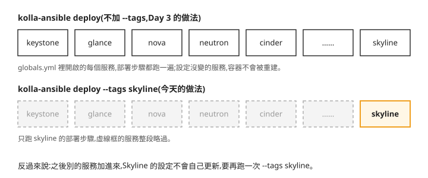
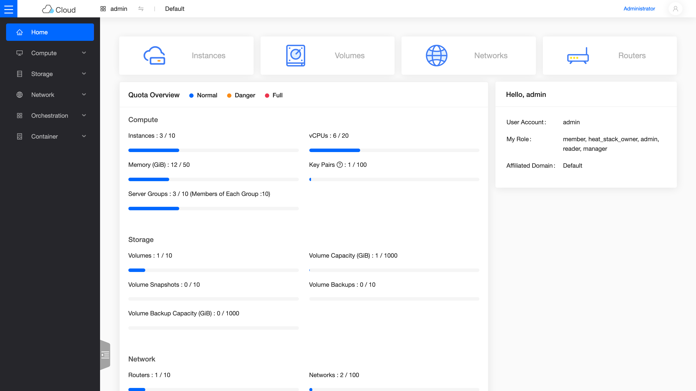
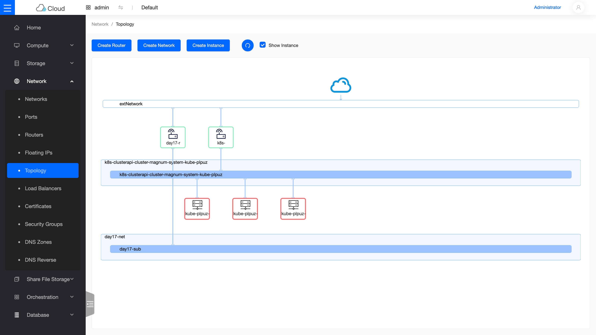
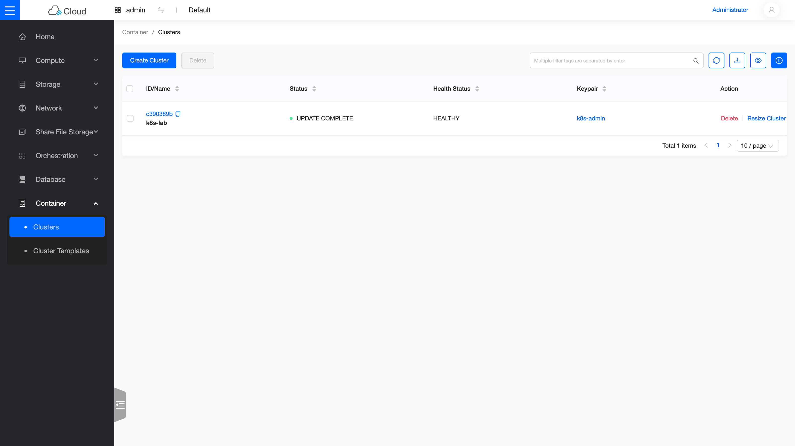

# Day 13: 用 Skyline 換上新一代儀表板——前後端兩個容器、只部署一個服務

{ align=right width="100" }

Day 1 部署完,你用 SSH tunnel 打開過網頁儀表板 Horizon。之後幾天建了網路、router、VM,還開了一座 Magnum K8s cluster。現在想看一眼「這些網路和 VM 是怎麼接在一起的」,Horizon 能列出每一項資源,但要自己在腦中把它們拼起來。OpenStack 官方另外有一個新的儀表板 **Skyline**,內建一張資源拓樸圖,操作起來也比較像現代的網頁應用。

這一章在不動其他服務的前提下,把 Skyline 加進同一朵雲,讓它和 Horizon 同時存在。讀完之後,Skyline 的頁面打不開或登入失敗時,你能判斷該先查哪一個容器;也能判斷這次只部署 Skyline 一個服務的做法,什麼時候夠、什麼時候不夠。

## Skyline 和 Horizon 差在哪

Horizon 是 OpenStack 用了十多年的儀表板,以 Python 的 Django 框架為基礎,包含伺服器端產生的頁面與前端互動功能。Skyline 把這件事拆成前後兩半:前端是在瀏覽器裡執行的 React 網頁程式,只在需要資料時向伺服器要;後端是一個 Python 寫的 API 服務。

兩個儀表板自己都不存任何資源,畫面上的 VM、網路、volume,都是當下向 Nova、Neutron、Cinder 這些服務的 API 查來的。所以兩者可以同時開著,看到的是同一份資料。Skyline 目前還沒有涵蓋 Horizon 的全部功能,部分管理員操作仍然要回 Horizon 做,實務上常常兩個都開著。

## Skyline 的兩個容器

在 Kolla 裡,Skyline 由兩個容器組成,跟其他 Kolla 服務一樣直接使用主機的網路:

- **`skyline_console`**(port 9999):前端。裡面是一個 nginx 網頁伺服器,把網頁送給瀏覽器,也負責轉送網頁發出的請求。
- **`skyline_apiserver`**(port 9998):Skyline 自己的 API 層,處理登入、權限這類 Skyline 自己的功能。

下面這張圖畫出一個請求從瀏覽器出發會經過哪幾站,右邊放 Horizon 對照:


我們可以從圖上看到兩件事:

1. **瀏覽器只跟 `skyline_console` 打交道。** 網頁本身、登入請求、查 VM 列表的請求,都先進 9999。console 再依請求種類,交給 apiserver 或直接轉給對應服務的 API。
2. **兩個儀表板最下面接的是同一組服務。** 登入用的是 Keystone 的同一組帳號,在 Skyline 刪掉的 VM,Horizon 也看不到了。

這個分工就是之後除錯的順序:整個網頁打不開,先看 `skyline_console`;網頁出得來但登不進去,看 `skyline_apiserver` 和 Keystone;只有某一類資源的頁面出錯,看那個服務本身。

## 步驟 1:開 flag,只部署 Skyline

加服務的做法跟 Day 3 加 Cinder 一樣:在 `globals.yml` 加一行開關,再跑一次部署。Skyline 不需要在 `/etc/kolla/config/` 放任何自訂設定檔。

不同的是這次在 deploy 後面加了 `--tags skyline`。Kolla-Ansible 的劇本裡,每個服務的部署步驟都標了自己的名字,`--tags` 讓這次只執行標了 `skyline` 的步驟,其他服務整段略過。Day 9 調 Nova 設定時用過的 `--tags nova` 也是同一個機制。下面把兩種跑法並排:



我們可以從圖上看到,`--tags` 省下的是其他服務的部署步驟,代價是它們完全不會被碰到。Skyline 能這樣做,是因為加入 Skyline 不需要改其他服務的設定;Day 3 加 Cinder 時,Nova 的設定也要跟著補上 Cinder 的部分,只跑 `--tags cinder` 就會漏掉 Nova。

圖的最下面一行是同一件事的另一面。Skyline 的設定是在部署當下,依照雲裡已經有哪些服務產生的。Day 21 裝好監控系統 Prometheus 之後,Skyline 的監控頁面要接上它,得再跑一次 `--tags skyline` 才會更新。到了 Day 21 會再提醒一次。

開 flag 並部署:

```bash
echo 'enable_skyline: "yes"' | sudo tee -a /etc/kolla/globals.yml
source ~/kolla-venv/bin/activate
kolla-ansible deploy -i ~/all-in-one --tags skyline
```

```text
PLAY RECAP *********************************************************************
localhost : ok=23  changed=16  unreachable=0  failed=0  skipped=3  ...
```

`failed=0` 代表部署成功。Day 1 整份部署的 PLAY RECAP 是 `ok=367`,這次只有 `ok=23`,因為只跑了 Skyline 自己的步驟。

## 步驟 2:確認兩個容器與 endpoint

接下來分三層確認:容器有沒有起來、Keystone 有沒有登記、網頁有沒有回應。指令裡的 `10.0.0.4` 是本課 VM 的私有 IP(Day 1 設給 `network_interface` 的 `eth0`),請換成你自己的:

```bash
sudo docker ps --format "{{.Names}}  {{.Status}}" | grep skyline
source /etc/kolla/admin-openrc.sh
openstack endpoint list -f value | grep skyline
curl -s -o /dev/null -w "%{http_code}\n" http://10.0.0.4:9999/
```

```text
skyline_console    Up (healthy)
skyline_apiserver  Up (healthy)
... skyline ... http://10.0.0.4:9998
200
```

輸出由上往下對應三層:

- **兩個容器都是 `Up (healthy)`。** 少一個,或停在 `Restarting`,就從那個容器的 log 查起。
- **Keystone 裡多了一個 `skyline` 服務,endpoint 指向 9998。** 被登記的是 apiserver,不是 console。這跟 Day 1 看 `openstack service list` 時 Horizon 不在清單上是同一個道理:console 只送網頁,不提供 API 給別人呼叫。
- **9999 回 `200`。** console 能把網頁送出來。

## 步驟 3:打開 Skyline

跟 Horizon 一樣,Skyline 聽在 VM 的私有 IP 上,要在你的電腦上開一條 SSH tunnel 才連得到(Day 1 開 Horizon 時用過同樣的做法)。這次轉的是 9999:

```bash
# 在你的電腦上執行
ssh -L 9999:<VM私有IP>:9999 -i <你的金鑰> azureuser@<VM公網IP>
```

瀏覽器開 `http://localhost:9999`,帳號 `admin`,密碼跟 Horizon 是同一組,在 VM 上用 `grep keystone_admin_password /etc/kolla/passwords.yml` 查。兩邊共用 Keystone 的帳號,所以不用另外建使用者。

登入後的首頁是配額總覽,每一列是一種資源目前用了多少、上限多少:



*Skyline 首頁:上半部是 Instances、Volumes、Networks、Routers 的捷徑,下方 Quota Overview 依 Compute、Storage、Network 分組顯示用量,右側是目前登入的帳號與角色。*

左側選單每一項都對應一個已部署的服務。值得先看的有兩頁。

**Network → Topology** 把網路資源畫成一張圖。圖上由上往下讀:最上面是對外網路 `extNetwork`,往下接 router,router 再接到內網,內網上掛著 VM。這跟 Day 2 用 CLI 一步步建的「外網 → router → 內網 → VM」是同一種接法:



*這張截圖是課程後期拍的。圖中間是 Day 8 Magnum cluster 的網路與三個節點;`day17-r`、`day17-net` 是 Day 17 才建的資源,你今天的畫面上不會有。*

**Container → Clusters** 列出 Day 8 開的 Magnum K8s cluster,狀態是 `UPDATE COMPLETE`,健康狀態是 `HEALTHY`:



*截圖包含後續章節的服務。`Share File Storage` 和 `Database` 分別需要 Day 16、Day 18 的 Manila 和 Trove;選單出現哪些項目,也取決於 Skyline 的部署設定是否更新。今天先看已完成部署的服務。*

畫面右上角還可以切換成深色模式。

## 想一想

- 同事照這章做完,瀏覽器打開 `http://localhost:9999` 看得到登入畫面,但按下登入之後一直失敗。你會請他先查哪一個容器?為什麼不是另一個?
- Day 21 用 `--tags prometheus` 部署了 Prometheus,同事打開 Skyline 的監控頁面,發現還是沒有資料。他漏了什麼?
- 你在 Skyline 裡找不到某個管理員操作,改到 Horizon 去做。做完之後回 Skyline,看得到這個變更嗎?需要在 Horizon 和 Skyline 之間同步什麼嗎?

## 小結

Skyline 是 OpenStack 的新一代儀表板,在 Kolla 裡由兩個容器組成:9999 的 `skyline_console` 送網頁並轉送請求,9998 的 `skyline_apiserver` 處理登入與權限,資料則和 Horizon 一樣來自各服務的 API、帳號來自同一個 Keystone,所以兩個儀表板可以並存。部署時用 `--tags skyline` 只跑它自己的步驟,這在不需要改其他服務設定時省事;反過來,之後雲裡加了 Skyline 會用到的服務,記得再跑一次 `--tags skyline`。之後頁面出問題時,先分清是網頁出不來、登不進去,還是某一類資源出錯,再決定查 console、apiserver 還是後面的服務。

## 延伸閱讀

想再深入，可以從這幾份開始：

- **[Skyline 官方文件](https://docs.openstack.org/skyline-apiserver/2025.1/)** —— apiserver 的架構與設定參考,console 和 apiserver 怎麼分工寫在這裡。
- **[Kolla-Ansible 的 Skyline 部署指南](https://docs.openstack.org/kolla-ansible/2025.1/reference/shared-services/skyline-guide.html)** —— 本章部署步驟的官方對照,SSO 與自訂 logo 等進階選項也在這份。
- **[skyline-console 原始碼](https://github.com/openstack/skyline-console/tree/stable/2025.1)** —— 想看前端怎麼畫出資源拓樸圖,可以直接讀原始碼。

## 下一步

儀表板換新了,接下來三天處理儲存。[Day 14](sprint4-day14-ceph-bootstrap.md) 先在同一台主機上建起一套 **Ceph**:它是正式環境 OpenStack 常用的儲存後端,Day 15 的物件儲存和 Day 16 的共享檔案系統都建在它上面。

---

*Skyline 吉祥物(九色鹿)為 OpenStack 官方專案標誌,此處作社群教學用途。*
