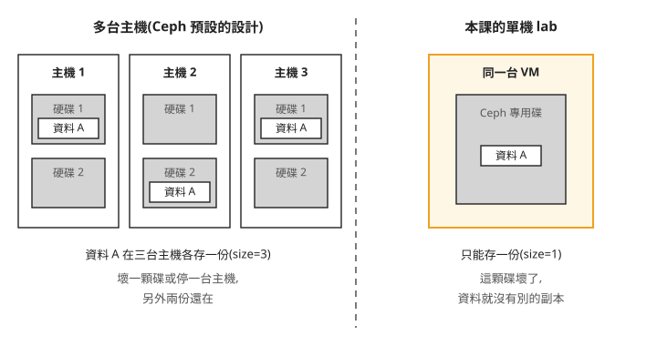
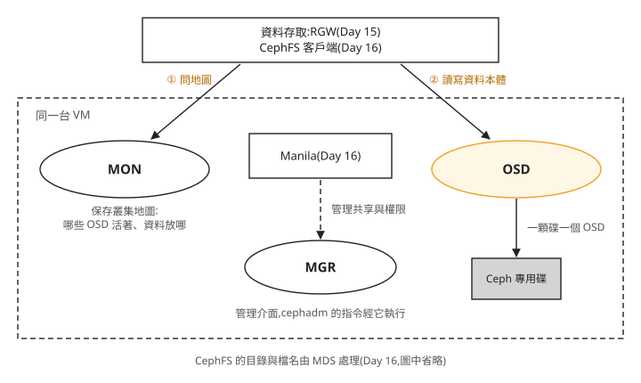
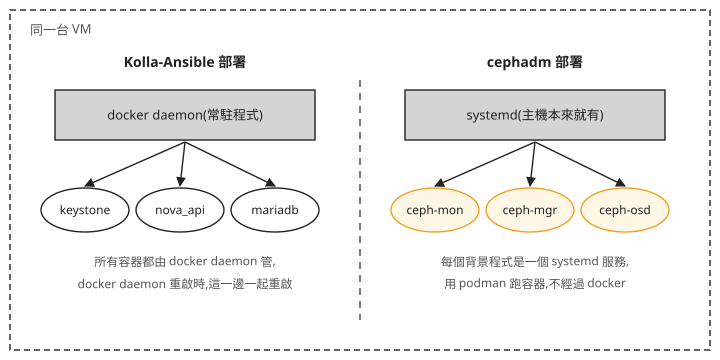

# Day 14: Ceph 基礎——副本數、MON/MGR/OSD 與單機 cephadm 部署

{ align=right width="110" }

Day 3 建的 Cinder volume,全都放在主機上同一顆 data disk 裡。這顆碟壞了,所有 volume 一起不見;主機停機,volume 也跟著無法使用;容量用完時,可以增加磁碟並擴充 LVM volume group,但仍要處理單一主機的故障。接下來兩章要做的物件儲存(Day 15)和共享檔案系統(Day 16),也需要一個不綁在單一顆碟上的儲存。生產環境的 OpenStack 多半用 **Ceph** 來做這件事。

這一章在同一台 VM 上,用 Ceph 官方的部署工具 cephadm 裝一套最小的 Ceph,先不接 OpenStack。Ceph 的預設值是為很多台機器、很多顆碟設計的,放到一台機器上,有幾個預設值一定要改,改了也一定會留下幾個告警。讀完之後,看到 `ceph health detail` 列出的告警,你能分辨它是單機刻意接受的代價、Ceph 和 OpenStack 同機共存造成的掃描錯誤,還是設定其實沒有生效。

## 為什麼一顆碟不夠

Ceph 把很多台機器上的很多顆碟,組成一個對外看起來只有一份的儲存空間。本章討論的是 replicated pool:資料會複製成多份,份數稱為**副本數**,設定名稱是 `size`,預設是 3。使用以 host 為故障域的放置規則時,副本分散到不同主機;Ceph 也有 erasure-coded pool 等其他配置,不能把所有 pool 都視為相同的複寫方式。

下面這張圖左右對照兩種情況:左邊是 Ceph 預設設計的多台主機,右邊是我們這一章的單機 lab。



我們可以從圖上看到兩件事:

1. **左邊的三份副本放在三台不同的主機上。** 壞掉一顆碟、甚至停掉一整台主機,資料都還有兩份。有足夠空間、而且還有符合放置規則的主機時,Ceph 會在別處補回副本。圖中只有三台主機,停掉一台後只能暫時保有兩份,要恢復第三個主機故障域才能補足三份。容量不夠時,加主機、加碟就好。
2. **右邊只有一顆碟,資料只能存一份。** 這一章的 lab 就是這種情況:副本數要從 3 改成 1,而這一份壞了就沒有了。這是單機 lab 要接受的代價,生產環境不會這樣設。

同一套 Ceph 對外可以提供三種儲存:**區塊**(像一顆硬碟,可以當 Cinder 的後端)、**物件**(用 HTTP API 存取,支援 S3 和 Swift 兩種介面)、**檔案**(掛成網路上的共享資料夾)。[Day 12](sprint3-day12-sprint4-preview.md) 提過業界改用 Ceph 提供 Swift API,原因就在這裡:維護一套 Ceph,三種儲存都有了。Day 15 用的是物件,Day 16 用的是檔案。

## Ceph 由哪些程式組成

Ceph 不是一個程式,而是幾種背景程式(daemon)合作。這一章會裝三種,後面每一條調整指令,都是在調其中一種:



照著圖上的編號看,客戶端讀寫一份資料要經過兩步:

- **① 先問 MON。** **MON**(monitor)保存整個叢集的地圖:有哪些 OSD、哪些還活著、每份資料該放在哪裡。客戶端拿到地圖,自己算出資料在哪個 OSD。
- **② 直接找 OSD。** **OSD**(Object Storage Daemon)是真正把資料寫進碟的程式,**一顆碟對應一個 OSD**,同時負責把資料複製到其他 OSD、在某顆碟壞掉時把資料補回來。要擴充容量,就是加碟、加 OSD。

圖中間的 **MGR**(manager)不在讀寫路徑上,它提供管理介面和統計數字,cephadm 下的部署指令也是經由它執行。MGR 通常會有一個在工作(active)、一個待命(standby),工作中的那個停了,待命的接手。

生產環境的 MON 會放 3 個或 5 個。MON 之間要對叢集地圖取得共識,規則是**過半數**的 MON 在線才算數,這個過半數的集合叫 **quorum**。3 個 MON 至少要 2 個在線,所以能容許壞 1 個;5 個至少要 3 個,能容許壞 2 個;4 個至少要 3 個,也只能容許壞 1 個,跟 3 個一樣。所以 MON 的數量用奇數,多一個偶數並不會多容許一次故障。這一章只有 1 個 MON,過半數就是它自己。

還有第四種背景程式 MDS,只有用到 Ceph 的檔案儲存時才需要,Day 16 才會出現。這一章只會在步驟 3 先替它設一個快取目標。

最後一個名詞是 **pool**(儲存池)。OSD 是一顆顆的碟,pool 是建在所有 OSD 之上的邏輯分區,Day 15、16 的服務各自會在 Ceph 裡建自己的 pool。副本數 `size` 就是 pool 的設定:每個 pool 建立時,從叢集的預設值拿到自己的副本數。這一點決定了步驟 3 和步驟 4 的順序。

## 開始之前

Ceph 需要一顆**全新的空碟**,只給 Ceph 用。Day 3 那顆 data disk 已經是 Cinder 的 LVM,不能拿來用。在 Azure 上替 VM 加掛一顆新碟,本課用 256 GB;下面指令的 `<資源群組>`、`<VM名>` 換成你 Day 0 建立時用的名稱:

```bash
# 在你的電腦上執行
az vm disk attach -g <資源群組> --vm-name <VM名> --name ceph-data --new --size-gb 256 --sku Premium_LRS
```

這一章會動到磁碟,建議先用 `az snapshot create` 替 VM 現有的磁碟拍快照,出錯時才有退路。

掛好之後回到 VM,用 `lsblk` 找到新碟:大小是你剛剛指定的 256G,底下沒有任何分割,也沒有掛載點。本課的新碟出現為 `/dev/sdc`(OS 碟是 `sda`,Day 3 的 data disk 是 `sdb`),你的裝置名稱如果不同,後面步驟 4 的 `/dev/sdc` 要換成你的。Ceph 只會在完全空白的碟上建 OSD:有分割、有檔案系統或有 LVM 的碟,都不會被當成可用的碟。

除非特別註明「在你的電腦上」,以下指令都在 VM 上執行。

## 步驟 1:安裝 cephadm

Day 1 用 Kolla-Ansible 部署了 OpenStack,但 Kolla-Ansible 從 2020 年起就不再部署 Ceph 本身,只負責把 OpenStack 接到一套已經存在的 Ceph。部署 Ceph 要用 Ceph 官方的工具 **cephadm**:它把每個 Ceph 背景程式放進容器裡跑,並替每一個容器註冊一個 systemd 服務(systemd 是 Ubuntu 管理背景服務的系統,開機時負責把服務啟動)。所以這台主機上會有兩套部署工具,各管各的:Kolla-Ansible 管 OpenStack,cephadm 管 Ceph。

cephadm 可以用 docker 或 podman 跑容器,這裡選 **podman**。兩者的差別畫成圖:



我們可以從圖上看到,docker 的所有容器都掛在同一個常駐程式 docker daemon 底下,而 Kolla 部署時可能會重啟 docker daemon。如果 Ceph 也跑在 docker 底下,每次 Kolla 部署,MON 和 OSD 都可能被一起重啟。podman 沒有常駐的總管程式,每個 Ceph 背景程式各自是一個 systemd 服務,Kolla 重啟 docker 時不受影響。

安裝 podman、LVM 工具(cephadm 用 LVM 管理 OSD 的碟)和校時服務 chrony(MON 之間要求時間一致),再下載 cephadm:

```bash
sudo apt-get install -y podman lvm2 chrony
cd ~
curl --silent --remote-name --location https://download.ceph.com/rpm-20.2.2/el9/noarch/cephadm
chmod +x cephadm
./cephadm version
```

```text
cephadm version 20.2.2 (...) tentacle (stable)
```

版本是 **Tentacle 20.2.2**,本課撰寫時最新的穩定版,前一代 Squid 已接近停止維護。不要用 Ubuntu 套件庫裡的 ceph 套件,Ubuntu 收錄的是有已知問題的預覽快照。cephadm 是一支不挑發行版的獨立執行檔,下載路徑雖然寫著 `el9`,在 Ubuntu 上照樣能用。

## 步驟 2:bootstrap

**bootstrap** 是在第一台主機上建立一個新的 Ceph 叢集:產生叢集的設定和金鑰、啟動第一個 MON 和 MGR。這一步還沒有任何 OSD,所以還不能存資料。

```bash
sudo ./cephadm bootstrap \
  --mon-ip 10.0.0.4 \
  --single-host-defaults \
  --skip-monitoring-stack \
  --skip-dashboard
```

- `--mon-ip`:第一個 MON 要聽的 IP。填你的 VM 的私有 IP(`ip -4 addr show eth0` 可查),跟 Day 1 的 `kolla_internal_vip_address` 是同一個,不一定是上面的 `10.0.0.4`。
- `--single-host-defaults`:改掉幾個假設有多台主機的預設值。依官方文件,它設定三件事:資料副本改成分散在不同的 OSD 而不是不同的主機(`osd_crush_chooseleaf_type = 0`);預設副本數改成 2(`osd_pool_default_size = 2`);以及關閉待命 MGR 的模組(`mgr_standby_modules = False`),讓待命的 MGR 不執行這些模組。這不會取消 MGR 本身的接手機制。只有一顆碟時 2 份還是放不下,所以步驟 3 會再改成 1。
- `--skip-monitoring-stack`:一定要帶。Ceph 自帶的監控套件包括 grafana(3000)、node-exporter(9100)、alertmanager(9093),跟 Day 21 要用 Kolla 部署的監控服務用同樣的 port。現在不跳過,Day 21 就會有兩個程式搶同一個 port。
- `--skip-dashboard`:不裝 Ceph 的網頁儀表板,節省資源;這一章用命令列看狀態就夠了。

結尾印出 `Bootstrap complete.` 就是成功,含下載 Ceph 容器映像檔約 2–3 分鐘。

## 步驟 3:單機要改的設定

主機上沒有直接裝 `ceph` 指令。`cephadm shell` 會開一個帶著 `ceph` 指令和管理員金鑰的容器,`--` 後面的指令就在這個容器裡執行。下面一次送進七行設定:

```bash
sudo ./cephadm shell -- bash -c "
ceph config set global mon_allow_pool_size_one true
ceph config set global osd_pool_default_size 1
ceph config set global osd_pool_default_min_size 1
ceph config set mon osd_pool_default_size 1
ceph config set osd osd_memory_target_autotune false
ceph config set osd osd_memory_target 2G
ceph config set mds mds_cache_memory_limit 1G
"
```

`ceph config set` 的第一個參數是這行設定給誰:`global` 套用到所有背景程式,`mon`、`osd`、`mds` 只套用到那一種。

**前四行把副本數改成 1。** Ceph 預設不讓 pool 的副本數設成 1,第一行先打開這個限制。第二行把預設副本數 `size` 改成 1;第三行的 `min_size` 是一個 pool 至少要有幾份副本可用才接受讀寫,只有一份時也只能是 1。第四行在 `mon` 這一層再設一次預設副本數;疑難排解的[告警讀到舊值](#mine-3)就是用 `ceph config get mon osd_pool_default_size` 檢查這一層。

這四行要在步驟 4 加 OSD **之前**設好。前面說過,pool 建立時才從預設值拿到自己的副本數。bootstrap 剛完成時叢集裡一個 pool 都沒有,Ceph 自己用的第一個 pool `.mgr`,要等第一個 OSD 上線才會建立。先改預設值、再加 OSD,`.mgr` 建立時就直接是 1 份。

**後三行調整記憶體目標。** OSD 會依 `osd_memory_target` 這個目標值決定用多少記憶體當快取,而 cephadm 預設開啟自動調整(autotune):把主機總記憶體乘上 0.7、扣掉其他 Ceph 程式的用量,再平分給每個 OSD。這個算法假設主機只跑 Ceph。在 Day 0 那台 128 GB、只有一個 OSD 的 VM 上,目標值會被調到幾十 GB,跟同一台主機上的 OpenStack 搶記憶體。所以關掉自動調整,把 OSD 的目標固定在 2 GB。最後一行替 Day 16 才會出現的 MDS 先設 1 GB 的快取目標。這些設定不是程序的硬性記憶體上限,仍需保留額外空間;2 GB 的 OSD 目標適合這個小型練習,繁忙時可能犧牲效能。

## 步驟 4:加入 OSD

指定要用哪一顆碟。不要用 Ceph「自動把所有空碟都拿來用」的選項(`--all-available-devices`),這台主機上還有 OpenStack 在用的碟。指令裡的 `$(hostname -s)` 會換成這台主機的名稱,`/dev/sdc` 換成你在「開始之前」用 `lsblk` 找到的新碟:

```bash
sudo ./cephadm shell -- ceph orch daemon add osd $(hostname -s):/dev/sdc
```

```text
Created osd(s) 0 on host 'openstack-lab'
```

輸出裡的 `osd(s) 0` 是這個 OSD 的編號,從 0 開始;`openstack-lab` 是本課 VM 的主機名稱,你的會不一樣。約 30 秒後,在 `cephadm shell` 裡跑 `ceph osd stat`,應該看到 `1 osds: 1 up, 1 in`:`up` 表示 OSD 程式在執行,`in` 表示它被算進存放資料的成員。

## 步驟 5:處理單機一定會出現的告警

先列出目前所有的健康告警:

```bash
sudo ./cephadm shell -- ceph health detail
```

單機、而且跟 OpenStack 同機,會看到兩種告警。兩種都是已知原因,處理方式是 **mute**(靜音):讓這個告警不再影響叢集的整體健康狀態。加上 `--sticky`,靜音就會一直有效;不加的話,告警一旦消失又再出現,靜音就失效了。

第一種是 `POOL_NO_REDUNDANCY`:有 pool 只有一份副本。這是步驟 3 刻意設的結果,靜音:

```bash
sudo ./cephadm shell -- ceph health mute POOL_NO_REDUNDANCY --sticky
```

第二種是 `CEPHADM_REFRESH_FAILED`:cephadm 定期掃描主機上所有的碟,掃到 Day 3 Cinder 建立的 LVM 時讀取失敗。不影響已經加好的 OSD,原因和處理見[疑難排解:裝置掃描報 `CEPHADM_REFRESH_FAILED`](#mine-1)。

如果還看到 `OSD count 1 < osd_pool_default_size 2`,代表健康檢查還在用 bootstrap 時的舊值 2,見[疑難排解:告警讀到舊值](#mine-3)。

處理完,看整個叢集的狀態:

```bash
sudo ./cephadm shell -- ceph -s
```

```text
    health: HEALTH_OK
    mon: 1 daemons, quorum openstack-lab
    mgr: openstack-lab.xxxx(active), standbys: openstack-lab.yyyy
    osd: 1 osds: 1 up, 1 in
    usage: 28 MiB used, 256 GiB / 256 GiB avail
```

逐行對照前面的名詞:

- `health: HEALTH_OK`:兩個已知的告警已被靜音,目前未靜音的健康檢查沒有回報問題;這不代表所有故障風險都已排除。
- `mon: 1 daemons, quorum openstack-lab`:只有一個 MON,quorum 就是它自己。
- `mgr: ... (active), standbys: ...`:一個 MGR 在工作、一個待命,兩個都在同一台主機上。
- `osd: 1 osds: 1 up, 1 in`:步驟 4 加的那顆。
- `usage: ... 256 GiB avail`:可用容量等於新碟的大小,因為只存一份,沒有被副本吃掉。

最後做 OpenStack 的初步檢查:載入 `/etc/kolla/admin-openrc.sh` 後跑 `openstack service list`,服務清單應該跟裝 Ceph 之前一樣,`docker ps` 的容器數也不變。這兩項只能確認註冊與容器仍在,不能證明所有 OpenStack 功能未受影響;仍要依使用中的服務確認操作與連線。`cephadm shell -- ceph orch ps` 會列出 cephadm 管理的每個 Ceph 背景程式,它們都不會出現在 `docker ps` 裡。

## 重開機之後

步驟 1 選 podman 的另一個結果,在主機重開機時看得到。每個 Ceph 背景程式都是一個 systemd 服務,主機開機時 systemd 會把它們依序啟動,健康狀態重新回報,步驟 5 的靜音設定也還在,不需要手動處理。

對照 [Day 6 的「VM reboot 後的復原」](sprint3-day6-capi-management-cluster.md#mine-4):kind 叢集的節點是 docker 容器,VM 重開機後要先手動 `docker start`。一套裝在主機上的服務重開機後能不能自己回來,先看它有沒有註冊成 systemd 服務。

## 拆除與重來

lab 結束,或想從頭再做一次,用 cephadm 把整個叢集刪掉。`ceph fsid` 取得這個叢集的識別碼:

```bash
FSID=$(sudo ./cephadm shell -- ceph fsid)
sudo ./cephadm rm-cluster --force --zap-osds --fsid $FSID
```

`--zap-osds` 會把資料碟上 Ceph 留下的痕跡一起清掉,這顆碟就回到步驟 4 能直接使用的空白狀態。

## 疑難排解

### 裝置掃描報 `CEPHADM_REFRESH_FAILED` {#mine-1}

**症狀**:`ceph health` 出現 `CEPHADM_REFRESH_FAILED: failed to probe daemons or devices`,詳細內容是一長串 `blkid: error: /dev/cinder-volumes/...pool_tmeta: No such file or directory`。

**原因**:cephadm 會定期盤點主機上所有的碟(`ceph-volume inventory`)。Day 3 的 Cinder 用 LVM thin pool,thin pool 內部有一個存放中繼資料的邏輯磁碟區(名稱以 `_tmeta` 結尾),它沒有可以讀取的裝置檔,盤點讀到它就失敗。只有 Ceph 和 Day 3 的 Cinder LVM 裝在同一台主機上才會出現。

**修法**:不影響功能。步驟 4 是直接指定 `/dev/sdc` 加 OSD,不依賴這份盤點。靜音:`ceph health mute CEPHADM_REFRESH_FAILED --sticky`。

### OSD 的記憶體目標被調到幾十 GB {#mine-2}

**原因**:漏了步驟 3 的後三行,cephadm 的自動調整依主機總記憶體算出 OSD 的記憶體目標。

**修法**:補跑步驟 3 的設定。檢查:`ceph config get osd osd_memory_target` 應該回 `2147483648`(2G)。

### 告警讀到舊值:`OSD count 1 < osd_pool_default_size 2` {#mine-3}

**症狀**:`ceph config get mon osd_pool_default_size` 已經回 1,`ceph -s` 卻還一直顯示 `OSD count 1 < osd_pool_default_size 2`。

**原因**:健康檢查用的值有快取,改了設定不會馬上重新計算。告警裡的 2 是 `--single-host-defaults` 設的值。

**修法**:`ceph mgr fail`,讓待命的 MGR 接手。接手後告警依新值重新計算,就會消失。這個處理只對應上述舊值告警,而且要先確認設定確實已生效、叢集有可接手的 MGR。其他告警應先查它自己的原因,不要一律切換 MGR。

### 對 `.mgr` pool 下指令回 `unrecognized pool` {#mine-4}

**原因**:第一個 OSD 上線之前,`.mgr` pool 還不存在。照步驟 3、步驟 4 的順序做,不需要對 `.mgr` 另外設定,見步驟 3「這四行要在步驟 4 加 OSD 之前設好」那一段。

## 想一想

- 一位同學把步驟 3 和步驟 4 的順序對調,先加 OSD、再改設定。依照本章講的 pool 建立規則,他的 `.mgr` pool 會是幾份副本?接下來 `ceph health detail` 可能會出現什麼?
- 另一位同學用相同的 `--single-host-defaults`,但在一台有 3 顆碟的專用主機上部署。還有必要把副本數改成 1 嗎?即使保留多份副本,停掉整台主機時能繼續服務嗎?
- 你的團隊要把 MON 從 3 個加到 4 個,理由是「多一個比較安全」。這樣能多容許一個 MON 故障嗎?為什麼?

## 小結

Ceph 用 MON 保存叢集地圖、OSD 把資料寫進碟並複製到其他碟、MGR 提供管理介面,副本數則是每個 pool 建立時從預設值拿到的設定。它的預設值假設有很多台主機,所以單機部署要做的事,都是在改這些假設:bootstrap 時帶 `--single-host-defaults`,副本數在加 OSD 之前改成 1,關掉依總記憶體計算的 OSD 記憶體自動調整,跳過會跟 Day 21 搶 port 的監控套件。之後在 `ceph health detail` 看到告警,先問三件事:它是不是只存一份造成的;是不是 cephadm 掃到 Cinder 的 LVM;若遇到本章記錄的副本數舊值告警,先確認設定已生效與待命 MGR 狀態,再依疑難排解處理。

## 延伸閱讀

想再深入，可以從這幾份開始：

- **[cephadm 部署官方指南](https://docs.ceph.com/en/tentacle/cephadm/install/)** —— bootstrap 的流程與 `--single-host-defaults` 實際改了哪些設定;本章步驟 1、2 的出處。
- **[Ceph 架構總覽](https://docs.ceph.com/en/tentacle/architecture/)** —— MON、MGR、OSD 的完整定義,以及客戶端怎麼從地圖算出資料位置。
- **[Ceph 硬體建議](https://docs.ceph.com/en/tentacle/start/hardware-recommendations/)** —— OSD 記憶體目標等參數的官方建議值,說明 2–4 GB 目標的效能取捨,以及為什麼仍要保留額外記憶體。
- **[Red Hat:單機跑 Ceph](https://www.redhat.com/en/blog/ceph-cluster-single-machine)** —— 單機部署要放棄什麼、換到什麼,講得很直接。

## 下一步

Ceph 裝好了,但還沒跟 OpenStack 連起來。[Day 15](sprint4-day15-object-storage-rgw.md) 在這套 Ceph 上開 **RGW 物件儲存**,讓這朵雲同時提供 S3 和 Swift 兩種 API。

---

*Ceph 標誌為 Ceph 專案之官方資產,此處作社群教學用途。*
