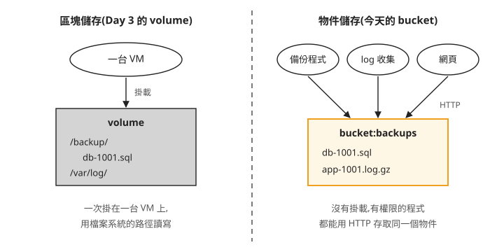
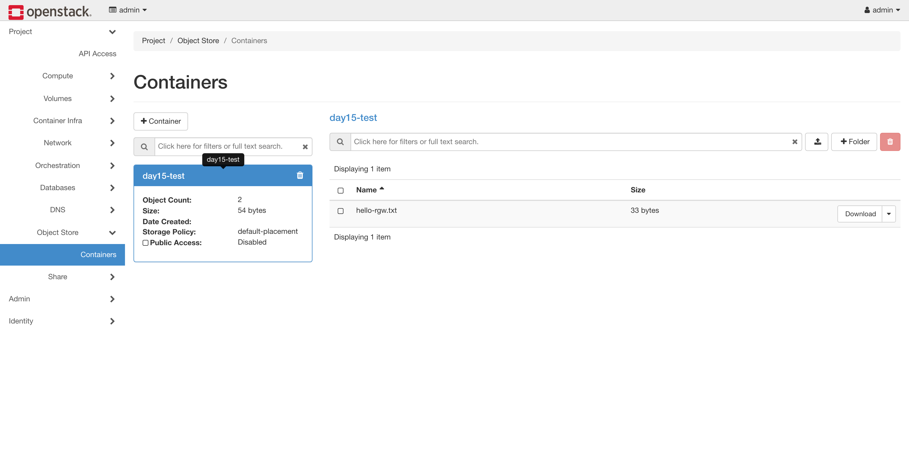
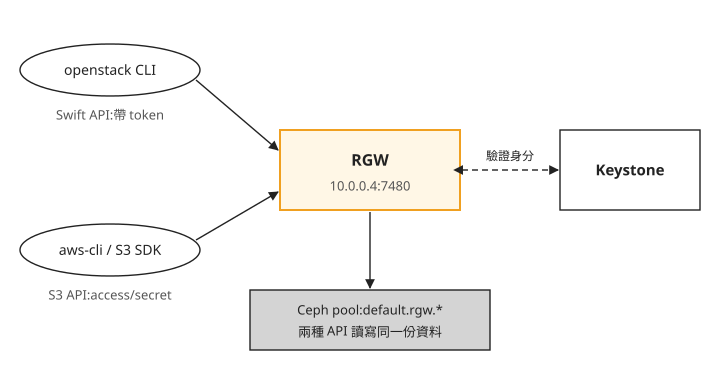

# Day 15: 用 Ceph RGW 開物件儲存——S3 與 Swift API、Keystone 認證

{ align=right width="100" }

假設有個團隊要把每天的資料庫備份和壓縮過的 log 存到你的雲上。他們的程式原本使用 S3 SDK,希望沿用 HTTP API 存取備份,因此需要確認新的儲存服務是否支援程式用到的操作。Day 3 的 Cinder volume 幫不上忙:volume 一次只掛在一台 VM 上,那台 VM 關機時,其他程式就拿不到裡面的檔案。他們要的是任何程式都能透過 HTTP 存取的儲存,這就是物件儲存。

Day 14 在主機上立好了一套 Ceph,這一章在它上面開出物件儲存服務 RGW,並接上 OpenStack 的帳號系統 Keystone:做完之後,你的雲會多一個 `object-store` endpoint,主線會以 OpenStack 帳號驗證 Swift API 存取。S3 金鑰與工具設定另放在未驗證的選讀段落,不列入這次完成結果。讀完之後,物件儲存的請求失敗時,你能分辨問題是 RGW 本身沒起來、Keystone 裡的 endpoint 沒註冊對,還是 RGW 沒辦法向 Keystone 驗證身分,並知道該回哪一步檢查。

## 區塊儲存和物件儲存差在哪

先把 Day 3 的 volume 和今天要開的物件儲存放在一起比:



我們可以從圖上看到兩個差別:

1. **左邊要先掛載,右邊不用。** volume 是一顆磁碟,要掛到某台 VM 上、格式化成檔案系統才能用,而且通常同一時間只掛在一台上。物件儲存不掛載,程式直接對它發 HTTP 請求:上傳是 PUT,下載是 GET。
2. **右邊沒有目錄樹。** 物件儲存只有兩層:一個個**容器**(Swift 叫 container,S3 叫 bucket,指的是同一種東西),和容器裡的**物件**(一個檔案加上它的名稱與屬性)。物件名稱裡可以有斜線,但那只是名字的一部分,不是真的資料夾。

所以物件儲存適合放「寫一次、讀很多次、不需要檔案系統功能」的資料:備份、log 封存、VM 映像檔、網站的圖片。

對物件儲存發 HTTP 請求,要照一套約定好的格式,這就是 API。業界有兩套:**S3 API** 是 AWS S3 定的格式,大部分工具和 SDK 都支援,幾乎是事實上的標準;**Swift API** 是 OpenStack 自家物件儲存服務 Swift 定的格式,`openstack container`、`openstack object` 這些指令和 Horizon 的物件儲存頁面用的就是它。

今天要開的 **RGW**(RADOS Gateway)是 Ceph 的物件儲存服務:一個 daemon,同時聽得懂 S3 和 Swift 兩種 API,資料存在 Day 14 那套 Ceph 的 pool 裡。[Day 12](sprint3-day12-sprint4-preview.md) 講過,Kolla-Ansible 已經移除了 Swift 本身的部署支援,這門課改用 RGW 提供 Swift API,同時多得到 S3 API。

## RGW 和 OpenStack 怎麼接在一起

Day 14 講過,主機上是兩套系統並存:cephadm 管 Ceph,Kolla 管 OpenStack。RGW 是 Ceph 的 daemon,所以由 cephadm 部署。Kolla 有一個叫 `ceph-rgw` 的角色,名字看起來像要部署 RGW,其實它不啟動任何容器,只做 OpenStack 那一側的整合:在 Keystone 註冊物件儲存服務,以及在有 haproxy 的部署裡替 RGW 做負載平衡。

這一側要註冊的東西有兩個:

- **`object-store` endpoint**:Keystone 裡有一份服務目錄,記著每個服務的 API 位址。`openstack object create` 這類指令會先查這份目錄,找到物件儲存的位址才知道要把請求送去哪裡。
- **service user `ceph_rgw`**:一個專門給 RGW 用的 Keystone 帳號。使用者拿著 token 來存取時,RGW 要用這個帳號登入 Keystone,才能問「這個 token 是誰的、有沒有效」。

先看稍後會實際驗證的 Swift API 請求,以及兩邊的分工:


照著圖上的編號看:① 和 ② 是使用者自己的動作,③ 是 RGW 在背後做的事。三步都要通,一次存取才會成功。今天的設定也因此分成兩半,在 Keystone 會合:步驟 1 用 cephadm 起 RGW,步驟 2 用 Kolla 在 Keystone 註冊 endpoint 和 service user,步驟 3 再回到 cephadm,告訴 RGW 去哪個 Keystone、用哪個帳號驗 token。之後存取失敗時,也照這三段分頭查。

## 開始之前

這一章需要 Day 14 的 Ceph 叢集是 `HEALTH_OK`,以及 Day 1–3 部好的 Kolla OpenStack。`./cephadm` 指令要在 Day 14 下載 cephadm 的那個目錄(家目錄)執行;`kolla-ansible` 指令要先進 venv。

以下指令裡的 `10.0.0.4` 是主機的私有 IP,請換成你自己的(`ip -4 addr show eth0` 可查),每一處都要換,包括 `globals.yml` 和 Keystone 位址。

## 步驟 1:用 cephadm 起 RGW

用 cephadm 部署一個名叫 `kolla` 的 RGW 服務,放一個 daemon,聽 7480 port:

```bash
sudo ./cephadm shell -- ceph orch apply rgw kolla --placement=1 --port=7480
```

**`--port=7480` 不能省。** RGW 沒有指定 port 時會聽 80,而這台主機的 80 已經被 Horizon 佔用(Kolla 的容器都共用主機的網路,Day 1 講過),兩邊會搶同一個 port。

約 30 秒後,`sudo ./cephadm shell -- ceph orch ps` 應該看到一個 rgw daemon 是 `running`。接著直接對它發一個 HTTP 請求,確認它在回應:

```bash
curl -s http://10.0.0.4:7480/
```

```text
<?xml version="1.0"...><ListAllMyBucketsResult ...><Buckets></Buckets></ListAllMyBucketsResult>
```

這是 S3 API 的回應格式。`curl` 沒帶任何身分,RGW 就當成匿名請求,回一份「你的 bucket 清單」,而匿名使用者沒有 bucket,所以 `<Buckets>` 是空的。看到這份 XML,代表 RGW 活著,也在 7480 上用 S3 API 回應。這時它還不認得 OpenStack 的任何帳號,接下來兩步就是要補上這一塊。

## 步驟 2:用 Kolla 在 Keystone 註冊物件儲存

把下面六行附加到 `globals.yml`:

```bash
sudo tee -a /etc/kolla/globals.yml << 'EOF'
enable_ceph_rgw: "yes"
enable_ceph_rgw_loadbalancer: "no"
ceph_rgw_port: "7480"
ceph_rgw_internal_fqdn: "10.0.0.4"
ceph_rgw_external_fqdn: "10.0.0.4"
update_keystone_service_user_passwords: "no"
EOF
```

<span id="mine-3"></span>附加之前如果想先確認 `globals.yml` 裡有沒有寫過這些設定,`grep` 要錨定行首,寫成 `grep "^enable_ceph_rgw"`。`globals.yml` 範本裡本來就有一行註解掉的 `#enable_ceph_rgw: "no"`,沒錨定行首的 `grep "enable_ceph_rgw"` 會比對到這行註解,誤以為已經設定過。

一行行看:

- `enable_ceph_rgw: "yes"`:啟用 Kolla 的 RGW 整合,也就是上一節說的在 Keystone 註冊 service user 和 endpoint。
- `enable_ceph_rgw_loadbalancer: "no"`:Kolla 預設會在 haproxy 上替 RGW 開一個入口。Day 1 的單機部署關掉了 haproxy,這行不寫,部署前的檢查會直接失敗。
- `ceph_rgw_port: "7480"` 和兩個 `fqdn`:決定 endpoint 寫進 Keystone 的位址。Kolla 預設的 endpoint 指向 haproxy 上的 RGW 入口(port 預設是 6780),haproxy 關了,那個位址沒有程式在聽,所以要明確寫成步驟 1 的 RGW 所在的主機和 port。`internal` 和 `external` 分別對應 Keystone 目錄裡的 internal 和 public endpoint。
- `update_keystone_service_user_passwords: "no"`:Kolla 官方文件的警告。不設的話,之後每次 reconfigure 都會重設 `ceph_rgw` 這類服務帳號的密碼,這個更新動作會使既有 token 失效,可能中斷物件儲存的存取。若另外更換了密碼檔裡的值,也要同步更新 RGW 使用的密碼。

另外在 `globals.yml` 明確保留以下設定。cephadm RGW 使用 `/swift/v1` 路徑；`false` 讓 Kolla 註冊的 endpoint 與 Skyline 轉送路徑維持一致。後續更新 Skyline 時也會讀到這個值。

```yaml
ceph_rgw_swift_compatibility: "false"
```

只部署 RGW 相關的部分:

```bash
source ~/kolla-venv/bin/activate
kolla-ansible deploy -i ~/all-in-one --tags ceph-rgw
```

```text
PLAY RECAP: ok=11  changed=5  failed=0
```

`failed=0` 代表 Keystone 裡已經有 `ceph_rgw` 這個 service user 和 `object-store` endpoint。步驟 4 會用 `openstack endpoint list` 確認位址。

## 步驟 3:告訴 RGW 怎麼向 Keystone 驗 token

最後一段回到 Ceph。RGW 要知道 Keystone 在哪,以及用哪個帳號、哪組密碼登入。密碼要和 Kolla 剛才在 Keystone 建帳號時用的那組一致,所以直接從 Kolla 的密碼檔讀出來,再一次寫進 RGW 的設定,最後重啟 RGW 讓設定生效:

```bash
PW=$(sudo grep '^ceph_rgw_keystone_password:' /etc/kolla/passwords.yml | awk '{print $2}')
sudo ./cephadm shell -- bash -c "
ceph config set client.rgw rgw_keystone_url http://10.0.0.4:5000
ceph config set client.rgw rgw_keystone_api_version 3
ceph config set client.rgw rgw_keystone_admin_user ceph_rgw
ceph config set client.rgw rgw_keystone_admin_password $PW
ceph config set client.rgw rgw_keystone_admin_project service
ceph config set client.rgw rgw_keystone_admin_domain Default
ceph config set client.rgw rgw_keystone_accepted_roles member,Member,admin
ceph config set client.rgw rgw_keystone_implicit_tenants true
ceph config set client.rgw rgw_s3_auth_use_keystone true
ceph config set client.rgw rgw_enable_apis s3,swift,swift_auth,admin
ceph orch restart rgw.kolla
"
```

這十行 `ceph config set` 可以分成四組看:

- **去哪裡驗**:`rgw_keystone_url` 是 Keystone 的位址(5000 是 Keystone API 的 port),`api_version 3` 指定用 Keystone v3 API。
- **用誰的身分去驗**:`admin_user`、`admin_password`、`admin_project`、`admin_domain` 四行合起來,就是步驟 2 建立的 `ceph_rgw` 帳號,它屬於 `Default` domain 的 `service` project。
- **誰可以用**:`accepted_roles` 列出 Keystone 的哪些角色可以存取物件儲存,一般使用者的 `member` 和管理員的 `admin` 都在內。`implicit_tenants` 讓 RGW 依 Keystone 的 project 建立隱含的 tenant(RGW 裡的命名空間),同一個 project 的使用者依角色存取該 project 的物件。
- **開哪些 API**:`rgw_s3_auth_use_keystone` 讓 S3 請求的金鑰也交給 Keystone 檢查,步驟 5 要靠它;`rgw_enable_apis` 列出 RGW 要提供的 API,`s3` 和 `swift` 就是這一章的兩種。

## 步驟 4:用 Swift API 存一個物件再拿回來

三段設定都完成了,用管理員身分走一次完整的流程:查 endpoint、建容器、上傳一個小檔案,再下載回來比對內容:

```bash
source /etc/kolla/admin-openrc.sh
openstack endpoint list --service object-store -f value -c Interface -c URL
openstack container create day15-test
echo "hello-rgw" > /tmp/obj.txt
openstack object create day15-test /tmp/obj.txt
openstack object save day15-test /tmp/obj.txt --file /tmp/back.txt && cat /tmp/back.txt
```

```text
internal http://10.0.0.4:7480/swift/v1
public   http://10.0.0.4:7480/swift/v1
day15-test
/tmp/obj.txt
hello-rgw
```

由上往下對照指令看:

- 前兩行是 endpoint。`internal` 和 `public` 都指向 RGW 的 7480,路徑 `/swift/v1` 是 RGW 提供 Swift API 的位置。如果這裡出現 6780 或別的位址,回步驟 2 檢查 port 和 `fqdn` 那幾行。
- `day15-test` 是建好的容器,`/tmp/obj.txt` 是上傳後的物件名稱。
- 最後一行 `hello-rgw` 是從 RGW 下載回來的內容,和上傳的一樣。

這幾行能成功,代表圖上的 ①②③ 都通了:CLI 從 Keystone 拿到 token,在服務目錄找到 RGW 的位址,RGW 也成功向 Keystone 驗證了 token。如果 `openstack container create` 回認證錯誤,而步驟 1 的 `curl` 仍然有回應,問題多半在步驟 3:密碼、Keystone 位址或 `ceph_rgw` 帳號設錯了。

物件的資料存在 Ceph 裡。在 cephadm shell 裡執行 `ceph osd pool ls`,會看到 RGW 自動建出的六個 `default.rgw.*` pool,這些就是 RGW 放容器清單、物件內容和其他中繼資料的地方。

同一個容器也可以在網頁主控台上看到。這一章用 Horizon 的物件儲存頁查看,路徑是「專案 → Object Store → Containers」。左邊是 container 的統計(物件數、總大小、storage policy),右邊列出裡面的物件,也能直接下載:



注意物件名稱。上面的 `openstack object create day15-test /tmp/obj.txt` 會**直接拿本機路徑當物件名**,所以物件真的叫 `/tmp/obj.txt`。開頭的斜線會讓 Horizon 把它當成資料夾層級,物件列表看起來會是空的。要取一個乾淨的名字,用 `--name` 指定:`openstack object create --name hello-rgw.txt day15-test /tmp/obj.txt`,截圖裡的 `hello-rgw.txt` 就是這樣上傳的。

## 選讀:用 S3 金鑰存取的設定方式

步驟 4 走的是 Swift API,步驟 1 的 `curl` 只確認了 S3 API 對匿名請求有回應。開場那個團隊的程式用的是 S3 SDK,它不認得 Keystone 的 token,只認一組 **access key** 和 **secret key**:access key 是公開的帳號代號,secret key 用來簽每一個請求。

以下 S3 命令是設定參考,尚未有本課的認證存取結果。主線到上一節的 Swift 上傳與下載就完成,不要把這段當成已通過驗證的 S3 操作。

在這朵雲上,這組金鑰由 Keystone 的 **EC2 credentials** 產生。這個名稱來自 OpenStack 早年相容 AWS EC2 API 的功能:它替某個使用者在某個 project 底下產生一組 access/secret。步驟 3 設了 `rgw_s3_auth_use_keystone`,RGW 收到帶這組金鑰簽過的 S3 請求時,會交給 Keystone 檢查簽章,檢查通過就當成那位使用者在那個 project 裡的操作。兩種 API 的路線畫在一起:



兩條路只差在用戶端帶的身分憑證不同,進的是同一個 RGW,驗證都交給 Keystone。下面用 Day 2 建的一般使用者(`demo-openrc.sh`)取得金鑰,再用 aws-cli 建 bucket、上傳、列出物件:

```bash
# 1. 拿一組 S3 相容金鑰(access / secret)
source ~/demo-openrc.sh
openstack ec2 credentials create        # 輸出的 Access / Secret 就是 S3 金鑰

# 2. 裝 aws-cli、設金鑰與 region,再打 RGW 的 S3 端點(RGW 走 path-style 定址)
sudo apt-get install -y awscli
aws configure set aws_access_key_id <access>
aws configure set aws_secret_access_key <secret>
aws configure set default.region us-east-1     # RGW 不挑 region 值,給個預設即可,不設會被 aws-cli 擋下
aws --endpoint-url http://10.0.0.4:7480 s3 mb s3://day15-s3
echo hello-s3 > /tmp/s3.txt
aws --endpoint-url http://10.0.0.4:7480 s3 cp /tmp/s3.txt s3://day15-s3/
aws --endpoint-url http://10.0.0.4:7480 s3 ls s3://day15-s3/     # 列出剛上傳的物件
```

**這一步本課沒有實際跑過,所以沒有附輸出**,照做時請自己確認每一行的結果。重點有三個:金鑰來自 `openstack ec2 credentials create`,綁在你目前的使用者和 project 上;`--endpoint-url` 直接指向 RGW 的 7480,不經過 Keystone 的服務目錄;`<access>`、`<secret>` 換成第一段輸出的值。既有 S3 程式還必須確認 RGW 支援它使用的 API、簽章與行為,並完成實際相容性測試;不能只改 endpoint 與金鑰就宣稱整個應用可用。

## 疑難排解

### 裝完 RGW 後 Horizon 打不開,或 RGW 起不來 {#mine-1}

RGW 沒指定 port 時聽 80,和 Horizon 搶同一個 port。修法見步驟 1 的 `--port=7480`。

### precheck 失敗,或 endpoint 指向沒有程式在聽的位址 {#mine-2}

單機部署關掉了 haproxy,而 Kolla 的 RGW 整合預設要透過 haproxy:`enable_ceph_rgw_loadbalancer` 沒設成 `"no"` 時部署前檢查會失敗,port 和 `fqdn` 沒覆寫時 endpoint 會指向 haproxy 的入口。修法見步驟 2 的那幾行設定。

## 想一想

- 一位同學做完步驟 3 之後,`curl http://<主機IP>:7480/` 還能拿到那份空的 bucket 清單 XML,但 `openstack container create` 回認證錯誤。你會請他先檢查哪一步的哪些設定?為什麼不是步驟 1?
- 另一位同學在一套有 haproxy、三台控制節點的部署上做同樣的事。步驟 2 的六行裡,哪一行他不該照抄?
- 有人執行 `kolla-ansible reconfigure` 調整了別的服務,隔天物件儲存全部回認證錯誤,其他服務都正常。你會先懷疑 `globals.yml` 少了哪一行?

## 小結

物件儲存不掛載、沒有目錄樹,程式用 HTTP 對容器裡的物件做 PUT 和 GET。Ceph 的 RGW 一個 daemon 同時提供 S3 和 Swift 兩種 API,資料存在 Ceph 的 pool 裡。把它接進 OpenStack 要兩邊各做一半:cephadm 起 RGW,並告訴它去哪個 Keystone、用哪個帳號驗 token;Kolla 在 Keystone 註冊 `object-store` endpoint 和 `ceph_rgw` 帳號。之後物件儲存出問題時,先用 `curl` 確認 RGW 有回應,再用 `openstack endpoint list` 確認位址,最後才查 RGW 的 Keystone 設定和密碼,三段分開查。

## 延伸閱讀

想再深入，可以從這幾份開始：

- **[Ceph Object Gateway 總覽](https://docs.ceph.com/en/tentacle/radosgw/)** —— RGW 的完整文件入口:S3/Swift API 相容性、multisite、進階設定。
- **[RGW 的 Keystone 整合](https://docs.ceph.com/en/tentacle/radosgw/keystone/)** —— 步驟 3 那一整批 `rgw_keystone_*` 設定的說明,也包括 S3 金鑰交給 Keystone 驗證的 `rgw_s3_auth_use_keystone`。
- **[Kolla-Ansible External Ceph 指南](https://docs.openstack.org/kolla-ansible/2025.1/reference/storage/external-ceph-guide.html)** —— Kolla 這側所有 Ceph 整合(RGW/Glance/Cinder/Manila)的官方說明;RadosGW 一節列出步驟 2 用到的設定與 `update_keystone_service_user_passwords` 的警告。
- **[cephadm 部署 RGW](https://docs.ceph.com/en/tentacle/cephadm/services/rgw/)** —— `ceph orch apply rgw` 的完整選項(placement、port、realm)。

## 下一步

區塊儲存(Day 3)和物件儲存(今天)都有了,還差檔案儲存:讓多台 VM 同時掛同一個資料夾。[Day 16](sprint4-day16-manila-cephfs.md) 用同一套 Ceph 的 CephFS,透過 Manila 提供共享檔案系統。
