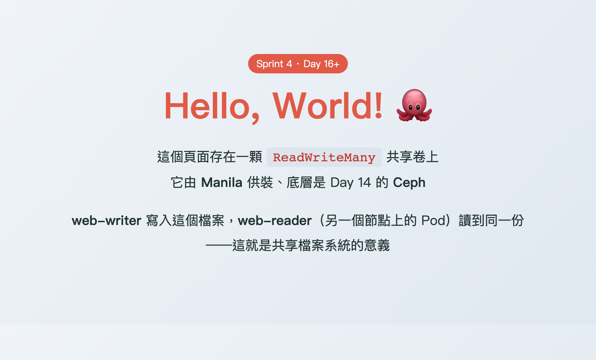

# Day 16: Manila——用 CephFS 讓多台機器同時讀寫同一份資料

{ align=right width="100" }

假設你在這朵雲上用兩台 VM 跑同一個網站,前面放負載平衡器分流。使用者上傳的圖片存在其中一台,另一台就讀不到。直覺的做法是開一顆 Cinder volume 當共用的圖片目錄,但 [Day 3](sprint3-day3-cinder-lvm.md) 已經看過,本課 Day 3 的 LVM volume 配置一次只 attach 到一台 VM,不能直接拿來當跨機共用目錄。Cinder 另有需後端與 volume type 支援的 multiattach;即使同時掛到多台,檔案系統與應用仍須能協調共用存取。改成在兩台之間定時同步檔案,又會出現某一台還沒同步到的空窗。

這一章部署 OpenStack 的共享檔案服務 **Manila**,後端用 [Day 14](sprint4-day14-ceph-bootstrap.md) 立起來的 Ceph。做完之後,你會在主機上掛載一個由 Manila 開出來的網路資料夾,寫入檔案再讀回來;章末的選讀段落再解讀它接回 [Day 8](sprint3-day8-e2e-workload-cluster.md) 的 Kubernetes cluster 後,兩個跨節點 Pod 共用檔案的結果,不提供完整 CSI 建置步驟。讀完之後,遇到「多台機器要同時讀寫同一份資料」的需求,你能判斷該開 Manila share 而不是 Cinder volume;share 掛不上時,也能分辨問題出在 Manila 這一側(share 沒建起來、沒有授權),還是 Ceph 這一側(連不到、金鑰不對)。

## 三種儲存怎麼分

到這一章為止,這朵雲已經有兩種儲存,加上今天的第三種,差別在使用方式:

| | 怎麼用 | 同時使用者 | 適合的場景 |
|---|---|---|---|
| 區塊(Cinder,Day 3 的 LVM 配置) | 掛成 `/dev/vdb`,自己分割、格式化 | 本課配置為一台機器 | 資料庫的資料碟 |
| 物件(RGW,Day 15) | 透過 HTTP API 存取,不掛載 | 不限 | 備份、映像檔、靜態資源 |
| **檔案(Manila,今天)** | 掛成網路資料夾,已經是現成的檔案系統 | 多台機器同時讀寫 | 共用的上傳目錄、多台機器跑同一個應用時的共同目錄 |

Manila 管的單位叫 **share**:一個有容量上限、可以被多台機器掛載的網路資料夾。AWS 上對應的服務是 EFS。Manila 本身不存檔案,它負責在後端儲存系統上把 share 建出來、設定容量上限、決定誰可以掛載;檔案實際存在後端,這一章的後端就是 Ceph 的檔案系統 CephFS。

## Manila 只管建立和授權,讀寫直接走 Ceph

Manila 對接 CephFS 有兩種方式。這一章用的是 **CephFS native**:要掛載的機器自己當 Ceph 客戶端,用 Ceph 的協定直接連到 Ceph。另一種是在中間放一台 NFS 服務,客戶端用 NFS 掛載,本課沒有實作。

把 Manila 的服務和 Ceph 的角色放在一起看,跟 Day 3 的 Cinder 一樣能分成控制路徑和資料路徑兩半:


我們可以從圖上看到兩件事:

1. **Manila 的三個服務只出現在上半。** `manila-share` 是跟 Ceph 打交道的那一個,它透過 Ceph MGR 的管理 API 建 share、設定誰可以存取,不碰檔案本身。所以待會兒給 Manila 的 Ceph 身分只需要很少的權限。
2. **掛載之後的讀寫完全不經過 Manila。** 客戶端從 MON 拿到叢集地圖,目錄和檔名找 **MDS**(Day 14 提過的檔案中繼,只有用 CephFS 才需要),檔案內容直接讀寫 OSD。這也決定了除錯的順序:share 建不起來或狀態不對,查上半的 Manila 服務;share 是 `available`、卻掛不上或讀寫失敗,查下半,也就是掛載的機器連不連得到 Ceph、金鑰對不對。

## 步驟 1:在 Ceph 建檔案系統和 Manila 用的身分

這一步全在 Ceph 這一側,跟 Day 14 一樣透過 `cephadm shell` 下指令。三行分別做三件事:建一個叫 `manila_fs` 的 CephFS;關掉一項單機一定會出現的健康警告;替 Manila 建一個專用的 Ceph 身分。

```bash
sudo ./cephadm shell -- ceph fs volume create manila_fs
sudo ./cephadm shell -- ceph fs set manila_fs standby_count_wanted 0   # 單機沒有備援 MDS,關掉這項健康檢查
sudo ./cephadm shell -- ceph auth get-or-create client.manila mon 'allow r' mgr 'allow rw'
```

`ceph fs volume create` 建檔案系統時,cephadm 會自動替它部署 MDS。CephFS 預設希望有一台待命的 MDS 隨時接手,單機只有一台,不關掉 `standby_count_wanted` 就會一直出現健康警告。等 MDS 起來之後,`ceph fs status manila_fs` 會顯示 MDS 狀態為 `active`。

第三行建的是一個 **cephx 身分**。cephx 是 Ceph 的認證機制,每個要連 Ceph 的程式都用一個名字(這裡是 `client.manila`)加一把金鑰登入,能做什麼由後面的權限決定。`client.manila` 只拿到 `mon 'allow r'`(讀叢集地圖)和 `mgr 'allow rw'`(使用 MGR 的管理 API),沒有任何 OSD 或 MDS 的權限,對應的正是上一節圖上的事實:Manila 只透過 MGR 管理 share,不讀寫檔案。這組權限的出處是 Manila CephFS driver 的官方文件。

建好檔案系統後,`ceph health` 可能出現 `too many PGs per OSD`。PG 是 Ceph 把 pool 裡資料分組、分配給 OSD 的單位。這是新的 pool 讓單一 OSD 承擔的 PG 數超過上限,處理方式見[疑難排解:CephFS 建好後出現 too many PGs per OSD](#mine-3)。

## 步驟 2:把 Ceph 設定檔和金鑰交給 Kolla

`manila-share` 容器要連 Ceph,需要兩個檔案:Ceph 的連線設定 `ceph.conf`,和 `client.manila` 的金鑰檔 keyring。Day 1 講過,某個服務需要的額外設定放在 `/etc/kolla/config/` 底下對應的目錄,deploy 時 Kolla 會把它們放進容器。Manila 對應的目錄是 `/etc/kolla/config/manila/`:

```bash
sudo mkdir -p /etc/kolla/config/manila
# ceph.conf:用官方指令產生「最小版」,再把行首空白拿掉
sudo ./cephadm shell -- ceph config generate-minimal-conf | sed 's/^[[:space:]]*//' \
  | sudo tee /etc/kolla/config/manila/ceph.conf
# keyring:同樣去掉行首空白
sudo ./cephadm shell -- ceph auth get client.manila | sed 's/^[[:space:]]*//' \
  | sudo tee /etc/kolla/config/manila/ceph.client.manila.keyring
```

這段有兩處要照做:

- **兩個 `sed` 都不能省。** `generate-minimal-conf` 和 `ceph auth get` 的輸出,每一行開頭帶縮排(tab),Kolla 解析這類 ini 格式的設定檔時,遇到行首的 tab 會解析失敗。Kolla-Ansible 的外部 Ceph 指南有提到要先拿掉這些 tab。
- **兩個檔案都直接放在 `manila/` 底下。** 官方指南在「多個 Ceph 後端」那一段,keyring 的範例路徑多了一層 `manila-share/` 子目錄。本課的單一後端照上面的路徑放,deploy 成功。

漏了其中一項會遇到的狀況,見[疑難排解:keyring 放錯目錄或 ceph.conf 帶縮排](#mine-2)。

## 步驟 3:打開 Manila 並部署

接著照 Day 1 的做法,在 `globals.yml` 加開關,再重跑 deploy。三行的意思:`enable_manila` 部署 Manila 本身;`enable_manila_backend_cephfs_native` 讓它用 CephFS native 這個後端;`manila_cephfs_filesystem_name` 指定用步驟 1 建的檔案系統,不寫的話 Manila 會用 Ceph 回報的第一個檔案系統。`--tags manila` 讓這次 deploy 只處理 Manila 相關的部分。

```bash
sudo tee -a /etc/kolla/globals.yml << 'EOF'
enable_manila: "yes"
enable_manila_backend_cephfs_native: "yes"
manila_cephfs_filesystem_name: "manila_fs"
EOF
source ~/kolla-venv/bin/activate
kolla-ansible deploy -i ~/all-in-one --tags manila
```

一樣看 `PLAY RECAP` 的 `failed=0`:

```text
PLAY RECAP: ok=29  changed=20  failed=0
```

部署完可以用 `openstack share service list` 確認 Manila 的服務都是 enabled 而且 `up`;這個指令要等下一步裝好 CLI 外掛才能用。

## 步驟 4:裝 CLI 外掛,建 share type

`openstack` 指令本身沒有 Manila 的子命令,要另外裝 Manila 的外掛 `python-manilaclient`。Day 5 的 Heat、Barbican 也是同樣的情況:每個服務的 CLI 指令來自各自的外掛套件。

接下來要建一個 **share type**。使用者建 share 時要指定一種 share type,Manila 的 scheduler 依照它上面寫的條件,挑出能滿足條件的後端。最基本的條件是 **DHSS**(driver handles share servers):後端的 driver 要不要自行建立和管理「share server」,share server 是提供共用檔案並管理匯出與存取規則的後端資源,具體形式由 driver 決定,不一定是一台新 VM。CephFS native 不建立這類 share server,客戶端直接連 Ceph,所以它只接受 DHSS 為 `False` 的 share type。下面最後一行的 `False` 就是 DHSS:

```bash
pip install python-manilaclient
source /etc/kolla/admin-openrc.sh
openstack share type create default_share_type False
```

如果照其他教學建成 `True`,scheduler 找不到符合條件的後端,share 就建不起來。Kolla-Ansible 的 Manila 指南示範的是另一種需要 share server 的 driver,範例裡的 share type 是 `True`,照抄時要改。

## 步驟 5:建 share、授權、掛載

先建一顆 1 GB、用 CephFS 協定的 share,確認狀態,再查它的 **export location**:客戶端掛載時要用的位址,也就是 share 在 Ceph 上的路徑。

```bash
openstack share create CEPHFS 1 --name day16-share --share-type default_share_type
openstack share show day16-share -f value -c status          # available(秒級)
openstack share export location list day16-share -f value -c Path
```

```text
10.0.0.4:6789:/volumes/_nogroup/bf9a.../a1d5...
```

這串位址分成兩段:冒號前的 `10.0.0.4:6789` 是 Ceph MON 的位址和 port,客戶端先連它拿叢集地圖;後面的 `/volumes/_nogroup/...` 是這顆 share 在 CephFS 裡的目錄。你的路徑會是另一串 ID。

share 建好了還不能掛,因為還沒有人被允許存取它。Manila 用 **access rule** 決定誰能掛載一顆 share;CephFS native 只支援 `cephx` 這種 access rule,意思是「允許某個 cephx 身分存取」。下面第一行允許一個叫 `day16user` 的身分存取,Manila 會在 Ceph 上建好這個身分、產生金鑰,第二行把金鑰取出來。接著就能在任何連得到 Ceph 的機器上掛載。這裡用主機示範。所有掛載端都要先有 Ceph 客戶端套件 `ceph-common`,包括這台主機;只有 cephadm 容器不代表主機已安裝掛載工具。掛載端也必須連得到 Ceph 的 MON、MDS 和 OSD,不能只放行 MON 的 6789。VM 裡也適用相同前提。

先確認掛載端有 `mount.ceph` 工具。若尚未安裝,依所用 Ubuntu 與 Ceph 版本準備 `ceph-common`;這是掛載前提,不屬於前面 cephadm 的部署結果。建立 access rule 後,要等規則狀態成為 `active`,再執行取金鑰與掛載的命令。

```bash
openstack share access create day16-share cephx day16user
KEY=$(openstack share access list day16-share -f value -c 'Access Key')
sudo mkdir -p /mnt/day16
sudo mount -t ceph 10.0.0.4:6789:/volumes/_nogroup/<你的路徑> /mnt/day16 -o name=day16user,secret=$KEY
echo "manila-e2e" | sudo tee /mnt/day16/proof.txt
sudo cat /mnt/day16/proof.txt && df -h /mnt/day16 | tail -1
```

`mount` 那一行的路徑換成你上一步查到的 export location。結果:

```text
manila-e2e
10.0.0.4:6789:/volumes/...  1.0G  0  1.0G  0% /mnt/day16
```

第一行是寫進去再讀回來的內容。第二行的 `df` 顯示這個掛載點的大小是 1.0G,正是建 share 時給的 1 GB:Manila 設的容量上限,在 Ceph 這一側生效了。如果 `mount` 失敗而 share 狀態是 `available`,依照前面那張圖,問題在資料路徑:先確認這台機器連得到 MON,再確認能連到地圖中的 MDS 和 OSD,以及 `name=` 和 `secret=` 用的是同一個身分的金鑰。

Day 13 已經部署 Skyline,加入 Manila 後還要更新它的代理設定,才能從網頁呼叫新服務。這沿用 Day 13 的部署方式,但下列補充命令沒有獨立的本課執行輸出:

```bash
kolla-ansible deploy -i ~/all-in-one --tags skyline
```

同一顆 share 在網頁主控台上也看得到。Skyline(Day 13)的「Share File Storage」頁列出這朵雲的 share:


`day16-share` 是剛才用 CLI 建的。另一顆 `pvc-…` 的描述寫著 `provisioned-by=manila.csi.openstack.org`,它是後續 Kubernetes 整合曾透過 Manila 建立的 share;做完這一節時,你的畫面只會有 `day16-share` 一列。

這個安全上的前提要知道:CephFS native 的客戶端直接連 Ceph 的網路,租戶之間的隔離只靠各自的 cephx 金鑰。Manila 的官方文件因此說明,這種後端只適合租戶彼此可以信任的私有雲;要給不互信的租戶使用,官方文件介紹的是透過 NFS 提供 share 的方式。

## 選讀:讀懂 Kubernetes 共用 share 的結果

前面到主機掛載為止,Manila 已經可以用了。這一節說明既有 Kubernetes 共用儲存結果。本章未提供完整 Helm values 與 manifests,所以這裡不作為可從空白叢集重建的操作步驟;先看懂 PVC、PV 和 Manila share 的關係即可。完整部署方式見章末的 Manila CSI 文件。

### 為什麼需要它

[Day 8](sprint3-day8-e2e-workload-cluster.md) 讓 Kubernetes 的 PVC 由 Cinder 提供,accessModes 寫的是 `ReadWriteOnce`(RWO):一顆 volume 同一時間只能掛到一個節點,原因跟開場的兩台 VM 一樣,Cinder 給的是區塊裝置。很多應用需要多個 Pod 同時讀寫同一份資料,例如共用的上傳目錄、多個副本共用的網站靜態檔,這種存取方式在 Kubernetes 叫 `ReadWriteMany`(RWX)。本課的 Cinder CSI 路徑沒有提供這種跨節點共用檔案模式,因此改用 Manila share。

### 兩個 CSI driver 怎麼分工

Kubernetes 透過 CSI driver(讓 Kubernetes 跟外部儲存系統對接的外掛)取得儲存。這個整合用到兩個:**csi-driver-manila** 向 Manila 要 share,實際把 CephFS 掛進 Pod 的工作交給 **ceph-csi**。兩者需要安裝在 workload cluster,並設定 OpenStack 憑證及掛載所需的節點服務。下圖由上往下是一個 RWX PVC 被滿足的過程:


照著圖由上往下看:中間的 Manila 做的事,跟步驟 5 你手動做的一樣,建 share 再授權一個 cephx 身分;差別是發出請求的換成了 csi-driver-manila。最後掛載的 ceph-csi 也跟步驟 5 的 `mount -t ceph` 一樣,直接連 Ceph,不經過 Manila。

讀其他安裝範例時,留意以下差異:

- **StorageClass 的 `provisioner` 要寫對。** StorageClass 告訴 Kubernetes 哪一種 PVC 交給哪個 driver 處理。csi-driver-manila 的 CephFS driver 註冊的名稱是 `cephfs.manila.csi.openstack.org`,前面多了協定名稱;寫成 `manila.csi.openstack.org`,PVC 會一直綁不上。
- **node-stage secret 放的是 OpenStack 的認證資訊,不是 Ceph 金鑰。** 節點要掛載時,csi-driver-manila 會用這組 OpenStack 帳號去 Manila 查這顆 share 的存取規則。
- **先分清由哪個 driver 接受 PV。** 直接交給 ceph-csi 的靜態 PV 與交給 Manila CSI 的 PV,參數不同。前者需要 CephFS 的 `fsName`;後者引用 Manila 的 share 與 access rule,不能把兩套範例混用。

### 驗證:兩個 nginx Pod 共用一顆 RWX volume

下面是既有結果的摘錄:一個 `ReadWriteMany` PVC 已經綁到 PV,兩個 nginx Pod 在不同節點執行,Manila 也有一顆 available share。PVC 是應用提出的儲存要求,PV 是 Kubernetes 用來描述實際儲存的物件;要證明兩者引用這顆 share,還必須核對 PV 的 shareID 或 shareName,不能只靠名稱猜測。

```text
$ kubectl get pvc shared-static
NAME            STATUS   VOLUME            CAPACITY   ACCESS MODES   ...
shared-static   Bound    manila-share-pv   1Gi        RWX            ...

$ kubectl get pods -l app=shared-web -o wide
web-reader   Running   kube-plpuz-default-worker-...    ← 節點 A
web-writer   Running   kube-plpuz-ng-app-...            ← 節點 B(不同節點!)

$ openstack share list          # 這顆 RWX 卷,就是 Manila 開的一顆 share
pvc-e6cbc3c7-...  CEPHFS  available
```

要看的有三處:PVC 的 `ACCESS MODES` 是 `RWX` 而且 `Bound`;兩個 Pod 的第三欄是兩個不同的節點;`openstack share list` 多了一顆 `pvc-` 開頭的 CephFS share,描述顯示它曾由 csi-driver-manila 建立。不過這份摘錄沒有 PV 的 shareID,不能單憑它判定 `shared-static` 是否觸發了這次建立,或只是重用既有 share。終端機畫面如下:


兩個 Pod 已掛好同一顆 share 時,下面的操作可檢查檔案是否跨節點可見。它依賴前述尚未附齊的安裝與 Pod 定義,請把它當作既有測試的解讀:

```bash
kubectl exec web-writer  -- sh -c 'echo "<h1>Hello, World!</h1>..." > /usr/share/nginx/html/index.html'
kubectl exec web-reader  -- wget -qO- http://localhost/     # 讀到同一份頁面
```

`web-reader` 回應的就是 `web-writer` 剛寫入的頁面。既有的瀏覽器畫面如下;下一小節說明這個入口如何連到 Pod:



### 既有 Pod 的網頁如何連到瀏覽器

Pod 的位址在 cluster 的內部網路(`10.100.x.x`),你的電腦連不到。有兩種做法,下圖上下兩列分別是它們經過的路:


兩條路最後讀的都是同一顆 RWX volume,差別在入口:上列限於能登入 lab VM 並建立 SSH tunnel 的操作者,下列則依負載平衡器與網路的開放範圍提供存取。

**路徑一:`kubectl port-forward`。** `kubectl port-forward` 透過 Kubernetes API server 把本機的一個 port 轉到某個 Pod,不需要負載平衡器,也不需要對外 IP。你的電腦到 Pod 之間隔著 Azure 上的 lab VM 和 cluster 內部網路,所以要接兩段:先在 lab VM 上把 Pod 的 80 轉到 loopback 的 8888,再從你的電腦用 SSH tunnel 把 VM 的 8888 接到本機。

```bash
# 在 lab VM 上:把 pod 的 80 埠轉發到 VM 的 8888
kubectl port-forward --address 127.0.0.1 pod/web-reader 8888:80 &
# 在你的電腦上:把 VM 的 8888 接到本機 8888
ssh -L 8888:127.0.0.1:8888 azureuser@<VM公網IP>
# 瀏覽器開 http://localhost:8888 —— 就看到那個 hello world 頁
```

這條路是臨時的,只有開著這兩段轉發的人看得到,適合除錯或展示。上面的截圖就是用這個方法打開的。

**路徑二:`Service type=LoadBalancer`。** 要給外部使用者用,做法跟 Day 8 一樣:把 Service 宣告成 `type=LoadBalancer`,cluster 裡的 CCM(cloud controller manager,替 Kubernetes 向 OpenStack 要資源的元件)會請 Octavia 建一台負載平衡器、配一個對外 IP,把流量分到各節點上的 Pod,而這些 Pod 讀寫的是同一顆 RWX volume。

在這個 lab 試 LoadBalancer,CCM 建 LB 時會失敗,訊息是 `Provider 'amphorav2' is not enabled`。原因和修法跟 Day 8 的[「LoadBalancer 一直 pending,CCM 報 `Provider 'amphorav2' is not enabled`」](sprint3-day8-e2e-workload-cluster.md#mine-3)相同:CCM 預設要 `amphorav2`,這朵雲的 Octavia 只啟用了 `amphora`,所以要在 cluster 帶上 `octavia_provider=amphora` 標籤。

不過這個修法在 Day 22 之後就不適用了。Day 22 的[「`--tags` 部署的檢查盲區」](sprint4-day22-upgrade-backup.md#mine-1)把 `octavia_provider_drivers` 收斂成只剩 `ovn`,amphora 不再可選。如果你的環境已經做過 Day 22,要走 LoadBalancer 得先依那一節的說明處理 provider,不能再直接帶 `amphora` 標籤。

## 疑難排解

### `openstack` 沒有 `share` 子命令 {#mine-1}

**原因**:Manila 的 CLI 指令來自另外的外掛套件 `python-manilaclient`,`openstack` 本身沒有。修法是步驟 4 的 `pip install python-manilaclient`。之後部署其他服務、CLI 沒有對應指令時,也先裝 `python-<服務名>client`。

### keyring 放錯目錄或 ceph.conf 帶縮排 {#mine-2}

**原因**:Kolla 解析設定檔時遇到行首的 tab 會失敗,而 `generate-minimal-conf` 和 `ceph auth get` 的輸出都帶縮排;另外,官方指南多後端那一段的範例把 keyring 放在 `manila-share/` 子目錄,單一後端照它放會放錯位置。正確的做法見步驟 2:兩個檔案都經過 `sed` 去掉行首空白,直接放在 `/etc/kolla/config/manila/` 底下。

### CephFS 建好後出現 `too many PGs per OSD` {#mine-3}

**症狀**:步驟 1 建立 `manila_fs` 之後,`ceph health` 出現 `too many PGs per OSD (369 > max 250)`。

**原因**:PG 是 Ceph 把 pool 裡的資料分組放到 OSD 上的單位,每個 pool 建立時都帶著預設數量的 PG。CephFS 會新增自己的 pool,單機只有一顆 OSD,所有 pool 的 PG 都算在它身上,很快就超過每顆 OSD 的上限。多顆 OSD 的叢集分攤得開,通常不會遇到。

**修法**:lab 環境直接放寬上限:

```bash
sudo ./cephadm shell -- ceph config set mon mon_max_pg_per_osd 512
```

正式環境不這樣處理,而是讓 PG autoscaler 依各 pool 的容量比例調整 PG 數。

## 想一想

- 一個團隊要在兩台 VM 上跑同一套轉檔程式,兩台都要從同一個資料夾讀原始影片、把結果寫回去。另一個團隊要給一台資料庫 VM 一顆資料碟。這兩個需求各該用 Cinder 還是 Manila?為什麼?
- 同學照步驟 5 做,`openstack share show` 顯示 `available`,`mount` 卻一直逾時。依照「Manila 只管建立和授權,讀寫直接走 Ceph」那張圖,你會請他先查 Manila 的服務,還是他這台機器到 `10.0.0.4:6789` 的連線?
- 另一位同學建 share 時,share 一直建不起來,而 `openstack share service list` 裡的服務都是 `up`。他的 share type 是照另一份教學建的。你會請他先看 share type 的哪一個設定?

## 小結

Manila 提供可以被多台機器同時掛載的 share,這符合本章的共用檔案需求,也不同於 Day 3 單機 attach 的區塊 volume 配置。它在 CephFS native 模式下只負責控制路徑:透過 Ceph MGR 建 share、設定容量上限,並用 cephx access rule 決定誰能掛載;掛載後的讀寫由客戶端直接連 Ceph 的 MON、MDS 和 OSD。部署時要準備好只有 MON 讀、MGR 讀寫權限的 `client.manila` 身分,把去掉行首縮排的 `ceph.conf` 和 keyring 放在 `/etc/kolla/config/manila/`,並建一個 DHSS 為 `False` 的 share type。之後 share 出問題,先看狀態:建不起來就查 Manila 的服務和 share type,狀態正常卻掛不上,就查掛載的機器能不能連到 Ceph、金鑰對不對。在 Kubernetes 上,同樣的機制讓 RWX PVC 由 Manila 供應。

## 延伸閱讀

想再深入，可以從這幾份開始：

- **[Manila CephFS driver 官方文件](https://docs.openstack.org/manila/2025.1/configuration/shared-file-systems/drivers/cephfs_driver.html)** —— native 與 NFS 兩種模式的差異、`client.manila` 需要的權限,以及 native 模式只適合可信任租戶的安全說明。
- **[Kolla-Ansible 外部 Ceph 指南](https://docs.openstack.org/kolla-ansible/2025.1/reference/storage/external-ceph-guide.html)** —— Manila 的 Ceph 設定檔與 keyring 要放在哪、行首 tab 的警告都在這一頁。
- **[Kolla-Ansible 的 Manila 指南](https://docs.openstack.org/kolla-ansible/2025.1/reference/storage/manila-guide.html)** —— Kolla 側部署 Manila 的官方說明;它的範例用的是需要 share server 的 driver,share type 的 DHSS 是 `True`。
- **[CephFS 官方文件](https://docs.ceph.com/en/tentacle/cephfs/)** —— MDS、subvolume、配額這些概念的正式定義。
- **[Manila CSI plugin](https://github.com/kubernetes/cloud-provider-openstack/blob/release-1.32/docs/manila-csi-plugin/using-manila-csi-plugin.md)** —— 選讀段那套 Kubernetes 整合的官方文件與部署選項。

## 下一步

到這裡,這朵雲的區塊、物件、檔案三種儲存都有了,後兩種都建在同一套 Ceph 上。[Day 17](sprint4-day17-designate-dns.md) 換到網路這一側:部署 DNS 服務 Designate,讓 VM 可以用名稱而不是 IP 被找到。
