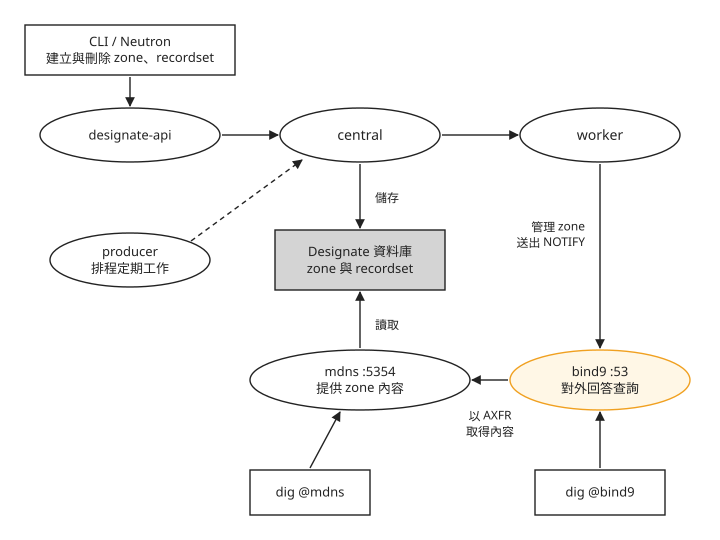
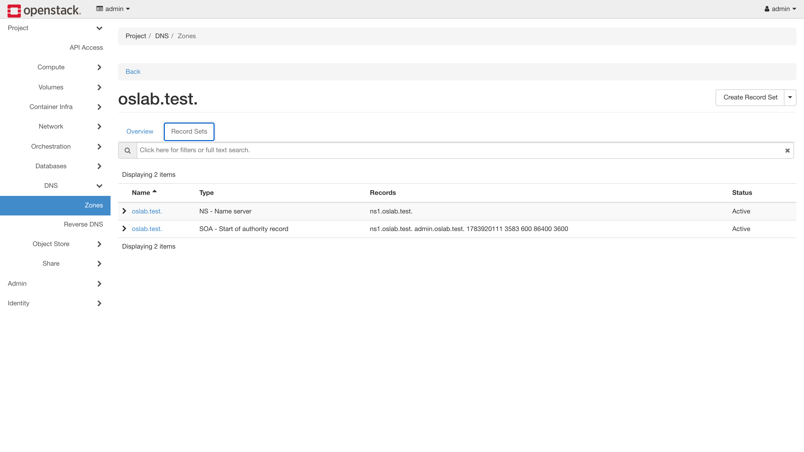
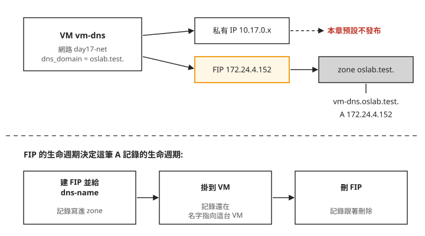

# Day 17: Designate DNS——zone、recordset 與 floating IP 的自動發布

{ align=right width="100" }

到 Day 16 為止,要連到雲裡的 VM,用的都是 IP。假設你開了一台 VM,掛上 floating IP(FIP)`172.24.4.152`,用這個位址存取它。過幾天 FIP 刪掉重建,位址換了,原來的 IP 就失效。可以在 DNS 裡維護一個名字,例如 `vm-dns.oslab.test`,而且讓這個名字跟著 FIP 走:FIP 建立時名字指向它,FIP 刪除時名字一起移除,不需要有人去改 DNS。

這一章用指定 DNS 伺服器的查詢來驗證名稱,不設定公司的 resolver(替用戶端查詢 DNS 名稱的服務),也不設定公開網域的委派(由上層網域指定某個子網域由哪些 DNS 伺服器負責)。我們部署 OpenStack 的 DNS 服務 **Designate**(對應 AWS 的 Route 53),再讓 Neutron 在 FIP 建立和刪除時自動通知它。讀完之後,遇到「VM 開了、網路也設了網域,卻查不到 DNS 記錄」時,你能判斷這是 Neutron 的預設行為、設定寫錯,還是問錯了 DNS 伺服器。

先看要維護的資料:`vm-dns.oslab.test.` 這個名字,對應一個 IPv4 位址,就是一筆 **A 記錄**。同一個名字、同一種類型的記錄放成一組,叫 **recordset**;`oslab.test.` 及其下未另行委派的名稱,構成一個管理範圍,叫 **zone**。稍後先建 zone,Neutron 才能把 FIP 的 A 記錄放進去。

## Designate 由哪些部分組成

先講 DNS 本身。每個網域的名字,最後都由某一台 DNS 伺服器負責回答「這個名字對應到哪個 IP」,這台伺服器叫這個網域的**權威伺服器**(authoritative server)。這門課用的權威伺服器是 **bind9**,一套很常見的開源 DNS 伺服器軟體。

一般用戶端的 DNS 查詢由 bind9 回答。Designate 另有供後端使用的 mdns,稍後會用它比較資料是否已同步。Designate 提供 API 讓人和其他 OpenStack 服務管理記錄,把記錄存進自己的資料庫,再交給 bind9 對外回答。部署完之後主機上會多出六個容器,下面這張圖畫出它們的分工,由上往下是一筆記錄從要求到能被查到的順序:



先看圖的上方與下方:CLI 和 Neutron 都透過 designate-api 管理記錄,用戶端則向 bind9 查詢名稱。中間的同步流程留到步驟 5 配合查詢結果說明。

Neutron 那一側的整合由 Kolla 自動設定:開啟 Designate 之後,Kolla 會在 Neutron 的設定裡加上呼叫 Designate 的驅動程式和認證資訊,你只需要在步驟 1 提供兩個值。

## 步驟 1:在 globals.yml 開啟 Designate

DNS 裡的名字寫完整時,結尾會有一個點,例如 `oslab.test.`。這個點代表 DNS 階層的最上層(根),有寫點的名字是一個完整的名字;沒寫點的名字,在某些地方會被當成還要再接上其他後綴。等一下 `neutron_dns_domain`、zone 名稱與 FIP 的 `--dns-domain` 都要保留結尾的點。

把下面四行附加到 `globals.yml`:

```bash
sudo tee -a /etc/kolla/globals.yml << 'EOF'
enable_designate: "yes"
designate_ns_record:
  - "ns1.oslab.test"
neutron_dns_domain: "oslab.test."
EOF
```

- `designate_ns_record`:每個 zone 都要宣告由哪台 DNS 伺服器負責,這裡填的名字會寫進 zone 的 NS 記錄(步驟 3 會在 Horizon 看到它)。它是一個 **list**,Kolla 的預設值也是 list 格式,不要寫成單一字串。
- `neutron_dns_domain`:Neutron 預設使用的網域。Kolla 官方文件要求這個值**必須以 `.` 結尾**,而且不能是預設的 `openstacklocal`。少了結尾的點,部署照樣成功,但 Neutron 不會替 FIP 建立任何 DNS 記錄,也不會顯示錯誤。

## 步驟 2:確認 port 53 沒被佔用,再部署

bind9 要佔用主機的 53 port。Ubuntu 內建的 systemd-resolved 也是 DNS 服務,但它只聽在 `127.0.0.53` 這類本機位址,跟 bind9 不衝突。部署前還是先看一眼:

```bash
sudo ss -tlnp | grep ":53 "     # 應該只看到 127.0.0.53/127.0.0.54
```

部署時要帶**三個 tag**:`designate` 部署 Designate 本身,`neutron` 和 `nova` 則把 DNS 整合的設定寫進這兩個服務。只帶 `designate`,Designate 會裝好,但 Neutron 不會去呼叫它。

```bash
source ~/kolla-venv/bin/activate
kolla-ansible deploy -i ~/all-in-one --tags designate,neutron,nova
```

```text
PLAY RECAP: ok=129  changed=47  failed=0
```

`failed=0` 之後,可以用 `docker ps` 確認上一節圖裡的六個容器都在:`designate_api`、`designate_central`、`designate_worker`、`designate_producer`、`designate_mdns` 和 `designate_backend_bind9`(也就是 bind9),狀態都應該是 healthy。

## 步驟 3:建立 zone

**zone** 是一個網域和它底下所有名字的管理範圍。建立 `oslab.test.` 這個 zone,就是告訴 Designate:`oslab.test.` 和 `xxx.oslab.test.` 這些名字由你負責。Neutron 只會把記錄寫進已經存在的 zone,所以 zone 要在開 VM 之前建好。

zone 相關的指令來自 Designate 的 CLI 外掛,跟 Day 1 裝 `python-openstackclient` 一樣要另外裝。`--email` 是這個 zone 的管理員信箱,會寫進 zone 的基本資料:

```bash
pip install python-designateclient
source /etc/kolla/admin-openrc.sh
openstack zone create --email admin@oslab.test oslab.test.
openstack zone show oslab.test. -f value -c status    # PENDING → 約 10 秒 → ACTIVE
```

`PENDING` 表示 worker 還在 bind9 上建立 zone,變成 `ACTIVE` 表示後端更新狀態已完成;實際能否從用戶端查到,仍要由步驟 5 的 dig 確認。

zone 建好之後,網頁主控台也看得到。這一章使用 Horizon 的 designate-dashboard(專案 → DNS → Zones),點進 `oslab.test.` 的「Record Sets」:



畫面上的每一列是一個 **recordset**:同一個名字、同一種類型的記錄。新的 zone 會自動帶兩筆:

- **NS**:這個 zone 由哪台 DNS 伺服器負責,值就是步驟 1 填的 `ns1.oslab.test`。
- **SOA**:zone 的基本資料,包括剛才填的管理員信箱。

我們要的是第三種類型 **A 記錄**:把一個名字對應到一個 IPv4 位址。這一筆不用手動加,下一步建立帶有 DNS 名稱與網域的 FIP 時,就會自動出現在這個列表裡。

## 步驟 4:開一台 VM,用 FIP 帶出網域名稱

Neutron 的網路可以設定 **`dns_domain`** 屬性:這個網路上的 port 要用哪個網域。建網路時用 `--dns-domain` 指定成剛才的 zone,再照 Day 2 的方式接上 router、開一台 VM:

```bash
openstack network create day17-net --dns-domain oslab.test.
openstack subnet create day17-sub --network day17-net --subnet-range 10.17.0.0/24 --dns-nameserver 8.8.8.8
openstack router create day17-r
openstack router set day17-r --external-gateway ext-net
openstack router add subnet day17-r day17-sub
openstack server create vm-dns --flavor m1.tiny --image cirros --network day17-net --wait
openstack recordset list oslab.test.
```

<span id="mine-3"></span>

subnet 的 `--dns-nameserver 8.8.8.8` 跟 Designate 無關:它是 VM 透過 DHCP 拿到的 DNS 伺服器,VM 要解析外部網域名稱就靠它。少了它,問題要等到 VM 裡的程式需要連外才會出現。

最後一行 `recordset list` 的結果裡**只有 NS 和 SOA,沒有 A 記錄**。網路設了 `dns_domain`,VM 也開好了,為什麼沒有記錄?

本章未啟用額外的固定 IP 發布選項。`day17-net` 是一般的租戶網路,VM 在上面拿到的 `10.17.0.x` 私有 IP 不符合這套設定下的發布條件,所以沒有 A 記錄。本章改用 **FIP** 驗證發布。

若要讓 port 的位址直接寫進 DNS,依 [Neutron 官方文件](https://docs.openstack.org/neutron/2025.1/admin/config-dns-int-ext-serv.html#configuration-of-the-externally-accessible-network-for-use-cases-3b-and-3c),這套發布方式通常需要管理員特別建立網路。例如 VXLAN 這類網路的 segmentation ID(用來區分不同虛擬網路的編號),必須落在分配給租戶網路的編號範圍之外。其他 DNS 擴充可以按 subnet 或網路設定發布,所以不能把本章結果推成所有私有 IP 一律不能進 DNS。

下面這張圖把同一台 VM 的兩個位址並排比較:



圖上半部是本章設定下的發布結果:租戶網路的私有 IP 不進 DNS,具名 FIP 會進。下半部是接下來三個動作對記錄的影響。

建 FIP 時用 `--dns-name` 和 `--dns-domain` 直接替它取名。依官方文件,這兩個值要在建立時一起給、之後不能改,記錄在 FIP 建立時就寫進 zone。第一個指令會印出 FIP 的位址,把它填進第二個指令的 `<上一步的FIP>`:

```bash
openstack floating ip create ext-net --dns-name vm-dns --dns-domain oslab.test. -f value -c floating_ip_address
openstack server add floating ip vm-dns <上一步的FIP>
sleep 10
openstack recordset list oslab.test. -f value -c name -c type -c records | grep -v "SOA\|NS"
```

`sleep 10` 是留時間給 worker 把記錄同步到 bind9。過濾掉 NS 和 SOA 之後,剩下的就是新的 A 記錄:

```text
vm-dns.oslab.test. A 172.24.4.152
```

名字是 `--dns-name` 加上 `--dns-domain`,位址是這個 FIP。你的 FIP 位址會不一樣。

## 步驟 5:用 dig 查詢,再確認記錄會跟著 FIP 刪除

記錄在 Designate 裡,不代表 DNS 伺服器已經能回答。要用 **`dig`** 實際查一次:它是命令列的 DNS 查詢工具,`@` 後面指定要問哪台伺服器,`-p` 指定 port,`+short` 只印出答案。

對照前面的架構圖,CLI 建 zone 或 Neutron 新增記錄時,要求都先送到 designate-api。central 管理資料庫儲存的內容,將 zone 和記錄寫入資料庫;worker 管理 bind9 上對應的 zone,並通知 bind9 有內容更新。producer 負責定期作業,不在單筆記錄的同步流程中。

bind9 收到更新通知後,向 designate-mdns 取得 zone 的內容。mdns 是 Designate 內建的小型 DNS 伺服器,從共用資料庫讀取記錄,在 5354 port 提供資料;bind9 在標準的 53 port 對外回答查詢。分別查這兩個 port,就能比較資料庫裡的記錄是否已同步到 bind9。

bind9 和 mdns 都聽在主機的管理網卡上(Kolla 的 `dns_interface` 預設就是 `network_interface`,也就是 Day 1 設的 `eth0`)。下面的 `10.0.0.4` 請換成你的主機私有 IP(`ip -4 addr show eth0` 可查)。先問 bind9,再問 mdns:

```bash
dig +short @10.0.0.4 vm-dns.oslab.test. A
dig +short -p 5354 @10.0.0.4 vm-dns.oslab.test. A
```

兩個查詢都應該印出你的 FIP 位址。這只證明指定伺服器的回答正確;一般用戶端要用這個名字,還需要讓它的 resolver 能查到這個 zone。如果只有 mdns 答得出來,記錄已經在 Designate 裡,問題在 mdns 傳給 bind9 的那一段;兩個都答不出來,就回到步驟 4 用 `recordset list` 確認記錄有沒有建立。

最後確認記錄的生命週期:把 FIP 從 VM 拿下來並刪除,記錄應該自動消失。兩個 `<FIP>` 都換成你的 FIP 位址:

```bash
openstack server remove floating ip vm-dns <FIP> && openstack floating ip delete <FIP>
openstack recordset list oslab.test. -f value | grep vm-dns || echo "記錄已自動清除"
```

只有先確認 `recordset list` 查詢成功,印出「記錄已自動清除」才表示 `grep` 找不到 `vm-dns`;API 查詢失敗也會讓這個 pipeline 走到 echo,不能單看文字判定。從建立、解析到刪除,這筆記錄都沒有人手動處理過。

## 疑難排解

### 網路設了 dns_domain,VM 卻沒有 DNS 記錄 {#mine-1}

**原因**:依本章未啟用額外固定 IP 發布選項的配置,這個租戶網路上的 port 位址不會寫進 DNS,說明見步驟 4。

**修法**:依步驟 4 建立帶 `--dns-name` 與 `--dns-domain` 的 FIP,再掛到 VM。只掛上一個沒有 DNS 屬性的既有 FIP,不能視為相同流程。

Kolla 官方 Designate 指南的驗證範例裡,私有網路的 VM 也有 A 記錄,那是因為範例另外開了 designate-sink:它接收 Nova 和 Neutron 的事件通知來建立記錄,是另一條機制。Kolla 預設不開它(`designate_enable_notifications_sink: "no"`),本章也未啟用。

## 想一想

- 同事在 `day17-net` 上又開了一台 `vm-b`,沒有掛 FIP,問你為什麼 `dig` 查不到 `vm-b.oslab.test.`。你會怎麼回答?要讓它查得到,他該做什麼?
- 另一位同學照這章操作,deploy 和建 zone 都成功,掛上帶 `--dns-name` 的 FIP 之後,`recordset list` 還是只有 NS 和 SOA。他的 `globals.yml` 裡寫的是 `neutron_dns_domain: "oslab.test"`。你會請他改什麼、重跑哪個指令?
- `dig -p 5354 @<主機IP>` 查得到記錄,`dig @<主機IP>` 查不到。照架構圖,問題比較可能出在哪一段?為什麼不必先懷疑 Neutron?

## 小結

Designate 把 DNS 變成一個有 API 的服務:central 將 zone 和記錄寫入資料庫,worker 通知 bind9 更新,bind9 向 mdns 取得內容,再由 bind9 在 53 port 對外回答。開啟它時要給 Kolla 兩個值,`designate_ns_record` 是 list,`neutron_dns_domain` 結尾要有點,部署時帶上 `designate,neutron,nova` 三個 tag,Neutron 就會在 FIP 建立時寫入 A 記錄、刪除時移除。之後遇到查不到名字的情況,先確認位址符合本章的發布條件,以及 FIP 建立時是否帶了 DNS 屬性,再看 `recordset list` 裡有沒有記錄,最後用 `dig` 分別問 mdns 和 bind9,判斷是哪一段沒有接上。

## 延伸閱讀

想再深入，可以從這幾份開始：

- **[Kolla-Ansible 的 Designate 指南](https://docs.openstack.org/kolla-ansible/2025.1/reference/networking/designate-guide.html)** —— 本章設定的官方對照,包含 `neutron_dns_domain` 的格式要求,以及本章沒有開的 designate-sink。
- **[Neutron 的 DNS 整合說明](https://docs.openstack.org/neutron/2025.1/admin/config-dns-int.html)** —— Neutron 的 port、網路、FIP 上各有哪些 DNS 屬性,彼此怎麼搭配。
- **[Neutron 與外部 DNS 服務的整合](https://docs.openstack.org/neutron/2025.1/admin/config-dns-int-ext-serv.html)** —— 哪些位址會寫進 Designate 的完整規則;步驟 4 的 FIP 用法和私有網路不發布的條件都在這一頁。
- **[Designate 官方文件](https://docs.openstack.org/designate/2025.1/)** —— zone、recordset、pool 的完整概念與 API。

## 下一步

雲現在會替 FIP 自動維護網域名稱了。[Day 18](sprint4-day18-trove-dbaas.md) 部署資料庫服務 **Trove**,它的資料庫實例直接開在今天建的 `day17-net` 上。
