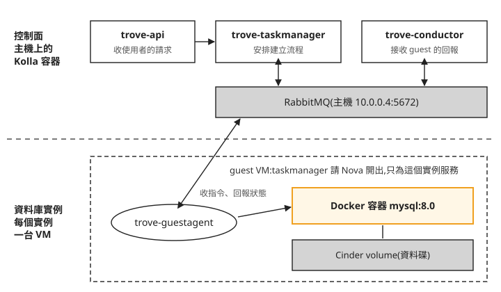
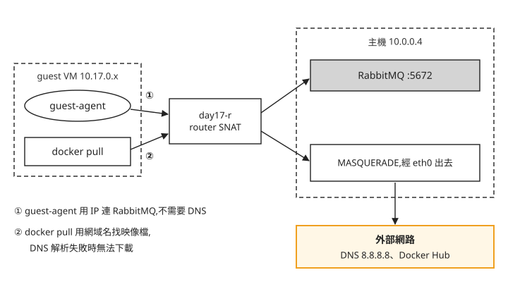
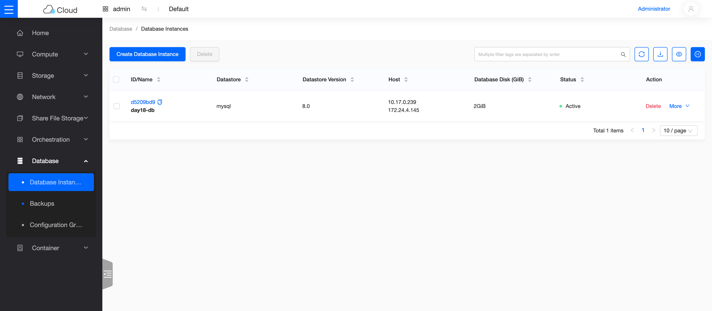
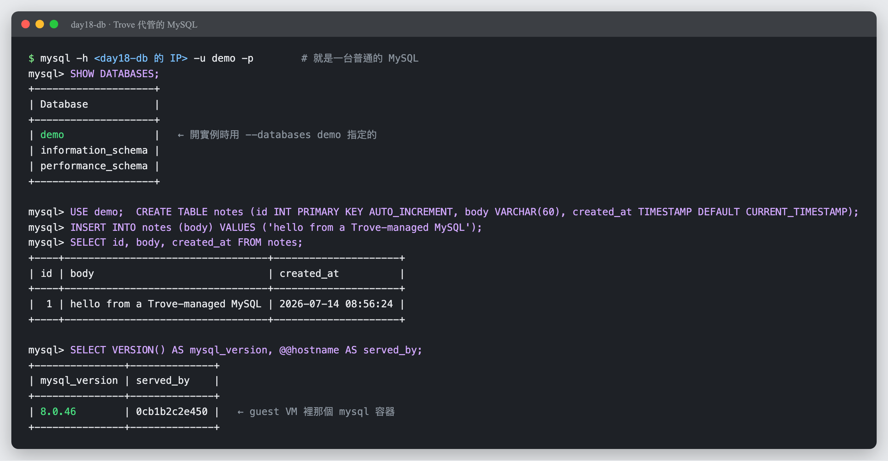

# Day 18: Trove——代管資料庫服務:guest VM、datastore 與建立失敗時的判讀

{ align=right width="100" }

團隊要一台 MySQL。在雲上自己開一台 VM 裝,安裝、設定、建帳號、備份、升版都得自己來;用過 AWS RDS 的人知道另一種做法:下一行指令,幾分鐘後拿到一台已經建好資料庫和帳號的 MySQL,底下的機器不用管。這種服務叫 **DBaaS**(Database as a Service,資料庫即服務),OpenStack 裡負責這件事的服務是 **Trove**。

這一章部署 Trove,沿用 Day 17 建立的 `day17-net` 網路,開出第一台代管 MySQL 並實際讀寫。Trove 會為資料庫建立專用的虛擬機器,稱為 **guest VM**;裡面的代理程式 **guest-agent** 負責管理資料庫並回報狀態。讀完之後,遇到實例建立失敗,你能從 guest-agent 有沒有回報狀態,判斷問題出在連回控制面的路徑,還是 guest 內部。

## 代管資料庫由哪些東西組成

使用者下一行「給我一台 MySQL」,Trove 實際做的事是:請 Nova 開一台專門跑這個資料庫的 VM,掛上 Cinder volume 當資料碟,在 VM 裡把 MySQL 跑起來,建好你要的資料庫和帳號。之後建帳號、建資料庫這類操作,也是由 Trove 轉交給 VM 裡的程式去執行。

把參與的元件畫出來,上半部是主機上的控制面,下半部是每個資料庫實例各自的一台 VM:



我們可以從圖上看到兩件事:

1. **控制面有三個元件。** `trove-api` 收使用者的請求;`trove-taskmanager` 負責建立流程,包括請 Nova 開 VM;`trove-conductor` 接收 VM 裡回報的狀態。三個都跑在主機上,步驟 1 部署完會看到這三個容器。
2. **資料庫跑在一台 VM 裡的 Docker 容器中。** 這台 VM 叫 **guest VM**,裡面除了作業系統,只有兩樣東西:Trove 的代理程式 **guest-agent**(`trove-guestagent`),以及 Docker。MySQL 本身是 guest-agent 用 Docker 拉下來啟動的容器。所以 guest 映像檔不用跟著 MySQL 版本走,要換資料庫版本,換的是容器映像檔的版本標籤。

控制面和 guest-agent 之間不直接連線,而是透過 RabbitMQ(Day 1 提過,OpenStack 服務內部互傳工作和通知用的訊息佇列)傳遞:taskmanager 把「建資料庫」「建使用者」這類指令放進佇列,guest-agent 取出來執行;guest-agent 也定期把狀態送回 conductor。這表示 **guest VM 必須連得到主機上的 RabbitMQ**,步驟 4 之前會再回來看這條路怎麼走。

## 步驟 1:部署 Trove

跟前幾章加服務的做法一樣,在 `globals.yml` 打開 Trove,只部署它這一組:

```bash
echo 'enable_trove: "yes"' | sudo tee -a /etc/kolla/globals.yml
source ~/kolla-venv/bin/activate
kolla-ansible deploy -i ~/all-in-one --tags trove
```

```text
PLAY RECAP: ok=24  changed=17  failed=0
```

`failed=0` 之後,用 `docker ps` 確認 `trove_api`、`trove_taskmanager`、`trove_conductor` 三個容器都是 healthy,再進下一步。

## 步驟 2:準備 guest 映像檔

Trove 開 guest VM 時,要從 Glance 找一份裝好 guest-agent 和 Docker 的映像檔。Trove 專案在 tarballs.opendev.org 提供每天自動建置的 guest 映像檔(約 1.4 GB),下載後上傳到 Glance,並打上兩個 tag:Trove 開 VM 時是用 tag 找映像檔,不是用名稱,步驟 3 會設定要找哪兩個 tag。

```bash
curl -L -o ~/trove-guest-noble.qcow2 \
  https://tarballs.opendev.org/openstack/trove/images/trove-master-guest-ubuntu-noble.qcow2
source /etc/kolla/admin-openrc.sh
openstack image create trove-guest-ubuntu-noble \
  --file ~/trove-guest-noble.qcow2 --disk-format qcow2 --container-format bare \
  --tag trove --tag mysql
```

檔名裡的 `master` 表示這份 Ubuntu 24.04(noble)映像檔是從 Trove 的開發主線建出來的,不是 2025.1 的穩定分支。它每天都會被新版覆蓋,今天下載的跟幾個月後下載的不一定相同,也不保證與 2025.1 控制面相容。要長期使用或之後升級控制面時,照[官方 guest 映像檔建置指南](https://docs.openstack.org/trove/2025.1/admin/building_guest_images.html)用對應分支自己建一份,版本才固定得住。

## 步驟 3:註冊 datastore

映像檔準備好了,還要告訴 Trove 有哪些資料庫可以開。Trove 把「一種資料庫」叫 **datastore**(例如 mysql),把它底下的每個版本叫 **datastore version**(例如 8.0)。每個 datastore version 記著兩件事:開 guest VM 時用哪些 tag 找映像檔,以及 guest-agent 要拉哪個版本的資料庫容器。

先安裝 Trove 的 CLI 外掛。跟 Day 16 的 Manila 一樣,`openstack` 指令預設沒有 `database`、`datastore` 這些子命令,要另外裝(見 Day 16 的[「`openstack` 沒有 `share` 子命令」](sprint4-day16-manila-cephfs.md#mine-1)):

```bash
pip install python-troveclient
openstack datastore version create 8.0 mysql mysql "" \
  --image-tags trove,mysql --active --default --version-number 8.0
openstack datastore version list mysql
```

`datastore version create` 後面四個位置參數依序是:版本名稱 `8.0`、datastore 名稱 `mysql`、資料庫管理類型 `mysql`(guest-agent 用哪一套邏輯管理這個資料庫),最後的 `""` 是映像檔 ID,這裡留空,改用 `--image-tags trove,mysql` 讓 Trove 找帶著這兩個 tag 的映像檔,也就是步驟 2 上傳的那份。`--version-number 8.0` 決定拉哪個版本的 MySQL 容器,`--default` 讓使用者建立實例時不指定版本也會用它。

## guest 怎麼連回 RabbitMQ

建立實例之前,先看 guest VM 要往外連的兩條路。官方文件的做法是替 Trove 另外建一條**管理網路**(management network):每台 guest VM 多掛一張網卡在這條網路上,只用來跟控制面溝通,資料庫的流量則走使用者自己的網路。

本課先不建管理網路,讓 guest VM 只接在 Day 17 建好的 `day17-net` 上。Day 2 看過,租戶網路的 VM 經過 router 的 SNAT 到達主機,而主機上的 RabbitMQ 就在 `10.0.0.4`,所以這條路本來就通。下面這張圖把 guest 往外的兩條路分開畫:



照著圖上的編號看:

1. **路徑 ①:guest-agent 連 RabbitMQ。** guest-agent 的設定裡寫的是 IP,所以這條路不需要 DNS。
2. **路徑 ②:guest-agent 拉 MySQL 容器。** 容器映像檔是用網域名稱找的,guest 要先查 DNS,查不到就拉不到,MySQL 也就起不來。

這兩條路需要的東西不同,所以會出現一種狀況:路徑 ① 通了,guest-agent 能回報狀態,但路徑 ② 斷了,MySQL 起不來。步驟 4 動手前先檢查的就是路徑 ② 需要的 DNS。

少建一條管理網路,換來的是安全上的代價。guest-agent 要連 RabbitMQ,它的設定檔裡就有 RabbitMQ 的帳號密碼;官方文件也指出,guest VM 被攻破,這組帳密就跟著外洩,等於訊息系統被攻破。本課的做法還讓租戶網路直接連得到主機上的 RabbitMQ。正式環境要建專用的管理網路,讓租戶網路碰不到控制面,並照官方文件啟用 Trove 的訊息加密(`enable_secure_rpc_messaging`),降低跨實例訊息遭讀取或偽造的風險,不能將它視為 guest 遭入侵後的完整隔離保證。部署時須確認這項加密是否啟用,不能只依賴預設值。

## 步驟 4:建立資料庫實例 {#step-4}

網路沿用 Day 17 建立的 `day17-net`。動手前先確認 subnet 設有 DNS nameserver,也就是上一節路徑 ② 需要的東西。Day 17 建 subnet 時已經加了 `--dns-nameserver 8.8.8.8`,換用其他 subnet 的話更要先查。

漏設 DNS 時,guest-agent 仍可用 IP 連 RabbitMQ 並回報狀態,但下載 MySQL 容器所需的網域名稱無法解析,可能出現 `Service not active, status: failed to spawn`。這個訊息也可能來自其他映像檔下載或 MySQL 啟動問題,不能單憑它判定是 DNS。先檢查 subnet 的設定:

```bash
openstack subnet show day17-sub -f value -c dns_nameservers   # 必須非空,例如 ['8.8.8.8']
```

結果是空的,就先用 `openstack subnet set <subnet> --dns-nameserver 8.8.8.8` 補上。接著建立實例:`--size 2` 是資料碟大小(GB,會建成一顆 Cinder volume),`--databases` 和 `--users` 讓 Trove 在 MySQL 起來後順便建好資料庫和帳號:

```bash
NET=$(openstack network show day17-net -f value -c id)
openstack database instance create day18-db \
  --flavor m1.medium --size 2 --nic net-id=$NET \
  --datastore mysql --datastore-version 8.0 \
  --databases demo --users demo:<你的密碼>
watch openstack database instance show day18-db -c status -c operating_status
```

`watch` 會每兩秒刷新一次狀態。這段時間裡,Nova 開出 guest VM 並掛上資料碟,guest-agent 開機後連回 RabbitMQ,拉 `mysql:8.0` 容器、啟動,再建好 `demo` 資料庫和使用者。幾分鐘後會停在下面的狀態:

```text
status: ACTIVE
operating_status: HEALTHY
```

這裡有兩個狀態欄位。`status` 是 Trove 對整個實例的狀態,`ACTIVE` 代表建立流程走完了;`operating_status` 是 guest-agent 回報的資料庫服務狀態,`HEALTHY` 代表 MySQL 真的在跑。兩個都到位才算可以用。

如果等了兩分鐘左右,`status` 變成 `ERROR`,先用 `openstack database instance show day18-db` 看 `fault` 欄位。訊息是 `Service not active, status: failed to spawn` 的話,這句話是 guest-agent 自己回報的:它能回報,代表路徑 ① 是通的,問題在 guest 內部。若前置檢查已確認 DNS 設定,還要查 guest 的紀錄,確認映像檔下載或 MySQL 啟動是否失敗。另外,Trove 會自動刪掉建立失敗的 guest VM,要看 VM 的開機訊息就得馬上動手,見[疑難排解:失敗的 guest VM 會被自動刪除](#mine-2)。

## 步驟 5:驗證它是一台真的資料庫

`ACTIVE` 加 `HEALTHY` 只是狀態,接下來實際操作它。先讀:下面兩個查詢會從 Trove API 經 RabbitMQ 轉給 guest-agent,再由 guest-agent 查 MySQL,所以能回結果代表整條路都通:

```bash
openstack database db list day18-db        # demo
openstack database user list day18-db      # demo
```

再寫:新建一個使用者和一個資料庫,讓 guest-agent 真的去改 MySQL 的內容:

```bash
openstack database user create day18-db u2 <密碼>
openstack database db create day18-db demo2
openstack database db list day18-db        # demo、demo2 都在
```

`demo2` 出現在清單裡,代表 guest 裡的 MySQL 在運作,也接受了寫入。

如果 Day 13 已部署 Skyline,這次只跑 Trove tag 不會更新 Skyline 的代理路由。先讓 Skyline 套用新服務設定,再開下一張頁面:

```bash
kolla-ansible deploy -i ~/all-in-one --tags skyline
```

接著從使用者的角度看。Skyline 的「Database」頁列出這台實例,欄位有 datastore、版本、配發到的位址、磁碟大小和狀態,完全沒有提到底下的 Nova VM:



這是 Trove 的預設設計:從 Ussuri 版開始,guest VM、Cinder volume 這些底層資源都建在 Trove 自己的 service project 裡,使用者看不到,只能透過 Trove API 操作實例。

最後看 MySQL 的資料連線。這條連線不經 Trove API:用戶端必須裝好 `mysql` CLI,並且能從所在網路連到實例的 MySQL 位址與 3306 port。單機 lab 的租戶私有位址不會直接開放給你的電腦;可使用已接入 `day17-net` 的用戶端,或先依既有網路章節建立可達的連線。具備這些條件後,才能執行下列 SQL。

用前面的 `openstack database instance show day18-db` 查看實例位址,填入 `<database-ip>`;登入帳號與密碼用建立實例時的 `demo` 那組:

```bash
mysql -h <database-ip> -u demo -p
```

```sql
SHOW DATABASES;
USE demo;
CREATE TABLE notes (id INT PRIMARY KEY AUTO_INCREMENT, body VARCHAR(60), created_at TIMESTAMP DEFAULT CURRENT_TIMESTAMP);
INSERT INTO notes (body) VALUES ('hello from a Trove-managed MySQL');
SELECT id, body, created_at FROM notes;
SELECT VERSION() AS mysql_version, @@hostname AS served_by;
```

下圖依序呈現查資料庫、建表、寫入、查詢的結果:



我們可以看到最後一行的 `served_by` 欄位,回答查詢的是 guest VM 裡那個 mysql 容器,也就是步驟 3 註冊、步驟 4 拉下來的那個版本。使用者不需要知道這件事,拿到的就是一台可以連的 MySQL。

## 疑難排解

### 失敗的 guest VM 會被自動刪除 {#mine-2}

**症狀**:實例轉 `ERROR` 後,想用 `openstack console log show` 看 guest 的開機訊息,卻找不到那台 VM。

**原因**:Trove 會自動刪除建立失敗的 guest VM,console log 跟著一起消失。

**修法**:用管理員身分在 Nova 的所有專案列表中找到對應的 guest VM,確認實例 ID 後立即取得 console log。Trove 實例名稱不等於 Nova server ID;先取得對應關係才能把 `openstack console log show` 指向正確的 VM。來不及的話,只剩主機上 taskmanager 的 log 可以查(`/var/log/kolla/trove/`)。

## 想一想

- 另一個專案的使用者在自己建的網路上開 Trove 實例,兩分鐘後轉 `ERROR`,fault 是 `failed to spawn`。他問你是不是 RabbitMQ 連不上。你會怎麼回答,第一個要他查的是什麼?
- 如果沒有收到 guest-agent 的狀態回報,還能用上一題的理由排除 RabbitMQ 連線問題嗎?接下來應先查哪一條路?
- 主管想讓租戶自己開 Trove 實例,但不希望租戶的 VM 碰得到控制面的 RabbitMQ。這一章的網路做法要改哪裡?

## 小結

Trove 用一台專屬的 guest VM 承載每個資料庫實例:控制面的 api、taskmanager、conductor 跑在主機上,VM 裡的 guest-agent 透過 RabbitMQ 收指令、回報狀態,真正的 MySQL 是它拉下來的 Docker 容器。所以 guest VM 往外有兩條路,用 IP 連 RabbitMQ,用網域名稱拉容器,第二條需要 subnet 設好 DNS。之後遇到 Trove 實例建立失敗,先看 fault 是不是 guest-agent 自己回報的:是的話,路徑 ① 沒問題,往 guest 內部查,並趁 VM 被刪掉之前抓 console log。Day 13 到 Day 18 加上的 Skyline、Ceph、RGW、Manila、Designate、Trove,到這裡都已經接進這朵雲。

## 延伸閱讀

想再深入，可以從這幾份開始：

- **[Trove 生產環境部署指南](https://docs.openstack.org/trove/2025.1/admin/run_trove_in_production.html)** —— 官方的管理網路設計、guest 裡 RabbitMQ 帳密的安全考量與訊息加密設定;本章省略管理網路的做法可以拿來對照。
- **[Trove guest image 建置指南](https://docs.openstack.org/trove/2025.1/admin/building_guest_images.html)** —— 自己建 guest 映像檔的官方流程與 `trovestack` 用法,要固定映像檔版本時從這裡開始。
- **[官方 guest image 下載處](https://tarballs.opendev.org/openstack/trove/images/)** —— 每日自動建置的映像檔放在這裡,步驟 2 從這裡下載。
- **[Trove User Guide](https://docs.openstack.org/trove/2025.1/user/)** —— 實例、備份、設定群組的使用者操作說明。

## 下一步

到這一章為止,每一天都在替這朵雲加新服務。[Day 19](sprint4-day19-api-request-lifecycle.md) 換個方向,不再加東西,改為拆開已經用了三個星期的服務:追一個 API 請求從取得 token 到 qemu 開出 VM 的完整過程。
