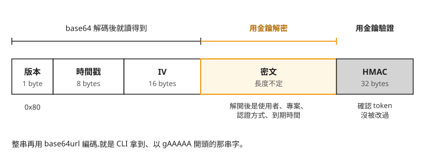

# Day 19: server create 的完整路徑——token、request-id、RabbitMQ、qemu 程序與資料庫的一列

[Day 2](sprint3-day2-openstack-resource-flow.md) 開第一台 VM 時,看過一張 `server create` 背後的流程圖:CLI 向 Keystone 換 token、scheduler 挑主機、nova-compute 接手、libvirt/qemu 把 VM 開起來。那張圖說了請求經過哪幾站,但每一站在主機上留下什麼、去哪裡看,還沒有實際看過。等到哪天 `server create` 回了一台 VM,狀態卻一直停在 `BUILD`,或直接變成 `ERROR`,CLI 只給一句錯誤訊息,你就得自己去找證據。

這一章不部署新服務。我們開一台 VM,沿著它的請求走一遍,在五個地方各用一兩個指令找到它留下的紀錄:Keystone 發的 token、Nova 的 log、RabbitMQ 的佇列、主機上的 qemu 程序,以及 Nova 資料庫裡的一列。讀完之後,建 VM 出問題時,你能判斷該先查這五處的哪一處,並用 server 的 UUID 對照 Nova log、libvirt/qemu 與資料庫;token 和佇列則用來理解認證與工作傳遞。

## 開始之前

需要 [Day 1](sprint3-day1-kolla-aio-core.md) 部署好的單機雲,以及 [Day 17](sprint4-day17-designate-dns.md) 建的 `day17-net` 網路。沒有 `day17-net` 的話,把下面指令裡的網路名稱換成任何一個你自己建過的網路即可。以下指令都在部署 OpenStack 的那台 VM 上執行。

## 這一章要看的五個地方

把 Day 2 那張流程圖換個畫法:每個方塊是一個服務,橘色編號是這一章要去查證的地方。


照著編號看:

1. **Keystone**:CLI 送出任何請求之前,先拿到的那張 token。
2. **nova-api 與 nova-compute 的 log**:一個收到請求,一個真正開機,兩者各留下紀錄。
3. **RabbitMQ**:nova-api 和 nova-compute 之間沒有直接連線,中間隔著它。
4. **qemu 程序**:VM 最後在主機上跑起來的樣子。
5. **Nova 資料庫**:Nova 用來記住這台 VM 的地方。

接下來照這個順序,一站一站看。

## 第一站:Keystone 發的 token

每次 CLI 操作會先取得或沿用有效 token,同一次操作的後續 API 請求可以重用它,不會每個 HTTP 請求都重新發一張。Keystone 是負責身分認證與發 token 的服務。先手動換一張,印出開頭和長度:

```bash
source /etc/kolla/admin-openrc.sh
TOKEN=$(openstack token issue -f value -c id)
echo "${TOKEN:0:20}…  (長度 ${#TOKEN})"
```

印出來的字串以 `gAAAAA` 開頭。這種 token 叫 **fernet token**,是 Keystone 預設的 token 格式,名稱來自它採用的 Fernet 加密規格。

Keystone 收到一張 token 時,要怎麼確認它是自己發的、還沒過期?最直覺的做法是把發出去的每張 token 存進資料庫,收到時去查。fernet token 走的是另一條路,把它拆開就看得出來。下面這段 Python 先做 base64 解碼,再把前面幾段印出來。執行前用 `echo $TOKEN` 印出完整的 token,貼進 `tok = ` 那一行:

```bash
python3 - << 'PY'
import base64, struct
tok = "貼上你的 token"
raw = base64.urlsafe_b64decode(tok + "=" * (-len(tok) % 4))
print(f"版本位元組: 0x{raw[0]:02x}   (0x80 = fernet)")
print(f"時間戳     : {struct.unpack('>Q', raw[1:9])[0]}")
print(f"IV (16B)   : {raw[9:25].hex()}")
print(f"密文+HMAC  : {len(raw)-25} bytes  ← 密文須用金鑰解密，HMAC 須用金鑰驗證")
PY
```

把腳本切開的這幾段排成一列,就是 fernet token 的結構:



我們可以看到,token 分成兩半。左半段的版本、時間戳(token 產生的時間)和 IV(加密時使用的隨機起始值)不需要任何金鑰,腳本印出的就是這幾段。右半段的密文才是 token 的內容:使用者、專案、認證方式、到期時間,由 Keystone 用金鑰加密;最後 32 bytes 的 HMAC 是訊息鑑別碼,用來驗證完整性,確認 token 沒被竄改。它使用對稱金鑰驗證,不是非對稱的數位簽章。解開密文與驗證 HMAC 都要用到 Keystone 的金鑰。

金鑰放在 `keystone` 容器裡:

```bash
sudo docker exec keystone ls /etc/keystone/fernet-keys/
# 0  1   ← 兩把輪替金鑰
```

目錄裡每個檔案是一把金鑰,檔名是編號。Keystone 用編號最大的那把(primary key)加密新發的 token;編號 0 是預備的金鑰(staged key),下次輪替時升為 primary;解 token 時,目錄裡的每一把都會拿來試。所以輪替之後,用舊金鑰發出、還沒過期的 token 仍然能用。

有了金鑰,Keystone 不必把 token 存進資料庫:收到 token 時,用金鑰驗證 HMAC、解開密文、看有沒有過期,就知道它是不是自己發的。有好幾台 Keystone 時,只要每一台都持有同一組金鑰,任何一台都能驗證另一台發出的 token。但驗證並沒有完全不碰資料庫:Keystone 仍會檢查這張 token 有沒有被撤銷(例如使用者改了密碼或被停用),回傳驗證結果時也要從資料庫讀出使用者在專案上的角色。金鑰目錄本身也必須在每台 Keystone 之間保持一致,某一台的金鑰沒同步,其他台發的 token 到它那裡就驗不過。

建 VM 時若 CLI 回 401(認證失敗),先看是哪個 HTTP 請求被拒絕。取得 token 失敗就查 Keystone;若 Nova 收到請求後拒絕 token,也要檢查它的認證設定。401 不能單獨證明請求尚未到達 Nova。

## 第二站:nova-api 和 nova-compute 的 log

有了 token,CLI 就能送出建立請求。OpenStack 的服務每收到一個 HTTP 請求,就給它一個編號,叫 **request-id**,寫在回應的 `x-openstack-request-id` 標頭裡,也寫進該服務的 log。加上 `--debug` 讓 CLI 印出所有 HTTP 往來,就看得到這個標頭。下面保留原有的 debug 範例,用來說明為什麼不能只取第一條 id。它會建立一台叫 `trace-vm` 的 VM,同名 VM 已存在時不要重跑;後面的 UUID 對照使用這台 VM:

```bash
openstack --debug server create trace-vm \
  --flavor m1.tiny --image cirros --network day17-net 2>&1 \
  | grep -i x-openstack-request-id | head -1
```

```text
x-openstack-request-id: req-30b85aef-a444-465d-8cb6-e97dc924b8f4
```

看起來拿這條 id 去 grep 各服務的 log 就能追到底,但要小心它屬於哪一個請求。`--debug` 會印出 CLI 送出的每一個 HTTP 請求:真正送出建立請求之前,CLI 要先向 Keystone 拿 token,再用名稱查出 flavor、image、network 的 ID,這些請求各有自己的 request-id,`head -1` 拿到的是最前面那一條,不一定是建立 VM 的請求。

追一台 VM,有一個不用挑的線索:**server UUID**。它是 Nova 在建立時給這台 VM 的 ID,也就是 `openstack server show` 的 `id` 欄,從建立到刪除都不會變。拿它搜整個 Nova 的 log 目錄,列出哪些檔案提到這台 VM:

```bash
UUID=$(openstack server show trace-vm -f value -c id)
sudo grep -rl "$UUID" /var/log/kolla/nova/ | sed 's|/var/log/kolla/||'
```

```text
nova/nova-api.log
nova/nova-compute.log
```

清單上只有兩個檔:nova-api 收到建立請求,nova-compute 真正開機。conductor 和 scheduler 也經手了這台 VM(第三站會看到),但在預設的 INFO log 等級下,它們的 log 沒有留下含這個 UUID 的紀錄。

再分別看這兩個檔裡跟這台 VM 有關的行:

```bash
# ① nova-api 收到請求
sudo grep "$UUID" /var/log/kolla/nova/nova-api.log | head -1
# ② nova-compute 真正開機(claims 資源 → spawn)
sudo grep "$UUID" /var/log/kolla/nova/nova-compute.log | grep -iE "claim|spawned"
```

```text
nova.compute.claims  Claim successful on node openstack-lab
nova.virt.libvirt.driver [instance: 206aa8b3-…] Instance spawned successfully
```

nova-compute 的這兩行對應開機的兩個階段。`Claim successful` 表示 nova-compute 已經在這台主機上預留 VM 要用的 CPU、記憶體和磁碟,這個動作叫 claim;`Instance spawned successfully` 表示 VM 已經開起來了。

VM 停在 `BUILD` 時,就用 UUID 查這兩個檔:nova-api 有紀錄、nova-compute 完全沒有,先檢查排程、RPC 與 compute 是否可用,不能只因沒有某行 log 就斷定停在哪裡;nova-compute 有 claim 卻沒有 spawned,優先查 compute 的後續錯誤與 VM 啟動階段,對應第四站。

## 第三站:nova-api 和 nova-compute 之間的 RabbitMQ

{ align=right width="72" }

第二站的 log 只出現在 nova-api 和 nova-compute,而 Day 1 確認過的 Nova 元件還有 conductor 和 scheduler。nova-api 是怎麼把工作交到 nova-compute 手上的?Nova 的元件之間不直接呼叫對方,而是用 **RPC**(remote procedure call,遠端程序呼叫:像呼叫函式一樣,請另一個程式做一件事)溝通。這些呼叫由 oslo.messaging 這個函式庫包成訊息,送進 Day 1 提過的 RabbitMQ。

列出 RabbitMQ 上跟這三個元件有關的佇列:

```bash
sudo docker exec rabbitmq rabbitmqctl list_queues name messages \
  | grep -iE "conductor|scheduler|compute"
```

輸出的每一行是一個佇列的名稱和目前積著的訊息數,名稱裡帶著 `conductor`、`scheduler`、`compute`。這些佇列在 `server create` 時怎麼用,依 Nova 官方架構文件畫成時間順序,由上往下看:


照著編號看:

1. nova-api 把建立 VM 的工作送進 conductor 的佇列,不等結果就回應 CLI。這就是為什麼 `server create` 一回來,狀態是 `BUILD`。
2. nova-conductor 問 nova-scheduler 這台 VM 該放哪台主機。scheduler 向 Placement(記錄每台主機還剩多少 CPU、記憶體的服務,Day 1 部署 Nova 時一起裝上)查詢,挑出合適的主機,也就是 Day 2 那張圖上「挑實體機」那一步。
3. scheduler 把選定的主機回覆給 conductor。第 2 則是唯一一則要等回覆的訊息。
4. conductor 把開機的工作送進那台主機專屬的 compute 佇列,那台主機上的 nova-compute 取出後開始 claim、開機,也就是第二站看到的那兩行。

元件之間隔著佇列,nova-api 不需要知道有哪幾台 compute 主機,也不必等開機完成;多開幾個 conductor,它們就從同一個佇列輪流取工作。反過來說,某個元件停了,送給它的訊息會留在佇列裡。所以 nova-api 有紀錄、nova-compute 沒有時,看 `list_queues` 的訊息數:某個佇列的訊息一直增加、沒有減少,可能是消費端停止,也可能是處理速度跟不上。這個清單只有佇列總數,不能指出哪一則訊息屬於 `trace-vm`,還要配合服務狀態與錯誤 log。

## 第四站:主機上的 qemu 程序

nova-compute 取到工作後,透過 libvirt(主機上管理 VM 的服務,Kolla 把它放在 `nova_libvirt` 容器裡)開機。libvirt 管理的每一台 VM 叫一個 **domain**。domain 的名稱由 Nova 產生,是 `instance-` 加一串十六進位編號,跟你在 OpenStack 裡取的名字 `trace-vm` 無關,但它的設定(一份 XML)裡記著 server UUID。

下面這個迴圈列出執行中的 domain,逐一比對 UUID,找出 `trace-vm` 對應哪一個。`virsh list` 的順序不等於建立順序,主機上有好幾台 VM 時,不能只挑最後一個。這一步用來對照已啟動的 `trace-vm`;停止的 domain 不會列在這個清單裡,查不到不等於不存在:

```bash
for d in $(sudo docker exec nova_libvirt virsh list --name); do
  u=$(sudo docker exec nova_libvirt virsh dumpxml "$d" | grep -oE '<uuid>[^<]+' | cut -d'>' -f2)
  [ "$u" = "$UUID" ] && echo "這台 VM 的 domain = $d"
done
```

把印出的 domain 名稱,填進下面指令的 `<你的domain>`。每個 domain 在主機上就是一個 qemu 程序,qemu 的啟動參數 `guest=` 後面接的是 domain 名稱,所以用它就能找到那個程序,再挑出其中兩個參數:

```bash
sudo pgrep -af "guest=<你的domain>" | grep -oE '\-uuid [a-f0-9-]+|accel=kvm'
```

```text
-uuid 206aa8b3-a51a-4868-9145-4798420394f4
accel=kvm
```

`-uuid` 後面就是 server UUID。你在 OpenStack 裡看到的 `trace-vm`,在主機上是一個普通的 Linux 程序,啟動參數裡帶著同一個 UUID。`accel=kvm` 表示這個程序用 KVM 硬體虛擬化執行。[Day 0](sprint3-day0-azure-vm.md) 選支援巢狀虛擬化的機型、用 `kvm-ok` 確認,就是為了這裡;QEMU 也可設定使用 TCG 軟體模擬,但本課 Nova 配置不保證在 KVM 不可用時自動切換到 TCG。

最後看這台 VM 的磁碟放在哪裡。把下面的 `<domain>` 同樣換成剛才那個名稱:

```bash
sudo docker exec nova_libvirt virsh dumpxml <domain> | grep 'source file'
# .../instances/<uuid>/disk        ← 這台 VM 專屬的差異磁碟(overlay)
# .../instances/_base/<hash>       ← 所有同 image 的 VM 共用的底圖
```

第一個檔案在以 UUID 命名的目錄裡,是這台 VM 自己的磁碟,只存它跟 image 不一樣的部分,這種只記差異的磁碟叫 overlay。第二個在 `_base` 目錄,是從 image 轉出來的底圖,用同一個 image 開的 VM 都共用它,所以開第二台同 image 的 VM 時,不用再複製一份完整的 image。

## 第五站:Nova 資料庫裡的一列

VM 跑起來了,OpenStack 又是怎麼記得它存在、目前是什麼狀態?答案在 Nova 的資料庫裡,也就是 Kolla 部署的 MariaDB。每台 VM 是 `nova` 資料庫 `instances` 表裡的一列。查詢要用 MariaDB 的 root 密碼,它存在 `passwords.yml` 的 `database_password` 欄位:

```bash
PW=$(sudo grep '^database_password' /etc/kolla/passwords.yml | awk '{print $2}')
sudo docker exec mariadb mysql -uroot -p"$PW" -N -e \
  "SELECT uuid, host, vm_state, power_state FROM nova.instances WHERE uuid='$UUID';"
```

```text
206aa8b3-…  openstack-lab  active  1
```

四欄依序是 UUID、VM 所在的主機、`vm_state` 和 `power_state`。`vm_state` 是 Nova 記錄的 VM 狀態;`power_state` 是 nova-compute 從 libvirt 讀到的電源狀態,`1` 代表執行中。`openstack server show` 顯示的 `ACTIVE`,就是從這一列的狀態換算出來的。

nova-compute 本身不直接連資料庫,狀態有變化時,也是經過 RabbitMQ 交給 conductor 寫入,所以開頭那張圖上,寫入資料庫的虛線是從 conductor 出發。

五站都看完了,用 `openstack server delete trace-vm` 刪掉這台 VM。

## 想一想

- 一位同學說:「既然 fernet token 不存在資料庫裡,把某個使用者停用之後,他手上還沒過期的 token 應該照樣能用。」你同意嗎?本章哪一段可以回答?
- 一台 VM 停在 `BUILD` 好幾分鐘。你用 UUID 搜 log,`nova-api.log` 有紀錄,`nova-compute.log` 沒有。下一步你會看哪裡、看什麼?如果 `nova-compute.log` 有 `Claim successful`,卻一直沒有 `Instance spawned successfully` 呢?
- 你把 Keystone 擴充成三台,其中一台的 `fernet-keys` 目錄跟另外兩台不一樣。使用者會遇到什麼現象?為什麼不是每次都發生?

## 小結

一次 `server create` 會在五個地方留下紀錄:Keystone 發出一張用金鑰加密、不必存進資料庫的 fernet token;nova-api 和 nova-compute 各在 log 裡留下請求與開機的紀錄;兩者之間的工作經過 RabbitMQ 的佇列,由 conductor 和 scheduler 轉手;VM 最後是主機上一個帶著 `-uuid` 參數的 qemu 程序;狀態則記在 `nova.instances` 的一列。其中 Nova log、libvirt/qemu 和資料庫能用同一個 server UUID 對照;token 代表使用者認證,佇列清單則只有總數。下次建 VM 出問題,先拿 UUID 查 nova-api 和 nova-compute 的 log,看請求停在哪一段:還沒進 Nova 就失敗,回頭看 token;到不了 nova-compute,看 RabbitMQ 的佇列;開機那一段出錯,看主機上的 domain 和 qemu 程序。

## 延伸閱讀

想再深入，可以從這幾份開始：

- **[Keystone Fernet Token FAQ](https://docs.openstack.org/keystone/2025.1/admin/fernet-token-faq.html)** —— fernet 設計的官方問答:為什麼不用存進資料庫、primary 與 staged 金鑰怎麼輪替;第一站的完整版。
- **[Nova 架構說明](https://docs.openstack.org/nova/2025.1/admin/architecture.html)** —— api、conductor、scheduler、compute 怎麼分工,以及 conductor 為什麼替 compute 寫資料庫;第三站那張時間順序圖的依據。
- **[oslo.messaging 文件](https://docs.openstack.org/oslo.messaging/2025.1/)** —— 第三站看到的 RPC 就是這個函式庫提供的;cast(送出不等回覆)和 call(等回覆)兩種呼叫的差別寫在這裡。

## 下一步

運算這一側追完了,還有網路那一側。[Day 20](sprint4-day20-ovn-packet-trace.md) 追一個封包從 VM 送出,看它經過哪些邏輯關卡、在哪一刻被 NAT 改寫,而且全程不用真的發一個封包。

---

*RabbitMQ 標誌為其商標持有者之資產,此處作社群教學用途。*
