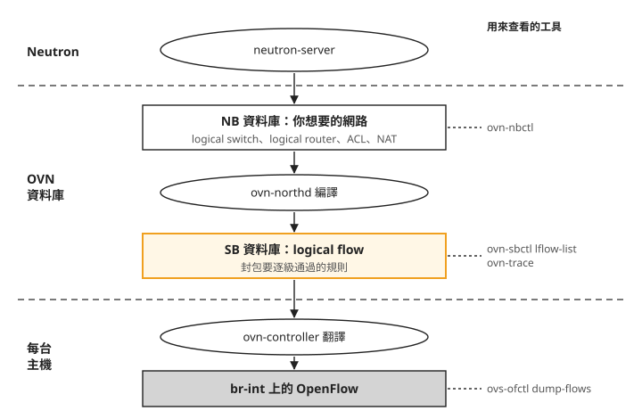
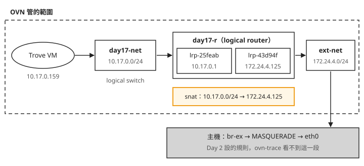
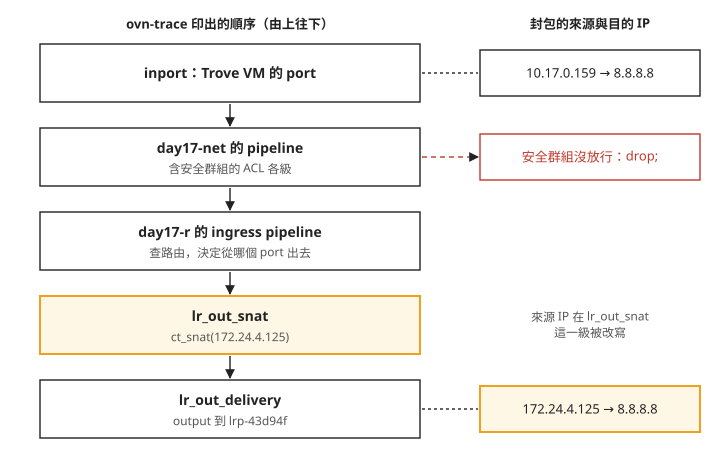

# Day 20：從 OVN 規則追查 VM 的封包

VM 已經是 ACTIVE，安全群組也放行了，連線卻仍然失敗。Day 19 的 server UUID 能追到運算服務，接下來要沿著網路規則查：封包進了哪個 switch、選了哪條路由、來源 IP 又在哪裡被改寫？本章用 Day 18 的 Trove guest 作例子，讀完能判斷 OVN 的邏輯規則是否符合預期，以及還有哪些實際連線條件必須另外檢查。

## 先分清楚要查哪一層

Neutron 接收我們建立 network、router、安全群組的要求；OVN 把這些設定轉為主機實際使用的網路規則。OVN 的 **logical switch** 是邏輯交換器，對應 Neutron network；**logical router** 是邏輯路由器，連接不同網段。

設定先進入 NB（Northbound）資料庫。`ovn-northd` 讀取 NB，產生 SB（Southbound）資料庫中的 **logical flow**，也就是封包逐級比對的條件與動作。各主機的 `ovn-controller` 再把它們轉成 Open vSwitch 使用的 OpenFlow 規則。下圖把兩次轉換與查看工具分開：



所以 `ovn-nbctl` 適合看拓樸與 NAT，`ovn-sbctl` 適合看 logical flow。`ovn-trace` 是另一支讀取 SB 的程式，不是 `ovn-sbctl` 的子命令。

以下在執行 Kolla 容器的主機操作。沿用 Day 17–18 的 `day17-net`、`day17-r` 與 Trove guest；若已刪除這些資源，就改選目前仍存在的網路與 VM。先定義兩個查詢工具：

```bash
NB="sudo docker exec ovn_nb_db ovn-nbctl"
SB="sudo docker exec ovn_sb_db ovn-sbctl"
# ovn-trace 也在 ovn_sb_db 容器;ovs-ofctl 在 openvswitch_vswitchd
```

## 步驟 1：對上 VM、switch 與 router

先列出 NB 裡的邏輯拓樸。每個 VM port 會帶有 MAC 與 IP，router port 則標示它連到哪個網段：

```bash
$NB show
```

下列為本課實測節錄，省略號與箭頭是說明標記，並非可直接複製的識別碼：

```text
switch (aka day17-net)
    port trove-a802f2…  addresses: ["fa:16:3e:f1:17:de 10.17.0.159"]
    port (type: router) router-port: lrp-25feab…       ← 接到 router 的埠
switch (aka ext-net)
    ...
router (aka day17-r)
    port lrp-25feab…  networks: ["10.17.0.1/24"]        ← 內網那一側
    port lrp-43d94f…  networks: ["172.24.4.125/24"]     ← 外網那一側
```

`day17-net` 裡的 Trove port 使用 `10.17.0.159`；同一個 switch 的 router port 接到 `day17-r`。router 另一側是外部網路。對照圖中的兩個 router port，稍後的 trace 就能看出封包從哪裡進、往哪裡出：



圖中的 IP 是既有輸出的例子。執行自己的查詢時，要取完整的 router 名稱與 port 名稱，不能使用含 `…` 的節錄值。

## 步驟 2：查來源 IP 在哪裡改寫

**SNAT** 會改寫封包的來源 IP。將下列 `<router-uuid>` 換成上一個完整輸出中 `neutron-` 後面的 router UUID：

```bash
$NB lr-nat-list neutron-<router-uuid>
```

```text
TYPE   EXTERNAL_IP     LOGICAL_IP
snat   172.24.4.125    10.17.0.0/24
```

這條規則讓 `10.17.0.0/24` 的出站流量使用 router 外部位址 `172.24.4.125`。Day 18 guest 連到主機 RabbitMQ 時，這是路徑中的一段；它仍需要正確路由與防火牆放行。Floating IP 則通常對應 `dnat_and_snat`，同時處理目的與來源位址的轉換。

## 步驟 3：讀安全群組相關的 logical flow

封包會依序通過多個 **table**，每個 table 比對條件後執行動作；這一整串處理順序稱為 pipeline。ACL（存取控制規則）在其中決定流量是否放行。先看與 ACL 有關的幾行：

```bash
$SB lflow-list day17-net | grep ls_in_acl | head -4
```

```text
table=7 (ls_in_acl_hint), priority=7, match=(ct.new && !ct.est), action=(...)
table=7 (ls_in_acl_hint), priority=5, match=(!ct.trk), action=(...)
```

`ct` 是 conntrack，也就是連線追蹤。`ct.new`、`ct.est` 分別描述新連線與已建立的連線。這兩行來自 `ls_in_acl_hint`，是在替後續 ACL 判斷整理連線狀態，還不能直接讀成某一條 Neutron 安全群組規則。追查特定允許或拒絕條件時，需要繼續看後續 ACL table 與封包走到的動作。

## 步驟 4：模擬封包經過的規則

`ovn-trace` 根據 SB 裡的規則模擬封包，不會真的送封包。以下示範 `ovn-trace` 的呼叫方式；這個版本的命令尚未重新執行驗證。先從完整拓樸輸出取得 VM 的 logical port、MAC、IP，以及 router 內側 port 的 MAC，再替換相應欄位：

```bash
sudo docker exec ovn_sb_db ovn-trace day17-net '
  inport=="<vm-logical-port>" &&
  eth.src==fa:16:3e:f1:17:de && eth.dst==fa:16:3e:27:b2:65 &&
  ip4.src==10.17.0.159 && ip4.dst==8.8.8.8 && ip.ttl==64
'
```

`inport` 是 VM 的 logical port；`eth.src` 是 VM MAC，`eth.dst` 是同網段 router 的 MAC；IP 目的位址則是要測試的遠端位址。`<vm-logical-port>` 必須換成完整名稱。其他 IP 與 MAC 也應以自己的拓樸為準。

本課 trace 結果的節錄如下。它顯示預期的 SNAT 路徑；其中 table 編號、優先權與省略內容不是跨版本固定值：

```text
ingress(dp="day17-r", inport="lrp-25feab")
  ...
3. lr_out_snat: ip4.src == 10.17.0.0/24 ... priority 153
     ct_snat(172.24.4.125);          ← 源 IP 就在這一刻被改寫!
6. lr_out_delivery: outport == "lrp-43d94f"
     output;                          ← 從外網埠送出
```

`ct_snat(172.24.4.125)` 是來源位址改寫，`output` 是從選定的 logical port 送出。下圖把節錄中的動作放回處理順序：



如果某個分支出現 `drop;`，先查該 table 的比對條件，以及模擬封包的 MAC、port、連線狀態是否正確。若模擬走到 `output;`，只能說這組輸入在邏輯規則中走得通；實際主機是否已套用規則、實體鏈路、MTU，以及圖中的主機 MASQUERADE，仍要另外確認。

## 步驟 5：確認主機已有 OpenFlow 規則

**br-int** 是主機上的整合橋接器，連接 VM 的虛擬介面。`ovn-controller` 將 SB 的 logical flow 轉成 br-int 上的 OpenFlow；以下只計算輸出的行數，並不能逐條證明某個 VM 的規則正確：

```bash
sudo docker exec openvswitch_vswitchd ovs-ofctl dump-flows br-int | wc -l
```

```text
2021
```

這份輸出證明當時 br-int 有流表內容。要追特定封包，仍應回到它的 port、位址與 match 條件，不能用總行數作為通訊成功的判準。

## 想一想

1. `ovn-trace` 顯示 `output;`，但 VM 仍連不到外部服務，為什麼不能直接排除主機上的網路問題？
2. NB 的 router 已有 SNAT 規則，卻在主機上找不到對應的處理行為，接下來應留意哪兩個轉換步驟？
3. `ls_in_acl_hint` 出現 `ct.est`，足以證明你新加的 TCP 443 安全群組規則已生效嗎？

## 小結

追查網路時，先用 NB 對上 port、switch、router 與 NAT，再用 SB 的 logical flow 和 `ovn-trace` 看特定封包的處理路徑。邏輯模擬縮小了要查的範圍；實際通訊還包含主機流表、介面與外部網路。本章將兩者分開，讓「規則允許」與「真的連得到」各有對應的證據。

## 延伸閱讀

想再深入，可以從這幾份開始：

- [OVN architecture](https://www.ovn.org/support/dist-docs/ovn-architecture.7.html)：對照 NB、SB、northd 與 ovn-controller 的分工。
- [ovn-trace 手冊](https://www.ovn.org/support/dist-docs/ovn-trace.8.html)：查 microflow 欄位、連線追蹤假設與模擬限制。手冊對應網站目前版本，table 細節應再對照部署的 OVN 版本。
- [Neutron 2025.1 的 OVN 文件](https://docs.openstack.org/neutron/2025.1/ovn/index.html)：回到 Neutron 資源與 OVN 的整合方式。

## 下一步

[Day 21](sprint4-day21-observability.md) 將分散的服務紀錄集中起來，並用 Prometheus 與 Grafana 觀察服務和主機狀態。
