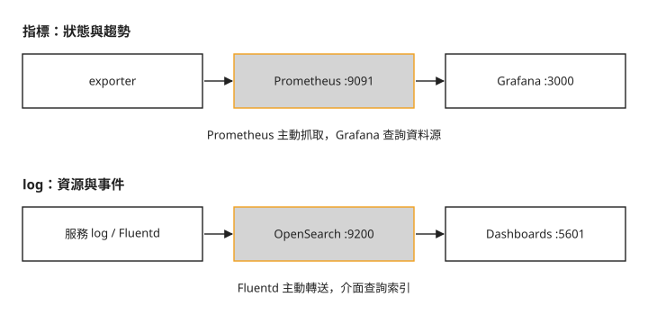
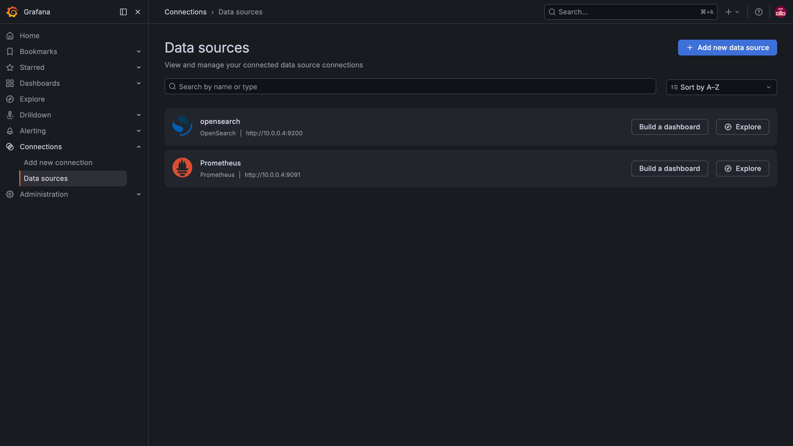
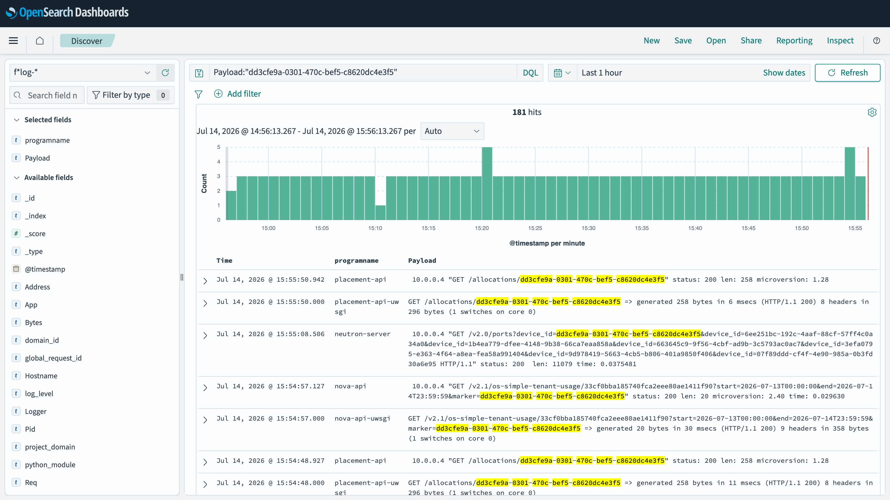

# Day 21：集中查詢服務紀錄與監控指標

一台 VM 建立失敗，你拿著 Day 19 找到的 UUID，分別到 Nova、Placement、Neutron 的紀錄搜尋。當服務分散到多台主機，逐台登入就很費時。另一個問題是：還沒有人回報錯誤，如何發現磁碟快滿了，或某個服務已經停止回報？本章建立兩條資料收集路徑，讓你判斷何時看指標、何時查事件紀錄。

## 指標與 log 各自回答什麼

**指標（metric）** 是隨時間取樣的數值，例如可用記憶體、佇列長度、API 錯誤次數。Prometheus 定期向 **exporter** 抓取指標；exporter 是把服務或主機狀態轉成 Prometheus 格式的程式。Grafana 再把數值畫成趨勢圖。

**log** 記錄個別事件，例如某台 VM 的資源配置成功或失敗。Fluentd 收集服務紀錄，送到 OpenSearch 儲存與搜尋；OpenSearch Dashboards 或 Grafana 提供查詢介面。下圖將兩條路徑分開：



圖中的連線方向表示資料流。Prometheus 主動抓取 exporter，Fluentd 則主動轉送 log。看到圖表空白時，先確認上游有資料，再確認介面能連到資料源。

## 步驟 1：啟用收集服務

以下沿用單機 Kolla 環境與管理員 openrc。先確認 `/var/lib/docker` 有足夠空間；OpenSearch 的索引會持續占用磁碟。設定 `enable_central_logging` 後，Kolla 會部署 OpenSearch 與 Dashboards，並設定 Fluentd：

```bash
sudo tee -a /etc/kolla/globals.yml << 'EOF'
enable_prometheus: "yes"
enable_grafana: "yes"
enable_central_logging: "yes"
EOF
source ~/kolla-venv/bin/activate
kolla-ansible deploy -i ~/all-in-one --tags prometheus,grafana,common,opensearch
```

`common` tag 涵蓋 Fluentd 的設定。部署結束的 `failed=0` 只代表部署工作成功；接下來還要確認 target 與索引實際有資料。

## 步驟 2：確認 Prometheus 能抓取指標

Prometheus 把每個抓取對象稱為 **target**。本章 Kolla 預設使用 `9091` 與 basic auth，帳號是 `admin`，密碼取自 `passwords.yml`。`10.0.0.4` 要對應你的單機管理位址：

```bash
PW=$(sudo grep '^prometheus_password:' /etc/kolla/passwords.yml | awk '{print $2}')
curl -s -u admin:$PW http://10.0.0.4:9091/api/v1/targets \
  | python3 -c "import sys,json,collections; \
    t=json.load(sys.stdin)['data']['activeTargets']; \
    print(collections.Counter(x['health'] for x in t))"
```

```text
Counter({'up': 36, 'down': 1})
```

`up` 表示最近一次抓取成功；`down` 表示抓取失敗，還不能直接斷定被監控的服務停止。這份紀錄裡 RabbitMQ 的 target 尚未上線，處理範圍見[疑難排解：RabbitMQ target 持續 down](#mine-3)。不要把「大部分 up」當作全部監控已完成。

若 `prometheus_cadvisor` 持續重啟並回報 `inotify_init: too many open files`，再依[疑難排解](#mine-1)調整主機限制。

## 步驟 3：確認 log 已匯入 OpenSearch

OpenSearch 將資料放在 **索引（index）** 中；Kolla 預設的 log 索引名稱以 `flog-` 開頭。以下先查叢集健康，再確認 log 索引存在：

```bash
curl -s http://10.0.0.4:9200/_cluster/health?pretty | grep status
curl -s http://10.0.0.4:9200/_cat/indices | grep flog
```

```text
"status" : "yellow",
yellow open flog-2026.07.12  ... 3857
```

`yellow` 表示 primary shard 可用，但有 replica shard 尚未配置；在只有一個節點、仍要求副本時可以出現。它不是所有異常都能忽略的訊號。這份節錄同時顯示索引已有文件；之後應持續留意文件是否增加與資料是否夠新。

Grafana 使用 `3000` 埠。從你已建立的 SSH tunnel 或可達管理網路開啟它，使用 `admin` 與 `passwords.yml` 裡的 `grafana_admin_password` 登入。資料源頁可以確認 Prometheus 與 OpenSearch 的連線設定：



看到資料源名稱不等於所有指標都存在。先從主機磁碟與記憶體、服務存活狀態，再到 API 錯誤率與佇列長度；每項都要對照相應 exporter 是否成功抓取。本章未補做各 dashboard 與告警規則的驗證。

## 步驟 4：更新 Skyline 的監控設定

Day 13 部署 Skyline 時，Prometheus 還沒有啟用。現在要重新產生 Skyline 設定，讓它取得 Prometheus endpoint 與專用認證資料。先確認 Day 15 的 `ceph_rgw_swift_compatibility: "false"` 仍寫在 `globals.yml`，避免 RGW 路徑在這次重新產生設定時不一致。

```bash
kolla-ansible deploy -i ~/all-in-one --tags skyline
```

部署成功後，檢查 Skyline 的監控頁是否能載入資料。如果模板回報缺少 RGW 變數，見[疑難排解](#mine-2)；這與 Prometheus 本身是否可用是不同問題。

## 步驟 5：用 UUID 跨服務搜尋

接著建立一台測試 VM，取得 UUID，再搜尋 OpenSearch 的 `Payload` 欄位，也就是 log 訊息本文。以下假設 `day17-net`、`cirros`、`m1.tiny` 仍存在；同名 `obs-vm` 若已存在，先確認它是不是先前練習留下的資源，避免重複建立。

```bash
# 開一台 VM,拿它的 UUID
VM=$(openstack server create obs-vm --flavor m1.tiny --image cirros --network day17-net -f value -c id)
sleep 20
# 用 UUID 在所有服務的 log 裡一次搜(Day 19 的技巧 × 集中式)
curl -s http://10.0.0.4:9200/flog-*/_search -H 'Content-Type: application/json' \
  -d "{\"query\":{\"match_phrase\":{\"Payload\":\"$VM\"}},\"size\":5}" \
  | python3 -c "import sys,json; \
    d=json.load(sys.stdin); \
    print('命中', d['hits']['total']['value'], '筆'); \
    [print(' ', h['_source']['Payload'][:80]) for h in d['hits']['hits']]"
```

這段範例等待 20 秒讓紀錄有時間送入索引，並非 VM 完成或 log 匯入的保證。若沒有命中，先確認 VM UUID、索引與收集延遲。本課的搜尋結果節錄如下：

```text
命中 19 筆
  [instance: ee9d0bd4-…] Claim successful on node openstack-lab
  10.0.0.4 "GET /allocations/ee9d0bd4-…" status: 200
  10.0.0.4 "PUT /allocations/ee9d0bd4-…" status: 204
```

命中的紀錄同時包含 Nova 的 instance 訊息與 Placement 的 allocations API。這說明同一個 UUID 能連結不同服務的事件，但這裡只要求傳回五筆文件，不能視為 VM 完整生命週期的全部紀錄。對單次請求，也可使用 Day 19 的 request-id 縮小範圍。

OpenSearch Dashboards 使用 `5601` 埠，預設帳號 `opensearch`，密碼為 `opensearch_dashboards_password`。首次登入先建立 index pattern `flog-*`，時間欄位選 `@timestamp`，再到 Discover 選對時間範圍，搜尋 UUID：



除了搜尋字串，也要看時間範圍與 `programname`。查不到時，先分辨是該服務沒有記錄這個 UUID，還是 Fluentd 尚未送入。練習結束以 `openstack server delete obs-vm` 刪除測試 VM。

## 疑難排解

### cAdvisor 持續重啟並回報 inotify 限制 {#mine-1}

`inotify` 是 Linux 監看檔案變化的機制。當 cAdvisor 無法再建立監看實例，會出現 `inotify_init: too many open files`。先確認錯誤訊息，再提高對應限制並重啟該容器：

```bash
echo 'fs.inotify.max_user_instances=1024' | sudo tee /etc/sysctl.d/99-inotify.conf
echo 'fs.inotify.max_user_watches=524288' | sudo tee -a /etc/sysctl.d/99-inotify.conf
sudo sysctl -p /etc/sysctl.d/99-inotify.conf
sudo docker restart prometheus_cadvisor
```

這是針對 inotify 限制的修法；不要只因容器數增加就認定所有重啟都由它造成。

### Skyline 模板找不到 ceph_rgw_swift_compatibility {#mine-2}

只部署 Skyline role 時，不能依賴另一個 role 的預設值剛好已載入。將 `ceph_rgw_swift_compatibility: "false"` 明確寫進 `globals.yml`，再重跑步驟 4。此值要與 Day 15 的 `/swift/v1` 一致；改成 `true` 會改用 `/v1`，不能當成單純消除 undefined 的修法。

### RabbitMQ target 持續 down {#mine-3}

本章尚未完成 RabbitMQ metrics 接線。Kolla 透過 RabbitMQ role 管理 `rabbitmq_prometheus` plugin；只部署 Prometheus 的 tag 不代表既有 RabbitMQ 容器已套用 plugin 設定。本課尚未驗證重新套用後 target 恢復，因此這裡仍是未完成項目。可沿用 Day 19 的 RabbitMQ 管理工具檢查佇列，但不能宣稱 Prometheus 已取得這些佇列指標。

## 想一想

1. 某個 target 是 down，但 VM 仍可建立，你會先檢查被監控服務，還是抓取 endpoint 與認證？需要什麼證據區分？
2. 搜尋 UUID 沒有結果，為什麼不能立刻斷定 Nova 沒處理這台 VM？
3. 同一台 VM 的紀錄有數十筆，只傳回五筆的搜尋結果能證明哪些事，又不能證明哪些事？

## 小結

Prometheus 用數值指出狀態與趨勢，OpenSearch 用事件紀錄追查資源經過的服務。部署之後要分別確認抓取、匯入與查詢三件事；資料源出現在介面上只是其中一步。集中查詢減少逐台找檔案的工作，對紀錄內容與缺漏的判讀仍需要 Day 19 的服務分工知識。

## 延伸閱讀

想再深入，可以從這幾份開始：

- [Kolla-Ansible 2025.1 Prometheus 指南](https://docs.openstack.org/kolla-ansible/2025.1/reference/logging-and-monitoring/prometheus-guide.html)：查看 exporter、認證與抓取設定。
- [Kolla-Ansible 2025.1 集中式 log 指南](https://docs.openstack.org/kolla-ansible/2025.1/reference/logging-and-monitoring/central-logging-guide.html)：對照索引、保留期限、Discover 與 Fluentd 設定。
- [Kolla-Ansible 2025.1 Grafana 指南](https://docs.openstack.org/kolla-ansible/2025.1/reference/logging-and-monitoring/grafana-guide.html)：查登入與資料源設定。
- [Prometheus 概念導覽](https://prometheus.io/docs/introduction/overview/)：理解時間序列與抓取模型。

## 下一步

[Day 22](sprint4-day22-upgrade-backup.md) 使用這些觀測資料，檢查更新與資料庫還原前後的狀態。
