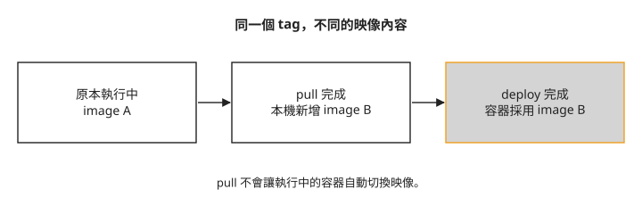
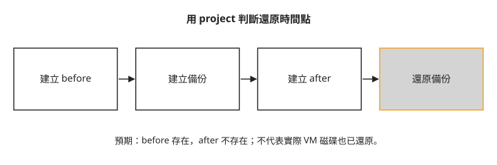
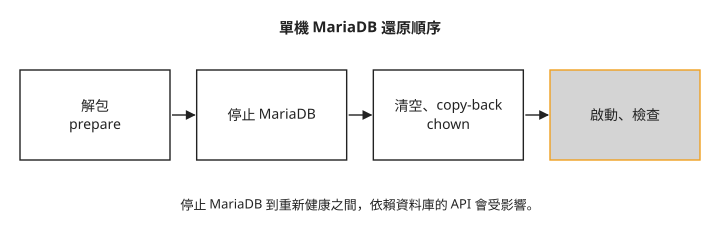

# Day 22：更新服務映像，演練資料庫還原

上游已發布修補，但你的 OpenStack 容器仍使用原先的映像。更新之前，你還需要回答另一個問題：如果控制平面資料庫必須還原，手上的備份是否真的能回到預期時間點？本章先完成 2025.1 系列內更新，再用備份前後建立的 project 判斷單機 MariaDB 還原結果。

## 先決定更新範圍

**系列內更新**是在同一個 OpenStack 系列內套用修補；Kolla 通常以更新工具、拉取映像後重新 `deploy` 的方式處理。**跨系列升級**則要依目標版本的升級文件使用 `upgrade`，包含資料庫遷移等工作。兩者都要先讀 release notes，不能只用「同系列」推論絕對沒有相容性或資料表與欄位結構的變化。

本章只走 2025.1 的系列內更新。**image tag** 是映像名稱上的標籤，同一個 tag 可以指向後來重建的內容；**image ID** 用來辨識本機實際映像。`pull` 下載新映像，既有容器仍可使用舊映像；`deploy` 才依映像與設定差異重新建立需要更新的容器：



這個分工讓下載與服務切換分開。單機重新啟動服務仍可能中斷 API，應保留維護時段；Day 21 的指標與 log 可協助比較前後狀態，但不會自動證明每項功能正常。

## 步驟 1：保存設定與可還原的狀態

先保存 `/etc/kolla`、inventory 與憑證金鑰，並記下當前工具版本、映像與服務狀態。這些設定不在 MariaDB 備份裡。Azure 磁碟快照也不能取代後面的資料庫備份。

若採用本課單機 Azure lab，先正常停止 VM，確保所有相關磁碟停止寫入，再分別建立 OS、資料與 Ceph 磁碟快照。下面的資源群組與磁碟名稱要從 Azure 中這台 VM 的磁碟清單取得；各磁碟用不同快照名稱：

```bash
az snapshot create -g <資源群組> -n pre-day22-os-$(date +%Y%m%d) \
  --source <OS磁碟名> --incremental true
# VM 停止寫入後，對所有相關磁碟保留同一停機區間的快照
```

停機區間內不要重啟 VM 或寫入磁碟，直到整組快照完成。執行中的多顆磁碟分別拍照，不會自動形成應用程式一致的備份。完成後才重新開機，確認服務健康，再繼續更新。

## 步驟 2：確認工具版本與映像

在 `~/kolla-venv` 中操作，並使用 Day 1 的 inventory。下列命令使用相對路徑 `all-in-one`，因此要在存放該檔案的家目錄執行。先確認安裝版本與上游分支：

```bash
pip show kolla-ansible | grep Version    # 20.4.1.dev17
git ls-remote https://opendev.org/openstack/kolla-ansible refs/heads/stable/2025.1
```

套件版本號與 Git commit 是不同資訊，不能直接拿兩者比較是否相同。依 [2025.1 Operating Kolla 的工具版本原則](https://docs.openstack.org/kolla-ansible/2025.1/user/operating-kolla.html#tools-versioning)，應使用目標系列的最新工具。本章目標是 2025.1，在同一個虛擬環境中先執行 `pip3 install --upgrade git+https://opendev.org/openstack/kolla-ansible@stable/2025.1`，再執行 `kolla-ansible install-deps` 更新依賴。這組工具更新指令本課沒有實跑，後面的結果不代表工具更新已驗證成功。

接著下載服務映像：

```bash
kolla-ansible pull -i all-in-one
```

```text
PLAY RECAP: ok=62  changed=28  failed=0
```

`changed` 是 Ansible 工作回報的變更數，不能直接當成下載映像的數量。以下用 MariaDB 比較 tag 目前指向的 image ID 與執行中容器的 image ID；區塊中的註解是本課的觀察值。

比對時應使用 `sudo docker inspect mariadb --format "{{.Image}}" | cut -c8-19`，去除 `sha256:` 前綴後取 12 碼，才與下方記錄的短 ID 長度一致。原指令的 `cut -c8-20` 會取出 13 碼；修正後的寫法本課沒有實跑。以下保留原指令與記錄：

```bash
sudo docker images --format "{{.Repository}}:{{.Tag}} {{.ID}} {{.CreatedSince}}" | grep mariadb-server
# quay.io/openstack.kolla/mariadb-server:2025.1-ubuntu-noble d3fbe3d26d58 2 hours ago
sudo docker inspect mariadb --format "{{.Image}}" | cut -c8-20
# 03fdc2d535fd   ← 跑著的容器還在舊 image
```

兩個 ID 不同，表示新映像已下載，但執行中的容器尚未切換。這也是為什麼只做 `pull` 不能算更新完成。

## 步驟 3：跑完整 prechecks，先處理 Octavia 相容性

之前常用 `--tags` 只處理新服務。更新整個部署前，應檢查所有已啟用服務：

```bash
kolla-ansible prechecks -i all-in-one
```

若沿用 Day 4 的 Amphora 與 `octavia_network_type: "tenant"`，這組設定會遇到 OVN 的相容性檢查。此時先決定仍需不需要 Amphora，不能把 provider 改掉只為通過檢查。

這條演練路線改為只啟用 OVN provider，設定如下：

```yaml
octavia_provider_drivers: "ovn:OVN provider"
octavia_provider_agents: "ovn"
```

這會使新建 `--provider amphora` 的負載平衡器不再可用，前面依賴 Amphora 的 CAPI／Magnum 指引也不能原樣沿用。既有 Amphora LB 的管理與後續生命週期要另外處理。如果仍需要它們，應先依 Kolla 2025.1 的支援方式重新規劃 Amphora 管理網路；本課沒有提供該遷移的完整操作證據，不能把這次 provider 變更視為無影響修補。

另外確認 Day 15 的 `ceph_rgw_swift_compatibility: "false"`，避免完整部署將 RGW 的 `/swift/v1` endpoint 改成不匹配的 `/v1`。處理完設定後重新跑 prechecks；以下是本課成功結果的節錄：

```text
PLAY RECAP: ok=93  changed=0  failed=0
```

## 步驟 4：套用映像與檢查服務

確認 prechecks 通過與維護時段已開始，再執行：

```bash
kolla-ansible deploy -i all-in-one
```

```text
PLAY RECAP: ok=628  changed=175  failed=0
```

部署完成後，先檢查容器健康、MariaDB image ID 與服務目錄，再驗證本次使用的服務功能。下方 image ID 查詢也應改用 `sudo docker inspect mariadb --format "{{.Image}}" | cut -c8-19`，取 12 碼與步驟 2 比較；修正後的寫法本課沒有實跑。以下保留原指令與記錄：

```bash
sudo docker ps --format "{{.Names}} {{.Status}}" | grep -i unhealthy   # (空)
sudo docker inspect mariadb --format "{{.Image}}" | cut -c8-20         # d3fbe3d26d58 ← 換上新映像了
openstack service list | wc -l                                        # 服務數不變
```

MariaDB 的 ID 應對上步驟 2 下載的映像。沒有 `unhealthy`、服務數不變，都是初步檢查；它們不能取代建立／查詢資源或應用程式連線測試。

## 步驟 5：建立資料庫備份與時間點標記

**Mariabackup** 能在資料庫運作時建立實體備份。Kolla 將備份存入 Docker volume `mariadb_backup`。先在 `/etc/kolla/globals.yml` 加入以下 YAML 設定：

```yaml
enable_mariabackup: "yes"
```

接著重新設定 MariaDB，建立備份需要的帳號與權限，再執行全量備份：

```bash
kolla-ansible reconfigure -i all-in-one -t mariadb
kolla-ansible mariadb-backup -i all-in-one
```

確認備份檔存在：

```bash
sudo ls -lh /var/lib/docker/volumes/mariadb_backup/_data/full-*/
# mysqlbackup-13-07-2026-1783920508.qp.xbc.xbs.gz   4.1M
```

這份備份包含控制平面資料庫的紀錄，不包含 VM 的磁碟內容、Ceph 物件或所有設定金鑰。備份 volume 仍在原主機上，也不是主機故障後可獨立取回的異地副本。

要驗證還原時間點，接著在另一份備份前後各建立一個 project。後面的還原必須選擇兩個 project 建立動作之間產生的那份備份，不能選剛才較早的檔案：

```bash
openstack project create day22-before-backup   # 備份前建 → 還原後應該「在」
kolla-ansible mariadb-backup -i all-in-one
openstack project create day22-after-backup    # 備份後建 → 還原後應該「消失」
```

下圖呈現預期差異：`before` 應留下，`after` 應消失。這比只確認 API 回應更能分辨還原到哪個時間點。



這是可丟棄 lab 的還原演練。開始前停止使用者與自動化對雲的變更；備份後新增的實體 VM、volume 不會因資料庫倒退而自動一起消失，不能把這個流程直接套在持續變動的正式環境。

## 步驟 6：準備備份，再停機還原

**prepare** 會套用備份內的交易紀錄，讓實體備份達到可還原狀態；**copy-back** 再把它放回 MariaDB 資料目錄。下圖標出資料庫停止服務的區間：



先將 `<日期>` 替換為步驟 5 選定的備份目錄及完整檔名。確認備份與資料庫映像版本相容，再用臨時容器解包、prepare：

```bash
sudo docker run --rm --volumes-from mariadb --volume mariadb_backup:/backup \
  quay.io/openstack.kolla/mariadb-server:2025.1-ubuntu-noble bash -c '
  cd /backup && rm -rf restore && mkdir -p restore/full
  gunzip -k full-<日期>/mysqlbackup-<日期>.qp.xbc.xbs.gz
  mbstream -x -C restore/full/ < full-<日期>/mysqlbackup-<日期>.qp.xbc.xbs
  mariabackup --prepare --target-dir /backup/restore/full'
# [00] completed OK!
```

確認 prepare 成功後才停止 MariaDB。從這裡起，依賴資料庫的控制平面 API 會受影響：

```bash
kolla-ansible stop -i all-in-one -t mariadb --yes-i-really-really-mean-it
```

以下動作會刪除目前 MariaDB 資料目錄，只適用於已選定備份並準備還原的演練。`--volumes-from mariadb` 讓臨時容器操作同一份資料；copy-back 後保留 `chown`，讓 MariaDB 的 `mysql` 使用者能存取檔案：

```bash
sudo docker run --rm --volumes-from mariadb --volume mariadb_backup:/backup \
  quay.io/openstack.kolla/mariadb-server:2025.1-ubuntu-noble bash -c '
  rm -rf /var/lib/mysql/* /var/lib/mysql/.[!.]*
  mariabackup --copy-back --target-dir /backup/restore/full
  chown -R mysql:mysql /var/lib/mysql'
```

重新啟動 MariaDB，等健康檢查通過，再用管理員 openrc 查 project：

```bash
sudo docker start mariadb
openstack project list | grep day22
# day22-before-backup   ← 在(正確)
#                       ← day22-after-backup 消失了(正確)
```

確認 `before` 存在、`after` 不存在，再檢查各服務與受影響資源。這兩個標記只驗證所選資料庫時間點，不是整朵雲所有資料一致性的完整測試。

## 疑難排解

### 完整 prechecks 擋下原本可用的 Octavia 設定 {#mine-1}

只跑特定 tags 時，不會完整檢查其他角色。`tenant` 型 Amphora 管理網路與 OVN 的組合必須重新評估；步驟 3 說明切成 OVN provider 的代價與仍需 Amphora 時的處理範圍。不要直接對既有 LB 宣稱已完成遷移。

## 想一想

1. 新映像已在主機上，執行中的容器仍使用舊 ID，更新還缺哪個步驟？
2. 還原後 before 與 after 都還在，這足以證明成功嗎？應重新核對哪個時間點？
3. 備份後又建立了一顆 volume，還原控制平面資料庫是否代表那顆 volume 的實際資料也回到了備份當時？

## 小結

更新要分辨工具、映像與執行中容器的版本；備份還原要分辨資料庫紀錄、設定與實際資源的狀態。用 image ID 與備份前後的 project 標記，可以各自驗證一項具體結果。將這些證據與服務檢查放在一起，才知道更新或還原還有哪些部分尚未完成。

## 延伸閱讀

想再深入，可以從這幾份開始：

- [Kolla-Ansible 2025.1 Operating Kolla](https://docs.openstack.org/kolla-ansible/2025.1/user/operating-kolla.html)：對照系列內更新、跨系列升級與設定備份。
- [Kolla-Ansible 2025.1 MariaDB 備份與還原](https://docs.openstack.org/kolla-ansible/2025.1/admin/mariadb-backup-and-restore.html)：確認全量、增量與多節點還原差異。
- [Mariabackup 總覽](https://mariadb.com/kb/en/mariabackup-overview/)：理解 prepare 與實體備份的一致性。
- [OpenStack 版本時間表](https://releases.openstack.org/)：規劃跨系列路線前，確認系列維護狀態與 SLURP 升級範圍。

## 下一步

[Day 23](sprint4-day23-multinode-ha.md) 改用獨立的多節點環境，檢查 API 入口與資料庫多數決如何影響故障時的服務。
