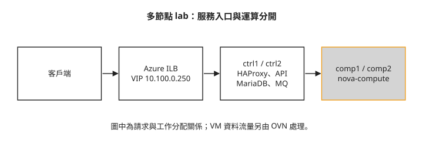
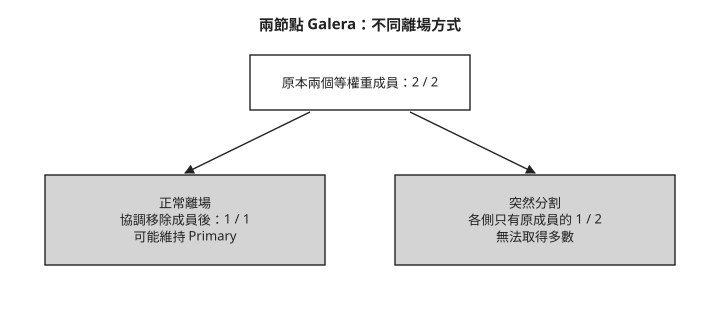

# Day 23：多節點 API 入口與資料庫故障演練

控制節點需要維護，但使用者仍會送出 API 請求。多放一台 controller 是否就能維持服務？這一章分別檢查 API 流量如何改走其他節點，以及資料庫是否仍允許讀寫。讀完後，你能區分「計畫性停機的接手成功」與「能承受突然失聯」。

## 先分開入口與資料狀態

Kolla inventory 的**群組**決定服務部署在哪些主機。把 control、network 與 compute 分到不同主機後，API 與 VM 執行程序便不必共用同一台機器。**VIP** 是客戶端共用的服務位址；**HAProxy** 依後端健康狀態轉送各服務的 API 請求。

下圖呈現本章獨立的多節點 lab。它沒有把 Day 1–22 的單機環境直接搬過來，也不代表已部署那裡的所有加值服務：



API 入口有兩個後端，不代表資料庫可以在任何故障下繼續寫入。**Galera** 是 MariaDB 使用的同步複寫叢集；**quorum** 是決定哪些成員仍可共同服務的多數條件。稍後兩種失聯情境，會得到不同結果。

## 在 Azure 上提供 VIP

常見實體網路部署會讓 keepalived 透過 **VRRP** 選出持有 VIP 的節點，再用 **GARP** 宣告 IP 與網卡位置。Azure 虛擬網路的位址轉送由平台控制，不能只在 guest 裡加一個漂移 VIP，就期待平台跟著轉送。

本章使用 Azure Internal Load Balancer（ILB，內部負載平衡器）提供固定入口。下面列的是已完成的環境前提，本章未提供建立 VM、ILB、NSG、NAT Gateway 的完整指令，因此本章不是從空白 Azure 訂閱開始的建置腳本。

| 元件 | 本章設定與用途 |
|---|---|
| ILB | frontend `10.100.0.250`，HA ports、Floating IP，TCP 1984 健康探測 |
| controller 後端 | 兩台都執行 HAProxy；防火牆／NSG 必須允許探測與服務流量 |
| loopback | 兩台 controller 都把 `10.100.0.250/32` 加到 loopback，使 guest 接受目的地為 VIP 的流量 |
| keepalived | `enable_keepalived: "no"`，入口選路交由 ILB |
| 出站連線 | subnet 使用 NAT Gateway；內部 LB 不是套件與映像下載的出站保證 |

這裡 Azure 的 Floating IP 是 LB 規則的功能，和 Neutron 配給 VM 的 Floating IP 是不同設定。VIP 的 loopback 設定需要在開機後仍存在；Kolla 設定的 `ip_nonlocal_bind` 讓 HAProxy 可以綁定非本機位址，但不能取代 Azure LB 與 guest 接收路徑的設定。

## 步驟 1：準備主機與 inventory

以下名稱與 IP 是 lab 範例。重做時要一致替換到 hosts、inventory、VIP 與後續查詢，並從部署機確認 SSH、sudo、主機名稱解析與各節點對外下載都正常。

| 主機 | 管理 IP | 角色 |
|---|---|---|
| oslab-ctrl1 | 10.100.0.11 | control、network、部署機 |
| oslab-ctrl2 | 10.100.0.12 | control、network |
| oslab-comp1 | 10.100.0.21 | compute |
| oslab-comp2 | 10.100.0.22 | compute |

以下區塊前四行是 `/etc/hosts` 的內容，不能直接貼進 shell。`dummy0` 沿用 Day 1 的外部介面準備方式；最後一行是 DNS 排錯時的調整，適用條件見[疑難排解](#mine-2)：

```bash
# 1. /etc/hosts——kolla 要求主機名稱互相解析
10.100.0.11 oslab-ctrl1
10.100.0.12 oslab-ctrl2
10.100.0.21 oslab-comp1
10.100.0.22 oslab-comp2
# 2. dummy0 網卡(Azure 單網卡的標準解,同 Day 1)
# 3. 若 DNS stub 逾時，確認上游可達後再調整解析路徑
sudo ln -sf /run/systemd/resolve/resolv.conf /etc/resolv.conf
```

以官方 multinode inventory 為底，保留其餘服務群組與 children 關係，再修改主機分配：

```ini
[control]
oslab-ctrl1
oslab-ctrl2

[network]
oslab-ctrl1
oslab-ctrl2

[compute]
oslab-comp1
oslab-comp2

[monitoring]
oslab-ctrl1

# glance 釘在單一節點:file 後端的映像檔不會自己同步,
# 兩台各存一半的 glance 是壞掉的 glance
[glance]
oslab-ctrl1
```

Glance 使用本機 file 後端，因此此例只放在 ctrl1；它也因此仍是單點。把兩台 API 都啟動，不會自動同步兩份本機映像檔。

在獨立多節點部署的 `globals.yml` 設定以下差異，並確認 HAProxy 已啟用。不要沿用單機的 `enable_haproxy: "no"`：

```yaml
kolla_internal_vip_address: "10.100.0.250"   # 單機時 = 本機 IP;現在是真 VIP
enable_keepalived: "no"                      # Azure ILB 接手(見上節)
network_interface: "eth0"
neutron_external_interface: "dummy0"
```

部署機沿用 Day 1 的同系列 Kolla 工具與依賴，對這份 inventory 執行 `kolla-genpwd`、`bootstrap-servers`、`prechecks` 與 `deploy`。本章保留的是設定差異與演練結果；缺少的 Azure 基礎設施流程不能靠這四行 YAML 取代。

## 步驟 2：理解兩節點的 quorum 限制

兩台等權重 Galera 成員突然互相失聯時，任一側只有原成員的一半，不能各自繼續寫入。這是避免兩邊資料分歧的保護。本課部署期間曾出現以下紀錄：

```text
WSREP: connection to peer … timed out, no messages seen in PT3S
WSREP: New COMPONENT: primary = no, memb_num = 1
WSREP: Received NON-PRIMARY.
```

`NON-PRIMARY` 表示目前成員不足以構成可服務的 Primary component。三個等權重成員失去一個時，剩下兩個通常仍能取得多數；這還需要剩餘節點可互通且其他服務也符合各自的可用條件。

若資料庫遷移被中斷，先查 Galera 狀態、migration 位置與資料備份。不要把刪除 Nova 資料庫當成既有雲的通用修法；重新初始化只適用於已確認可丟棄的全新部署。完成修復後的部署摘要如下：

```text
PLAY RECAP: oslab-ctrl1 ok=354 … failed=0(其餘三台皆 failed=0)
```

## 步驟 3：從客戶端方向驗證入口

controller 本機有 VIP 的 loopback 位址，從它查 VIP 可能直接走本機。要驗證 Azure ILB，從沒有該 loopback 位址的 compute 節點發送請求：

```bash
# 在 comp1 上
curl -s -o /dev/null -w "keystone via VIP: HTTP %{http_code} (%{time_total}s)\n" \
  http://10.100.0.250:5000/
# keystone via VIP: HTTP 300 (0.003805s)   ← 300 是 keystone 的版本清單,正常回應
```

Keystone 根路徑回 HTTP 300 是版本清單回應。這能驗證到 Keystone 的入口，但還沒有驗證 Nova、資料庫寫入或所有 API。

接著用這個多節點雲的管理員 openrc，確認 Nova 服務註冊：

```bash
openstack compute service list -f value -c Binary -c Host -c State | sort
# nova-compute   oslab-comp1  up
# nova-compute   oslab-comp2  up
# nova-conductor oslab-ctrl1  up
# nova-conductor oslab-ctrl2  up
# nova-scheduler oslab-ctrl1  up
# nova-scheduler oslab-ctrl2  up
```

`up` 是服務心跳狀態，不等於 VM 已可成功排程。建立測試 VM 前，要先在此獨立環境準備 `cirros`、`m1.tiny` 與 `day23-net`。本章未提供該網路的建立指令；可按 Day 2 的網路流程準備，不能直接假設單機的同名資源會出現在這裡。

```bash
openstack server create ha-canary --flavor m1.tiny --image cirros \
  --network day23-net --availability-zone nova:oslab-comp2 --wait
openstack server show ha-canary -f value -c OS-EXT-SRV-ATTR:host   # oslab-comp2
```

回傳的 host 對上 comp2，才確認這次指定落點的要求已完成。

## 步驟 4：觀察計畫性停機

在 comp1 開一個終端持續探測 VIP，另從 Azure 管理端正常停止 ctrl2。下面保留探測腳本；最後一行註解只是當時動作摘要，實際 Azure 操作仍需正確資源群組與訂閱：

```bash
# comp1 上的秒級探測
while true; do
  echo "$(date -u +%H:%M:%S) $(curl -s -o /dev/null -m 2 -w %{http_code} http://10.100.0.250:5000/ || echo FAIL)"
  sleep 1
done > /tmp/vip-probe.log
# 然後:az vm deallocate -n oslab-ctrl2
```

這份迴圈會一直執行，觀察完成後以 Ctrl+C 結束，保留 log。測試期間同時檢查讀寫能力；下列為本課的操作摘要，其中 `flavor create …` 省略了參數，不能直接執行：

```bash
openstack token issue        # 通——Keystone 由 ctrl1 接手
openstack server list        # 通——ha-canary 照常 ACTIVE
openstack flavor create …    # 通——資料庫「寫入」也正常
```

`token issue`、`server list` 與建立 flavor 檢查的是不同操作，不能只以 API 根路徑有回應代替。該次 Galera 狀態節錄為：

```text
wsrep_cluster_size    1
wsrep_cluster_status  Primary   ← 一台也能是 Primary?
```

正常離場時，成員可先協調移除，倖存者因此可能以新的成員集合維持 Primary。突然斷線則沒有這個前提。下圖比較兩者：



因此這次結果只能支持「該次正常關機過程能接手」，不能外推成兩節點具備完整故障容忍。原有探測摘要如下：

```text
128 次探測,6 次失敗——07:54:45 到 07:54:50
```

這是固定探測間隔與逾時設定下的觀察，不能直接換算成所有客戶端的精確中斷時間。LB 探測間隔、失敗門檻、既有連線與客戶端重試都會影響體感。重新啟動 ctrl2 後，仍要確認 Galera 成員重新同步、各服務健康，再結束維護。

## 疑難排解

### 內部 LB 後端無法下載套件或映像 {#mine-1}

內部 LB 不會自動提供完整的出站連線方式。先確認 subnet 的 NAT Gateway 或其他明確出站設計、路由與 NSG，再查 DNS。不要用「VM 有私網 IP」推論它必定可連外。

### 多台節點在拉取映像時出現 DNS 逾時 {#mine-2}

先查最早失敗的節點與解析結果，區分上游 DNS、網路或本機 `systemd-resolved` stub 的問題。本課案例以 `/run/systemd/resolve/resolv.conf` 取代指向 stub 的設定；只有確認該檔案存在、上游可達且符合你的 DNS／split DNS 設計時才採用。這不是所有 Ubuntu 環境都必須做的前置動作。

### Galera 失聯後進入 NON-PRIMARY {#mine-3}

兩節點等權重配置突然失去一側，倖存者無法取得多數。先恢復通訊並依資料庫恢復程序處理；正式架構應規劃足夠投票成員與故障域，不能用計畫性關機成功證明突然故障也可服務。步驟 2 已說明 migration 中斷時不能直接刪除既有資料庫。

## 想一想

1. 從 controller 本機打 VIP 成功，為什麼仍不能證明 Azure ILB 能轉送流量？
2. 正常停止 ctrl2 後可以建立 flavor，為什麼兩節點配置仍可能在網路分割時停下？
3. Glance 只在 ctrl1 使用 file 後端，若 ctrl1 故障，兩份 Nova API 能補上這個缺口嗎？

## 小結

多節點要分別檢查服務入口、後端健康、資料庫 quorum 與各服務的儲存狀態。這份 lab 展示了正常離場的接手，也保留了兩節點突然失聯的限制。HA 結論必須跟著故障方式與測試範圍，不能只由 controller 數量推定。

## 延伸閱讀

想再深入，可以從這幾份開始：

- [Kolla-Ansible 2025.1 多節點部署](https://docs.openstack.org/kolla-ansible/2025.1/user/multinode.html)：確認 inventory 與角色配置。
- [Kolla-Ansible HAProxy 指南](https://docs.openstack.org/kolla-ansible/2025.1/reference/high-availability/haproxy-guide.html)：查看 HAProxy 與 keepalived 設定。
- [Azure Load Balancer Floating IP](https://learn.microsoft.com/en-us/azure/load-balancer/load-balancer-floating-ip)：對照 guest loopback 與平台轉送需求。
- [Galera quorum 與加權投票](https://mariadb.com/docs/galera-cluster/galera-architecture/quorum-control-with-weighted-votes/)：理解 Primary component 的多數判斷。

## 下一步

[Day 24](sprint4-day24-scale-out.md) 沿用這份多節點環境，加入 compute，並把 VM 遷移到有足夠容量的主機。
