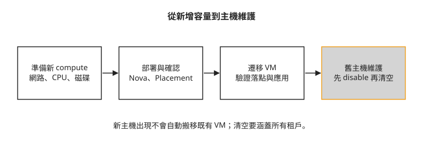

# Day 24：加入 compute，遷移 VM 並準備主機維護

一台 compute 需要換硬體，上面的 VM 卻仍在服務。你可以先加入新主機，再把工作負載移過去；前提是 Nova 能使用新主機，目的地主機也容得下原有 VM。本章沿用 Day 23 的多節點環境，讀完能用服務註冊、Placement 資源與遷移結果判斷是否已準備好維護。

## 先看雲還有多少可排程資源

Magnum 或 CAPI 建立 worker VM 時，使用的是 Nova 已管理的 compute 容量。新增 Kubernetes worker 並不會替底層 OpenStack 增加實體主機。

**Placement** 記錄可供排程的資源。**resource provider** 是提供資源的實體，在這個 lab 中對應 compute 主機；**inventory** 記錄總量與限制，**allocation** 記錄已分配給工作負載的用量。

<a id="mine-2"></a>

在執行 OpenStack CLI 的同一個虛擬環境安裝 Placement CLI 外掛 `osc-placement`，再單獨查詢 resource provider，確認指令能成功列出 compute 主機：

```bash
pip install osc-placement   # resource provider 系列指令需要這個外掛
openstack resource provider list -f value -c name
```

查詢成功後再進入以下 shell pipeline，避免錯誤訊息或空輸出被後續指令誤讀成容量資料：

```bash
openstack resource provider list -f value -c uuid -c name | while read u n; do
  T=$(openstack resource provider inventory list "$u" -f value | awk '/VCPU/{print $3}')
  echo "$n: $T vCPU"
done
# oslab-comp1: 8 vCPU
# oslab-comp2: 8 vCPU        ← 叢集總量 16 vCPU
```

這個查詢依欄位位置讀取 total，先確認你的輸出格式一致。它顯示的是 VCPU 總量，不是剩餘容量；要判斷能否接下一台 VM，還必須看已配置量、保留量、allocation ratio，以及記憶體、磁碟和資源限制。

下圖把本章三個動作接起來。新主機註冊成功後，既有 VM 不會自動重新平均分配：



## 步驟 1：準備新主機

本章新節點叫 `oslab-comp3`，管理位址 `10.100.0.23`，使用較小的 2 vCPU 規格。這個例子用來觀察異質容量；不代表任何規格都能接收任意 VM。新機仍須符合 KVM、CPU 相容性、網路、磁碟與 Kolla 支援條件。

<a id="mine-1"></a>

新增主機前，先確認 Azure 的區域總 vCPU 配額與 VM family 配額。allocated 與 deallocated 的 VM 都計入配額，停止計費不會釋放配額；不足時，確認哪些 VM 可刪除或提出配額申請。即使配額充足，區域實際可用容量仍是另一項限制。詳見 [Azure vCPU quota](https://learn.microsoft.com/en-us/azure/virtual-machines/quotas)。本章沿用已準備好的 Azure VM，不另提供其建立流程。

新舊節點必須互相解析主機名稱，外部介面與管理網路配置也要一致。以下為前置作業摘要；DNS 調整僅在確認 stub 問題後採用，條件同 [Day 23 的 DNS 排錯](sprint4-day23-multinode-ha.md#mine-2)：

```bash
# oslab-comp3(10.100.0.23)上:
# 1. /etc/hosts 全叢集互相解析(新節點一行也要加回舊節點)
# 2. dummy0 網卡
# 3. 確認 DNS stub 故障後才考慮改用上游
sudo ln -sf /run/systemd/resolve/resolv.conf /etc/resolv.conf
```

接著把新主機加入現有 multinode inventory 的 compute 群組，保留其他群組：

```ini
[compute]
oslab-comp1
oslab-comp2
oslab-comp3     # ← 新成員
```

## 步驟 2：只對新 compute 部署

在原部署機使用同一份 Kolla 設定與 inventory，依序準備主機、拉取映像、部署 compute：

```bash
kolla-ansible bootstrap-servers -i multinode --limit oslab-comp3   # 裝 docker、建 kolla 使用者
kolla-ansible pull -i multinode --limit oslab-comp3                # 預拉映像
kolla-ansible deploy -i multinode --limit oslab-comp3              # 部署 compute 角色
```

```text
oslab-comp3 : ok=104  changed=62  failed=0
```

`--limit` 限制此次選取的 inventory 主機。這是官方新增 compute 的做法，但不能擴大解讀為所有 Ansible 動作都絕對不會經過其他節點：角色可能透過 delegation 在控制端執行整合工作。新增 controller 的範圍要求也不同，不能直接套用。

Nova 使用 **cell** 組織 compute 與其資料庫、訊息通道；新主機還需要映射到 cell，提供排程所需的主機與 cell 對應資訊。Kolla 的 nova-cell 角色會處理主機探索工作，不過是否成功仍要由結果確認：

```bash
openstack compute service list -f value -c Binary -c Host -c State | grep nova-compute
# nova-compute oslab-comp1 up
# nova-compute oslab-comp2 up
# nova-compute oslab-comp3 up     ← 已註冊、已上線

openstack resource provider list -f value -c name
# oslab-comp1 / oslab-comp2 / oslab-comp3
```

`nova-compute up` 與 resource provider 出現是必要檢查，還要實際驗證工作負載能落到新主機。本例原有兩台各 8 VCPU，新增主機回報 2 VCPU；總量的增加不代表每一台 VM 都能放進它。

## 步驟 3：遷移既有 VM

**live migration（熱遷移）** 在 VM 持續執行時搬移其狀態。若 VM 使用 compute 本機磁碟，**block migration** 還要搬移磁碟內容，因此會額外占用網路與目的地儲存。

開始前確認來源與目的地在支援的 cell、CPU 與 hypervisor 相容、遷移網路可達，且目的地資源足夠。本例使用 Day 23 建立的 `ha-canary`，從 comp2 遷往 comp1：

```bash
openstack server show ha-canary -f value -c OS-EXT-SRV-ATTR:host   # oslab-comp2
openstack server migrate ha-canary --live-migration --block-migration \
  --host oslab-comp1 --wait
openstack server show ha-canary -f value -c OS-EXT-SRV-ATTR:host   # oslab-comp1
openstack server show ha-canary -f value -c status                  # ACTIVE
```

兩次 host 查詢可確認落點改變，最後的 ACTIVE 顯示查詢當下的狀態。它不能證明應用程式完全沒有中斷。熱遷移會逐步複製記憶體與變更頁面，最後仍有短暫切換；要評估使用者影響，必須同時觀察應用連線，而本章沒有這項探測結果。

## 步驟 4：讓主機停止接收新 VM，再清空

維護前先 **disable nova-compute**，避免新的排程繼續送進主機；這不會自動搬走既有 VM。把所有租戶的 VM 逐一遷移成功後，才可以停機維護。

第二台測試 VM 名稱是 `drain-canary`，本章未提供它的建立命令。以下是已有該 VM 且它位於 comp2 的演練範例；重做時先以管理員身分列出 comp2 上所有租戶的 VM，選擇實際要搬移的資源，不能假設這個名稱已存在。

清空檢查應以管理員身分執行 `openstack server list --all-projects --host oslab-comp2`，涵蓋所有專案，做法依據 [Kolla 移除 compute 流程](https://docs.openstack.org/kolla-ansible/2025.1/user/adding-and-removing-hosts.html#removing-existing-compute-nodes)。修正後的寫法本課沒有實跑。每台 VM 都確認遷移成功，且這項查詢成功、清單為空，才可停機維護。下方保留的查詢只涵蓋目前專案，`# 0` 不是全租戶清空的結果，也不能作為停機判準：

```bash
# 1. 停止接收新的排程
openstack compute service set --disable \
  --disable-reason "maintenance: hardware replacement" oslab-comp2 nova-compute

# 2. 逐一遷移該主機上的 VM
openstack server migrate drain-canary --live-migration --block-migration \
  --host oslab-comp3 --wait

# 3. 確認清空
openstack server list --host oslab-comp2 -f value | wc -l    # 0

# 4. 維護完成且健康檢查通過後重新啟用
openstack compute service set --enable oslab-comp2 nova-compute
```

上面最後一步只適用於維護完成且已確認主機健康的情況；若要永久移除節點，保持 disabled，另依 Kolla 官方移除主機流程清理服務與 inventory。遷移失敗時不要繼續停機。

逐台沿用步驟 3 的 `openstack server show` 查詢方式，將 VM 名稱換成要檢查的資源：以 `-c OS-EXT-SRV-ATTR:host` 比較遷移前後的主機，以 `-c status` 檢查查詢當下的狀態。對上方範例，應確認 `drain-canary` 的 host 從 comp2 變成 comp3，且 status 為 ACTIVE，再搭配全租戶清單確認 comp2 已清空。不能只看 CPU 用量為零就移除主機。

## 預留維護需要的容量

以一台待遷移的 VM 為例，目的地主機必須同時滿足它的 CPU、記憶體與磁碟需求。即使某台主機還有足夠 VCPU，若記憶體不足，或本機磁碟放不下要搬來的磁碟內容，仍無法接收這台 VM；分散在不同主機上的剩餘資源也不能合併給它使用。

Placement 的 `allocation_ratio` 決定資源可配置量相對於實際量的比例，`reserved` 則扣除預留資源。規劃容量時須考慮這些設定與已配置量；可配置量不等於效能保證，CPU 與儲存相容性仍須另外確認。

**N+1** 是在承載工作負載所需的 N 台主機之外，預留一台主機的備援容量。規劃時要逐一檢查：任一台主機離線後，它上面的每台 VM 是否都能在剩餘且相容的主機找到足夠資源。不同規格的主機容量不同，不能只靠多一台主機或叢集閒置 VCPU 的加總判斷。

當 Magnum 要增加 worker，Nova 最後仍必須找到符合所有需求的資源。遇到 No valid host，除了總量，也要回頭檢查租戶配額、資源分組與主機限制。

## 想一想

1. 新 compute 顯示 up，也出現在 Placement，為什麼仍要再測試能否承接 VM？
2. 管理員自己的專案查不到 comp2 上的 VM，能否據此停止該主機？
3. 叢集還有 8 個閒置 VCPU，但分散在數台不符合 VM CPU／記憶體條件的主機上，是否代表可以完成維護遷移？

## 小結

新增 compute 要確認主機準備、服務註冊、cell 與資源配置；主機維護則先停止新排程，再遷移並核對所有租戶的 VM。可用總量、相容條件與應用中斷各有不同的檢查方式。把它們分開，才能判斷新增容量是否真的能用，以及主機是否已可離線。

## 延伸閱讀

想再深入，可以從這幾份開始：

- [Kolla-Ansible 2025.1 新增與移除主機](https://docs.openstack.org/kolla-ansible/2025.1/user/adding-and-removing-hosts.html)：比較 compute 與 controller 的處理範圍。
- [Nova 2025.1 熱遷移設定](https://docs.openstack.org/nova/2025.1/admin/configuring-migrations.html)：確認 CPU、網路、儲存與安全前提。
- [Nova 2025.1 熱遷移操作](https://docs.openstack.org/nova/2025.1/admin/live-migration-usage.html)：查遷移模式與結果監看。
- [Placement 2025.1 文件](https://docs.openstack.org/placement/2025.1/)：理解 inventory 與 allocation。
- [Azure vCPU quota](https://learn.microsoft.com/en-us/azure/virtual-machines/quotas)：區分配額與平台容量。

## 下一步

[Day 25](sprint4-day25-sprint4-recap.md) 回顧儲存、排錯與維護情境，並整理這些 lab 尚未涵蓋的範圍。
