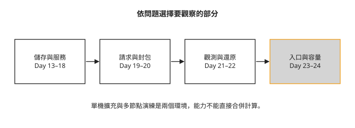

# Day 25：Sprint 4 總結——服務、排錯與維護

接到「VM 連不到外面」或「這台主機下週要維修」的要求時，你現在有不只一種檢查方法。問題是該從哪裡開始，以及目前的結果能支持多大的結論。這一章回到這些實際情境，整理 Sprint 4 各段的用途。

## 回到一開始的問題

最初我們問的是：OpenStack 還能提供哪些服務，底層容量又由誰準備？前半段在單機環境加入物件儲存、共享檔案、DNS 與資料庫；後半段改用獨立多節點 lab，觀察 API 入口、資料庫 quorum 與 compute 容量。

下圖依問題串起章節。這些結果來自兩個環境，不能理解成最後一套多節點雲已經裝好前面全部服務：

服務能部署是一個結果，故障時能否使用、維護時能否遷移，則需要各自的測試。

## 遇到儲存需求時

程式要透過 HTTP 上傳備份，可以回到 [Day 15 的 RGW](sprint4-day15-object-storage-rgw.md)；多個用戶端需要共同讀寫檔案，則回到 [Day 16 的 Manila 與 CephFS](sprint4-day16-manila-cephfs.md)。兩者都能使用 Ceph，卻有不同的存取介面與授權方式。

選擇時也要看示範範圍：本課 RGW 保留了 Swift 路徑的實測結果，S3 設定是未驗證選讀；Manila 的主機掛載有操作流程，Kubernetes CSI 則只保留部分歷史結果，缺少完整 manifests。不能把兩段都當成已提供可從零重建的安裝腳本。單機單 OSD 的 Ceph 也沒有提供跨主機副本保護。

## 遇到建立失敗或連線問題時

[Day 19](sprint4-day19-api-request-lifecycle.md) 的 server UUID 可對上 Nova 紀錄、libvirt domain 與資料庫；[Day 21](sprint4-day21-observability.md) 再把紀錄集中查詢。request-id、資源 UUID 與佇列統計的範圍不同，找到其中一項，還不能宣稱完整追完每個服務。

網路問題則先用 [Day 20](sprint4-day20-ovn-packet-trace.md) 對上 logical port、router 與 NAT，再看 `ovn-trace` 的邏輯路徑。模擬放行後，仍可能有主機流表、介面或外部網路問題；這正是要把模擬與真正連線分開判讀的原因。

## 準備更新或主機維護時

[Day 22](sprint4-day22-upgrade-backup.md) 用 image ID 確認容器採用新映像，再以備份前後的 project 檢查還原時間點。它沒有涵蓋持續變動的 VM 磁碟與控制平面資料庫之間的完整災難復原。

[Day 23](sprint4-day23-multinode-ha.md) 顯示正常關機與突然失聯是不同故障情境。兩節點 Galera 在前者可能維持服務，在後者可能無法取得多數。不能用某次 API 探測的短暫中斷結果作為所有故障的服務承諾。

到了 [Day 24](sprint4-day24-scale-out.md)，新增 compute 與遷移 VM 也分別檢查。新主機出現在 Placement，不代表既有 VM 已重新分配；總 VCPU 足夠，也不代表某台目的地主機滿足該 VM 的記憶體、CPU 與儲存需求。維護前要停用新排程，再確認所有租戶的 VM 都已移走。

## 尚未涵蓋的正式環境工作

本段沒有演練跨系列升級，也沒有三個以上 controller 的故障域設計、多主機 Ceph 復原、完整監控告警或異地還原。這些工作都需要與實際硬體、儲存與可接受中斷時間一起規劃，不能只把單機設定複製到多台。

TLS、企業身分與稽核會在下一個 Sprint 繼續，但那也不是完整合規認證。若準備將這些服務交給其他團隊，先為要使用的功能建立可重複的建置、故障與還原流程，再確認每項測試涵蓋的範圍。

## 想一想

1. `ovn-trace` 通過、VM 仍連不出去，你會先補哪一類實際觀察？
2. 要清空一台 compute，為什麼查到叢集總 VCPU 有剩餘仍不夠？
3. 只還原 MariaDB 後，哪些資料仍需要另外核對？

## 小結

Sprint 4 增加了服務介面，也增加了理解與維護它們的方法。選擇工具時，先把問題縮到資源、請求、封包或主機，再確認觀察能回答什麼。知道哪些部分尚未驗證，與讀懂成功輸出同樣是維護工作的一部分。

## 延伸閱讀

想再深入，可以從這幾份開始：

- [Kolla-Ansible 2025.1 操作指南](https://docs.openstack.org/kolla-ansible/2025.1/user/operating-kolla.html)：準備工具更新與跨系列升級。
- [Kolla-Ansible 新增與移除主機](https://docs.openstack.org/kolla-ansible/2025.1/user/adding-and-removing-hosts.html)：對照本課維護演練之外的移除流程。
- [Ceph 架構](https://docs.ceph.com/en/tentacle/architecture/)：進一步理解副本、CRUSH 與故障域。

## 下一步

[Day 26](sprint4-day26-sprint5-preview.md) 介紹多租戶使用同一朵雲後，如何整理用量、費率、身分與操作紀錄。
