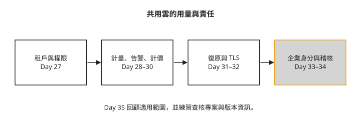

# Day 26：Sprint 5 預告——用量、費率與操作責任

兩個部門開始共用這朵雲之後，問題會變成：資源算在哪個專案名下、每個部門能用多少、費用怎麼計算，以及發生異常時該從哪份紀錄追查。Sprint 4 提供了部署與維護的基礎；Sprint 5 接著處理使用者、資源歸屬與操作責任。本章不操作環境，讀完後你能依需求選擇後續章節，並判斷練習需要單機或多節點環境。

## 從租戶開始，再解讀用量

先有清楚的 project 與角色，後續用量才有歸屬。**計量（metering）** 收集資源使用資料；**計價（rating）** 依規則把資料換算成金額。計價結果仍不等於完整收款與帳務系統，這個差異會在 CloudKitty 章裡說明。

另外一條路徑是服務維護：用告警觸發動作、在特定故障下復原 VM，再處理 API 加密與登入身分。**SLA** 是對可用性等服務條件的約定，不能只因部署了自動復原工具就宣稱已達成。

下圖呈現章節的學習順序：

圖中的箭頭表示課程安排，不代表每組章節都以完成前一組為技術前提。先學租戶與權限，是為了讓用量能歸屬到 project；計量、告警與計價沿用 Day 21 的 Prometheus。復原章的 compute 故障演練則需要 Day 23–24 的多節點環境，另有可接收 VM 的 compute。

Day 35 會回顧這些能力的適用範圍，也練習查核官方專案與版本資訊。

## 各章要回答的問題

| 章節 | 要處理的問題 |
|---|---|
| [Day 27：多租戶治理](sprint5-day27-multi-tenant-governance.md) | 使用者屬於哪個 project？角色、application credential 與額度如何配合？ |
| [Day 28：Ceilometer 計量](sprint5-day28-ceilometer-metering.md) | VM 用量怎麼收集，又如何進入 Prometheus？ |
| [Day 29：Aodh 告警與擴縮](sprint5-day29-aodh-autoscaling.md) | 數值達到條件後，告警怎麼觸發 Heat？ |
| [Day 30：CloudKitty 計價](sprint5-day30-cloudkitty-rating.md) | 用量、單位與費率如何形成可解釋的計價結果？ |
| [Day 31：Masakari 復原](sprint5-day31-masakari-ha.md) | VM 程序故障與 compute 故障，各需要哪些偵測及復原前提？ |
| [Day 32：TLS](sprint5-day32-full-tls.md) | 哪段連線受到加密，用戶端要信任哪個 CA？ |
| [Day 33：企業身分](sprint5-day33-keycloak-federation.md) | 如何使用公司帳號登入這朵雲，並對應到 OpenStack 角色？Keycloak 管理公司帳號，Keystone federation 讓 OpenStack 接受外部身分。 |
| [Day 34：CADF 稽核](sprint5-day34-cadf-audit.md) | 事件如何描述誰對哪個資源做了什麼，哪些操作尚未涵蓋？ |
| [Day 35：總結](sprint5-day35-sprint5-recap.md) | 如何依使用情境選擇這些能力，並查核專案狀態？ |

## 為什麼繼續使用 Prometheus

Day 21 已部署 Prometheus，接下來會沿用它儲存計量資料，由 Ceilometer 收集用量、Aodh 依資料判斷是否告警，CloudKitty 則讀取用量來計價。其他教材也可能使用 Gnocchi 儲存計量資料；本課選用 Prometheus，不能據此推論 Gnocchi 在所有部署中都已被取代。比對教材時，要確認資料送到哪裡、告警依據什麼資料，以及計價服務從哪裡讀取用量，不能只按專案名稱替換元件。各服務的整合設定會在實作章說明。

本課也不把直接開放 Prometheus API 當作租戶隔離。資料收集與存取控制是兩個不同問題，查詢入口要依實際權限設計。

## 為什麼有些畫面仍使用 Horizon

前面的 Skyline 與 Horizon 會繼續並存。CloudKitty 的操作示範使用 Horizon 外掛；選擇介面時看該版本支援的功能，而不是把兩個介面當成完全可互換。CLI 與 API 則用來確認畫面背後的資源與設定。

## 哪一段需要多節點環境

多數章節沿用單機 lab。Day 31 的 compute 故障復原需要另一台可接收 VM 的 compute，因此回到 Day 23–24 的獨立多節點環境。兩邊的 endpoint、openrc 與資源不能混用；每章會先說明操作落點。

## 查資料前先確認版本

OpenStack 專案可能更名、移出治理範圍，或在不同系列中採用不同整合方式。先看課程使用的 2025.1 文件，再查目標版本的 release notes、官方治理頁與程式碼活動。某個專案不在 OpenStack 治理名單，不等於程式已無人維護；反過來，找到舊教學也不代表仍適用。

## 想一想

1. 計量資料沒有 project 歸屬時，即使能畫出 CPU 圖表，還缺什麼才能分配部門費用？
2. 為什麼自動復原演練通過，仍不足以直接承諾某個 SLA？請依本章對 SLA 的說明回答。

## 小結

下一段從租戶結構開始，讓用量能歸屬、費率能解釋、操作能追查。各元件處理的是其中一部分；章節會保留它們之間的前提與限制，讓你能判斷一項需求還需要哪些資料或驗證。

## 延伸閱讀

想再深入，可以從這幾份開始：

- [OpenStack 2025.1 文件入口](https://docs.openstack.org/2025.1/)：依專案查找本課系列文件。
- [CloudKitty 2025.1 文件](https://docs.openstack.org/cloudkitty/2025.1/)：先了解計價服務的輸入、規則與輸出。
- [OpenStack 官方治理專案清單](https://governance.openstack.org/tc/reference/projects/index.html)：查專案治理歸屬，再搭配版本與程式碼資訊判斷。

## 下一步

從 [Day 27](sprint5-day27-multi-tenant-governance.md) 建立租戶、角色與額度的對應關係。需要先複習資料收集時，回看 [Day 21](sprint4-day21-observability.md)。
