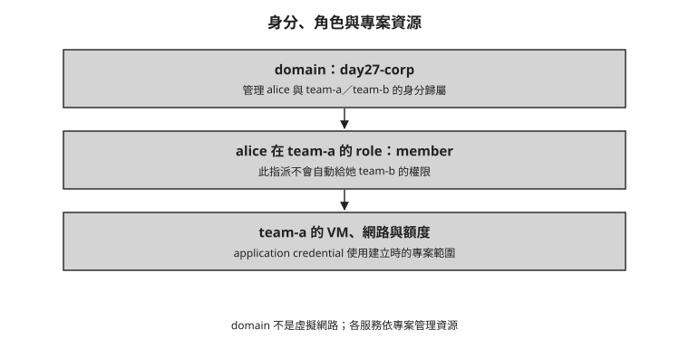
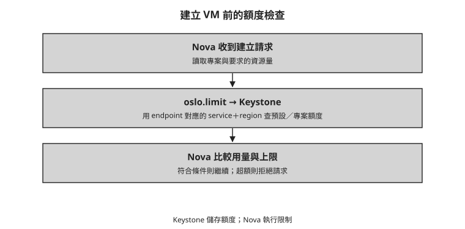
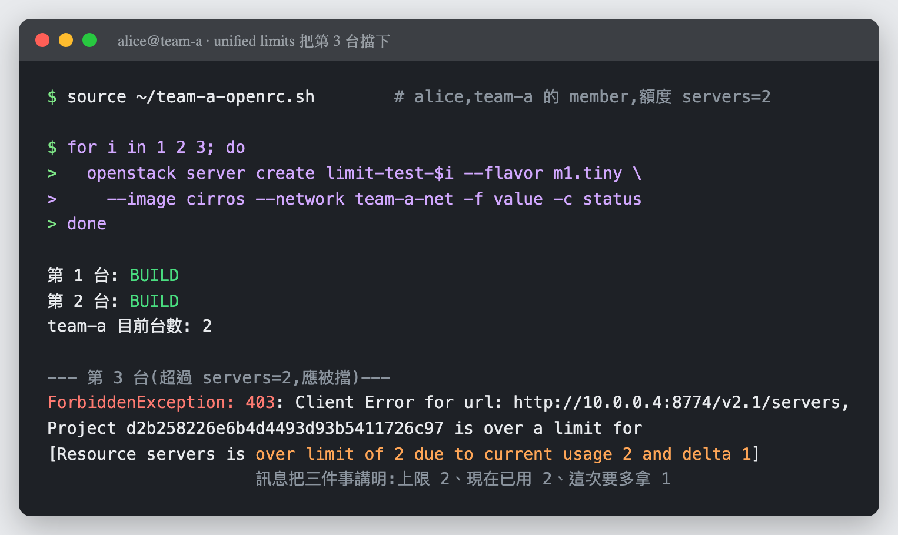

# Day 27: 多租戶治理——認證範圍、應用憑證與 Nova 額度

{ align=right width="100" }

兩個團隊開始共用同一朵雲。工程團隊希望 CI 自動開 VM，資料團隊也需要自己的資源；你不想把管理員密碼交給兩邊，更不能讓其中一邊耗盡所有容量。先前已經會建立 VM，這一章要在建立之前加上身分與額度的判斷。讀完之後，請求被拒絕時，你能分辨是認證範圍不對、額度不足，還是 Nova 查詢額度的設定有問題。

## 開始之前

沿用 Kolla-Ansible 2025.1 的部署主機，在啟用 OpenStack CLI 的 shell 操作。需要管理員 openrc、可用的 `cirros` 映像及 `m1.tiny` flavor。下列歷史命令中的 `10.0.0.4`、`RegionOne`、inventory 路徑請對照自己的 Keystone endpoint、region 與部署檔替換；輸出中的 UUID 只用來辨認當時的資源，不要複製為自己的 ID。

本章會切換三種身分。openrc 只是設定環境變數，不保證清掉前一種認證留下的值。每次由 application credential 切回帳號密碼前，先執行 `unset OS_AUTH_TYPE OS_APPLICATION_CREDENTIAL_ID OS_APPLICATION_CREDENTIAL_SECRET OS_SYSTEM_SCOPE`，再載入目標 openrc；由 system scope 切回專案前，至少清除 `OS_SYSTEM_SCOPE`。這個前提也適用後續章節。

## 步驟 1：建立各自的專案

Keystone 的 **domain** 管理一組使用者與專案；**project** 是資源歸屬與額度的對象。使用者取得哪種權限，取決於被指派的 **role** 及作用範圍。本章建立 `day27-corp` domain、`team-a`／`team-b` 兩個 project，讓 `alice` 在 team-a 有 member 角色。domain 本身不替 VM 建立隔離網路，還要由各服務依專案管理資源。

圖中把身分歸屬與資源歸屬分開，避免把「使用者屬於 domain」誤認成「能管理這個 domain 下所有專案」。



alice 在 team-a 的指派不會自動給她 team-b 的權限。先以管理員建立這組關係：

```bash
source /etc/kolla/admin-openrc.sh
openstack domain create day27-corp --description "Sprint 5 多租戶示範"
openstack project create --domain day27-corp team-a --description "工程團隊"
openstack project create --domain day27-corp team-b --description "資料團隊"
openstack user create --domain day27-corp --password '<你的密碼>' alice
openstack role add --project team-a --project-domain day27-corp \
  --user alice --user-domain day27-corp member
```

接著準備 alice 的 openrc。填入自己的 Keystone 位址與剛設定的密碼，檔案只讓自己讀取；查到 token 的 project ID，才繼續建立資源：

```bash
cat > ~/team-a-openrc.sh << 'EOF'
export OS_AUTH_URL=http://10.0.0.4:5000/v3
export OS_IDENTITY_API_VERSION=3
export OS_USERNAME=alice
export OS_PASSWORD='<你的密碼>'
export OS_USER_DOMAIN_NAME=day27-corp
export OS_PROJECT_NAME=team-a
export OS_PROJECT_DOMAIN_NAME=day27-corp
export OS_REGION_NAME=RegionOne
EOF
chmod 600 ~/team-a-openrc.sh
source ~/team-a-openrc.sh
openstack token issue -f value -c project_id
```

前面章節以 admin 建立的網路，不會自動成為 team-a 的網路。下面是嘗試使用其他專案網路時留下的錯誤：

```text
No Network found for e279e342-5ad3-4001-810c-045bc9a98de1
```

在 alice 的 team-a 身分下建立自己的網路與子網：

```bash
openstack network create team-a-net
openstack subnet create team-a-sub --network team-a-net --subnet-range 10.27.0.0/24 \
  --dns-nameserver 8.8.8.8
```

DNS 設定延續 Day 17 的[子網 DNS 檢查](sprint4-day17-designate-dns.md#mine-3)。這一步完成後，後面的 VM 才有可選的 `team-a-net`。

## 步驟 2：讓 CI 使用獨立憑證

**Application credential** 是使用者替應用建立的認證資料，可限定既有角色、設到期日並單獨撤銷，不必把本人密碼放進 CI。它仍然是機密，而且綁定建立時的專案。本例沿用 alice 在 team-a 的權限；若你的角色配置沒有 reader，應只指定自己已持有的角色。

```bash
source ~/team-a-openrc.sh
openstack application credential create day27-ci --role member --role reader
```

保存建立時顯示的 ID 與 Secret。Secret 之後不能重新查回。以下清除帳號密碼變數，改用這組憑證列 VM：

```bash
unset OS_USERNAME OS_PASSWORD OS_PROJECT_NAME OS_USER_DOMAIN_NAME OS_PROJECT_DOMAIN_NAME
export OS_AUTH_TYPE=v3applicationcredential
export OS_APPLICATION_CREDENTIAL_ID=<剛才的 ID>
export OS_APPLICATION_CREDENTIAL_SECRET=<剛才的 Secret>
openstack server list
```

請求成功代表這組憑證可以在 team-a 執行該查詢，不代表獲得全雲管理權限。用完驗證後，依開頭說明清除 application credential 相關變數，再載入 `/etc/kolla/admin-openrc.sh`；下一步是管理員的額度設定工作。

## 步驟 3：把 Nova 額度登記到 Keystone

**Quota（額度）**限制專案可申請多少資源。Unified limits 把額度數值集中存入 Keystone；本章遷移的是 Nova，沒有遷移 Cinder 或 Neutron。Nova 自 2023.2 起已推薦使用這條路線，並非到 2025.1 才出現。

兩種記錄分工如下：**registered limit** 是某個服務／region 的預設額度；**project limit** 覆寫特定專案的值。Nova 透過 **oslo.limit** 函式庫讀取額度並執行檢查，Keystone 不直接攔截建立 VM 的請求。

查詢前要確認認證的 **scope（作用範圍）**。專案範圍的 token 可能只看得到自己的 limit。管理全雲 limit 時，使用有 system admin 權限的管理員：載入 admin openrc 後，依下方清除專案變數並設定 `OS_SYSTEM_SCOPE=all`。此處先完成該身分切換，後面的 limit 寫入都使用它。

```bash
source /etc/kolla/admin-openrc.sh
unset OS_PROJECT_NAME OS_PROJECT_DOMAIN_NAME OS_PROJECT_ID \
      OS_TENANT_NAME OS_TENANT_ID OS_PROJECT_DOMAIN_ID
export OS_SYSTEM_SCOPE=all
openstack limit list -f value -c "Project ID" -c "Resource Name" -c "Resource Limit"
```

這段最後一行會列目前可見的專案額度；初次操作可能是空清單。原紀錄的 registered limit 查詢也沒有資料：

```bash
openstack registered limit list -f value | wc -l
```

```text
0
```

Nova 提供遷移工具，先用 dry-run 查看將搬哪些資料：

```bash
sudo docker exec nova_api nova-manage limits migrate_to_unified_limits --dry-run
```

```text
The following resource classes were found during the scan:
+-----------------+------------------+
| Resource        | Registered Limit |
+-----------------+------------------+
| class:DISK_GB   | missing          |
| class:MEMORY_MB | missing          |
| class:VCPU      | missing          |
+-----------------+------------------+
WARNING: It is strongly recommended to create registered limits for resource
classes missing limits in Keystone before proceeding.
```

`missing` 表示那些資源尚未有 registered limit。確認遷移範圍後，原紀錄執行了下面命令：

```bash
sudo docker exec nova_api nova-manage limits migrate_to_unified_limits
```

```text
ec8ba3a754d44487879a381264baf009 servers 10
ec8ba3a754d44487879a381264baf009 class:VCPU 20
ec8ba3a754d44487879a381264baf009 class:MEMORY_MB 51200
ec8ba3a754d44487879a381264baf009 server_metadata_items 128
ec8ba3a754d44487879a381264baf009 server_injected_files 5
...
```

輸出列出已遷移的資源與數值，但還不能直接切換 driver。這個未帶 region 的命令產生了 `region=None` 的記錄；本課 Nova endpoint 卻是 `RegionOne`。官方遷移工具另有 `--region-id` 選項，新遷移可依實際 region 使用；下面保留的是原操作及其補救程序。

### 先補齊 region 與缺少的預設額度

以 `openstack service list -f value -c ID -c Type` 找出 compute 的 service ID，存入 `SVC`；以自己 domain 下 team-a 的 project ID 設定 `TEAM_A`。若同名專案不只一個，必須用 domain 區分，不能只憑名稱取第一筆。先確認這兩個 ID 都非空。

下面的命令一次建立一個 registered limit。執行前設定 `R` 為資源名稱、`V` 為核准的預設額度，再逐項執行第一個命令：`servers` 為 10、`class:VCPU` 為 20、`class:MEMORY_MB` 為 51200 是上面遷移留下的預設值；`class:DISK_GB` 沒有可直接遷移的舊值，要依實驗容量另行決定，且至少容納兩台測試 VM 的磁碟。不要把未設定的 shell 變數送進 API。完成預設值後，第二個命令把 team-a 的台數限制設為 2：

```bash
openstack registered limit create --service "$SVC" --region RegionOne \
  --default-limit "$V" "$R"
openstack limit create --service "$SVC" --region RegionOne \
  --project "$TEAM_A" --resource-limit 2 servers
```

這裡的 region 必須與 Nova 在 `[oslo_limit]` 使用的 endpoint 相同。既有同一組記錄時應更新它，不要重複建立。設定完成後，再補 team-a 的 VCPU 上限；下列區塊同時列出原紀錄取得 service/project ID 的方法與專案 limit 命令，已建立的 `servers` 那一筆不用再執行：

```bash
NOVA_SVC=$(openstack service list -f value -c ID -c Type | awk '$2=="compute"{print $1}')
TEAM_A=$(openstack project show team-a --domain day27-corp -f value -c id)
openstack limit create --service "$NOVA_SVC" --region RegionOne \
  --project "$TEAM_A" --resource-limit 2 servers
openstack limit create --service "$NOVA_SVC" --region RegionOne \
  --project "$TEAM_A" --resource-limit 4 class:VCPU
```

最後用 system scope 查 registered／project limit 的 service、region 與資源名稱。先處理缺漏，再切換 Nova。若查不到某項必須限制的資源，可能被當成額度 0；實際處理還受 Nova 的 `unified_limits_resource_strategy`／resource list 設定影響，不能把所有版本都視為同一種預設。

## 步驟 4：讓 Nova 讀取並執行新額度

下圖是建立 VM 時的額度查詢。endpoint 不只是 API 網址，它也決定 oslo.limit 查哪個 service 與 region 的記錄。



查詢需要服務憑證及 system reader 權限。先從服務目錄找出 Nova 的 public endpoint ID，從部署密碼設定取得 `nova_keystone_password`，再填入下列覆寫檔。若檔案已含其他設定，合併這兩段，避免 `tee` 覆蓋原設定。

```bash
sudo tee /etc/kolla/config/nova/nova-api.conf << 'EOF'
[quota]
driver = nova.quota.UnifiedLimitsDriver

[oslo_limit]
auth_url = http://10.0.0.4:5000/v3
auth_type = password
user_domain_id = default
username = nova
password = <nova_keystone_password>
system_scope = all
endpoint_id = <nova 的 public endpoint id>
EOF
sudo cp /etc/kolla/config/nova/nova-api.conf /etc/kolla/config/nova/nova-conductor.conf
```

上面 `cp` 也會覆蓋既有的 nova-conductor 覆寫檔；如果該檔已含其他設定，改成合併 `[quota]` 與 `[oslo_limit]`，保留原有內容。設定同時放到 nova-api 與 nova-conductor，並給 nova 服務使用者 system reader：

```bash
openstack role add --user nova --user-domain Default --system all reader
```

切回部署虛擬環境，用自己的 inventory 部署 Nova：

```bash
kolla-ansible deploy -i ~/all-in-one --tags nova
```

```text
PLAY RECAP: ok=74  changed=13  failed=0
```

`failed=0` 只表示部署步驟成功。還要做下一步的建立測試，才能知道額度查詢與執行是否正常。

## 步驟 5：確認額度真的限制建立請求

清除 `OS_SYSTEM_SCOPE` 及 application credential 變數後，載入 alice 的 team-a openrc。確認 team-a 沒有其他 VM 佔用這個兩台的額度，再依序申請三台：

```bash
source ~/team-a-openrc.sh
for i in 1 2 3; do
  openstack server create limit-test-$i --flavor m1.tiny --image cirros \
    --network team-a-net -f value -c status
done
```

```text
第 1 台: BUILD
第 2 台: BUILD
team-a 目前台數: 2

--- 第 3 台(超過 servers=2,應被擋)---
ForbiddenException: 403: Project d2b258226e6b4d4493d93b5411726c97 is over a limit for
[Resource servers is over limit of 2 due to current usage 2 and delta 1]
```



第三次回應列出上限 2、目前使用量 2，以及這次新增量 1。這才是額度限制生效的觀察。前兩個 `BUILD` 表示請求已受理，並不單獨保證 VM 最後進入 ACTIVE。測試後用 `openstack server delete limit-test-1 limit-test-2` 刪掉這兩台，避免影響後續章節。

## 疑難排解

### 切換 driver 後 compute API 回 500 {#mine-1}

**症狀**：建立請求出現以下錯誤：

```text
HttpException: 500: Server Error for url: http://10.0.0.4:8774/v2.1/servers,
Unexpected API Error... <class 'oslo_limit.exception.SessionInitError'>
```

**原因**：這份紀錄缺少 `[oslo_limit]` 的認證設定，Nova 無法建立查額度的連線。**修法**：回步驟 4 補完整設定與服務角色。這個 `SessionInitError` 與超額的 403 不同；不能把所有 500 都判作額度問題。

### 尚未建立 VM，卻每項都顯示額度 0 {#mine-2}

**症狀**：Keystone 查得到預設值，Nova 卻拒絕第一台：

```text
403: Project d2b258226e6b4d4493d93b5411726c97 is over a limit for
[Resource class:DISK_GB is over limit of 0 due to current usage 0 and delta 1,
 Resource class:MEMORY_MB is over limit of 0 due to current usage 0 and delta 512,
 Resource class:VCPU is over limit of 0 due to current usage 0 and delta 1,
 Resource servers is over limit of 0 due to current usage 0 and delta 1]
```

比對兩邊的 region：

```text
=== registered limits 的 region ===
servers 10 None
class:VCPU 20 None
=== nova endpoint 的 region ===
RegionOne
```

**原因**：本課遷移結果是 None，endpoint 是 RegionOne。**修法**：依步驟 3 在相符 region 補齊預設與專案記錄，再查一次。舊 None 記錄若仍被 project limit 參照，要先處理相依記錄，不能只看到新資料就假設舊資料已刪除。

### 管理員查詢回空，Nova 卻仍執行限制 {#mine-3}

**症狀**：使用 admin 專案範圍的 token 查 team-a：

```bash
openstack limit list --project $TEAM_A -f value
```

CLI 沒列出結果。直接呼叫 API 也得到零筆；這裡的 `TOKEN` 指同一個 project-scoped token，UUID 與位址需換成自己的值：

```bash
curl -s -H "X-Auth-Token: $TOKEN" "http://10.0.0.4:5000/v3/limits" \
  | python3 -c "import sys,json; print('總數:', len(json.load(sys.stdin)['limits']))"
```

```text
總數: 0
```

但建立 VM 仍被拒絕：

```text
403: Project ... is over a limit for
[Resource servers is over limit of 2 due to current usage 2 and delta 1]
```

**原因**：本課的 limit list 依 token scope 過濾，空清單不代表其他專案沒有額度。**修法**：依步驟 3 改用有 system 權限的 token 查詢，原紀錄才列出：

```text
d2b258226e6b4d4493d93b5411726c97 servers 2
d2b258226e6b4d4493d93b5411726c97 class:VCPU 4
```

檢查額度時，把請求的身分與 scope 一起記下；只換 CLI 成 curl，不會改變 token 能看見的範圍。

### 解析 application credential JSON 得到 KeyError {#mine-4}

下面是失敗寫法，不要重新建立同名憑證來重試：

```bash
openstack application credential create day27-ci -f json | python3 -c "
import sys,json; print(json.load(sys.stdin)['id'])"
```

```text
KeyError: 'id'
```

原輸出的欄位是大寫：

```json
{
  "ID": "fe27332a44874f6aab76bac71ac4d3d8",
  "Name": "day27-ci",
  ...
```

**原因**：這個 CLI 輸出用 `ID`，程式卻讀 `id`。**修法**：依實際欄位名稱解析，或用 `-f value -c ID` 取值。建立時的 Secret 仍須妥善保存。

### service list 不接受 --service {#mine-5}

以下是參數錯誤的反例：

```bash
openstack service list --service compute -f value -c ID
```

```text
openstack service list: error: unrecognized arguments: --service compute
```

空的 service ID 若又傳給下一個指令，會出現另一種錯誤：

```text
BadRequestException: 400: Invalid input for field/attribute service_id.
Value: . '' is not a 'uuid'
```

**修法**：先列 service 的 ID 與 Type，再選 compute：

```bash
NOVA_SVC=$(openstack service list -f value -c ID -c Type | awk '$2=="compute"{print $1}')
```

確認取得一個非空 ID，再用它建立 limit。

## 本章沒有驗證完整的 Secure RBAC

Secure RBAC 涵蓋角色與 system／domain／project scope 的政策。單看設定檔沒有寫某個選項，不能判定它已關閉：

```text
nova-api         enforce_scope=(未設,用預設)
neutron-server   enforce_scope=(未設,用預設)
cinder-api       enforce_scope=(未設,用預設)
```

直接讀函式庫的預設值，也不等於服務載入設定後的實際行為：

```text
nova_api         enforce_scope/new_defaults = True True
neutron_server   enforce_scope/new_defaults = True True
cinder_api       enforce_scope/new_defaults = True True
```

本章驗到的是 application credential 的查詢、專案額度及 system scope 的可見性，沒有逐一測各服務的 `enforce_scope`。政策產生工具可協助檢視政策規則，但不能單憑產出的規則保證執行中的服務採用哪個設定。要驗證權限邊界，仍需選定 API、身分、scope 與應拒絕的操作做行為測試；limit list 的過濾行為不能直接代替所有 API 的拒絕測試。

## 想一想

- CI 已能用 application credential 列 team-a 的 VM，接著管理額度卻失敗。你會先檢查哪些環境變數與角色範圍？
- 預設 servers 是 10，第一台卻收到 limit 0。切回舊 driver 前，應先比對哪兩份資料？
- admin 專案的 limit list 回空，能否判定另一個專案沒有額度？你會怎麼確認？

## 小結

資源先有專案歸屬，才有可以限制與計量的對象。Application credential 讓 CI 使用獨立憑證；scope 決定查詢與管理的範圍。Unified limits 將 Nova 額度存到 Keystone，再由 Nova 取回執行檢查。遷移後要確認 service、region、資源名稱與認證設定一致，最後用實際建立請求分辨超額拒絕和設定失敗。

## 延伸閱讀

想再深入，可以從這幾份開始：

- [Nova Unified Limits](https://docs.openstack.org/nova/2025.1/admin/unified-limits.html)：遷移、region、oslo.limit 與資源策略。
- [Keystone Unified Limits](https://docs.openstack.org/keystone/2025.1/admin/unified-limits.html)：預設與專案限制，以及管理所需角色。
- [Application Credentials](https://docs.openstack.org/keystone/2025.1/user/application_credentials.html)：角色、到期日與撤銷。
- [Secure RBAC 目標](https://governance.openstack.org/tc/goals/selected/consistent-and-secure-rbac.html)：各服務的權限政策演進。

## 下一步

[Day 28](sprint5-day28-ceilometer-metering.md) 用 Ceilometer 取得帶有 `project_id` 的用量。先有這個專案歸屬，後面的告警與費用計算才知道要套用到誰。
