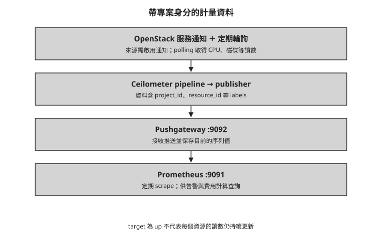
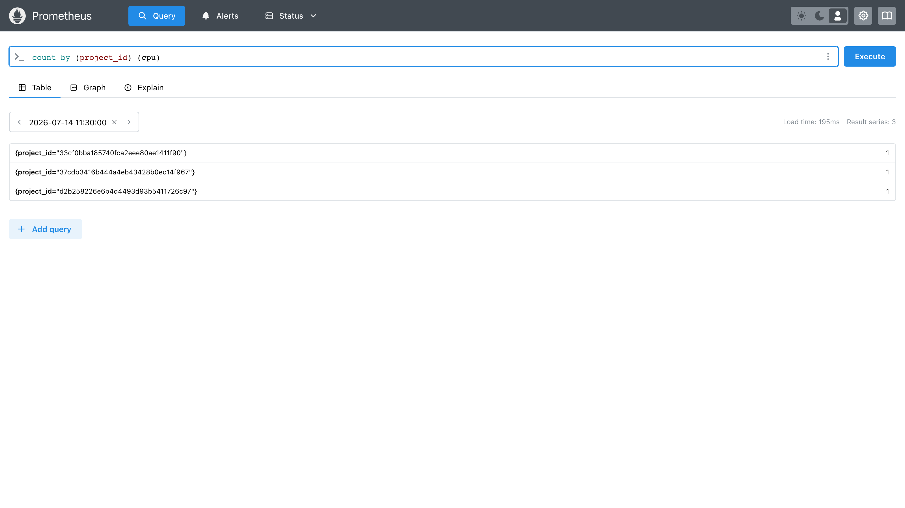
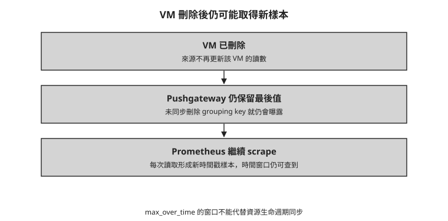

# Day 28: 計量管線——把用量對回租戶，並確認資料仍有效

{ align=right width="100" }

Prometheus 已經能查主機 CPU 與記憶體，現在同事要問的是「team-a 用了多少」。你需要把 VM 的讀數對回 OpenStack 專案，而不是把整台主機的用量當作某個租戶的用量。這一章加入 Ceilometer，將帶有 `project_id` 的計量資料送到現有 Prometheus。讀完之後，查不到資料時，你能逐段確認來源、轉送與查詢；查得到資料時，也能判斷它是否仍代表存在的資源。

## 開始之前

沿用 Day 21 的 Prometheus、Day 27 的 team-a 與 `team-a-net`。指令在 Kolla 部署主機執行；`10.0.0.4`、inventory、服務埠與 project UUID 都需對照自己的環境。下面保留歷史輸出，UUID 不可直接套用。

**Ceilometer** 蒐集 OpenStack 的資源用量與事件，資料包含專案歸屬。Day 21 的主機 exporter 指標主要用來觀察主機健康；是否帶租戶資訊要看 exporter 與設定，不能只看指標存在哪套資料庫。

本課選擇 Prometheus 作為後端。舊教材也可能使用 Gnocchi；那是另一種資料模型與整合方式，不能把其資源 metadata 查詢直接套用到本章。本章 publisher 實際送出的 labels 才是後續告警可用的條件，不能從「Prometheus 支援 label」推定它已收到所有 VM metadata。

## 資料怎麼到 Prometheus

Ceilometer 有兩種來源：**polling** 定期讀取 CPU、磁碟等讀數；**notification** 接收 Nova、Cinder 等服務發出的事件。**Pipeline** 決定資料交給哪個 **publisher**，也就是發送到後端的元件。

下圖從來源往下看。來源服務要開通知，Ceilometer 才收得到；Prometheus 則主動抓取 Pushgateway 的 `/metrics`。



**Pushgateway** 保存推送的最新值，供 Prometheus 的 **scrape（定期抓取）**讀取。這個保存動作與 VM 的生命週期分開，刪掉 VM 不會自動刪掉指標。後面會看到這為何影響計費；先把資料路徑接起來。

## 步驟 1：準備 Pushgateway 的接收端

Kolla 的 `enable_ceilometer_prometheus_pushgateway` 設定 Ceilometer 的目的地，這份部署仍需自行啟動接收服務。先檢查主機上的監聽埠；本課 Prometheus 已使用 9091，因此 Pushgateway 改用 9092。

```bash
sudo docker run -d --name pushgateway --restart unless-stopped --network host \
  quay.io/prometheus/pushgateway:latest --web.listen-address=:9092
```

這份歷史命令使用 `latest`，沒有留下固定 digest，不能用它保證重現同一版本。重建環境時應先選定並記錄測試版本。它也沒有啟用認證，且監聽所有主機介面；只應放在已限制來源的實驗網路，讀寫邊界見[疑難排解：無認證的計量入口](#mine-6)。

本課 Docker 的 bridge／iptables 設定不能使用一般 `-p` 對映，因此使用主機網路；這是此部署的限制，不是所有 Kolla 環境都只能這樣做。確認服務健康與埠分布：

```bash
curl -s -o /dev/null -w "%{http_code}\n" http://10.0.0.4:9092/-/healthy
sudo ss -tlnp | grep -E ":909[12]"
```

```text
200
10.0.0.4:9091  users:(("prometheus",pid=10788,fd=6))
*:9092         users:(("pushgateway",pid=1319183,fd=4))
```

200 表示健康端點回應；`*:9092` 表示所有主機介面都在監聽，不能解讀為只有本機可連。

## 步驟 2：讓 Prometheus 抓取並保留標籤

把 scrape 設定放進 Kolla 支援的片段目錄：

```bash
sudo mkdir -p /etc/kolla/config/prometheus/prometheus.yml.d
sudo tee /etc/kolla/config/prometheus/prometheus.yml.d/10-pushgateway.yml << 'EOF'
scrape_configs:
  - job_name: ceilometer-pushgateway
    honor_labels: true
    static_configs:
      - targets:
        - '10.0.0.4:9092'
EOF
```

`honor_labels: true` 讓來源的 `job`／`instance` 在衝突時優先保留；否則 Prometheus 會使用目標標籤，來源衝突值可能改名為 `exported_job`／`exported_instance`。後續 CloudKitty 查 `job="openstack-telemetry"`，需要這些標籤保持一致。

## 步驟 3：部署收集器

開啟 Ceilometer 與 publisher，填入自己的 Pushgateway 位址：

```bash
sudo tee -a /etc/kolla/globals.yml << 'EOF'
# Day 28:計量管線(Ceilometer → Prometheus,不用 Gnocchi)
enable_ceilometer: "yes"
enable_ceilometer_prometheus_pushgateway: "yes"
ceilometer_prometheus_pushgateway_host: "10.0.0.4"
ceilometer_prometheus_pushgateway_port: "9092"
EOF
source ~/kolla-venv/bin/activate
kolla-ansible deploy -i ~/all-in-one --tags ceilometer,prometheus
```

```text
PLAY RECAP: ok=49  changed=18  failed=0
```

部署後確認 central、compute、notification 三個容器，以及 Prometheus 中的 scrape target。原紀錄顯示目標健康：

```text
job=ceilometer-pushgateway  health=up
總 targets: 38
```

`up` 只能證明 Prometheus 抓得到 Pushgateway，不能證明每個 VM 的資料都有更新；Pushgateway 仍可能回傳已停止更新的值。

## 步驟 4：確認通知來源也更新了設定

只部署 Ceilometer，不會重新產生 Nova、Cinder、Neutron 的設定。先查來源服務的 `oslo_messaging_notifications` driver。Nova、Cinder 使用各自的 API 容器；Neutron 的容器名是 `neutron_server`，不能沿用 `${s}_api`：

```bash
for s in nova cinder neutron; do
  echo -n "$s: "
  container="${s}_api"
  if [ "$s" = neutron ]; then container=neutron_server; fi
  sudo docker exec "$container" grep -A2 "^\[oslo_messaging_notifications\]" /etc/$s/$s.conf | grep driver
done
```

原紀錄的來源狀態是：

```text
nova:   driver = noop
cinder: driver = noop
neutron:driver = noop
```

`noop` 表示不發送通知。更新這些來源服務，而不只是接收端：

```bash
kolla-ansible deploy -i ~/all-in-one --tags nova,neutron,cinder,glance,keystone,heat
```

```text
PLAY RECAP: ok=190  changed=52  failed=0
```

更新後再查對應容器中的 driver 與 topics：

```text
nova-api        driver=messagingv2  topics=notifications
cinder-api      driver=messagingv2  topics=notifications
neutron-server  driver=messagingv2  topics=notifications
glance-api      driver=messagingv2  topics=notifications
```

`messagingv2` 會把通知送到訊息系統。這與 Day 34 的 API 稽核日誌是不同設定與用途，不要為了輸出稽核 log 把計量通知來源關掉。

## 步驟 5：用 team-a 的 VM 確認標籤

先依 Day 27 清除 application credential 變數與 `OS_SYSTEM_SCOPE`，再載入 team-a 的 openrc。Day 27 的兩台額度測試 VM 應已刪除；本章需要至少一台的剩餘額度。

```bash
source ~/team-a-openrc.sh
openstack server create meter-vm --flavor m1.tiny --image cirros \
  --network team-a-net --wait
```

等待輪詢產生樣本，再看 Pushgateway 原始資料：

```bash
curl -s http://10.0.0.4:9092/metrics | grep -v "^#" | head
```

```text
compute_instance_booting_time{...} 13.29833
cpu{instance="",job="openstack-telemetry",project_id="…",resource_id="…",user_id="…"} 6.777e+10
disk_device_read_bytes{...} 2.877696e+07
disk_device_read_requests{...} 1035
disk_device_write_bytes{...} 7.303168e+07
```

這裡的 `cpu` 是累積 CPU 時間讀數，不是百分比。`project_id` 是租戶歸屬，`resource_id` 是 VM；之後要查指定租戶時，用自己的 team-a project ID。指標名稱沒有 `ceilometer_` 前綴。

先按專案計算目前看見的 cpu 時間序列數：

```bash
PW=$(sudo grep '^prometheus_password:' /etc/kolla/passwords.yml | awk '{print $2}')
curl -s -u admin:$PW --get http://10.0.0.4:9091/api/v1/query \
  --data-urlencode "query=count by (project_id) (cpu)"
```

```text
project_id=33cf0bba…(admin)   → 1 台
project_id=37cdb341…(Trove)   → 1 台
project_id=d2b25822…(team-a)  → 1 台      ← Day 27 建的租戶
```



這個結果代表各專案有幾條符合條件的 `cpu` 序列。只有每台 VM 對應一條序列、資料沒有重複且已刪資源已清理時，才可把它當 VM 台數。下面再縮到單一 project；命令內的 UUID 請替換成自己的 team-a ID：

```bash
curl -s -u admin:$PW --get http://10.0.0.4:9091/api/v1/query \
  --data-urlencode 'query=cpu{project_id="d2b258226e6b4d4493d93b5411726c97"}'
```

```text
resource=83b15110-76b4-4f3b-9…   cpu=3.16e+09 ns
```

這筆資料確認了 VM 讀數與專案標籤的連結。它還沒有證明資料完整、沒有重複或可直接用於收費。

## 在哪裡觀察 Ceilometer

本課沒有部署 Ceilometer 的網頁面板。Kolla 的 Horizon 設定中，Ceilometer 這一列只有政策檔，其他服務才有面板開關：

```yaml
- { name: "ceilometer", enabled: "{{ enable_ceilometer_horizon_policy_file }}" }   # 只有政策檔
- { name: "cloudkitty", enabled: "{{ enable_horizon_cloudkitty }}" }               # 有面板
- { name: "designate",  enabled: "{{ enable_horizon_designate }}" }                # 有面板
```

因此，操作時看來源服務、Ceilometer 日誌、Pushgateway 原始資料，再到 Prometheus 查詢。Day 30 才會透過 CloudKitty 查看費用計算結果。

## 疑難排解

### 容器 Up，9092 健康檢查卻連不上 {#mine-1}

下列是此環境失敗的埠對映方式，不要跟步驟 1 同時執行：

```bash
sudo docker run -d --name pushgateway -p 10.0.0.4:9092:9091 \
  quay.io/prometheus/pushgateway:latest
```

```text
pushgateway :9092 → HTTP 000
```

**原因**：本課 Docker 的 `iptables: false` 與 `bridge: none` 使這條對映路徑不可用。**修法**：先移除同名失敗容器，再採主機網路版本；不要直接重跑而留下名稱衝突：

```bash
sudo docker run -d --name pushgateway --restart unless-stopped --network host \
  quay.io/prometheus/pushgateway:latest --web.listen-address=:9092
```

主機網路仍需檢查監聽位址、埠衝突與防火牆。

### Pushgateway 與 Prometheus 使用同一個埠 {#mine-2}

**症狀**：服務無法綁定 9091。**原因**：Pushgateway 預設埠與本課 Kolla Prometheus 相同。**修法**：依步驟 1 使用 9092，並同步修改 Ceilometer publisher 與 Prometheus scrape target。

### 收集器正常，卻沒有服務事件 {#mine-3}

**原因**：來源服務仍使用 `noop`，僅部署 Ceilometer 沒有更新它們。**修法**：檢查來源設定後，執行步驟 4 的部署範圍：

```bash
kolla-ansible deploy -i ~/all-in-one --tags nova,neutron,cinder,glance,keystone,heat
```

之後再確認 `messagingv2`；不要只以部署成功判定通知已送達。

### 搜尋 ceilometer_ 沒有指標 {#mine-4}

publisher 設定可能已正確：

```text
publishers:
    - prometheus://10.0.0.4:9092/metrics/job/openstack-telemetry
```

錯誤的名稱假設卻會查到零筆：

```bash
curl -s http://10.0.0.4:9092/metrics | grep -c "^ceilometer_"
```

```text
0
```

**修法**：先查看原始資料，再以實際名稱與 labels 查詢：

```bash
curl -s http://10.0.0.4:9092/metrics | grep -v "^#" | head
```

## 已刪 VM 的讀數為什麼還在 {#mine-5}

原紀錄用一筆指標的 resource ID 查 VM，目前認證身分查不到這個資源：

```bash
openstack server show a0500345-2306-4b09-90d2-82b2b7c209b9
```

```text
No Server found for a0500345-2306-4b09-90d2-82b2b7c209b9
```

`No Server found` 也可能是專案範圍或權限造成，不能單靠這一行判定 VM 已刪除。先以有權查看該專案的管理員核對正確 UUID 與歸屬，再比對實際刪除前後的記錄。以下說明的是已確認刪除時的資料生命週期。

Pushgateway 會持續曝露已保存的序列，直到對應資料被明確刪除或替換。Prometheus 每次 scrape 都會把仍曝露的值記成新的樣本，因此「VM 不再推送」和「Prometheus 不再取得樣本」是兩件事。

圖中最後一條箭頭會持續發生，這正是只加時間窗口不能解決的原因：



`max_over_time(...[1h])` 仍會看見窗口內新抓到的舊值；它不會自動排除已刪 VM。`count(cpu)` 也可能把它算進台數。不能據此聲稱 Day 30 帳單已避免這項誤差。

要把這份資料用於費用計算，必須另外管理資源刪除與 Pushgateway grouping key 的同步，並核對資料的新鮮度與租戶清單。清理前先確認 grouping key 對應範圍，避免刪到仍存在的 VM；本課沒有完成自動同步與刪除後停止計費的端到端驗證。[Pushgateway 官方說明](https://github.com/prometheus/pushgateway#about-timestamps)明確區分推送時間與抓取樣本的時間。

### 無認證的計量入口可被其他來源讀寫 {#mine-6}

步驟 1 的服務沒有認證且監聽 `*:9092`。只要網路可達，來源就可能讀取租戶標籤或寫入指標；單機部署也不自動等於只有本機可達。這些數值會影響告警與費用，必須確認寫入者可信。

要限制的來源包括需要寫入的 Ceilometer 與需要讀取的 Prometheus；可用網路限制及具認證的代理建立邊界。本課未部署這套完整保護，也沒有驗證跨租戶的讀寫隔離，不能把實驗設定直接視為計費平台的完成配置。

## 想一想

- Pushgateway target 是 up，但沒有 VM 的新讀數。你會依資料路徑先查哪幾處？
- 某台 VM 已刪除一週，`max_over_time(cpu[1h])` 卻仍有值。為什麼縮短窗口不一定有效？
- Prometheus 已有密碼，但 Pushgateway 沒有。這是否足以保護計量資料？還要允許哪些來源連線？

## 小結

Ceilometer 將用量和專案歸屬一起送出，Prometheus 才能按租戶查詢。驗證資料路徑時，來源通知、publisher、scrape 與 labels 都要確認。資料到達之後仍要檢查生命週期：Pushgateway 保留的舊值會被持續抓成新樣本，時間窗口不能代替資源刪除同步，也不能單憑有數字就認定可以正確收費。

## 延伸閱讀

想再深入，可以從這幾份開始：

- [Ceilometer 2025.1](https://docs.openstack.org/ceilometer/2025.1/)：polling、通知與 publisher。
- [Kolla 監控與日誌指南](https://docs.openstack.org/kolla-ansible/2025.1/reference/logging-and-monitoring/index.html)：部署設定的入口。
- [Pushgateway 適用情境](https://prometheus.io/docs/practices/pushing/)：保存序列與資源生命週期不同的限制。
- [Pushgateway 時間戳](https://github.com/prometheus/pushgateway#about-timestamps)：推送、曝露與 scrape 的區別。

## 下一步

[Day 29](sprint5-day29-aodh-autoscaling.md) 讓 Aodh 查這些序列，並在條件成立時通知 Heat 調整 VM 數量。告警條件也必須使用正確租戶與有效資料，否則會對錯誤的讀數採取動作。
