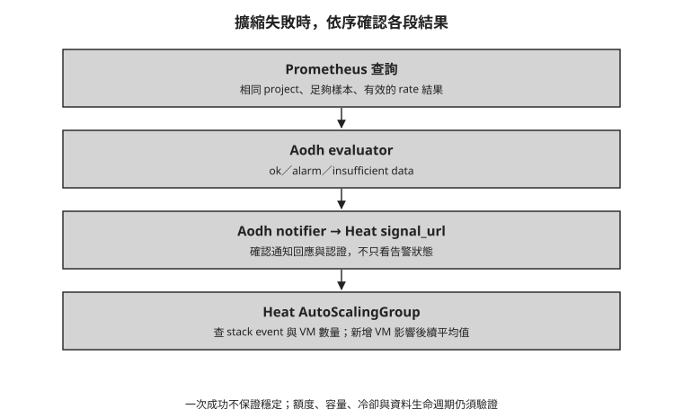
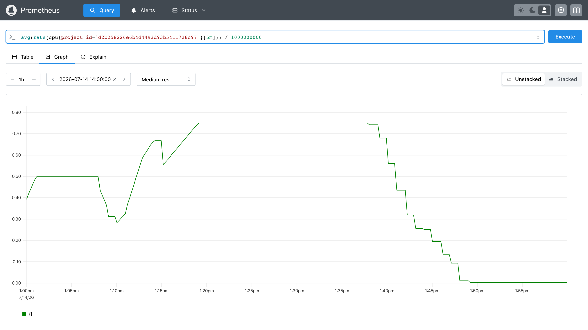

# Day 29: 告警與自動擴縮——從查詢結果追到 VM 增減

{ align=right width="100" }

Prometheus 圖上 CPU 已經上升，VM 數量卻沒有變。可能是告警查不到資料，也可能是通知已送出、Heat 卻拒絕執行。這一章把 Day 28 的計量資料接到 Aodh，再讓 Heat 調整 VM 數量。讀完之後，你能分段查詢、告警狀態、通知回應與 stack 事件，找出擴縮停在哪裡。

## 開始之前

需要 Day 28 的 Ceilometer／Prometheus、Day 27 的 team-a 身分與網路，以及 Day 5 的 Heat。指令在 Kolla 部署主機執行，位址、UUID 與 inventory 請換成自己的值。切換 admin、system 與 team-a 身分時，沿用 Day 27 的認證變數清理方式。

Day 27 把 team-a 的 servers 限為 2，本章卻要觀察最多 3 台。先以 system 管理員查出 team-a 的 `servers` limit ID，將該筆上限調到至少 3，並確認 VCPU、記憶體與磁碟額度可容納三台 `m1.tiny`。可依 Nova 的 limit 更新方式使用 `openstack limit set --resource-limit 3 <servers-limit-id>`；這是補足跨章前提的命令，原紀錄沒有保存這一步輸出。不能把 registered limit 改大就假設覆寫值也跟著變。

第一段用 Day 28 的 `meter-vm` 測告警；建立 autoscaling stack 前再刪除它，並確認 team-a 沒有其他無關 VM。因為本章以 project 分組，其他 VM 的指標也會影響平均值。Day 28 所述 Pushgateway 舊序列的清理與新鮮度問題仍然存在。

## 先看要追查的四段 {#architecture}

**Aodh** 定期評估一條 **alarm（告警規則）**，再依結果決定 **state（狀態）**：`ok`、`alarm` 或 `insufficient data`。**Action** 是指定狀態下要呼叫的通知端點；本章把它設為 Heat 的擴縮訊號網址。

圖中每一段都要有可觀察的結果，才能把 VM 增減連回告警。



`alarm` 不表示通知已送達，通知回 200 也不單獨表示新 VM 已完成。另一方面，新增 VM 會改變後續樣本與平均值，因此擴縮本身也會影響下一次判斷。

### 用哪些標籤選工作負載

其他教材可能以 Gnocchi 資源 metadata 選群組，例如：

```yaml
metadata: {"metering.server_group": {get_param: "OS::stack_id"}}   # 幫 VM 貼標籤
type: OS::Aodh::GnocchiAggregationByResourcesAlarm                 # 再用標籤篩
```

本章保存的 Prometheus 樣本卻是以下欄位：

```text
__name__      = cpu
job           = openstack-telemetry
project_id    = d2b258226e6b4d4493d93b5411726c97
resource_id   = dd3cfe9a-0301-470c-bef5-c8620dc4e3f5
user_id       = 1384190dc01245789ea1465816402146
```

沒有 `server_group`，所以這份 publisher 設定不能直接使用上面的查詢。本章以 team-a 的 `project_id` 選定範圍，前提是該 project 只承載這組實驗。這不是 Prometheus 不能儲存自訂 label，而是目前資料沒有送出該 label；同一專案混合多種工作負載時，需要另外設計可靠的分組資料。

## 步驟 1：部署 Aodh

```bash
echo 'enable_aodh: "yes"' | sudo tee -a /etc/kolla/globals.yml
source ~/kolla-venv/bin/activate
kolla-ansible deploy -i ~/all-in-one --tags aodh
```

確認 api、evaluator、notifier、listener 容器健康。evaluator 負責算條件，notifier 負責發送動作；之後要分別看這兩個元件的日誌。

## 步驟 2：建立查詢並設定 Prometheus 連線

在 CLI 虛擬環境安裝外掛，再以管理員建立一條只測「是否有 cpu 序列」的告警。先清除前一章殘留的認證變數：

```bash
pip install python-aodhclient
source /etc/kolla/admin-openrc.sh
TEAM_A=$(openstack project show team-a --domain day27-corp -f value -c id)
openstack alarm create --type prometheus --name day29-vm-count \
  --query "count(cpu{project_id=\"$TEAM_A\"})" \
  --comparison-operator ge --threshold 1 --evaluation-periods 1 --granularity 60
```

原紀錄建立成功，但 evaluator 找不到 Prometheus：

```text
Could not load 'prometheus': Can't find prometheus host and port configuration
```

這個版本的客戶端讀設定檔，不透過 Keystone 服務目錄尋找 Prometheus。建立它需要的檔案：

```bash
PW=$(sudo grep '^prometheus_password:' /etc/kolla/passwords.yml | awk '{print $2}')
sudo mkdir -p /etc/openstack
sudo tee /etc/openstack/prometheus.yaml << EOF
host: admin:${PW}@10.0.0.4
port: 9091
EOF
```

`host` 內嵌 basic-auth 憑證，是本課版本驗證過的整合方式；這份檔案應限制為必要帳號可讀，避免把密碼放進日誌或分享檔案。不要因此關閉 Prometheus 認證。若密碼包含 URL 保留字元，要先確認客戶端接受的編碼方式，本課沒有測這個情況。

Aodh 在容器內，還要將設定掛入：

```bash
sudo tee -a /etc/kolla/globals.yml << 'EOF'
aodh_extra_volumes:
  - "/etc/openstack:/etc/openstack:ro"
EOF
kolla-ansible deploy -i ~/all-in-one --tags aodh
```

重新部署後查 evaluator 日誌，確認不再是找不到設定；若改為 401，表示已連到服務，但認證仍失敗，見[疑難排解：Prometheus 回 401](#mine-2)。

## 步驟 3：先驗告警兩種結果

查看測試規則的狀態與原因：

```bash
openstack alarm show day29-vm-count -f value -c state -c state_reason
```

```text
alarm
Transition to alarm due to 1 samples outside threshold, most recent: 1.0
```

這個查詢結果達到門檻，所以是 alarm。再把門檻提高，讓目前資料不滿足條件：

```bash
openstack alarm update day29-vm-count --threshold 99
```

查 API 的原始規則。`<alarm-id>` 換成剛建立的告警 ID：

```bash
TOKEN=$(openstack token issue -f value -c id)
AODH=$(openstack endpoint list --service alarming --interface public -f value -c URL)
curl -s -H "X-Auth-Token: $TOKEN" "$AODH/v2/alarms/<alarm-id>" | python3 -m json.tool
```

```json
"state": "ok",
"prometheus_rule": {
  "comparison_operator": "ge",
  "threshold": 99.0,
  "query": "count(cpu{project_id=\"d2b258226e6b4d4493d93b5411726c97\"})"
}
```

`state` 回到 ok，而且 `prometheus_rule` 中的門檻是更新後的值。這確認 evaluator 能依這份查詢改變判斷。測試後可以把門檻改回 `openstack alarm update day29-vm-count --threshold 1`；它不負責後面的擴縮動作。

## 步驟 4：調整讀數更新與查詢窗口

後面的查詢使用 **`rate()`**，由累積 CPU 時間估計每秒速率，再除以十億將奈秒換成秒，得到平均使用的 CPU 核心數。

這裡要分清三種間隔：Ceilometer 多久讀到新用量、Prometheus 多久 scrape 一次，以及 Aodh 多久評估一次。`rate()` 需要的是 Prometheus 窗口內足夠的樣本；即使 Ceilometer 沒更新，Pushgateway 舊值仍可能被多次抓取。因此不能單憑 Ceilometer 的 300 秒輪詢推論一分鐘窗口只有一個樣本。

原設定的 polling 段落是：

```yaml
# 容器內 /etc/ceilometer/polling.yaml
sources:
    - name: some_pollsters
      interval: 300
```

原操作將它改為 60 秒，並使用五分鐘的 rate 窗口：

```bash
sudo mkdir -p /etc/kolla/config/ceilometer
sudo docker exec ceilometer_central cat /etc/ceilometer/polling.yaml \
  | sed 's/interval: 300/interval: 60/' \
  | sudo tee /etc/kolla/config/ceilometer/polling.yaml
kolla-ansible deploy -i ~/all-in-one --tags ceilometer
```

這會提高來源讀數的更新頻率，但仍要確認實際 scrape 間隔、資料是否持續到達，以及是否有已刪 VM 的舊序列。先在 Prometheus 執行同一條查詢，確認有合理結果，再把它交給 Aodh；不同窗口的原始觀察保留在[疑難排解：insufficient data](#mine-4)。

## 步驟 5：讓 Heat 接收擴縮訊號 {#step-5}

Heat 的 **AutoScalingGroup** 保存同規格 VM 的目標數量與上下限；**ScalingPolicy** 定義一次增加或減少多少台，以及動作之間的 cooldown。Aodh 的 PrometheusAlarm 則把符合條件的結果送給政策。

先確認 Heat 支援這些資源型別：

```bash
openstack orchestration resource type list | grep -i aodh
```

```text
| OS::Aodh::Alarm                              |
| OS::Aodh::CompositeAlarm                     |
| OS::Aodh::EventAlarm                         |
| OS::Aodh::GnocchiAggregationByMetricsAlarm   |
| OS::Aodh::GnocchiAggregationByResourcesAlarm |
| OS::Aodh::GnocchiResourcesAlarm              |
| OS::Aodh::LBMemberHealthAlarm                |
| OS::Aodh::PrometheusAlarm                    |
```

清單同時有 Gnocchi 與 Prometheus 型別；這證明目前安裝的 Heat 認得它們，不表示各後端都已部署。

將[完整範本](#full-template)存為 `~/day29-autoscale.yaml`。關鍵段落如下：

```yaml
  cpu_high:
    type: OS::Aodh::PrometheusAlarm
    properties:
      query:
        str_replace:
          template: 'avg(rate(cpu{project_id="PID"}[5m])) / 1000000000'
          params:
            PID: { get_param: project_id }
      comparison_operator: gt
      threshold: 0.4
      alarm_actions:
        - str_replace:
            template: trust+url
            params:
              url: { get_attr: [scale_out, signal_url] }
```

`project_id` 限定 team-a，門檻 0.4 是每條 VM CPU 序列速率的平均值。`trust+url` 經字串替換形成 `trust+http://...`，讓 Aodh 透過 Keystone **trust（委派授權）**取得 token，再通知 Heat 原生 API。這是本課替代失敗 `alarm_url` 的方式，並不是宣稱所有環境的 `alarm_url` 都不可用。

建立 stack 前，在 team-a 身分刪除 Day 28 的 `meter-vm`，確認額度和指標範圍符合開頭前提，再載入 team-a openrc。`TEAM_A` 必須是同一個專案的 ID：

```bash
source ~/team-a-openrc.sh
openstack stack create day29-as -t ~/day29-autoscale.yaml \
  --parameter project_id=$TEAM_A --wait
```

VM 的 user_data 會執行一段 CPU 工作後停止。下面保留原操作的通知、stack 更新與數量變化：

```text
13:08:28  aodh notifier  →  gets response: 200 OK
13:08:30  ASG 巢狀 stack UPDATE started
13:08:43  UPDATE completed          →  2 台
13:08:44  scale_out  Remaining as alarm due to 1 samples outside threshold,
                     most recent: 0.40572612101851857

13:13:28  aodh notifier  →  gets response: 200 OK
13:13:45  scale_out  most recent: 0.6274204384722222   →  3 台(max_size)

13:43:36  scale_in   Transition to ok due to 1 samples inside threshold,
                     most recent: 0.25709375           →  2 台
13:48:36  scale_in   Remaining as ok ... most recent: 0.010958333333333334
                                                       →  1 台(min_size)
```

數量從 1 增至 3，再回到 1；notifier 成功回應與 Heat 更新事件共同支持這次擴縮觀察。只看數量還不夠，因為滾動替換也可能短暫增加 VM。

同一組查詢的圖形顯示負載上升、之後下降：



新 VM 初期用量較低，可能拉低平均值，但不能只憑曲線凹陷就斷定是哪個事件造成。這份範本的 `repeat_actions` 沿用預設，仍在同一狀態時可以重複送動作，所以縮容可分次回到 `min_size`。

擴與縮使用同一個門檻，且各自 cooldown 為 60 秒，不能保證不會來回擴縮。若要用於真實服務，需要評估啟動時間、分開的擴縮門檻、持續條件與冷卻時間；本課只驗這一輪，沒有測振盪抑制或容量不足的恢復。

## 疑難排解

### evaluator 找不到 Prometheus 設定 {#mine-1}

**症狀**：`Can't find prometheus host and port configuration`。**原因**：本課客戶端讀 `prometheus.yaml`，Kolla 沒替它產生這份設定。**修法**：依步驟 2 寫檔並確認容器內可讀；只在 Keystone 新增 endpoint 不會修好這個讀檔問題。

### 已能找到 Prometheus，卻回 401 {#mine-2}

本課客戶端設定沒有獨立帳密欄位。驗證過的設定形狀是：

```yaml
host: admin:<prometheus_password>@10.0.0.4
port: 9091
```

**修法**：確認帳密與位址，再確認掛載後容器讀到同一份檔案。嵌入 URL 的密碼仍須當作機密，不應把完整 URL 複製進排錯報告。

### Aodh 轉成 alarm，Heat 卻拒絕通知 {#mine-3}

原紀錄的 `alarm_url` 通知失敗：

```text
Notifying alarm <...> gets response: 403 AccessDenied.
```

```xml
<ErrorResponse><Error><Type>Sender</Type><Code>AccessDenied</Code>
<Message>User is not authorized to perform action</Message></Error></ErrorResponse>
```

這個 URL 走 EC2 簽章驗證，日誌顯示 Keystone 拒絕：

```text
INFO  heat.api.aws.ec2token  Authenticating with http://10.0.0.4:5000/v3/ec2tokens
ERROR heat.api.aws.ec2token  Failed to obtain a Keystone token from None:
      keystoneauth1.exceptions.http.Unauthorized: (HTTP 401)
```

改用 Heat 的 `signal_url`，並讓 Aodh 用 trust 通知器處理：

```yaml
      alarm_actions:
        - str_replace:
            template: trust+url
            params:
              url: { get_attr: [scale_out, signal_url] }
```

可列出目前安裝的通知器：

```bash
sudo docker exec aodh_notifier python3 -c "
from importlib.metadata import entry_points
for ep in entry_points(group='aodh.notifier'): print(ep.name)"
```

```text
http  https  log  test  trust+heat  trust+http  trust+https  trust+zaqar  zaqar
```

這份環境有 `trust+http`／`trust+https`。修正後仍須核對 notifier 回應與 Heat event，不能只看範本建立成功。

### 告警停在 insufficient data {#mine-4}

先直接執行同一條 PromQL，比較窗口：

```bash
for W in 1m 2m 3m 5m; do
  curl -s -u admin:$PW --get http://10.0.0.4:9091/api/v1/query \
    --data-urlencode "query=avg(rate(cpu{project_id=\"$TEAM_A\"}[$W]))"
done
```

```text
rate(cpu[1m]) → 空(算不出來)
rate(cpu[2m]) → 0.0
rate(cpu[5m]) → 0.0
```

這個結果只證明當時一分鐘窗口算不出 rate；沒有同時保存完整 scrape 時序，不能將原因唯一歸為 Ceilometer 的 polling 間隔。回步驟 4 檢查來源更新、scrape 樣本、label 條件與窗口。

`insufficient data` 不會走本章的 alarm／ok actions；Aodh 另有 `insufficient_data_actions`，本範本未設定。正式部署需要另外處理「資料不夠」的通知，不能把沒有擴縮動作當成沒有問題。整體反應時間也受這三種間隔、窗口平滑與 VM 建立時間影響，並非固定相加或相乘即可算出。

### CLI 的 rule 是 null {#mine-5}

本課 CLI 沒把 Prometheus 型規則對到通用的 `rule` 欄。用步驟 3 的 API 查 `prometheus_rule`，再核對 state 與 query；不要因 CLI 顯示 null 就重新建一條規則。

## 完整範本 {#full-template}

下面保留這輪驗證使用的範本。它是 CPU 工作的擴縮示範，沒有負載平衡器、應用健康檢查或正式服務的擴縮穩定性設計：

```yaml
heat_template_version: 2021-04-16

description: Day 29 - PromQL 驅動的自動擴縮

parameters:
  project_id:
    type: string
    description: 用 project_id 收斂告警範圍(Prometheus 路線沒有 server_group label)

resources:

  asg:
    type: OS::Heat::AutoScalingGroup
    properties:
      min_size: 1
      max_size: 3
      desired_capacity: 1
      resource:
        type: OS::Nova::Server
        properties:
          image: cirros
          flavor: m1.tiny
          networks:
            - network: team-a-net
          user_data_format: RAW
          user_data: |
            #!/bin/sh
            # 開機後燒 CPU 30 分鐘再自己停
            # cirros 的 busybox 沒有 timeout 指令,只能自己算時間
            (
              END=$(( $(date +%s) + 1800 ))
              while [ "$(date +%s)" -lt "$END" ]; do
                i=0; while [ $i -lt 200000 ]; do i=$((i+1)); done
              done
            ) &

  scale_out:
    type: OS::Heat::ScalingPolicy
    properties:
      adjustment_type: change_in_capacity
      auto_scaling_group_id: { get_resource: asg }
      cooldown: 60
      scaling_adjustment: 1

  scale_in:
    type: OS::Heat::ScalingPolicy
    properties:
      adjustment_type: change_in_capacity
      auto_scaling_group_id: { get_resource: asg }
      cooldown: 60
      scaling_adjustment: -1

  cpu_high:
    type: OS::Aodh::PrometheusAlarm
    properties:
      description: team-a 平均 CPU 超過 0.4 顆核就加機器
      query:
        str_replace:
          template: 'avg(rate(cpu{project_id="PID"}[5m])) / 1000000000'
          params:
            PID: { get_param: project_id }
      comparison_operator: gt
      threshold: 0.4
      alarm_actions:
        - str_replace:
            template: trust+url
            params:
              url: { get_attr: [scale_out, signal_url] }
      ok_actions:
        - str_replace:
            template: trust+url
            params:
              url: { get_attr: [scale_in, signal_url] }
```

這份 CirrOS 範本用迴圈計時，因為原先使用 `timeout` 的版本沒有執行成功：

```text
/run/cirros/datasource/data/user-data: line 3: timeout: not found
```

Nova 的 ACTIVE 不保證 user_data 成功；讀數一直為零時，也要查 `openstack console log show` 的 VM 開機日誌。

## 完成實驗後

先清除 `OS_AUTH_TYPE`、`OS_APPLICATION_CREDENTIAL_ID`、`OS_APPLICATION_CREDENTIAL_SECRET` 與 `OS_SYSTEM_SCOPE`，載入 `~/team-a-openrc.sh`，以 team-a 身分用 Heat 刪除 `day29-as` stack，確認其 VM 與 stack 管理的告警都已移除。接著再次清除上述認證變數，載入 `/etc/kolla/admin-openrc.sh`，以步驟 2 建立告警的管理員身分刪除獨立的 `day29-vm-count` 測試告警。刪除資源後，依 Day 28 檢查 Pushgateway 的殘留序列；下一章不能把仍在曝露的舊值視為有效用量。若調高了 team-a 額度，依實際後續需求保留或恢復原值。

## 想一想

- Aodh 是 alarm，VM 數量卻沒有變。你會先取得哪三種結果，而不是重建告警？
- 同一個 project 多了一批不相關的 VM，這份平均 CPU 查詢還能代表原工作負載嗎？
- Ceilometer 每五分鐘更新一次，但 Prometheus 每分鐘抓 Pushgateway。rate 的樣本點數與讀數的新鮮度有什麼不同？

## 小結

自動擴縮要把資料、判斷與動作分開驗證。先確認查詢範圍和樣本，再看 Aodh 狀態、notifier 回應及 Heat 事件。擴縮成功一輪不等於策略已能穩定控制正式負載；專案額度、舊序列、VM 啟動時間與重複動作，都會改變結果。

## 延伸閱讀

想再深入，可以從這幾份開始：

- [Aodh 2025.1](https://docs.openstack.org/aodh/2025.1/)：告警狀態與通知器。
- [Heat 資源型別](https://docs.openstack.org/heat/2025.1/template_guide/openstack.html)：ScalingPolicy、PrometheusAlarm 與 repeat_actions。
- [Prometheus rate](https://prometheus.io/docs/prometheus/latest/querying/functions/#rate)：計數器速率與窗口的意義。
- [Kolla 監控整合](https://docs.openstack.org/kolla-ansible/2025.1/reference/logging-and-monitoring/index.html)：服務側部署設定。

## 下一步

[Day 30](sprint5-day30-cloudkitty-rating.md) 使用相同租戶標籤，讓 CloudKitty 依規則計算費用。告警需要有效資料，費用計算也一樣；讀得到指標只是開始。
