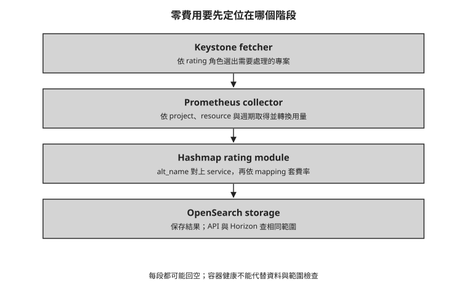
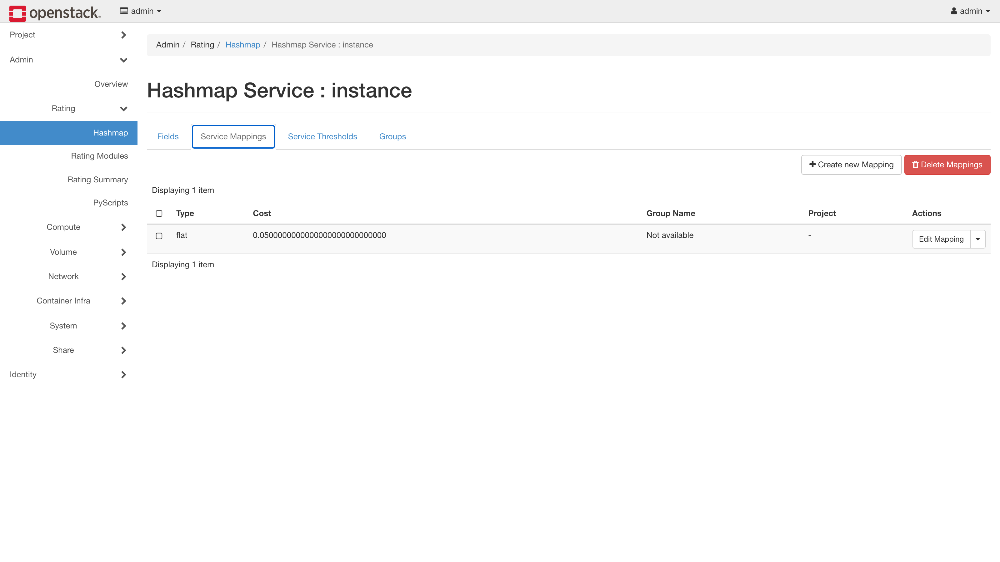
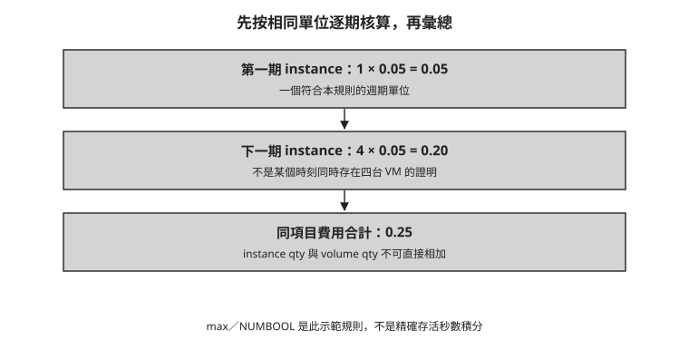
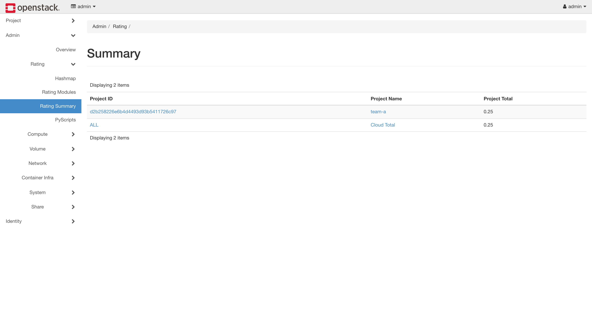

# Day 30: 計算租戶費用——選取專案、套用費率與逐期核對

{ align=right width="100" }

Prometheus 查得到 team-a 的用量，費用摘要卻一直是 0。你可能先懷疑費率設錯，其實也可能根本沒有專案被選進計算。這一章部署 CloudKitty，沿著「選專案、取用量、套費率、存結果」逐段查驗。讀完之後，你能找到零費用出在哪個階段，也能把結果對回同一租戶、同一週期與同一計費項目。

## 先分清楚費用計算與完整帳務

CloudKitty 做的是 **rating**：依規則把用量轉成費用資料。它不會因此替你完成付款、發票、稅務、退款或對帳爭議處理。本章的 `$0.05` 等數值是示範費率，不代表實際貨幣或市場報價。

需要 Day 21 的 Prometheus／OpenSearch、Day 28 的計量，以及 Day 27 的兩個專案。以管理員身分操作設定；先清除 application credential 與 `OS_SYSTEM_SCOPE` 殘留，再載入管理員 openrc。CLI 命令在已安裝 OpenStack 工具的虛擬環境執行，`10.0.0.4`、inventory 與 UUID 需換成自己的值。

下圖把處理過程分成四段。**Fetcher** 決定要處理哪些專案，**collector** 取回用量，**rating module** 套費率，**storage** 保存結果。



四段都設定好才會得到有意義的金額。容器健康不代表專案清單非空，也不代表已啟用計價模組。

## 步驟 1：部署 collector 與 storage {#step-1}

本章使用 Prometheus collector、OpenSearch storage。明確指定後端，避免沿用套件的 Gnocchi 預設：

```bash
sudo tee -a /etc/kolla/globals.yml << 'EOF'
# Day 30: CloudKitty 計費(prometheus collector + 重用 Day 21 的 OpenSearch)
enable_cloudkitty: "yes"
cloudkitty_collector_backend: "prometheus"
cloudkitty_storage_backend: "opensearch"
EOF
source ~/kolla-venv/bin/activate
kolla-ansible deploy -i ~/all-in-one --tags cloudkitty
```

```text
PLAY RECAP: ok=26  changed=16  failed=0
```

本課 Kolla 模板能帶入既有服務位址與 Prometheus 認證，相關段落是：

```jinja
[collector_prometheus]
prometheus_url = {{ cloudkitty_prometheus_url }}
prometheus_user = admin
prometheus_password = {{ prometheus_password }}
```

這與 Day 29 的 Aodh 整合不同：CloudKitty 有專用帳密設定。部署後仍要查實際產生的設定與連線結果，不能只依同屬 OpenStack 就假設設定方式一致。

## 步驟 2：決定收哪些指標、如何解讀

先從 `/etc/kolla/passwords.yml` 讀取自己的 `prometheus_password` 並設定 shell 變數 `PW`，沿用 Day 28 的方式；不要假設換終端機後仍保留變數。查看來源有哪些指標：

```bash
curl -s -u admin:$PW --get http://10.0.0.4:9091/api/v1/query \
  --data-urlencode 'query={job="openstack-telemetry"}'
```

```text
power_state             4 條序列      ← 機器存在 = 計費主軸
volume_size             4 條序列      ← 儲存 GB
cpu                     4 條序列
memory_usage            4 條序列
network_incoming_bytes  4 條序列
...
```

本章挑 `power_state` 與 `volume_size`，映射成計費項目 `instance` 與 `volume`。Kolla 沒提供這條 Prometheus 路線所需的完整 `metrics.yml`，需自行寫入：

```bash
sudo mkdir -p /etc/kolla/config/cloudkitty
sudo tee /etc/kolla/config/cloudkitty/metrics.yml << 'EOF'
metrics:

  # 機器時數:power_state 開機中為 1,NUMBOOL 把任何非零轉成 1
  power_state:
    unit: instance
    alt_name: instance
    groupby:
      - project_id
      - resource_id
    mutate: NUMBOOL
    extra_args:
      aggregation_method: max

  # 儲存:volume_size 單位已是 GiB
  volume_size:
    unit: GiB
    alt_name: volume
    groupby:
      - project_id
      - resource_id
    extra_args:
      aggregation_method: max
EOF
```

`alt_name` 是套費率時使用的名稱；`groupby` 保留 project/resource，避免把不同專案或資源合在一起。`unit` 是記錄給人看的單位名稱，不會自動換算數值。

### 這份規則究竟算什麼

`NUMBOOL` 會把非零值轉為 1，並不是「只接受開機狀態 1」。其他非零 power-state 也可能算入。因此這個示範不能直接宣稱是只對 RUNNING 秒數收費；正式規則要先決定哪些狀態應計費，再依資料模型篩選或映射。

Collector 產生的查詢形狀如下：

```promql
max(max_over_time(power_state{project_id="<租戶>"}[3600s])) by (resource_id, project_id)
```

它對每個 resource/project 取窗口中的最大值，之後才做 NUMBOOL。只要窗口內符合非零條件，就可能計一個週期單位；這不是按精確存活秒數比例計算。例如只存在部分小時的 VM，也可能被這份規則計成一個小時週期。

而 Day 28 的 Pushgateway 仍可能曝露已刪 VM 的舊值，每次 scrape 都形成新樣本。`max_over_time` 不會自動排除這些資源，所以這份練習尚未驗證資源刪除後一定停止計費。

### 使用實際 collector 的 schema 驗證

在已載入 `cloudkitty.conf` 的容器內驗證，才能使用 Prometheus 的 schema：

```bash
sudo docker cp /etc/kolla/config/cloudkitty/metrics.yml cloudkitty_api:/tmp/m.yml
sudo docker exec cloudkitty_api python3 -c "
import yaml
from cloudkitty import collector
from oslo_config import cfg
cfg.CONF(['--config-file','/etc/cloudkitty/cloudkitty.conf'], project='cloudkitty')
print('生效的 collector =', cfg.CONF.collect.collector)
for k,v in collector.validate_conf(yaml.safe_load(open('/tmp/m.yml'))).items():
    print('✅', k, '| groupby =', v.get('groupby'))
"
```

```text
生效的 collector = prometheus
✅ power_state@#instance | groupby = ['resource_id', 'project_id']
✅ volume_size@#volume | groupby = ['resource_id', 'project_id']
```

結果顯示 collector 是 prometheus，且兩項規則通過結構驗證。若環境錯用 Gnocchi 預設，會出現不相關的必填欄位錯誤：

```text
❌ required key not provided @ data['extra_args']['resource_type']
```

結構驗證通過仍不等於費用語意正確。確認規則符合預期後，重新執行 `kolla-ansible deploy -i ~/all-in-one --tags cloudkitty` 套用。

## 步驟 3：啟用 hashmap 並設定費率

**Hashmap** 模組把選定的服務或屬性對到費率。先看模組狀態：

```bash
pip install python-cloudkittyclient
openstack rating module list
```

```text
hashmap    False
noop       True
pyscripts  False
```

本課預設只開 noop，它不計價。啟用 hashmap，再建立與 `alt_name` 同名的服務：

```bash
openstack rating module enable hashmap
IID=$(openstack rating hashmap service create instance -f value -c "Service ID")
VID=$(openstack rating hashmap service create volume -f value -c "Service ID")
```

接著建立 flat 費率。這裡的示範是每個一小時週期的 instance 單位 0.05、GiB 單位 0.01；若改 `period`，必須重新確認費率及週期單位，不能直接沿用「每小時」的解讀。

本課 CLI 與 API 有參數不相容，使用 API 建立：

```bash
TOKEN=$(openstack token issue -f value -c id)
CK=http://10.0.0.4:8889
for pair in "$IID:0.05" "$VID:0.01"; do
  curl -s -X POST "$CK/v1/rating/module_config/hashmap/mappings" \
    -H "X-Auth-Token: $TOKEN" -H "Content-Type: application/json" \
    -d "{\"service_id\":\"${pair%:*}\",\"type\":\"flat\",\"cost\":\"${pair#*:}\"}"
done
```

```text
✅ cost= 0.0500000000000000000000000000 | type= flat
✅ cost= 0.0100000000000000000000000000 | type= flat
```

回傳值顯示兩筆 mapping 已建立。若 token 過期，重新取得；`CK` 也要使用自己的 CloudKitty endpoint。



Horizon 的 Service Mappings 頁也可檢查同一筆設定。API 與畫面要對到同一個服務名稱，不要重複建立 mapping 來處理查不到的情況。

## 步驟 4：選出要計算費用的專案

有用量與費率，摘要仍可能是零：

```bash
curl -s -H "X-Auth-Token: $TOKEN" "$CK/v2/summary"
```

```text
{"results": [["2026-07-01T00:00:00+00:00", "2026-08-01T00:00:00+00:00", 0.0, 0.0]]}
```

先看 processor 的 fetcher 日誌：

```text
DEBUG cloudkitty.fetcher.keystone  Number of tenants to rate : 0
```

`Number of tenants to rate : 0` 表示它沒有選中任何專案。這個 fetcher 預設要求 cloudkitty 服務使用者在該專案有 `rating` 角色。以管理員確認服務使用者 ID，再替本章 domain 下兩個專案指派：

```bash
CKUSER=$(openstack user show cloudkitty -f value -c id)
for P in team-a team-b; do
  openstack role add --user $CKUSER --project "$P" --project-domain day27-corp rating
done
sudo docker restart cloudkitty_processor
```

上面的 restart 是讓本課練習立即重新讀取專案清單；正式環境要配合處理中的工作安排重啟。重新處理後，原紀錄選到兩個專案：

```text
Number of tenants to rate : 2
```

這只確認選取範圍，不表示它們都有可計價資料。

## 步驟 5：按週期、專案與項目核對

**Period** 是收集／計價的週期，本課是 3600 秒。**Wait periods** 預設為 2，讓近期資料先等待兩個週期再處理；實際看見結果的延遲還受週期邊界、處理進度與補算影響，不是精確固定兩小時。

先查按 project 分組的摘要：

```bash
curl -s -H "X-Auth-Token: $TOKEN" "$CK/v2/summary?groupby=project_id"
```

```text
{"columns": ["begin", "end", "qty", "rate", "project_id"],
 "results": [["2026-07-01T00:00:00+00:00", "2026-08-01T00:00:00+00:00",
              5.0, 0.2500000037252903, "d2b258226e6b4d4493d93b5411726c97"]]}
```

原紀錄中 team-a 的 instance 數量合計 5，費用約 0.25。摘要是區間總和，要再看 `/v2/dataframes` 的每個週期，不能拿單一時刻的 VM 台數直接比：

| 原紀錄的週期 | instance 數量 | 套用費率 | 結果 |
|---|---:|---:|---:|
| 第一個小時 | 1 | 0.05 | 0.05 |
| 下一個小時 | 4 | 0.05 | 0.20 |
| 合計 | 5 個週期單位 | | 0.25 |

這裡的 4 是該窗口查詢得到的資源數，不等於同時有四台 VM，也不能證明每台都執行滿一小時。請先看懂本章 max／NUMBOOL 規則，再解讀它和實際執行時間的差別。

圖中刻意把每期數量與費率配在一起，最後才相加：



`instance` 與 `volume` 的 qty 單位不同，不可把兩者的數量直接相加。費用可以按同一幣值規則彙總，但仍須能拆回來源資料。

### 兩個專案與儲存項目的既有結果

後續保存的核對結果同時包含兩個專案及 volume：

| 專案 | 項目 | 原紀錄用量 | 費率 | 金額 |
|---|---|---:|---:|---:|
| team-a | instance | 13 個一小時週期單位 | 0.05 | 0.65 |
| team-a | volume | 10 GiB 週期單位 | 0.01 | 0.10 |
| team-b | instance | 2 個一小時週期單位 | 0.05 | 0.10 |
| team-b | volume | 6 GiB 週期單位 | 0.01 | 0.06 |

team-a 合計 0.75、team-b 合計 0.16，四筆都能按費率核算。這支持這些樣本的分組與乘法結果，不足以證明完整租戶隔離、所有計費狀態或刪除同步都正確。原紀錄沒有留下這段補驗建立各資源的完整命令，這裡保留結果，沒有補造可直接重跑的輸出。

## 用 Horizon 核對畫面

只部署 CloudKitty 不會更新 Horizon。先部署其面板設定：

```bash
kolla-ansible deploy -i ~/all-in-one --tags horizon
```

再打開 Admin → Rating → Rating Summary：



畫面的 project 名稱與費用要對回 API 使用的範圍。Hashmap 頁管理費率，Rating Modules 頁查看模組，Rating Summary 看結果；Project → Rating 則是專案端檢視。本章沒有測完每個角色的資料存取邊界。

## 疑難排解

### Prometheus 有用量，但沒有專案被計算 {#mine-1}

**症狀**：零費用且 fetcher 顯示：

```text
DEBUG cloudkitty.fetcher.keystone  Number of tenants to rate : 0
```

原始碼的篩選條件是：

```python
# cloudkitty/fetcher/keystone.py
if not ignore_rating_role:
    roles = self.admin_ks.roles.list(user=my_user_id, project=tenant)
    if 'rating' not in [role.name for role in roles]:
        tenant_list.remove(tenant)          # ← 沒有 rating 角色 → 直接移除
```

**修法**：依步驟 4 指派 rating 角色；單一專案的原操作如下，已補明確 domain：

```bash
CKUSER=$(openstack user show cloudkitty -f value -c id)
openstack role add --user $CKUSER --project team-a --project-domain day27-corp rating
```

也有 `ignore_rating_role` 設定，但它會改變要處理的範圍，不能只為消除空清單就直接對所有專案啟用。

### 改 Prometheus collector 後仍要求 Gnocchi 欄位 {#mine-2}

**原因**：collector 與 metrics 設定沒有同步，或驗證工具沒載入相同的服務設定。**修法**：依步驟 2 檢查生效的 collector、`metrics.yml` 與 schema，再重新部署。

### 有專案與資料，費用仍為零 {#mine-3}

**原因**：本課預設啟用 noop、未啟用 hashmap，或 alt_name 沒對到有費率的服務。**修法**：先列模組，再核對 service 與 mapping：

```bash
openstack rating module list
```

不要把「沒有可計費專案」與「沒有計價規則」混為同一個問題。

### 改了角色，processor 尚未重新處理 {#mine-4}

本課版本在處理迴圈末尾等待 collect period：

```python
        LOG.debug("Finished processing all storage scopes with worker ...")
        # FIXME(sheeprine): We may cause a drift here
        time.sleep(CONF.collect.period)
```

因此設定更新後可能要等下一輪。實驗中使用重啟讓它重新讀取：

```bash
sudo docker restart cloudkitty_processor
```

```text
14:10:22  Number of tenants to rate : 2
```

這只證明重新選到專案，還要檢查計量 scope（本章按 `project_id` 切分的處理範圍）的進度和待結算週期。不要為了讓畫面立即出數字就隨意縮短 period，因為它也改變計價週期。

全新的 scope 另有補算行為，沒有時間狀態時從當月開始：

```python
# cloudkitty/utils/__init__.py
def check_time_state(timestamp=None, period=0, wait_periods=0):
    if not timestamp:
        return tzutils.get_month_start()
```

因此短暫零費用也可能是尚未處理到有資料的週期。查看進度後再決定是否需要介入。

### mapping create 回 Unknown attribute: name {#mine-5}

以下是在 python-cloudkittyclient 6.1.0 與 CloudKitty 22.0.1 組合的失敗命令：

```bash
openstack rating hashmap mapping create --service-id $IID --type flat 0.05
```

```json
{"faultcode": "Client", "faultstring": "Unknown attribute for argument mapping_data: name",
 "debuginfo": null}  (HTTP 400)
```

**原因**：客戶端送出 API 不接受的 `name`。**修法**：用步驟 3 已驗證的 API 內容或 Horizon 建立；這是此版本組合的問題，不能推成所有 2025.1 安裝都會失敗。查結果時可用 `/v2/scope`、`/v2/dataframes`、`/v2/summary`，並依伺服器支援的 API 參數操作。

## 想一想

- 費用是 0，但 Prometheus 有數字。你會依哪個順序查專案清單、模組、mapping 與處理進度？
- VM 只存在十分鐘，這份 max／NUMBOOL 規則一定會按六分之一小時計算嗎？
- instance 的 qty 是 5，volume 的 qty 是 10，能否宣稱總用量是 15？要怎樣核對才有意義？

## 小結

費用計算先決定處理哪些專案，再決定讀取與轉換哪些用量，最後才套費率。核對時保留專案、資源、週期與項目，才能辨認零費用或數量差異。這份示範驗到機器與儲存樣本的計價結果，仍缺少資源生命週期同步、完整狀態規則與正式帳務流程；有金額並不代表已能正確向客戶收費。

## 延伸閱讀

想再深入，可以從這幾份開始：

- [CloudKitty 2025.1](https://docs.openstack.org/cloudkitty/2025.1/)：rating 與各元件的用途。
- [Collector configuration](https://docs.openstack.org/cloudkitty/2025.1/admin/configuration/collector.html)：NUMBOOL、單位、groupby、period 與 Prometheus 查詢。
- [Hashmap rating module](https://docs.openstack.org/cloudkitty/2025.1/user/rating/hashmap.html)：費率與 mapping。
- [Kolla CloudKitty 指南](https://docs.openstack.org/kolla-ansible/2025.1/reference/rating/cloudkitty-guide.html)：部署設定。

## 下一步

[Day 31](sprint5-day31-masakari-ha.md) 回到多節點環境，用 Masakari 測試 VM 恢復。計算用量之外，還要確認故障後能恢復哪些狀態，以及自動處理之前需要哪些隔離前提。
