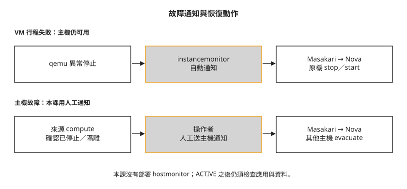
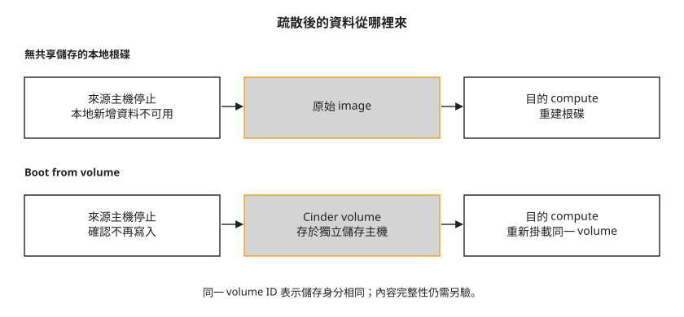

# Day 31：用 Masakari 恢復失敗的 VM

一台 compute 主機無法連線，上面的 VM 也失去回應。把 VM 在別台主機重新啟動之前，先要回答兩件事：來源主機真的停止執行了嗎？原本的磁碟資料還能從哪裡取得？本章回到多節點實驗環境，用 Masakari 觀察行程重啟與主機故障後疏散；讀完能判斷恢復流程的前提，以及 ACTIVE 狀態還沒有證明的事。

## 行程失敗與主機失敗，恢復方式不同

**Masakari** 接收故障通知，再呼叫 Nova 執行恢復。它的 API 收通知，engine 編排後續工作；負責觀察故障的 monitor 則是另一個元件。

**Instancemonitor** 觀察 compute 上的 libvirt 事件。本章第一個實驗是某台 VM 的 qemu 行程異常結束，但主機仍可用；通知送達後，Masakari 在原主機上安排 stop／start。

**Hostmonitor** 用來偵測主機故障，本課沒有部署它，也沒有整合其 Pacemaker／Corosync 前提。第二個實驗在確認主機停止後，由操作者人工送通知，才讓 Masakari 呼叫 Nova **evacuate**：在其他主機重建實例。這不是 Day 24 在正常運作中搬移 VM 的 live migration。



所以本章驗到行程事件的自動通知，以及人工主機通知之後的恢復處理，沒有驗證完整的自動主機故障偵測。

## 疏散之前，要先排除兩台同時執行

**Fencing** 是確認或強制隔離來源主機，使它不能繼續執行或存取共享資料。Nova 顯示主機 `down` 只代表心跳條件不成立，不能證明來源 qemu 已停止；網路中斷時，VM 可能仍在原機執行。

如果這時在別台重新啟動同一份 VM，可能造成雙重執行與共享磁碟同時寫入。本課用 Azure 的 deallocate 停止實驗 compute，並在確認解除配置完成後才送通知。真正改成自動偵測時，仍要設計與驗證 fencing，不能只把「監控報失聯」直接接到 evacuate。

磁碟也影響能保留什麼。沒有共享儲存的本地根碟，可以由原始 image 重建實例，但原機上後來寫入的資料不會因此搬過去。共享根碟或 **boot-from-volume** 的實例則能使用原有儲存，前提是目的主機仍能存取它。



因此 Cinder 不是所有 evacuate 的必要條件；本章加它，是為了觀察同一顆 volume 跨 compute 重新掛載。這個 LVM 後端放在 controller，仍是單點，沒有因為 compute 能疏散就成為高可用儲存。

## 開始之前

需要 Day 23–24 的兩台 controller、三台 compute，以及可用的網路、image、flavor 和目的主機容量。以下 `oslab-ctrl1`、`oslab-comp1` 等是 inventory 名稱，應對應自己的環境；這套多節點環境與 Day 27–30 的單機環境分開。

本課未附完整 loop device 開機掛載 unit、canary VM 建立指令與人工主機通知 payload，以下包含操作與結果摘要。重做前必須補齊這些素材，不能把含省略號的片段當成完整命令，也不能在未確認來源主機隔離時送出恢復通知。

## 步驟 1：先確認控制面可用

先檢查 Galera 與各節點服務。若叢集已是 Primary 且成員正常，不需每次開機都執行資料庫恢復。本課曾在整組關機後無法形成正常叢集，依 Kolla 的資料庫恢復程序執行：

```bash
source ~/kolla-venv/bin/activate
kolla-ansible mariadb-recovery -i ~/multinode
```

以下為當時的 Ansible 摘要及後續 Galera 查詢節錄：

```text
PLAY RECAP:
oslab-ctrl1  : ok=27  changed=5   failed=0
oslab-ctrl2  : ok=31  changed=10  failed=0
```

```text
wsrep_cluster_size    2
wsrep_cluster_status  Primary
```

`Primary` 與預期的兩個成員表示這次叢集形成成功。若仍有不同步或分割情況，要先處理資料庫，不要繼續故障演練。

本課曾出現只有 ctrl1 的多個服務不健康、ctrl2 正常的情況：

```text
ctrl1: neutron_server nova_conductor nova_api nova_scheduler placement_api keystone
ctrl2: (全健康)
```

相關 API log 都出現資料庫連線失敗：

```text
WARNING oslo_db.sqlalchemy.engines SQL connection failed.
```

多個服務共用的資料庫入口是 ProxySQL，所以接著檢查 ctrl1 的代理。本課定位到統計資料庫檔案問題後，移走該檔並重啟，結果如下；只有符合[疑難排解：單一 controller 的多個服務連不上資料庫](#mine-2)時才採用該修法：

```text
proxysql: Up 30 seconds (healthy)
ctrl1 → VIP:3306 ✅ 通了
```

受影響服務重新連線或重啟後，Nova 服務摘要恢復正常：

```text
nova-scheduler oslab-ctrl1 up
nova-conductor oslab-ctrl1 up
nova-compute    oslab-comp1 up / comp2 up / comp3 up
```

這些是開始演練的基本條件，不是應用正常的完整證明。

## 步驟 2：準備獨立於 compute 的 Cinder 根碟

Day 23 的多節點環境沒有 Cinder。本課在 ctrl1 用檔案加 loop device 建立 LVM VG，作為實驗儲存。這是把檔案當區塊裝置的做法，不適合作為正式高可用儲存設計。

下面摘要省略了目錄建立、loop device 掛載及 systemd unit；`/dev/loop7` 是當時已確認的裝置，自己的環境不能直接照抄。必須先確認 loop device 對應到指定檔案且沒有其他資料，再執行會初始化裝置的 PV／VG 指令：

```bash
sudo truncate -s 60G /var/lib/cinder-lvm/cinder-volumes.img
# systemd oneshot 開機把它接成 loop device(檔略)
sudo pvcreate /dev/loop7
sudo vgcreate cinder-volumes /dev/loop7
```

本課建立結果如下：

```text
Physical volume "/dev/loop7" successfully created.
Volume group "cinder-volumes" successfully created
```

把 ctrl1 加入 inventory 的 `[storage]`，在 globals 開啟 Cinder 與 Masakari，並明確關閉尚未整合的 hostmonitor：

```yaml
enable_cinder: "yes"
enable_cinder_backend_lvm: "yes"
enable_masakari: "yes"
enable_masakari_instancemonitor: "yes"
enable_masakari_hostmonitor: "no"
```

## 步驟 3：部署服務，也部署 VIP 前端

使用多節點 inventory，先部署服務角色：

```bash
kolla-ansible deploy -i ~/multinode --tags common,cinder,iscsi,masakari
```

以下是部分容器分布摘要；實際受保護的每台 compute 都要確認 instancemonitor 是否可用，不能只確認 comp1：

```text
ctrl1: masakari_engine, masakari_api
comp1: masakari_instancemonitor
```

接著部署 loadbalancer，讓 VIP 有新服務入口：

```bash
kolla-ansible deploy -i ~/multinode --tags loadbalancer
```

這個步驟不能因 Cinder 容器已經啟動就省略。本課在尚未補前端時曾看到：

```text
Failed to establish a new connection: [Errno 111] Connection refused
(host='10.100.0.250', port=8776)
```

前端配置完成後，Cinder 服務與測試 volume 的結果如下：

```text
cinder-volume oslab-ctrl1@lvm-1 up
volume 狀態: available
```

`available` 只代表該 volume 建立完成；還要以 boot-from-volume 的測試實例確認 compute 能存取儲存。若新服務的 db sync 被拒，再查 ProxySQL 是否載入新帳號，不要把所有資料庫拒絕都視為密碼錯誤。

## 步驟 4：登記恢復群組與測試 VM

Masakari 的 **failover segment** 管理一組主機及其恢復策略。本章選 `auto`；實際目的主機還由 Nova 排程與資源、儲存、網路條件決定，不能只靠 segment 名單就假設容量或相容性足夠。

以下是本課登記三台 compute 的命令；執行環境需已有提供 `openstack segment` 的 Masakari CLI 外掛，本課未留存安裝步驟：

```bash
openstack segment create day31-seg auto COMPUTE
for h in oslab-comp1 oslab-comp2 oslab-comp3; do
  openstack segment host create $h COMPUTE SSH day31-seg
done
openstack segment host list day31-seg
```

主機清單中的 **`on_maintenance`** 表示 Masakari 的維護狀態，這時是 False：

```text
oslab-comp1  False      ← on_maintenance,False = 正常待命
oslab-comp2  False
oslab-comp3  False
```

它不是電源隔離證明，也不能單獨代表 Nova 一定會接受新排程。

本課另準備了可破壞的 `ha-canary` 與 `bfv-canary`，後者從 Cinder volume 開機。建立過程未完整收錄；測試前應先確認所在 compute、磁碟來源與可用容量，並寫入自己能辨認的測試資料，供恢復後比對。以下是替行程實驗的 VM 加 metadata：

```bash
openstack server set --property HA_Enabled=True ha-canary
# 在 comp1 上:sudo kill -9 <qemu-pid>
```

**`HA_Enabled=True`** 是本課恢復策略使用的實例標記。Masakari engine 的 `[instance_failure] process_all_instances` 預設 False，因此只恢復有對應標記的實例；主機故障的範圍由另外的 `[host_failure] evacuate_all_instances` 控制。不要把兩種事件的設定當成同一個開關。

## 步驟 5：分開讀兩次恢復結果 {#step-5}

### VM 行程失敗，原主機仍在

本課終止測試 VM 的 qemu 行程，instancemonitor 收到 libvirt 的異常停止事件後通知 Masakari。破壞性操作只應針對已用 VM UUID 核對的測試行程；不能猜 PID，也不能終止其他租戶的 VM。

以下保留當時的事件順序：

```text
06:50:11  kill qemu PID 20730
06:50:12  notification: {vir_domain_event: STOPPED_FAILED}   ← libvirt 通報
06:50:14  masakari engine → nova stop
06:50:18  masakari engine → nova start
06:50:30  vm=ACTIVE(下一次輪詢確認)
```

重點是 `STOPPED_FAILED` 之後出現 stop／start，最後查到 ACTIVE。這不是正常關機的測試，也不能從這一次時間戳推導恢復時間保證；ACTIVE 仍需搭配連線、檔案與應用檢查。

### compute 停止後，人工通知再疏散

這次要測整台 compute 無法執行 VM，而不是只停一個容器。在自己的可破壞實驗環境，以下為本課對來源 compute 執行的動作；resource group 與 VM 名稱都要先確認：

```bash
az vm deallocate -g <多機RG> -n oslab-comp1     # 停止並解除配置實驗 compute
```

**先確認 Azure 已完成 deallocate，再確認 Nova 對來源主機的狀態。** 本課之後人工送主機失效通知，未提供完整通知命令與 payload，所以不能宣稱照目前片段就完成自動偵測與復原。收到通知後留下的流程摘要如下：

```text
07:09:28  comp1: down                    ← nova 終於判定失聯
07:17:55  lock → evacuate                ← Masakari 的搬家流程
07:18:06  bfv=comp1/REBUILD  ha=comp1/REBUILD
07:18:31  notif=finished  bfv=comp2/ACTIVE  ha=comp2/ACTIVE   ← 在 comp2 復活
```

兩台實例最後都在 comp2 顯示 ACTIVE。Boot-from-volume 的 `volume_id` 保持相同、attachment 改變，表示目的主機重新掛上同一顆 volume；這不等於驗證所有資料原封不動，也沒有證明應用沒有中斷。本地根碟的實例由 image 重建，原機上的新增資料不會隨這個動作恢復。

後續應比較事前寫入的測試資料、檢查應用啟動與實際連線，並確認來源主機重新加入時不會重複啟動舊實例。本課沒有留下完整資料比對與主機重新加入的驗證結果，不能把演練直接視為正式復原程序。

## 疑難排解

### mariadb_recovery 不是有效子命令 {#mine-1}

本課 Kolla 2025.1 使用 `mariadb-recovery`，拼字帶連字號。依目前版本的 help 與官方文件操作；不要只因服務不健康就直接執行 recovery。

### 單一 controller 的多個服務連不上資料庫 {#mine-2}

若 Galera 狀態正常、另一台 controller 也可使用，先查失敗節點的 ProxySQL。這些觀察縮小檢查範圍，仍不足以排除所有資料庫問題。本課的代理狀態是：

```text
proxysql: Exited (134)          ← 134 = SIGABRT,程式自己爆的
policy=no                        ← restart policy 是 no,崩了不會被拉起來
```

當時 crash log 指向讀取 `proxysql_stats.db` 的錯誤，因而採用移走統計檔的處理。這不是通用 SQL 連線修法；先確認該實例已停止、檔案確為統計資料且路徑正確，再保留原檔並重啟：

```bash
sudo mv /var/lib/docker/volumes/proxysql/_data/proxysql_stats.db{,.corrupt}
sudo docker restart proxysql
```

不要移走包含實際設定的資料庫；若沒有同樣的 crash 證據，先查網路、使用者設定與代理 log。

### 新服務 db sync 被 ProxySQL 拒絕 {#mine-3}

本課手動修復代理後，曾出現檔案已更新、執行中的 ProxySQL 卻尚未接受新服務帳號的情況。先比對設定與執行狀態，再依部署方式載入或重啟代理；不能推論 Kolla 每次部署新服務都必然漏掉重啟。處理後重新驗證資料庫連線與服務同步。

### Cinder 已啟動，VIP 的 8776 埠仍拒絕連線 {#mine-4}

檢查 HAProxy 是否已有 Cinder 前端。本課使用服務 tags 後還需套用步驟 3 的 loadbalancer 設定；同類問題也可能發生在有 HAProxy 的單機環境，不是多節點專屬。

### 停 Docker 後，Nova 仍顯示主機 up {#mine-5}

本課曾因 systemd 重啟 `nova_compute`，或 Docker live-restore 讓容器繼續執行，而無法用停止管理元件模擬主機故障。應確認測試真正停掉的是哪一層，不代表軟體永遠不能停止主機。

以下是當時 deallocate 的縮寫；省略號不是合法參數，請以步驟 5 的完整參數形式核對自己的資源：

```bash
az vm deallocate ... oslab-comp1
```

### 重送主機通知回 already under maintenance {#mine-6}

恢復流程失敗後可能留下 `on_maintenance=True`，再次送通知因而被拒。先查原通知、工作狀態、來源主機隔離及目的實例是否已建立，排除仍在執行或重複恢復，再決定是否清除標記重試。本課使用過：

```bash
openstack segment host update day31-seg oslab-comp1 --on_maintenance False
```

這只改 Masakari 的維護狀態，不會完成 fencing，也不應當成強迫任何失敗流程繼續的方法。

### VM 異常停止後沒有執行恢復 {#mine-7}

先查 libvirt 事件、monitor 是否送出通知，再看 Masakari 的實例恢復設定與 metadata。預設 `process_all_instances=False` 時，缺少 `HA_Enabled=True` 會排除該實例；限制來自恢復策略，不是看到 monitor 容器就代表所有 VM 都會重啟。

## 想一想

- Nova 顯示來源主機 down，但來源 VM 可能仍能存取共享儲存。這時能立即 evacuate 嗎？還缺哪個前提？
- 本地根碟與 boot-from-volume 的 VM 都回 ACTIVE，為什麼兩者保留的資料可能不同？同一個 volume ID 又能證明到哪裡？
- 行程故障自動重啟成功，能不能推論整台主機故障也會自動被偵測？本章主機通知由誰發出？

## 小結

Masakari 將故障通知接到 Nova 的恢復動作；行程仍有可用主機時可以原機重啟，整台 compute 停止時則需要疏散。這次主機演練用人工通知，並先以 deallocate 確認來源停止。恢復能否保留資料，取決於儲存來源與隔離條件；VM 回 ACTIVE 後仍須確認應用、資料與來源主機重新加入的安全條件。

## 延伸閱讀

想再深入，可以從這幾份開始：

- [Kolla-Ansible 2025.1 Masakari 指南](https://docs.openstack.org/kolla-ansible/2025.1/reference/compute/masakari-guide.html)：API、engine 與 monitor 開關。
- [Masakari 2025.1 設定參考](https://docs.openstack.org/masakari/2025.1/configuration/config.html)：實例與主機故障的恢復範圍。
- [Nova 2025.1 evacuate 指南](https://docs.openstack.org/nova/2025.1/admin/evacuate.html)：來源主機停止、從 image／volume 重建與共享儲存條件。
- [ProxySQL 文件](https://proxysql.com/documentation/)：代理設定與統計資料的管理。

## 下一步

[Day 32](sprint5-day32-full-tls.md) 回到單機環境，為 API 的 VIP 入口啟用 TLS，並檢查改址後的用戶端信任與手動覆寫設定。
