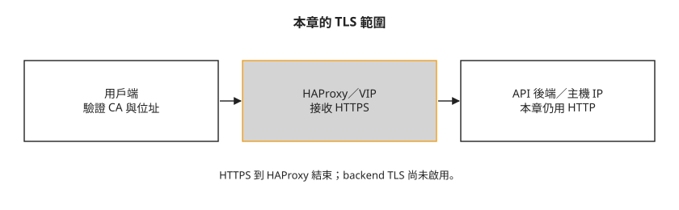

# Day 32：替 API 入口啟用 TLS

同事準備從另一台電腦操作這朵雲，卻發現認證位址仍是 `http://`。帳號密碼與 token 會經過網路，接下來要讓用戶端驗證伺服器身分，並加密這段連線。本章回到單機環境，為 API 的 VIP 入口啟用 TLS；讀完能區分入口位址、後端服務與 CA 信任造成的連線問題。

## 先確認加密到哪裡

**TLS** 是保護傳輸內容並驗證連線對象的協定。本課採用 **TLS 終結**：用戶端與 HAProxy 建立加密連線，HAProxy 解密後再轉給 API 服務。前面的 Day 23 已看過 HAProxy 轉送請求，這次多了憑證與加密工作。



圖中的兩段連線要分開看。本章打開 internal／external VIP 的 TLS，沒有打開 `kolla_enable_tls_backend`，因此不代表後端、RabbitMQ、資料庫或 VM 流量也已加密。兩個入口開關如下：

```yaml
kolla_enable_tls_internal: "yes"
kolla_enable_tls_external: "yes"
```

**開始前需要** Day 1–22 的單機環境、Day 15 的 RGW，以及 Day 27 的額度設定。Day 31 的多節點故障演練是另一套環境；不要把這裡的單機位址直接套進去。以下 `10.0.0.4` 是實驗主機、`10.0.0.250` 是預留的 API VIP，必須換成自己網段中已配置的位址。

本章保留了設定與結果摘要，但沒有完整 Azure 網卡參數、VIP 持久化 service 檔及所有用戶端遷移步驟。可以用它理解變更與檢查順序；要重做前，須依官方文件補齊這些設定，不能直接執行含 `...` 的摘要。

## 步驟 1：讓 VIP 與主機位址分開

Day 1 的單機配置關閉 HAProxy，API 直接使用主機 IP。以下是要調整的原有設定：

```yaml
enable_haproxy: "no"
enable_proxysql: "no"
kolla_internal_vip_address: "10.0.0.4"    # 主機 IP
```

現在 HAProxy 要在 VIP 接收連線，API 容器則仍使用主機位址。Azure 網卡先登記 secondary private IP，Linux 介面也要有這個位址。Azure 這行省略了 resource group、NIC 名稱與 IP configuration 名稱，不能原樣執行：

```bash
# Azure 層:給網卡加一個 secondary private IP
az network nic ip-config create ... --private-ip-address 10.0.0.250
```

登記完成後，以下是當時加入 Linux 介面的動作；`eth0` 必須對應自己的 API 介面，且此命令本身不會跨重開機保存：

```bash
# OS 層:把 10.0.0.250 接上 eth0
sudo ip addr add 10.0.0.250/32 dev eth0
```

加入後要確認主機名稱仍解析到主 IP，Ansible 的 `api_interface` 位址也仍是主 IP。若 prechecks 出現 `Hostname has to resolve uniquely to the IP address of api_interface`，核對主機名稱解析、介面主要位址與 Ansible facts 是否一致。預期的配置關係如下：

```text
inet 10.0.0.4/24   metric 100 ... eth0     ← 主
inet 10.0.0.250/32 ...          eth0       ← 次要
ansible fact address: 10.0.0.4             ← 對了
```

本課用開機後執行的 systemd oneshot 保留次要位址，但未附完整 unit。若自行改用 Netplan，需檢查位址順序與 Ansible facts，不能假定任何 Netplan 配置都會選錯主 IP。

## 步驟 2：替 HAProxy 準備後端與入口

RGW 在 Day 15 由 cephadm 管理，原先監聽所有本機位址的 `7480` 埠。HAProxy 現在要使用 VIP 的同一個埠，RGW 得改成只監聽主機 IP。以下在可使用 Ceph 管理命令的 cephadm shell 執行；`<daemon>` 必須換成實際 RGW daemon 識別名稱，不能保留括號：

```bash
ceph config set client.rgw.<daemon> rgw_frontends 'beast endpoint=10.0.0.4:7480'
ceph orch restart rgw.kolla
```

這是本課使用的 daemon 級設定；改完要確認實際監聽位址。daemon 名稱與設定層級不同時，不能只根據重啟成功就認定綁定已改。

在 `/etc/kolla/globals.yml` 啟用 `enable_ceph_rgw_loadbalancer`，並列出 HAProxy 要轉送的 RGW 後端。這段的 `host`、`ip` 必須對應目前 RGW 主機：

```yaml
ceph_rgw_hosts:
  - host: openstack-lab
    ip: 10.0.0.4
    port: 7480
```

接著調整 VIP、HAProxy 與 TLS。ProxySQL 是此部署的資料庫代理設定，不是所有 TLS 部署都必須採用的加密元件。

Day 15 在 `/etc/kolla/globals.yml` 把兩個 RGW FQDN 寫成主機 IP；只改 `kolla_internal_vip_address` 不會覆蓋這些值。依 [Kolla-Ansible 的 RGW 設定](https://docs.openstack.org/kolla-ansible/2025.1/reference/storage/external-ceph-guide.html#keystone-integration)，`ceph_rgw_internal_fqdn` 與 `ceph_rgw_external_fqdn` 分別決定 internal 與 public endpoint 的主機位址。沿用本章 VIP 時，應將原有設定改為 `ceph_rgw_internal_fqdn: "10.0.0.250"` 與 `ceph_rgw_external_fqdn: "10.0.0.250"`。修正後的寫法本課沒有實跑。

`kolla_copy_ca_into_containers` 會把 CA 憑證放入服務容器的信任庫；它不會自動讓每一支外部 CLI 都信任 CA。**CA bundle** 是受信任 CA 憑證集合。使用 Ubuntu 容器時，依[官方 TLS 指南](https://docs.openstack.org/kolla-ansible/2025.1/admin/tls.html#quick-start)，還要在 `/etc/kolla/globals.yml` 補上 `openstack_cacert: /etc/ssl/certs/ca-certificates.crt`，讓服務使用容器內的信任庫。修正後的寫法本課沒有實跑。

以下保留原有設定節錄：

```yaml
kolla_internal_vip_address: "10.0.0.250"     # 從主機 IP 改成 VIP
enable_haproxy: "yes"                         # 啟用 HAProxy
enable_proxysql: "yes"
kolla_enable_tls_internal: "yes"
kolla_enable_tls_external: "yes"
kolla_copy_ca_into_containers: "yes"          # 讓容器信任自簽 CA
```

## 步驟 3：準備憑證與用戶端信任

**CA** 是簽發憑證的機構或管理系統。用戶端信任 CA，才能驗證伺服器出示的憑證；憑證中的名稱或 IP 也必須符合實際連線位址。

Kolla 提供測試憑證產生工具：

```bash
kolla-ansible certificates -i ~/all-in-one
```

本課憑證資訊節錄如下。`issuer` 是簽發者，`notAfter` 是有效期限，自己的憑證要另行確認：

```text
subject=C = US, ST = NC, L = RTP, OU = kolla
issuer=CN = KollaTestCA
notBefore=Jul 16 08:05:09 2026 GMT
notAfter =Jul 16 08:05:09 2027 GMT
```

`KollaTestCA` 是 Kolla 產生的簡易測試 CA，官方不建議用在正式部署。**私有 PKI** 是組織管理憑證簽發、更新與撤銷的制度與工具。公司管理的私有 PKI 可以用於正式環境；問題不是「私有 CA 一律不能用」，而是要具備受控的簽發、金鑰保護、輪替與信任散布流程。

CLI 的 openrc 另外需要 CA 路徑，先在 globals 設定：

```yaml
kolla_admin_openrc_cacert: "{{ kolla_certificates_dir }}/ca/root.crt"
```

這個路徑必須在執行 CLI 的電腦上存在。把 openrc 複製到別台電腦時，也要安全地提供公開 CA 憑證；不要複製 CA 私鑰。

## 步驟 4：更新手動覆寫，再檢查與部署

Day 27 的 Nova `[oslo_limit]` 會呼叫 Keystone 查額度。若這段手動設定仍指向舊 HTTP 位址，入口改址後就會失敗。在原本的 Nova 設定覆寫中更新它：

```ini
[oslo_limit]
auth_url = https://10.0.0.250:5000/v3
cafile = /etc/ssl/certs/ca-certificates.crt
```

`cafile` 是 Nova 容器內的信任庫路徑，要確認新 CA 已放進該容器。這類手動覆寫不會因為 globals 的 VIP 改變就自動改好。

設定備妥後，依 Day 22 的順序執行全量 `prechecks`、`deploy`、`post-deploy`，使用單機 inventory。遇到錯誤先修正再繼續；本課完成時的摘要如下，數量只對應當時環境：

```text
=== prechecks ===
localhost  : ok=142  failed=0
=== 全量 deploy ===
localhost  : ok=872  changed=342  failed=0
=== post-deploy(重產 openrc)===
localhost  : ok=10   changed=6    failed=0
```

`failed=0` 表示這幾次 Ansible 作業沒有回報失敗，接下來仍須檢查用戶端與服務操作。

## 步驟 5：用新入口認證，再確認既有功能

部署完成後，沿用 Day 15 的指令載入 openrc 並查詢 object-store 入口：

```bash
source /etc/kolla/admin-openrc.sh
openstack endpoint list --service object-store -f value -c Interface -c URL
```

檢查 internal 與 public 的 URL 是否都使用 HTTPS，主機位址是否為本章的 VIP `10.0.0.250`，埠與路徑是否仍為 `7480/swift/v1`。若仍指向 `10.0.0.4`，回查步驟 2 的兩個 RGW FQDN 設定；這裡未附修正後的查詢輸出。

`post-deploy` 重新產生的 openrc 應包含新的認證位址：

```text
export OS_AUTH_URL='https://10.0.0.250:5000'
```

若用戶端尚未信任 CA，會看到：

```text
SSLError: certificate verify failed: unable to get local issuer certificate
```

重新載入包含 `OS_CACERT` 的 openrc 後，本課可查到 Keystone 的兩個 HTTPS 入口：

```text
export OS_CACERT='/etc/kolla/certificates/ca/root.crt'
openstack endpoint list --service identity
  public   https://10.0.0.250:5000
  internal https://10.0.0.250:5000
```

這只能證明這次認證與 endpoint 查詢成功。下一步還要檢查 Nova 的額度查詢、儲存與 UI，因為它們可能保留不同設定。例如未更新 `[oslo_limit]` 時會出現：

```text
HttpException: 500 ... Unexpected API Error
nova-api log: The identity service for 10.0.0.4:None exists but does not
              have any supported versions.
```

以下為本課操作摘要，包含核心讀取、UI 與 Swift 檔案往返：

```text
--- 容器 ---  總數 91 | 不健康:(無)
--- endpoints 還有非 https 的嗎 ---  (只剩 prometheus 後端,見下)
--- 核心讀操作 ---  server/volume/network/image/container list 全部正常
--- UI ---  Skyline https://…:9999 → 200 | Horizon http → 301 轉 https
--- Swift 往返 ---  上傳下載,hello-rgw.txt 原樣取回
```

容器健康與 list 成功是初步檢查，不代表所有寫入或整合都已驗證。Prometheus catalog 中保留的 HTTP 位址是當時的後端位址；走那個位址的用戶端仍使用 HTTP，不能因為另外有 HTTPS 前端就視為加密。要使用 TLS，必須讓用戶端實際連到已驗證的 HTTPS 入口。

**Magnum／CAPI 沒有在本章重測。** 仍保留 Day 8 cluster 時，應盤點管理叢集的 CAPO 設定、workload cluster 的 CCM／Cinder CSI 設定，以及 Magnum 的服務與 trustee 認證。更新目的位址之外，還要讓各用戶端信任新 CA，再測 LB 與 PVC。本課沒有留下完整遷移步驟，不宣稱那些 cluster 已完成遷移；Day 22 的 Amphora provider 變更也仍須另外處理。

## 疑難排解

### CLI 無法驗證憑證簽發者 {#mine-6}

`unable to get local issuer certificate` 表示用戶端缺少信任鏈。依步驟 3 設定 openrc 的 CA 路徑、重產並載入 openrc；若換電腦執行，確認該檔案也存在。不以關閉驗證當成完成。

## 想一想

- CLI 的 token 查詢成功，Nova 建 VM 卻回舊 Keystone 位址的錯誤。你會查哪一段設定？
- 用戶端到 VIP 是 HTTPS，HAProxy 到 API 是 HTTP。哪一段受到本章保護？要保護後一段，還要研究哪個設定？
- 把 openrc 複製到新電腦後出現憑證錯誤，為什麼只確認伺服器已經部署憑證還不夠？

## 小結

這次變更把 API 入口移到 VIP 上的 HAProxy，為用戶端到入口的連線啟用 TLS。要讓既有服務繼續使用，必須一起核對後端監聽位址、手動覆寫與各用戶端的 CA 信任。完成核心讀取與 Swift 往返後，仍需另外驗證 Magnum／CAPI 等整合，以及尚未啟用的後端加密。

## 延伸閱讀

想再深入，可以從這幾份開始：

- [Kolla-Ansible 2025.1 TLS 指南](https://docs.openstack.org/kolla-ansible/2025.1/admin/tls.html)：VIP 與 backend TLS、CA 信任與測試憑證的設定。
- [Kolla-Ansible 2025.1 外部 Ceph](https://docs.openstack.org/kolla-ansible/2025.1/reference/storage/external-ceph-guide.html)：RGW 後端與 HAProxy 整合。
- [OpenStack 安全通訊指南](https://docs.openstack.org/security-guide/secure-communication.html)：規劃不同通訊區段的保護方式。

## 下一步

[Day 33](sprint5-day33-keycloak-federation.md) 使用 HTTPS 入口與 CA 信任，把外部 IdP 接到 Keystone，分開驗證身分與專案授權。
