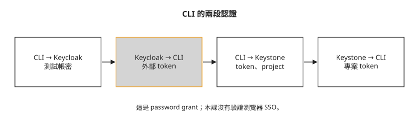
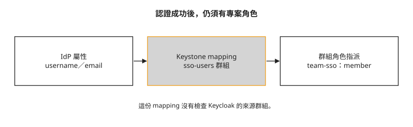

# Day 33：用外部帳號取得 OpenStack 的專案權限

Day 27 的 alice 是 Keystone 資料庫裡的本地帳號，密碼也存在 Keystone。公司通常已經用 Keycloak 這類系統管理員工帳號；要讓同一批人操作 OpenStack，如果再替每個人在 Keystone 建一組密碼，入職要建兩次、離職要刪兩次，漏掉一邊，就會留下一個還能登入的帳號。

**Keystone federation** 讓 Keystone 接受外部身分系統驗證過的結果，不再保存這些人的密碼。驗證交給外部系統之後，Keystone 這邊還要決定一件事：登入的人能使用哪個 project、拿到什麼角色。讀完這章，你能分辨認證、身分映射與專案角色各自負責什麼；CLI 登入失敗時，也知道該先查 Keycloak 還是 Keystone。

## 登入時的兩段請求

Federation 由外部系統確認「這個人是誰」，Keystone 只接收確認後的結果。這個外部系統稱為 **IdP**（identity provider），本章用 Keycloak；Keystone 是接收身分資料、提供服務的一方。兩邊用 **OIDC**（OpenID Connect）溝通：IdP 驗證帳號後簽發 token，token 裡帶著可以驗證真偽的身分資訊。

本章走 CLI 的 `v3oidcpassword` 流程：CLI 先把測試帳號 `carol` 的密碼送給 Keycloak 換 token，再拿這份 token 向 Keystone 認證。下圖把這兩次請求分開畫：



第一段只跟 Keycloak 有關，第二段才進入 Keystone 的映射與角色。CLI 登入失敗時，先判斷卡在哪一段；疑難排解最後一項就是照這個切法查。

這種由用戶端直接拿帳號密碼換 token 的方式叫 **password grant**，Keycloak 稱為 Direct Grant，OAuth 規格裡叫 ROPC。Keystone 不保存 carol 的密碼，但 CLI 仍然經手密碼，Keycloak 官方不建議採用，見 [Keycloak 的 OIDC 流程說明](https://www.keycloak.org/securing-apps/oidc-layers)。本章用它，是因為一條 CLI 指令就能走完兩段請求，方便把注意力放在 Keystone 這一側。讓使用者從 Horizon 或 Skyline 用瀏覽器登入一次、就能使用多個服務的 SSO（單一登入），要另外設定，本章不涵蓋。

## 開始之前

你需要 Day 32 的 HTTPS Keystone 入口與 CA 信任，以及 Day 27 介紹過的 domain、project 與 role。指令裡的 `10.0.0.4` 是 Keycloak 所在的實驗主機，`10.0.0.250` 是 Day 32 的 Keystone API 位址，照自己的環境替換。

這章練的是看懂 Keystone federation 的設定與結果。Keycloak 的憑證與啟動參數、管理員登入、metadata 檔內容與 CLI 的 OIDC 端點缺完整寫法，所以標成「設定走讀」與「結果判讀」的各節只能看懂設定、判讀結果，可以照打的是替群組授予角色那一步，前提是 Kolla 的 federation 部署已經建好 `day33-sso` domain；要從頭部署，請搭配章末的 Kolla-Ansible Keystone 指南與 Keycloak 文件。

## 設定走讀：讓 Keystone 能驗證 Keycloak 的 HTTPS

Keystone 自己不處理 OIDC。它前面的 Apache 載入 **`mod_auth_openidc`** 模組，由這個模組跟 IdP 溝通。IdP 用 HTTP 位址接上時，Keystone 啟動會出現 Apache 設定錯誤，錯誤訊息指向 IdP 的 HTTP URL；Keycloak 改走 HTTPS 之後才通過。所以先讓 Keycloak 走 HTTPS，憑證也要讓 Keystone 驗證得過，之後才接 federation 設定。錯誤的完整內容見疑難排解的[第一項](#mine-1)。

Keycloak 以容器執行，用 `quay.io/keycloak/keycloak:26.0` 映像檔的 `start-dev` 開發模式。用 Day 32 的測試 CA（`KollaTestCA`）簽一張 Keycloak 憑證，再讓 Keycloak 在 8443 port 提供 HTTPS：

!!! note "只保留關鍵片段"
    省略了 CSR 與私鑰的產生、SAN、有效期限，以及 `start-dev` 前面的容器啟動與掛載參數，不能直接執行；完整寫法見 [Keycloak 的 TLS 設定](https://www.keycloak.org/server/enabletls)。

```bash
# 用 Day 32 的 KollaTestCA 簽一張 Keycloak 憑證
openssl x509 -req -in keycloak.csr -CA root.crt -CAkey root.key ...
# Keycloak 改用 https:8443 對外
... start-dev --https-certificate-file=... --https-port=8443
```

往下設定 federation 之前，先確認 Keycloak 的 HTTPS 能用 CA 驗證通過：

!!! note "只保留關鍵片段"
    下面這行是 HTTPS 與 CA 檢查的結果摘要，不是上面 `start-dev` 的輸出；檢查用的指令沒有保留。

```text
✅ Keycloak https + CA 驗證通過
```

Keycloak 不一定要跟 Keystone 用同一個 CA。條件是憑證上的名稱符合 IdP URL（這裡是 `10.0.0.4`），而且 Keystone 與其他要連 Keycloak 的用戶端都信任它的簽發鏈；這裡用 `KollaTestCA`，是因為 Day 32 已經讓 Keystone 信任它，公司管理的其他 CA 也能滿足這個條件。另外有三樣東西要分清楚：憑證私鑰給 Keycloak 自己提供 HTTPS，CA 憑證讓別人驗證這張伺服器憑證，token 簽章用的公鑰讓 Keystone 驗證 token，三者不能互相替代。

## 設定走讀：在 Keycloak 建 realm、client 與使用者

Keycloak 的 **realm** 是一個獨立管理使用者與登入設定的範圍；**client** 是向這個 realm 申請認證的應用程式，這裡就是 Keystone。這一節建 `day33` realm、登記 `keystone` client，再建測試使用者 `carol`。指令都透過 Keycloak 容器裡的管理工具 `kcadm.sh` 執行：

!!! note "只保留關鍵片段"
    省略了 `kcadm.sh` 的管理員登入，以及 client secret 與密碼（`...`），`<carol>` 要換成 carol 在 Keycloak 的使用者 ID，不能直接執行；登入與查詢使用者 ID 的寫法見 [Keycloak Admin CLI 文件](https://www.keycloak.org/docs/latest/server_admin/index.html#admin-cli)。

```bash
K="docker exec keycloak /opt/keycloak/bin/kcadm.sh"
$K create realms -s realm=day33 -s enabled=true
$K create clients -r day33 -s clientId=keystone \
  -s 'redirectUris=["https://10.0.0.250:5000/redirect_uri"]' \
  -s secret=... -s directAccessGrantsEnabled=true
$K create users -r day33 -s username=carol -s enabled=true \
  -s email=carol@example.com -s firstName=Carol -s lastName=Sso
$K set-password -r day33 --userid <carol> --new-password ...
```

client 上有兩個設定跟登入方式有關。`redirectUris` 是瀏覽器登入流程結束時，Keycloak 允許導回的位址，這裡填 Day 32 的 Keystone HTTPS 端點；本章的 CLI 流程不經過瀏覽器，用不到它。`directAccessGrantsEnabled=true` 打開 password grant，CLI 的 `v3oidcpassword` 靠它才能拿帳密換 token。改走瀏覽器 SSO 時，Keycloak 建議的是授權碼流程（authorization code），這個開關就用不到。

建 carol 時，`firstName`、`lastName` 不能省。這個 realm 的 user profile 把它們列為必填，少了它們，carol 的帳號會被當成還沒設定完成，向 Keycloak 換 token 只會拿到 `invalid_grant`。換成自己的 realm 時，先查 user profile 有哪些必填欄位。

`start-dev` 把 realm、client 與使用者存在容器內的資料庫，刪掉容器（`docker rm`）就全部消失，必須重新建立。練習環境這樣就夠；要長期使用，改用正式模式並接外部資料庫，見 [Keycloak 的資料庫設定](https://www.keycloak.org/server/db)。

## 設定走讀：把外部身分映射成 Keystone 群組

這一節練習讀懂 mapping 規則與 Kolla 的 federation 設定。Kolla 設定的完整欄位與三個 metadata 檔的內容，要照章末的 Kolla-Ansible Keystone 指南自己補上。

IdP 簽發的 token 裡帶著身分屬性，稱為 **claim**，例如使用者名稱與 email。**Mapping** 是 Keystone 把這些屬性轉成本地使用者與群組的規則。本章的規則如下：

```json
[{
  "local": [{
    "user": {"name": "{0}", "email": "{1}"},
    "group": {"name": "sso-users", "domain": {"name": "day33-sso"}}
  }],
  "remote": [{"type": "OIDC-preferred_username"}, {"type": "OIDC-email"}]
}]
```

`remote` 依序取出 username 與 email，`{0}`、`{1}` 分別放回 `local.user` 的 name 與 email。`local.group` 指定 Keystone 裡 `day33-sso` domain 下的 `sso-users` 群組，所有符合規則的登入者都會成為這個群組的成員。

這份規則沒有比對任何群組或部門：只要通過 Keycloak 驗證、token 裡帶得出 username 與 email，就會進 `sso-users`。要只讓某個部門登入，得讓 Keycloak 把群組資訊放進 token，再在 `remote` 加上比對 claim 值的條件，規則寫法見 [Keystone 的 mapping 組合說明](https://docs.openstack.org/keystone/2025.1/admin/federation/mapping_combinations.html)。

下圖把 carol 的身分屬性一路畫到專案權限：



前半段的 mapping 只決定 carol 屬於 `sso-users`；後半段的群組角色指派才決定她能在 `team-sso` 做事，這是下一個步驟要建的部分。

**Protocol** 是 Keystone 中連結 IdP 與 mapping 的物件，指定從這個 IdP 來的登入要套用哪份映射規則。本章以 `openid` 連結 `keycloak` 與 `keycloak_mapping`，見 [Keystone 的 Create a Protocol 說明](https://docs.openstack.org/keystone/2025.1/admin/federation/configure_federation.html#create-a-protocol)。在 Kolla 裡，IdP、protocol 與 mapping 都寫進 `globals.yml`：

!!! note "只保留關鍵片段"
    省略了 `attribute_mapping`、metadata 目錄等欄位（`...`），mapping 檔路徑也只留檔名，不能直接使用；完整欄位見 [Kolla-Ansible 2025.1 Keystone 指南](https://docs.openstack.org/kolla-ansible/2025.1/reference/shared-services/keystone-guide.html)。

```yaml
keystone_identity_providers:
  - name: "keycloak"
    openstack_domain: "day33-sso"
    protocol: "openid"
    identifier: "https://10.0.0.4:8443/realms/day33"
    ...
keystone_identity_mappings:
  - name: "keycloak_mapping"
    file: ".../mapping.json"
```

`identifier` 要填 IdP 的 **issuer**，也就是簽發 token 的 IdP 識別值。`mod_auth_openidc` 還需要 IdP 的 **metadata**，內容是 issuer、認證端點與金鑰位置。Kolla 的 metadata 目錄放 `.provider`、`.client` 與 `.conf` 三個 JSON 檔，檔名依 issuer 編碼：

```text
issuer: https://10.0.0.4:8443/realms/day33
檔名  : 10.0.0.4%3A8443%2Frealms%2Fday33.provider (+ .client + .conf)
```

`.provider` 描述 IdP，`.client` 放 client ID 與 secret，`.conf` 放額外選項。CLI 用的端點可能還需要設定 `keystone_federation_oidc_jwks_uri`；JWKS 是 IdP 公開、用來驗證 token 簽章的公鑰集合，不能拿 TLS 的 CA 檔代替。

依 Kolla 的 federation 部署任務，`openstack_domain` 指定的 `day33-sso` domain 也會在部署時建立（欄位說明見 [Kolla-Ansible 2025.1 Keystone 指南](https://docs.openstack.org/kolla-ansible/2025.1/reference/shared-services/keystone-guide.html)）。用 `openstack identity provider list`、`openstack mapping list` 與 `openstack federation protocol list` 確認三個物件，下面每一行是一條查詢的摘要，箭頭右邊是列出的重點欄位：

```text
openstack identity provider list  →  keycloak  True  Login with Keycloak
openstack mapping list            →  keycloak_mapping
openstack federation protocol list →  openid  keycloak_mapping
```

看兩個地方。IdP 那一行的 `True` 表示 `keycloak` 已啟用；protocol 那一行把 `openid` 接到 `keycloak_mapping`，從 Keycloak 來的登入就會套用上面的 mapping。三個物件都在，下一步才有東西可以授權；登入仍可能因 metadata 等設定失敗，見[疑難排解](#mine-4)。

## 步驟：替 sso-users 授予 team-sso 的角色

映射到群組之後，使用者還需要專案角色才能操作資源。以管理員身分在 `day33-sso` domain 建立 `sso-users` 群組與 `team-sso` project，再把 `member` 角色授予這個群組：

```bash
openstack group create sso-users --domain day33-sso
openstack project create team-sso --domain day33-sso
openstack role add --group sso-users --project team-sso member
```

環境裡如果已有同名的群組或 project，改用 ID 或明確指定 domain，避免授權到別的對象。這裡只給了 `team-sso` 的 member，沒有任何系統層級的 admin 權限；登入者實際能做什麼，還受各服務的 policy 與 Day 27 的額度限制。

## 結果判讀：carol 的 token 與她建出的 VM

這一節的認證指令缺參數，用途是判讀登入結果：哪個結果代表外部認證成功，哪個代表拿到了專案權限。

**Scoped token** 是帶有特定 project 授權範圍的 token。下面指令最後的 `--os-project-name` 與 `--os-project-domain-name` 就是在要求這個範圍：

!!! note "只保留關鍵片段"
    省略了 client secret 與密碼（`...`），也沒有列出 keystoneauth OIDC 外掛需要的 discovery endpoint 或 access-token endpoint，不能直接執行；完整參數見 [keystoneauth 的認證外掛](https://docs.openstack.org/keystoneauth/2025.1/authentication-plugins.html)。`<CA>` 是執行 CLI 那台電腦上的 CA 檔。

```bash
openstack --os-auth-type v3oidcpassword \
  --os-auth-url https://10.0.0.250:5000/v3 --os-cacert <CA> \
  --os-identity-provider keycloak --os-protocol openid \
  --os-client-id keystone --os-client-secret ... \
  --os-username carol --os-password ... \
  --os-project-name team-sso --os-project-domain-name day33-sso \
  token issue
```

拿到 scoped token 之後，可以在 `day33-sso` domain 列出這個使用者：

```text
openstack user list --domain day33-sso  →  carol
```

列出的這筆是 carol 的 **shadow user**（影子使用者），Keystone 用它識別這個外部身分，裡面沒有她的 IdP 密碼。carol 不必事先在 Keystone 建帳號，但登入過之後，可以在 Keystone 列出她的使用者紀錄。

carol 接著用這個身分建網路 `sso-net`、開 `sso-vm`，VM 最後進入 ACTIVE：

!!! note "只保留關鍵片段"
    建網路與開 VM 的指令沒有保留，只剩結果；指令寫法見 [Day 2](sprint3-day2-openstack-resource-flow.md)。

```text
carol 建網路 sso-net → 開 sso-vm → ACTIVE
```

VM 能開起來，表示整條路都接上了：Keycloak 驗證 carol，mapping 把她放進 `sso-users`，群組的 member 角色讓她能在 `team-sso` 建資源。

IdP 停用帳號之後，既有 Keystone token 與應用憑證的生命週期仍須另外管理，不能承諾立即切斷所有存取。

## 疑難排解

### Keystone 啟動失敗：cannot be parsed as a "https" URL {#mine-1}

Keycloak 先用 HTTP 的開發模式啟動：

!!! note "只保留關鍵片段"
    省略了管理員密碼（`...`），不能直接執行；容器啟動參數見 [Keycloak 的容器部署說明](https://www.keycloak.org/server/containers)。

```bash
sudo docker run -d --name keycloak --network host \
  -e KC_BOOTSTRAP_ADMIN_USERNAME=admin -e KC_BOOTSTRAP_ADMIN_PASSWORD=... \
  quay.io/keycloak/keycloak:26.0 start-dev
```

再把這個 HTTP 位址接進 Keystone 的 federation 設定並部署，Keystone 的 Apache 設定會出現以下錯誤：

```text
AH00526: Syntax error on line 43 of wsgi-keystone.conf:
'http://10.0.0.4:8080/realms/day33/...' cannot be parsed as a "https" URL
(scheme == http)!
```

錯誤訊息指出 IdP 的 HTTP URL 不能當成 https URL 解析，而且是 Apache 設定語法錯誤：出現這個錯誤時，keystone 容器退出（`Exited(1)`），API 回 503，不只 federation 失效。照「設定走讀：讓 Keystone 能驗證 Keycloak 的 HTTPS」一節讓 Keycloak 改走 HTTPS，再把 `globals.yml` 的 `identifier` 與 `jwks_uri` 都改成那一節的 https 位址（8443 port），例如 `identifier` 改成 `https://10.0.0.4:8443/realms/day33`。

### OIDC 模組找不到 metadata 檔案 {#mine-4}

核對 issuer、metadata 目錄與檔名的 URL 編碼，以及三個 JSON 檔的用途。映射那一節有檔名的編碼範例，三個檔案的內容依自己的 IdP 填寫。

### CLI 回 HTTP 400，無法判斷哪段認證失敗 {#mine-5}

先分清楚失敗的是哪一段：CLI 向 Keycloak 換 token，或帶著 token 向 Keystone 的 federation auth 端點認證。後者成功時回傳 **unscoped token**，還沒有帶專案授權範圍，之後才換成指定 project 的 scoped token。兩段分開送請求，結果像這樣：

!!! note "只保留關鍵片段"
    兩段請求的指令沒有保留，只剩結果；Keycloak 換 token 的端點見 [Keycloak 的 OIDC 流程說明](https://www.keycloak.org/securing-apps/oidc-layers)，Keystone 的 federation auth 端點見 [Keystone 的端點說明](https://docs.openstack.org/keystone/2025.1/admin/federation/configure_federation.html#configure-protected-endpoints)。

```text
段 1(Keycloak):換 token → 起初 invalid_grant,補完 profile 後拿到
段 2(Keystone):帶 token 打 federation auth → HTTP 201
```

段 1 的 `invalid_grant` 就是 carol 少了 `firstName`、`lastName` 的情況，補完 user profile 才拿到 token。第一段失敗，查 Keycloak 的 client、user profile 與授權流程；第二段失敗，再查憑證信任、mapping 與 protocol。

段 2 的 HTTP 201 拿到的是 unscoped token，表示 Keystone 接受了這個外部身分。要確認 carol 能用 `team-sso`，看的是帶 `--os-project-name team-sso` 的那次認證有沒有拿到 scoped token；拿不到時，查群組的 project role 與要求的 project 範圍。檢查時不要把密碼、client secret 或有效 token 放進公開 log。

## 想一想

- Carol 能取得外部 token，卻無法選 `team-sso`。哪一段設定決定 project 權限？
- 這份 mapping 能不能限制只有 Keycloak 某個部門的人登入？從哪個欄位看得出來？
- CLI 的 password grant 走通之後，同事說「那 Horizon 用瀏覽器登入應該也沒問題」。這兩條登入路徑差在哪？client 上哪個設定只有瀏覽器流程會用到？

## 小結

IdP 驗證帳號，mapping 把身分屬性對應到本地群組，群組的 project role 才給出可操作的範圍。CLI 換 token 就失敗，查 Keycloak 的 client 與 user profile；federation auth 回 201、卻拿不到 `team-sso` 的 scoped token，查的是 `sso-users` 在 `team-sso` 的角色，不是 Keycloak。

## 延伸閱讀

想再深入，可以從這幾份開始：

- [Keystone 2025.1 Federation 設定](https://docs.openstack.org/keystone/2025.1/admin/federation/configure_federation.html)：IdP、protocol、mapping 與群組授權。
- [Kolla-Ansible 2025.1 Keystone 指南](https://docs.openstack.org/kolla-ansible/2025.1/reference/shared-services/keystone-guide.html)：完整 globals 與 metadata 欄位。
- [Keycloak 的 OIDC 流程](https://www.keycloak.org/securing-apps/oidc-layers)：授權碼、Direct Grant 與各流程的限制。
- [keystoneauth 的認證外掛](https://docs.openstack.org/keystoneauth/2025.1/authentication-plugins.html)：OIDC 用戶端的設定與認證方式。

## 下一步

[Day 34](sprint5-day34-cadf-audit.md) 替 Nova API 加上 CADF 稽核，練習從稽核事件找出請求者、資源與操作。
