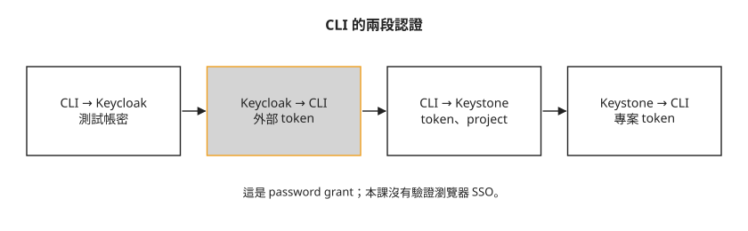
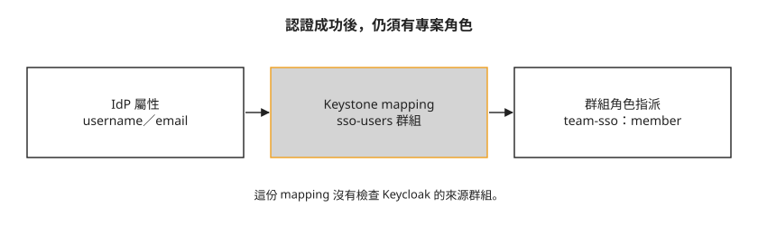

# Day 33：用外部帳號取得 OpenStack 的專案權限

公司已經在 Keycloak 管理員工帳號，現在要讓同一個人操作 OpenStack。重新在 Keystone 建一組密碼，會多出一套要維護的認證資料；改接外部身分之後，又要決定登入者能使用哪個 project。本章用 Keycloak 與 Keystone 的 federation，讀完能分辨認證、身分映射與專案角色各自負責什麼。

## 這次驗證的是哪一條登入路徑

**Federation** 讓 Keystone 接受外部身分系統驗證的結果。外部系統稱為 **IdP**（identity provider），本章使用 Keycloak；Keystone 是接受這些身分資料的服務提供者。兩者使用 **OIDC**（OpenID Connect），以 token 傳遞可驗證的身分資訊。

本課驗證的是 CLI 的 `v3oidcpassword` 流程：CLI 先把測試帳號密碼送給 Keycloak，再以取得的 token 向 Keystone 認證。下圖把兩次請求分開：



Keystone 不替這個外部使用者保存一份本地密碼，但 CLI 仍會接觸密碼。這種 **password grant** 也叫 Direct Access Grants／ROPC，不適合需要瀏覽器互動或 MFA 的流程。Keycloak 官方不建議採用；本課只用它解讀既有實驗，沒有驗證 Horizon／Skyline 的瀏覽器 SSO。UI 上出現登入選項，也不能當成登入成功的證據。

開始前要有 Day 32 的 HTTPS Keystone 入口與 CA 信任、Day 27 的 domain／project／role 概念。本章缺完整憑證產生參數、Keycloak 管理登入、metadata 檔案內容及資源建立命令，以下包含操作摘要與結果解讀；含 `...` 的片段不能直接執行。

## 步驟 1：先讓 IdP 的 HTTPS 能被驗證

Keycloak 的 `start-dev` 是開發模式。本課最初用以下摘要啟動，沒有配置持久化儲存；密碼欄位必須替換，不能把 `...` 當成實際密碼：

```bash
sudo docker run -d --name keycloak --network host \
  -e KC_BOOTSTRAP_ADMIN_USERNAME=admin -e KC_BOOTSTRAP_ADMIN_PASSWORD=... \
  quay.io/keycloak/keycloak:26.0 start-dev
```

這時 IdP 還使用 HTTP。接入本課的 Apache `mod_auth_openidc` 設定後，Keystone 出現以下啟動錯誤：

```text
AH00526: Syntax error on line 43 of wsgi-keystone.conf:
'http://10.0.0.4:8080/realms/day33/...' cannot be parsed as a "https" URL
(scheme == http)!
```

`mod_auth_openidc` 是在 Keystone 前面處理 OIDC 的 Apache 模組。錯誤指向 IdP 的 HTTP URL，因此應先把 IdP 配成 HTTPS，並讓 Keystone 信任其憑證，再部署 federation；不要先接上這段已知會失敗的設定。

本課使用 Day 32 的測試 CA 簽發 Keycloak 憑證。下面省略了 CSR、私鑰、SAN、有效期限與容器掛載等參數，只表示當時的操作方向：

```bash
# 用 Day 32 的 KollaTestCA 簽一張 Keycloak 憑證
openssl x509 -req -in keycloak.csr -CA root.crt -CAkey root.key ...
# Keycloak 改用 https:8443 對外
... start-dev --https-certificate-file=... --https-port=8443
```

留下的檢查摘要如下：

```text
✅ Keycloak https + CA 驗證通過
```

這不表示 Keycloak 必須與 Keystone 使用同一個 CA。真正的條件是憑證名稱符合 IdP URL，且相關用戶端與 Keystone 信任簽發鏈；受管理的其他 CA 也能滿足這個條件。憑證私鑰、OIDC token 簽章用的公鑰與 CA 憑證用途不同，不要互相替代。

## 步驟 2：在 Keycloak 定義登入來源

Keycloak 的 **realm** 是一個獨立管理使用者與登入設定的範圍；**client** 是向這個 realm 申請認證的應用。本章建立 `day33` realm，登記 `keystone` client，再建立測試使用者 `carol`。

以下是配置摘要。執行前必須先用 `kcadm.sh` 完成管理員認證；本課未留存該步驟。`<carol>` 要換成 Keycloak 使用者 ID，省略的 secret 與密碼需自行安全提供：

```bash
K="docker exec keycloak /opt/keycloak/bin/kcadm.sh"
$K create realms -s realm=day33 -s enabled=true
$K create clients -r day33 -s clientId=keystone \
  -s 'redirectUris=["https://10.0.0.250:5000/redirect_uri"]' \
  -s secret=... -s directAccessGrantsEnabled=true
$K create users -r day33 -s username=carol -s enabled=true \
  -s email=carol@example.com -s firstName=Carol -s lastName=Sso
$K set-password -r day33 --userid <carol> --new-password ...
```

`redirectUris` 限定瀏覽器流程可回到的位址，本課雖有設定，仍未實測該流程。`directAccessGrantsEnabled=true` 是讓這次 CLI password grant 能執行的開關，不是所有 federation 都需要。正式整合應依 IdP、CLI 與 UI 支援情況選擇授權碼或其他合適流程，不能假設任一替代流程已在本課接通。

`firstName`／`lastName` 是本課 realm user profile 要求的欄位；缺少它們曾造成帳號未完成設定。其他 realm 的必填條件可能不同，要查實際 profile 設定。

此啟動方式把資料留在容器可寫層，刪除容器會失去 realm 與帳號。本課沒有提供可完整重建的腳本或正式資料庫設定；不要把開發模式當成可持續營運的 IdP。

## 步驟 3：把外部身分映射成 Keystone 群組

**Mapping** 是把 IdP 傳來的身分屬性轉成 Keystone 使用者與群組的規則。這次使用以下內容：

```json
[{
  "local": [{
    "user": {"name": "{0}", "email": "{1}"},
    "group": {"name": "sso-users", "domain": {"name": "day33-sso"}}
  }],
  "remote": [{"type": "OIDC-preferred_username"}, {"type": "OIDC-email"}]
}]
```

`remote` 依序取出 username 與 email；`{0}`、`{1}` 放回 `local.user`。`local.group` 則指定 Keystone 的 `day33-sso` domain 下的 `sso-users` 群組。

**這份規則沒有檢查 Keycloak 的來源群組。** 只要通過這個受信任 IdP／protocol 並符合所需屬性的使用者，都會被映射到同一個本地群組。不能解讀成「只有 Keycloak 的 sso-users 成員能進來」。正式部署若要限制部門或群組，需要另外設計並驗證 claim 條件。



圖上前半段是身分映射，後半段才是授權。接著在 Kolla 指定 IdP 與 mapping。這段是縮寫，尚缺 `attribute_mapping`、metadata 目錄等完整欄位；要以章末 Kolla 2025.1 文件補齊：

```yaml
keystone_identity_providers:
  - name: "keycloak"
    openstack_domain: "day33-sso"
    protocol: "openid"
    identifier: "https://10.0.0.4:8443/realms/day33"
    ...
keystone_identity_mappings:
  - name: "keycloak_mapping"
    file: ".../mapping.json"
```

**Metadata** 描述 IdP 的 issuer、認證端點與金鑰位置。Kolla 的 metadata 目錄使用 `.provider`、`.client` 與 `.conf` JSON 檔；檔名依 issuer 編碼，示例如下：

```text
issuer: https://10.0.0.4:8443/realms/day33
檔名  : 10.0.0.4%3A8443%2Frealms%2Fday33.provider (+ .client + .conf)
```

`.provider` 描述 IdP，`.client` 放 client ID／secret，`.conf` 放額外選項。CLI 所用端點還可能需要 `keystone_federation_oidc_jwks_uri`；JWKS 是驗證 token 簽章用的公鑰集合，不能用 TLS CA 檔代替。本課未附完整 JSON，這裡不能直接完成部署。

配置與部署完成後，以下是本課物件查詢摘要。它們說明 IdP、mapping 與 protocol 已建立，不代表所有登入方式都通：

```text
openstack identity provider list  →  keycloak  True  Login with Keycloak
openstack mapping list            →  keycloak_mapping
openstack federation protocol list →  openid  keycloak_mapping
```

## 步驟 4：替群組授予 project role

映射到群組後，使用者仍需專案角色才能操作資源。以管理員身分建立本地群組、project 並授予 `member`：

```bash
openstack group create sso-users --domain day33-sso
openstack project create team-sso --domain day33-sso
openstack role add --group sso-users --project team-sso member
```

若環境有同名群組或 project，應以 ID 或明確 domain 消除歧義。這裡授予的是 `team-sso` 的 member，沒有授予整朵雲的 admin。之後登入者能做什麼，還要由各服務的 policy 與額度決定。

## 步驟 5：解讀 scoped token 與 VM 結果

**Scoped token** 是帶有特定 project 等授權範圍的 token。以下是本課 CLI 認證摘要，`<CA>` 是執行 CLI 那台電腦上的 CA 檔；secret／密碼都已省略。實際重做還要依 keystoneauth 的 OIDC 設定提供 discovery 或 access-token endpoint，本課片段未列出它的來源：

```bash
openstack --os-auth-type v3oidcpassword \
  --os-auth-url https://10.0.0.250:5000/v3 --os-cacert <CA> \
  --os-identity-provider keycloak --os-protocol openid \
  --os-client-id keystone --os-client-secret ... \
  --os-username carol --os-password ... \
  --os-project-name team-sso --os-project-domain-name day33-sso \
  token issue
```

取得 token 後，Keystone 可列出這個外部帳號對應的 **shadow user**（影子使用者），用來識別外部身分，而不保存它的 IdP 密碼：

```text
openstack user list --domain day33-sso  →  carol
```

所以「外部帳號不需要先手動建立本地密碼」不等於「Keystone 永遠沒有這個使用者的紀錄」。最後的操作摘要顯示，這個身分曾建出 VM：

```text
carol 建網路 sso-net → 開 sso-vm → ACTIVE
```

此摘要沒有完整建網路與 VM 的命令，也沒有證明瀏覽器 SSO、MFA、離職停權或既有 token 撤銷已完成。IdP 停用帳號之後，既有 Keystone token 與應用憑證的生命週期仍須另外管理，不能承諾立即切斷所有存取。

## 疑難排解

### Keystone 啟動時拒絕 IdP 的 HTTP URL {#mine-1}

出現 `cannot be parsed as a "https" URL` 時，先查 IdP metadata 與相關端點。依步驟 1 配置 HTTPS 及信任鏈，再接入本課的 OIDC 模組設定。

### 重建 Keycloak 後 realm 與帳號消失 {#mine-2}

本課容器沒有外接資料庫或資料 volume，資料位於可寫層。刪除容器會丟失資料；重做前要有可恢復的配置與儲存安排，不能只重跑啟動命令。

### password grant 回 Account is not fully set up {#mine-3}

本課曾因 user profile 缺 `firstName`／`lastName` 收到 `invalid_grant`，即使 `requiredActions` 是空的仍會失敗。先核對 realm 的必填欄位與使用者 profile，補齊後再測；不是所有 realm 都有同樣要求。

### OIDC 模組找不到 metadata 檔案 {#mine-4}

核對 issuer、metadata 目錄與檔名的 URL 編碼，以及三個 JSON 檔的用途。步驟 3 保留本課檔名範例，實際內容須依自己的 IdP 填寫。

### CLI 回 HTTP 400，無法判斷哪段認證失敗 {#mine-5}

先分清楚 CLI 向 Keycloak 換 token，或向 Keystone 換專案 token 的哪一段失敗。以下是本課拆開檢查的摘要，沒有包含可直接執行的 HTTP 請求：

```text
段 1(Keycloak):換 token → 起初 invalid_grant,補完 profile 後拿到
段 2(Keystone):帶 token 打 federation auth → HTTP 201
```

第一段失敗要查 IdP 的 client、profile 與授權流程；第二段失敗再查信任、mapping、protocol 及 project role。檢查時不要把密碼、client secret 或有效 token 放進公開 log。

## 想一想

- Carol 能取得外部 token，卻無法選 `team-sso`。哪一段設定決定 project 權限？
- 這份 mapping 是否能限制只有 Keycloak 某個部門群組登入？從哪個欄位能看出答案？
- CLI password grant 成功，為什麼還不能宣告瀏覽器 SSO 與 MFA 都已完成？

## 小結

IdP 驗證帳號，mapping 把身分屬性對應到本地群組，project role 才給出可操作的範圍。本課把這三段接到 CLI，留下取得專案身分並建立 VM 的摘要；瀏覽器 SSO、MFA、持久化與停權流程仍未驗證。查錯時先找出失敗段落，再檢查該段的端點、信任與授權條件。

## 延伸閱讀

想再深入，可以從這幾份開始：

- [Keystone 2025.1 Federation 設定](https://docs.openstack.org/keystone/2025.1/admin/federation/configure_federation.html)：IdP、protocol、mapping 與群組授權。
- [Kolla-Ansible 2025.1 Keystone 指南](https://docs.openstack.org/kolla-ansible/2025.1/reference/shared-services/keystone-guide.html)：完整 globals 與 metadata 欄位。
- [Keycloak 的 OIDC 流程](https://www.keycloak.org/securing-apps/oidc-layers)：授權碼、Direct Access Grants 與各流程的限制。
- [keystoneauth 的認證外掛](https://docs.openstack.org/keystoneauth/2025.1/authentication-plugins.html)：OIDC 用戶端的設定與認證方式。

## 下一步

[Day 34](sprint5-day34-cadf-audit.md) 只針對 Nova API 加入 CADF 稽核，練習從事件找出請求者、資源與操作；不假設本章所有登入活動都已被收錄。
