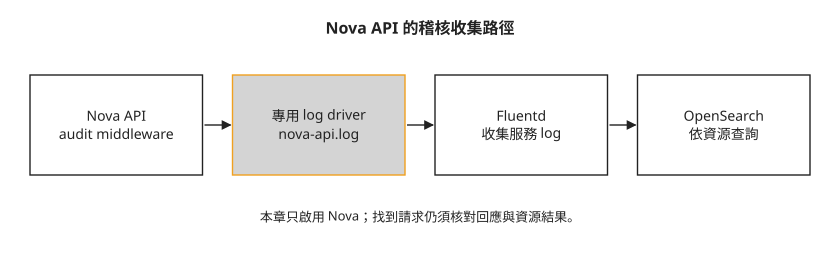

# Day 34：從 Nova 的稽核事件追查 VM 操作

一台 VM 不見了，同事想知道誰送出了刪除要求。Nova 的一般 log 能協助排錯，但如果每次都要從不同訊息找使用者、URL 與結果，查詢很難一致。本章把 Nova API 的請求記成 CADF 事件，再送進 Day 21 的 OpenSearch；讀完能判讀請求者、操作、資源與回應，並知道這些紀錄還不能證明什麼。

## 先分清楚事件記錄的範圍

**CADF**（Cloud Auditing Data Federation）是描述雲端稽核事件的標準格式。這裡先看四個欄位：

| 欄位 | 要判讀的內容 |
|---|---|
| `initiator` | 發出請求的身分，例如 user ID、來源 IP |
| `action` | 操作類型，例如 read、create、delete |
| `target` | 請求所針對的服務或資源 |
| `outcome` | 這筆事件的結果，例如 pending、success、failure |

時間由 `eventTime` 表達。欄位有一致名稱，才方便查詢；但要保留完整事件、對照 request／response，不能只看 `action=delete` 就認定 VM 已經刪完。OpenStack API 常先接受非同步要求，再由背景服務執行。

**本章只接 Nova API。** 它不涵蓋所有 OpenStack 服務、VM 裡的命令或所有背景工作，也沒有驗證防竄改保存、保存期限與稽核告警。以下設定與結果來自本課實驗，但缺完整 `config.json` 持久化修改及 OpenSearch 查詢指令，應當作整合與判讀練習，不能直接視為完整部署程序。

## 事件從哪裡進 OpenSearch

**Middleware** 是 API 處理請求時經過的中介程式。`keystonemiddleware.audit` 讀取已驗證的身分與 API 資訊，產生 CADF 事件；**notification driver** 決定事件送去哪裡。本課選 `log`，讓事件先寫進 `nova-api.log`，再由 Day 21 的 Fluentd 收到 OpenSearch。



圖中有兩個可以分開檢查的地方：Nova log 是否出現事件，以及 OpenSearch 是否收到同一類事件。開始前須有 Day 21 的收集管線與查詢權限；如果連一般 Nova log 都查不到，應先修復那一段。

## 步驟 1：讓稽核使用自己的通知目的地

Day 28 的服務通知用 `messagingv2` 送到 RabbitMQ，供計量使用。稽核不需要取代它，可以在 Nova 的設定覆寫中指定獨立的通知 driver：

```ini
[audit_middleware_notifications]
driver = log
```

這表示 audit middleware 的事件走 log；服務原本的計量通知仍可走 messagingv2。不要把它誤讀成所有通知都同時複製到兩個目的地。

## 步驟 2：確認 audit filter 真的進入 Nova

Nova 的 API **pipeline** 是請求依序經過的處理元件。Audit 要放在 `authtoken` 之後，才能使用它驗證後的身分資訊。本課順序節錄如下，省略號表示其他既有元件，不能把整行當成完整配置：

```text
... authtoken audit keystonecontext osapi_compute_app_v21
             ↑ 插在 authtoken(確認身分)之後
```

`api-paste.ini` 裡的 filter 則指定如何載入 middleware，以及 URL 與 action 的映射檔：

```ini
[filter:audit]
paste.filter_factory = keystonemiddleware.audit:filter_factory
audit_map_file = /etc/nova/nova_api_audit_map.conf
service_name = nova
```

`audit_map_file` 必須在容器內存在，並且符合服務路徑。本課使用 `/etc/nova/nova_api_audit_map.conf`；自己的映像檔若路徑不同，需明確配置並確認。

接著檢查 Kolla 是否會把自訂檔案送進容器。Kolla 的 `config.json` 定義啟動時要複製的設定檔；本課最初的摘要是：

```text
config.json COPY: nova.conf, nova-api-uwsgi.ini, ca-certificates
```

清單沒有 `api-paste.ini`，因此只把檔案放在主機的 override 目錄不會生效。本課增加複製項目並重啟後，留下以下結果：

```text
config.json COPY: ..., api-paste.ini, nova_api_audit_map.conf
容器內 filter:audit 段數: 1
pipeline: authtoken audit ...
```

這證明當時的容器載入了 filter，卻沒有提供完整、能跨 deploy 保存的修改程序。生成的 `config.json` 下次可能被重新產生；正式採用前須把變更納入受版本管理的部署模板或自訂映像，並驗證重新部署後仍有效。本章沒有完成這項持久化驗證。

## 步驟 3：在 Nova log 看 request 與 response

對已存在的測試 VM 執行 list／show 類操作後，本課 log 出現兩種事件：

```text
INFO oslo.messaging.notification.audit.http.request  ...
INFO oslo.messaging.notification.audit.http.response ...
```

request 是收到要求時的事件，response 記錄 API 回應。以下為其中一筆的欄位節錄：

```text
typeURI    : http://schemas.dmtf.org/cloud/audit/1.0/event
action     : read
outcome    : pending
eventTime  : 2026-07-16T12:58:09
誰(initiator): user=1384190d... @ 172.17.0.2
              agent=cluster-api-provider-openstack
對誰(target) : /v2.1/servers/9d978419-...
```

`action=read` 表示讀取，`outcome=pending` 表示這筆不是已完成結果。`initiator.user` 可用來對照 Keystone 身分；`agent=cluster-api-provider-openstack` 是用戶端送來的 user-agent，顯示可能來自 CAPO，但該字串本身可由用戶端設定，不能單獨證明操作者身分。

CADF 內容位於通知外層的 **`payload`**，也就是事件資料本體。抽欄位時先進入 payload，再取 action／initiator／target。若只在最外層找，可能取得空值。

## 步驟 4：確認 OpenSearch 收到稽核事件

先沿用 Day 21 的 Dashboards 登入與索引查詢方式，限定 Nova API、事件類型與測試時間範圍。以下是本課查詢摘要，索引日期與數量只代表當時資料：

```text
flog-2026.07.16 索引  →  420419 筆
查 audit.http.request  →  命中 40 筆,programname=nova-api
```

找到 `audit.http.request` 與 `programname=nova-api`，能說明這類事件已經進入索引。它不證明每筆都成功收集，也不代表其他服務已啟用稽核；要再用已知測試操作檢查對應資源。

## 步驟 5：用 VM ID 查刪除要求 {#step-5}

選一台可刪除的測試 VM，保存完整 UUID，再刪除並查詢。下面是本課操作摘要：`...` 省略了建立參數，UUID 也經截短，不能原樣貼上執行：

```bash
openstack server create audit-victim ... --wait    # 5ffbfcd0-...
openstack server delete 5ffbfcd0-...
# 從 OpenSearch 查這個 VMID 的稽核事件
```

在 OpenSearch 查該完整 VM UUID，並對照 action、initiator 與時間。本課留下的事件節錄是：

```text
命中 7 筆含此 VMID 的稽核事件:
  12:59:14 | action=delete | user=1384190dc012 | path=/v2.1/servers/5ffbfcd0-...
  12:59:13 | action=read   | user=1384190dc012 | path=/v2.1/servers/5ffbfcd0-...
  12:59:12 | action=read   | user=1384190dc012 | path=/v2.1/servers/5ffbfcd0-...
  ...
```

這裡可辨認出使用同一 user ID 的讀取與刪除要求。它還沒有列出對應 response 的 outcome，也不是 VM 全生命週期的完整證據；若要確認刪除真的完成，還要對照 API 回應與 Nova 資源狀態或後續服務紀錄。若帳號由多個人或自動化共用，也不能只憑 user ID 判斷是哪位自然人。

查不到時，依序回到 Nova log、Fluentd 與 OpenSearch 的時間範圍／索引。Nova 沒產生事件與 OpenSearch 沒收進事件，修法不同。

## 疑難排解

### deploy 成功，容器卻沒有 audit filter {#mine-1}

核對容器中的 `api-paste.ini` 與 `config.json` 複製清單。若檔案沒在清單內，放進主機 override 目錄也不會生效；步驟 2 說明本課曾成功載入的結果與持久化缺口。

### 原始事件有內容，抽出的欄位卻全是空值 {#mine-2}

先確認 JSON 的層級。通知外層包含 event type 等資訊，CADF 欄位在 payload 裡；不要因為頂層查不到就斷定 middleware 沒有產生資料。

### Nova log 與 OpenSearch 都沒有稽核事件 {#mine-3}

在確認 filter 已載入後，檢查 `[audit_middleware_notifications]` 是否指定 log driver。計量用的 messagingv2 不會自動把同一批事件寫入 Nova log，步驟 1 的設定是獨立目的地。

### 重新部署後 audit 設定消失 {#mine-4}

生成的 `config.json` 會受 Kolla 部署模板管理，直接修改生成檔可能在下次 deploy 被覆蓋。應檢查持久化的模板或映像變更是否仍在、檔案是否仍被複製，再用測試操作確認事件；本課未提供完成這項修復的驗證結果。

## 想一想

- OpenSearch 找到 `action=delete`，但沒有 response outcome。能直接判定 VM 已經刪除完成嗎？還缺哪些資料？
- 容器 healthy，deploy 也成功，為什麼仍可能完全沒有 CADF 事件？你會查哪份複製清單？
- user-agent 寫 CAPO、user ID 是共用服務帳號，能據此指認某位同事嗎？

## 小結

本章在 Nova API 插入 audit middleware，讓標準化事件經服務 log 與 Fluentd 進入 OpenSearch。查詢時把請求者、操作、資源與 outcome 一起讀，並區分 API 收到要求與背景工作完成。此實驗只涵蓋 Nova，設定跨部署保存、其他服務與稽核保存制度仍需另行設計及驗證。

## 延伸閱讀

想再深入，可以從這幾份開始：

- [keystonemiddleware 2025.1 audit 指南](https://docs.openstack.org/keystonemiddleware/2025.1/audit.html)：pipeline、audit map 與獨立通知 driver。
- [Kolla-Ansible stable/2025.1 Nova API 設定模板](https://github.com/openstack/kolla-ansible/blob/stable/2025.1/ansible/roles/nova/templates/nova-api.json.j2)：檢查容器實際載入哪些設定檔。
- [pycadf 文件](https://docs.openstack.org/pycadf/latest/)：CADF 事件模型與 OpenStack 實作。

## 下一步

[Day 35](sprint5-day35-sprint5-recap.md) 把租戶、計量、復原與安全整合起來，回顧哪些能力已經驗到，哪些還需要額外的營運設計。
