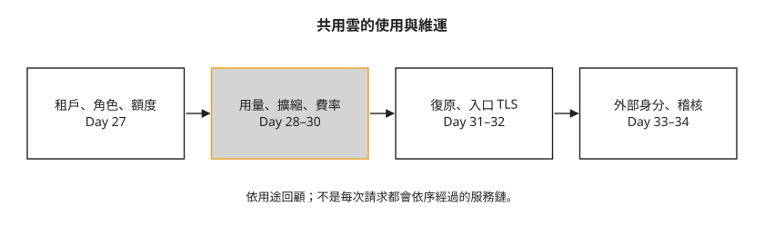

# Day 35：Sprint 5 總結——租戶、用量、復原與安全

假設明天要讓另一個團隊使用這朵雲，對方問的不只是能不能開 VM，還會問誰能使用、用了多少、故障後怎麼恢復，以及操作能不能追查。走完 Sprint 5，你已經看過這些需求如何對應到服務與設定。接下來要練習的判斷，是分清楚課內實驗已證明的能力，與交付服務前仍須補齊的條件。

## 回頭看服務怎麼合作

這段課程從租戶身分開始，把資源的使用量連到費率，再加入復原、入口加密與操作紀錄。下圖依用途分組；它們不是每次請求都會依序經過的服務鏈：

[Day 27](sprint5-day27-multi-tenant-governance.md) 的 project role 決定操作範圍，額度限制可建立多少資源。[Day 28](sprint5-day28-ceilometer-metering.md) 把資源與 project 身分帶進用量資料；[Day 29](sprint5-day29-aodh-autoscaling.md) 再以告警驅動 Heat 擴縮。當你看到一個數字，現在應該會先問它代表哪個資源、哪個租戶、哪個採樣時間，而不只是看數字高不高。

[Day 30](sprint5-day30-cloudkitty-rating.md) 的 CloudKitty 依用量與費率做 **rating**，也就是計算一段時間的用量價格。這是帳務流程的一部分，沒有涵蓋收款、稅務、退款或發票。課內的機器與儲存結果可用來核對費率，但尚未納入所有資源類型，也沒有證明資源刪除後的計量同步完整。特別是 Pushgateway 保留的值仍可能被重新抓取，查詢時間窗不能代替刪除同步。

## 如果要交給其他團隊使用

先選一個用途驗完整流程。例如對方只要幾台測試 VM，就先確認角色與額度、網路、磁碟保存和刪除後的資源回收。不需要為了課程提過每一個服務，就一次啟用所有整合。若要依用量分攤費用，再驗證採樣間隔、資源生命週期與計價期間，確定每個租戶能核對自己的結果。

如果對方要求故障後恢復，要先談可接受的中斷時間與資料損失。[Day 31](sprint5-day31-masakari-ha.md) 展示 Masakari 的恢復處理，但主機故障通知由人工送出，沒有完成自動 hostmonitor 偵測。演練先讓來源主機確實停止運作，再疏散 VM；正式設計須有 **fencing**，也就是確認或強制隔離來源主機，避免兩份 VM 同時寫同一份儲存。VM 重新變成 ACTIVE，也還要確認應用與資料正常，不能直接等同符合 SLA。

如果要從其他電腦存取，則檢查真正連到哪個入口。[Day 32](sprint5-day32-full-tls.md) 保護的是用戶端到 HAProxy VIP 的 TLS 連線，沒有涵蓋所有後端通訊；測試 CA 也未取代正式的憑證管理。[Day 33](sprint5-day33-keycloak-federation.md) 驗證 CLI 經外部 IdP 取得專案身分，沒有完成瀏覽器 SSO（單一登入：登入一次後使用多個服務）、MFA（多因素驗證：以兩種以上不同類型的驗證因素確認身分）或停權測試。這些能力需要各自驗證，不能由「token 取得成功」一起推論。

[Day 34](sprint5-day34-cadf-audit.md) 則示範 Nova API 的 CADF 事件。它能協助找出請求者與資源，但沒有覆蓋所有服務，也未完成防竄改、保存期限與部署後設定持續存在的驗證。若要用於正式稽核，還須確認事件的完整性、帳號能否對應責任人，以及誰能讀取或刪除紀錄。

## 遇到另一份教學，先核對哪個版本

網路文章可能使用不同 OpenStack 系列、不同部署工具，甚至不同的專案維護方式。挑選延伸題目前，分開查三件事：治理狀態、發行版本，以及部署工具對該版本的支援。

治理頁能確認一個團隊是否仍列在 OpenStack 官方治理範圍；它不能單獨證明功能完整、維護頻率足夠，或適合你的部署。發行頁則能查對應系列的版本與 release notes；不同專案的發行模式不一定相同，不能只用「半年內有沒有版號」判斷是否停止維護。最後還要看 Kolla 等部署工具是否支援它，以及所選發行版的相容限制。

例如截至 2026-10-16，官方治理清單仍列有 Zun；不能因某個部署工具不再支援，就把專案寫成已退役。同樣地，本課選 Prometheus 作為計量與查詢路線，也不代表 CloudKitty 只支援這一種來源。查證時保留日期、版本與直接來源，讓下一次升級有依據可比對。

## 接下來可以完成的一個練習

挑一個與工作最相關的缺口，先限定範圍。想做身分整合，就用測試 realm 驗證瀏覽器登入、角色限制與停權；想做復原，就在隔離環境驗證偵測、來源主機隔離與資料可用性；想做稽核，就先確認 Nova 設定在重新部署後仍存在，再研究其他服務支援的 middleware 與事件種類。不要假設 Nova 的設定檔可以直接套到其他服務。

各項練習可從以下指南開始：

- 身分整合：依 [Keystone 2025.1 Federation 指南](https://docs.openstack.org/keystone/2025.1/admin/federation/configure_federation.html) 設定身分映射、群組的專案角色與 Horizon WebSSO；這裡的瀏覽器入口以 Horizon 為範圍。Keycloak 26.0 系列可參考 [26.0.8 管理指南](https://www.keycloak.org/docs/26.0.8/server_admin/index.html) 的使用者管理、認證流程與工作階段管理；停用帳號的欄位則查同版 [Admin REST API](https://www.keycloak.org/docs-api/26.0.8/rest-api/index.html) 的使用者更新與 `UserRepresentation.enabled`。停權練習須分別確認新登入與既有工作階段、Keystone token 的結果。
- 故障復原：從 [Kolla-Ansible 2025.1 Masakari 指南](https://docs.openstack.org/kolla-ansible/2025.1/reference/compute/masakari-guide.html) 確認 monitor 開關，再讀 [masakari-monitors 19.0.0 hostmonitor 指南](https://raw.githubusercontent.com/openstack/masakari-monitors/19.0.0/doc/source/hostmonitor.rst) 的 Pacemaker 偵測與設定；19.0.0 對應 [OpenStack 2025.1](https://releases.openstack.org/epoxy/index.html#masakari-monitors)。若選用 Pacemaker 2.1，依其 [fencing 指南](https://clusterlabs.org/projects/pacemaker/doc/2.1/Pacemaker_Explained/html/fencing.html) 選擇及測試適合平台的隔離方式；再用 [Nova 2025.1 evacuate 指南](https://docs.openstack.org/nova/2025.1/admin/evacuate.html) 核對來源主機停止、重建與共享儲存條件。應用與資料是否可用，仍須依自己的工作負載驗證。
- 稽核：先依 [Kolla-Ansible 2025.1 設定覆寫指南](https://docs.openstack.org/kolla-ansible/2025.1/admin/advanced-configuration.html#openstack-service-configuration-in-kolla) 查各服務支援的設定路徑，作為重新部署後檢查設定是否保留的起點；再讀 [keystonemiddleware 2025.1 audit 指南](https://docs.openstack.org/keystonemiddleware/2025.1/audit.html)，了解 pipeline 插入位置、各服務的 audit map 與通知 driver。這份指南以 Nova 為例，擴到其他服務時仍須核對該版本的 pipeline 與事件，沒有涵蓋完整的保存期限或防竄改設計。

延伸時應依自己的版本補齊步驟，保留成功、失敗與恢復的結果，而不是把未測部分當成已完成。

## 想一想

- 同事看到 CloudKitty 有價格結果，就要求開始向客戶收費。還有哪些流程不在 rating 的範圍？
- 故障主機上有 VM 在另一台重新啟動，為什麼仍不能直接宣稱完整的自動主機故障復原已完成？
- 教學說某部署工具移除一個服務，能據此判斷上游專案已退役嗎？你會再查什麼？

## 小結

Sprint 5 把資源操作延伸到租戶、用量與服務責任。讀完後，你能把一個營運需求拆成身分與授權、資料收集、控制動作，以及結果確認，也能指出實驗沒有涵蓋的部分。這些區分會影響後續設計：計價要對得上生命週期，復原要先排除雙重執行，TLS 與稽核則要明確界定範圍。

## 延伸閱讀

想再深入，可以從這幾份開始：

- [CloudKitty 2025.1 文件](https://docs.openstack.org/cloudkitty/2025.1/)：rating 的能力與不包含的帳務功能。
- [OpenStack 官方專案團隊](https://governance.openstack.org/tc/reference/projects/)：查治理範圍與團隊資訊。
- [OpenStack 發行資訊](https://releases.openstack.org/)：查版本、系列與發行模式，並回到相應 release notes。

## 下一步

[結語](epilogue.md) 回到整門課，依你目前的工作選擇下一個練習。
