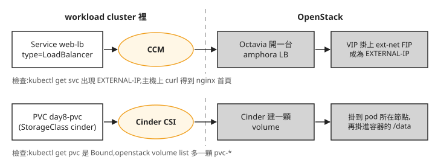

# Sprint 3 回顧：從 OpenStack 資源到 Kubernetes 工作負載

剛開始開 VM 時，網路、磁碟與負載平衡器是分開操作的資源。到 Day 8，你在 Kubernetes 建立 Service 或 PVC，也會用到同一組 OpenStack 服務。這段課程的進展，是能沿著請求找到負責的元件，並判斷「VM 已建立」與「應用程式已可使用」之間還缺哪一步。

## 建好叢集之後，資源由誰提供？

Day 6 的 kind 是 management cluster，裡面的 CAPI 與 CAPO 管理 workload cluster。應用程式執行在後者的節點 VM；建立負載平衡器或持久磁碟時，還會回頭呼叫 OpenStack。下圖重畫 Day 8 的兩條資源路徑：

Service 出現外部 IP，與 Pod 透過 PVC 寫入檔案，是兩項不同的結果。前者需要 Octavia、網路與後端服務；後者需要 Cinder、CSI 與節點掛載。只有 nodes Ready，還不足以確認這兩條路徑都能使用。

前面的章節分別練過 Nova VM、Neutron 網路、Cinder volume 與 Octavia LB，因此工作負載出問題時，可以回到對應層檢查。若 cluster 還停在建立中，先分清楚 Magnum 是否已送出 CAPI 物件、OpenStack 是否已建立 VM，以及新節點是否完成初始化；不要只重試最外層的建立指令。

## 先前的部署嘗試留下了哪些問題？

Juju／Charms 路線沒有完成本課需要的 Octavia、Cinder LVM 與 Magnum 工作負載驗證。當時的限制包含所選 charm 的版本支援、LXD 容器對儲存裝置的限制，以及舊 driver 使用的映像來源。這些是特定版本與部署環境的結果，不能用來判定整個專案是否可用。

這次改用 Kolla-Ansible，將服務容器部署在 Azure VM 上，完成 [Cinder LVM](runbook/sprint3-day3-cinder-lvm.md)、[Octavia](runbook/sprint3-day4-octavia.md)，再以 [Magnum CAPI driver](runbook/sprint3-day7-magnum-capi-driver.md) 管理 workload cluster。Magnum 與 CAPO 並非只能選一個：本課的 Magnum 提供 API，driver 將請求交給 CAPI／CAPO 執行。

這也不代表換部署工具後就不必處理整合問題。Docker 的 iptables 設定影響 kind 對外連線，子網重疊影響節點存取 API，Octavia 則依賴 amphora 管理網路、Redis 與主機工具。遇到問題時，先確認失敗發生在哪個容器或 VM，再檢查該層的設定、路由與版本；相關案例可從[疑難排解](solutions/README.md)查找。

## Terraform 涵蓋了多少重建工作？

[Day 10](runbook/sprint3-day10-terraform-teardown.md) 用 Terraform 管理一組 network、VM 與 LB，並說明 state 的用途。這份設定沒有涵蓋整個實驗環境：Kolla 設定、kind、節點映像、kubeconfig、主機網路與儲存仍有各自的建置步驟。刪除 Terraform 管理的資源，不等於清除整朵雲；保留那份 HCL，也不等於已備份所有服務與資料。

需要重建時，先列出每個元件的設定與資料從哪裡恢復，再安排相依順序。還原後除了查看 API 與容器狀態，也要重新驗證 VM 連線、LB 與 PVC 等工作負載路徑。能成功部署一次，與能在資料損毀後恢復服務，是不同的驗證。

## 接下來要補什麼？

這段課程使用單機實驗環境，沒有證明主機故障後服務仍可持續，也沒有完成容量、資料保護與存取治理的整體設計。實際 Azure 費用仍需以自己的帳單核對；實驗規格與使用時數不能直接當成通用的每週成本。

Sprint 4 先補物件儲存、共享檔案、DNS 與代管資料庫，再練習監控、備份還原與另一套多節點環境。沿用本課時還要注意版本與設定的連續性：Day 22 會調整 Octavia provider，先前使用 Amphora 的 template 不能直接沿用。相關限制在 [Day 4](runbook/sprint3-day4-octavia.md)、[Day 8](runbook/sprint3-day8-e2e-workload-cluster.md)及 [Day 22](runbook/sprint4-day22-upgrade-backup.md)都有說明。

## 想一想

1. workload cluster 的 nodes 都是 Ready，但 PVC 一直 Pending，你會先查哪些元件？為什麼不先重建整座 cluster？
2. 保留 Day 10 的 HCL 與 state，是否足以在全新的主機上恢復這套實驗環境？還缺哪些設定或資料？
3. 單機 API、LB 與 PVC 都驗證成功之後，仍有哪些故障情境不能由這些結果推論？

## 小結

Sprint 3 把 OpenStack 的個別資源與 Kubernetes 工作負載接起來，也讓你看到部署工具之外仍有主機網路、版本與管理叢集的相依性。下一段從這些已能使用的服務出發，處理長期維運需要補上的能力。課程安排見 [Day 12 的 Sprint 4 預告](runbook/sprint3-day12-sprint4-preview.md)。
